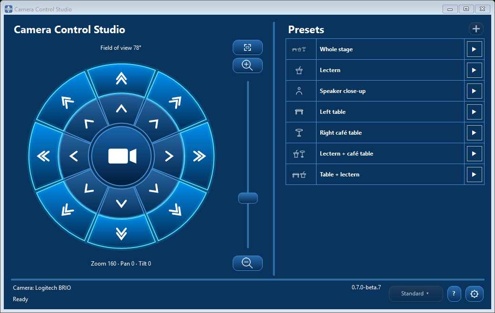
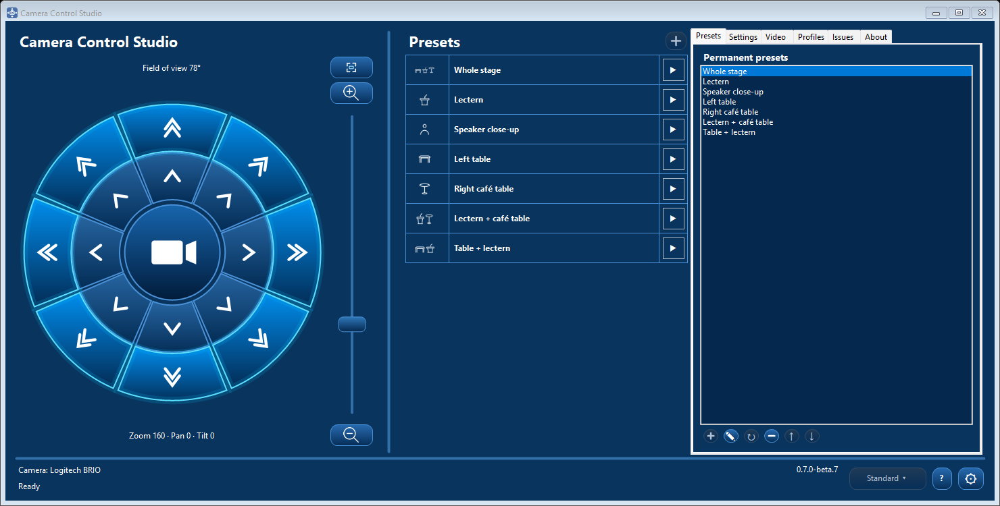
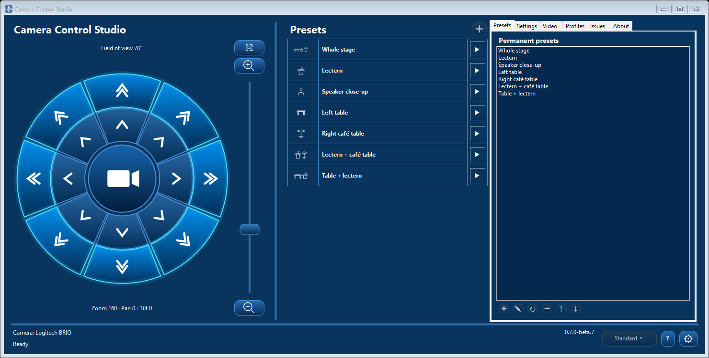
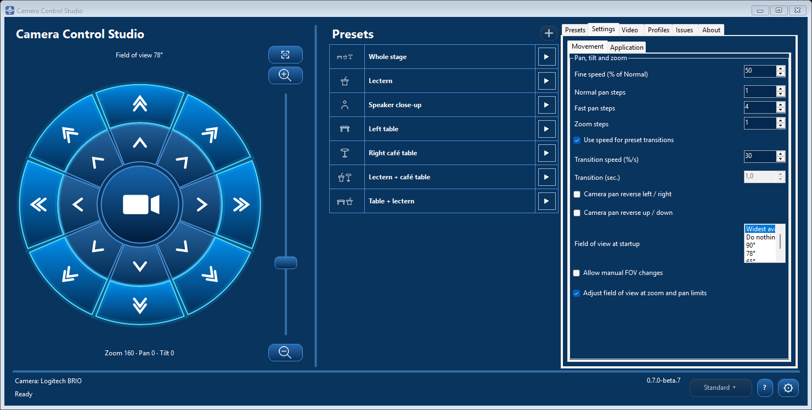
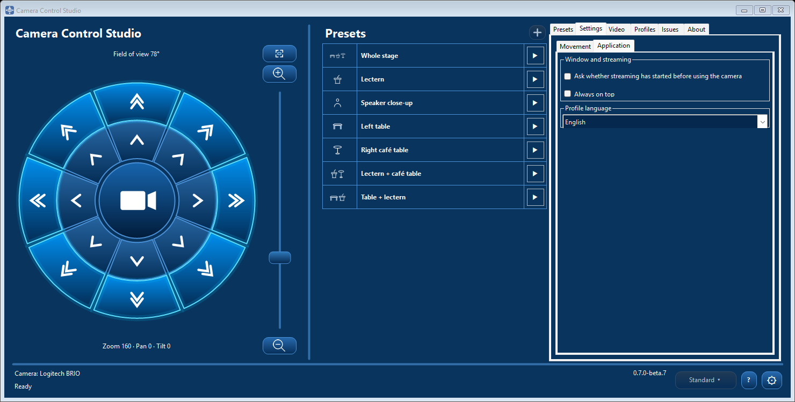
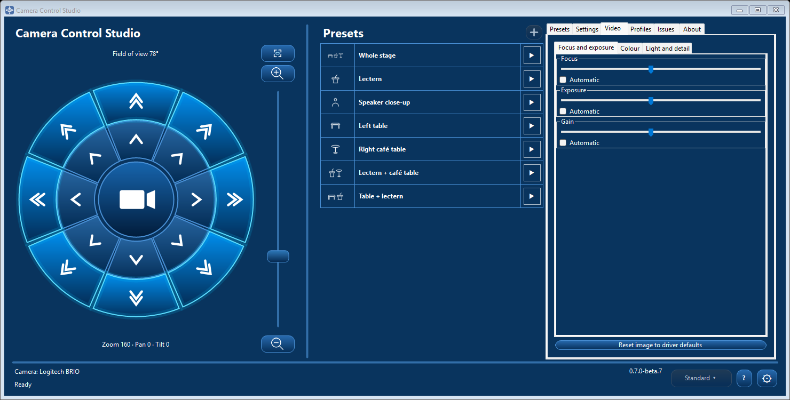
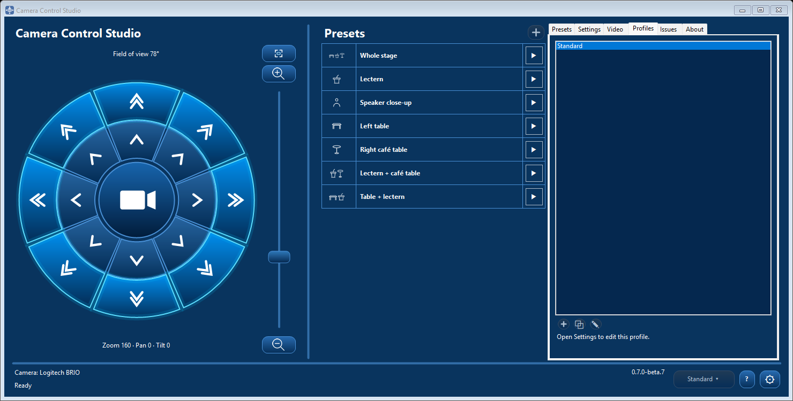
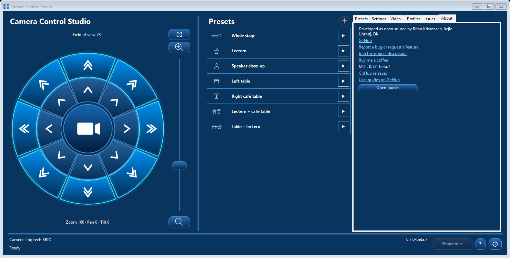

# Camera Control Studio

**[Download Camera Control Studio](https://github.com/bkristensen/Camera-Ctrl-Pressets-Studio/releases)** · [User guides in 12 languages](Source/docs/USER-GUIDES.md) · [FAQ](Source/faq.md) · [Troubleshooting](Source/docs/en/TROUBLESHOOTING.md)

Camera Control Studio is a Windows app for controlling a supported camera during video meetings, recordings and live streams. Move and zoom the camera manually, then save useful framings as named presets so you can switch between them during a session. For example, save a wide shot of a stage, a close-up of the speaker and a shot of the demonstration table.

Use it alongside Zoom Meetings or your preferred capture or streaming app. That app displays the picture, shares it with viewers and handles recording. Camera Control Studio sends pan, tilt, zoom and image commands through the Windows camera driver.

## Download and install

Download the installer or portable ZIP under **Assets** on the [GitHub Releases page](https://github.com/bkristensen/Camera-Ctrl-Pressets-Studio/releases).

[Code signing policy](Source/docs/SIGNPATH.md) · [Privacy policy](Source/PRIVACY.md)

| Download | How to use it |
| --- | --- |
| Windows installer (`CamCtrlStudio-Setup-*.exe`) | Run Setup to install the app and add Start menu shortcuts for the app and its guides. |
| Portable ZIP (`Camera-Control-Studio-*-portable.zip`) | Extract the entire archive and run `Camera Control Studio.exe`. The guides are in the extracted `docs` folder. |
| `SHA256SUMS.txt` | When provided, compare the published SHA-256 hash with your downloaded file. |

Use Windows with .NET Framework 4.8 and a driver that supports the camera controls you need. Windows may warn about the unsigned downloads. [Check the download](Source/docs/en/SETUP.md#install-and-verify-the-download)

To uninstall the Setup version, find Camera Control Studio under **Apps** in Windows Settings and select **Uninstall**. To remove the portable version, close the app and delete its extracted folder. If you used `Install.ps1`, remove the app folder under `%LOCALAPPDATA%\Programs\Camera Control Studio` and its Start menu shortcut. Profiles and settings stay in your Windows account.

## Get started

1. Open your meeting or streaming app and choose the camera you want to use. Start capture first if your camera setup requires it.
2. Open Camera Control Studio. Use the profile picker in the footer and double-click the camera icon in the centre of the direction wheel to choose the same camera.
3. Use the inner, middle or outer arrows for Fine, Normal or Fast pan and tilt. Use the magnifier buttons to zoom in and out, or drag the vertical slider to adjust the zoom as you move it.
4. Frame the shot in your meeting or streaming app. Click **+** to save it temporarily, or open the gear and choose **Presets → Add permanent preset** to save it for future sessions.
5. Click **▶** on a preset row to recall the shot. Yellow shows a move in progress. Green means the driver has reported the saved coordinates. Check the framing in your meeting or streaming app.

## Presets and transitions

Store permanent presets by camera and profile. Give each preset a name and optional symbol that makes it easy to recognise at a glance. In the **Presets** tab you can edit the name and symbol, replace the coordinates with the current position, or delete the preset. Temporary presets last for the current session and appear below permanent presets.

In **Settings → Movement**, choose a fixed duration or a movement speed for preset transitions. The camera driver determines the available positions and how finely the camera can move. Manual movement cancels a transition, and unavailable directions are disabled at the limits of the camera's range.

## Settings, image controls and profiles

| Tab | What you can do |
| --- | --- |
| [Settings → Movement](Source/docs/images/screenshots/0.7.0-beta.7/en/settings.png) | Set Fine, Normal and Fast movement, preset duration or speed, and direction reversal. |
| [Settings → Application](Source/docs/images/screenshots/0.7.0-beta.7/en/application.png) | Set the profile language and always-on-top behaviour, or enable streaming confirmation. |
| [Video](Source/docs/images/screenshots/0.7.0-beta.7/en/image.png) | Adjust the controls exposed by the camera driver, such as focus, exposure, sharpness and backlight compensation. Image settings are saved per camera and profile. |
| [Profiles](Source/docs/images/screenshots/0.7.0-beta.7/en/profiles.png) | Create or copy profiles for different operators, rooms or camera setups. Use the footer picker to switch profiles. |
| [Issues](Source/docs/images/screenshots/0.7.0-beta.7/en/issues.png) | Set up local diagnostic logs and prepare a GitHub issue report. |
| [About](Source/docs/images/screenshots/0.7.0-beta.7/en/about.png) | Find the installed version, developer credit and links to the project, issue tracker and discussions. |

Drag the vertical divider to resize the camera controls and preset list. Hover over compact buttons for tooltips. The settings pane starts closed each time the app opens.

See the settings pane and example tabs

[See every tab and subtab](Source/docs/SCREENSHOTS.md).

## Camera compatibility

Each camera driver determines which controls are available and how they behave when another app is using the camera. A control can work during a Zoom meeting and show no visible change in the Windows Camera preview. Check your framing in the app you will use to broadcast or take the meeting. See [camera compatibility and project scope](Source/docs/PROJECT.md).

## Documentation

- [Setup and settings](Source/docs/en/SETUP.md) covers camera selection, movement steps, image controls, permanent presets and profiles.
- [Daily use](Source/docs/en/DAILY-USE.md) covers recalling shots, manual adjustments and temporary presets.
- [All user guides](Source/docs/USER-GUIDES.md) covers English, Danish, German, Mandarin Chinese (Simplified Chinese), Hindi, Spanish, Arabic, Bengali, French, Indonesian, Portuguese and Urdu.
- [Build and release guide](Source/docs/en/BUILD-AND-RELEASE.md) explains how to build, verify and package the Windows downloads.

## Source and contributions

Open `Source/Camera-Control-Pressets-Studio.sln` in Visual Studio for the WinForms application. The [development guide](Source/docs/en/DEVELOPMENT.md) covers editing the interface and translations. See [Contributing](Source/CONTRIBUTING.md) for guidance on pull requests.

Camera Control Studio is open source under the [MIT licence](LICENSE), developed by **Brian Kristensen, Vejle Uhrhøj, Denmark**. [Report a bug or request a feature](https://github.com/bkristensen/Camera-Ctrl-Pressets-Studio/issues?q=is%3Aissue) · [Discuss an idea](https://github.com/bkristensen/Camera-Ctrl-Pressets-Studio/discussions) · [Privacy](Source/PRIVACY.md) · [Third-party notices](Source/THIRD-PARTY-NOTICES.md)
