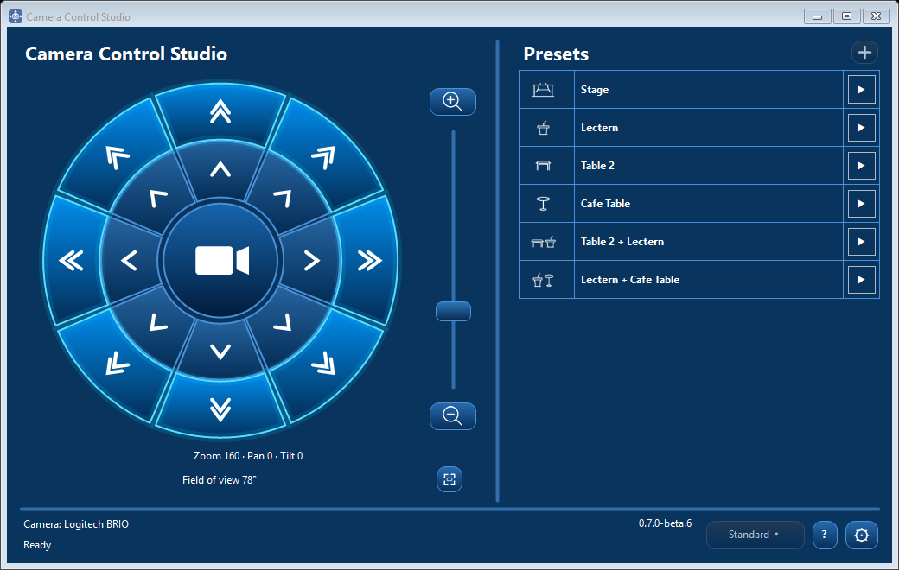

# Camera Control Studio

**[Windows downloads on GitHub Releases](https://github.com/bkristensen/Camera-Ctrl-Pressets-Studio/releases)**

Control a Windows camera and save your shots as named positions. Recall a position when you need it. **Brian Kristensen, Vejle Uhrhøj, Denmark**, develops the app as open source.

**Source version 0.7.0-beta.6.** The beta builds are unsigned. See the [validation notes](docs/VALIDATION.md) for the checks that were run.

| Language | Set up | Daily use |
| --- | --- | --- |
| English | [Setup](docs/en/SETUP.md) | [Daily use](docs/en/DAILY-USE.md) |
| Dansk | [Opsætning](docs/da/SETUP.md) | [Daglig brug](docs/da/DAILY-USE.md) |
| Deutsch | [Einrichtung](docs/de/SETUP.md) | [Tägliche Nutzung](docs/de/DAILY-USE.md) |

The installer and portable ZIP include [user guides for all 12 supported languages](docs/USER-GUIDES.md). The installer adds a user-guides shortcut to the Start menu. See the [screenshots](docs/SCREENSHOTS.md) for each settings tab and subtab.

## Use

Extract the complete portable ZIP. Run `Camera Control Studio.exe` on Windows with .NET Framework 4.8. No SDK is needed to run the app. `Install.ps1` optionally copies the portable release into your user account and adds a Start menu shortcut.

The app controls the physical camera through its Windows driver. It does not open a video preview, record, start other programs or share a screen. A driver must expose the relevant pan, tilt or zoom control. Concurrent use with capture software depends on the driver.

## Build

Open **`Camera-Control-Pressets-Studio.sln`** in Visual Studio. Import `.vsconfig` in Visual Studio Installer for the .NET desktop workload. Install the .NET 8 SDK selected by `global.json` as well. Set **CameraControlStudio** as the startup project.

```powershell
./scripts/setup-dev.ps1
```

If WinGet is unavailable, install the SDK from [Microsoft](https://dotnet.microsoft.com/download/dotnet/8.0), reopen the terminal, then run the command above. The application targets .NET Framework 4.8; the tests target .NET 8. This is WinForms, not WPF.

[Build and release guide](docs/en/BUILD-AND-RELEASE.md) · [Visual editing](docs/en/DEVELOPMENT.md) · [Project details](docs/PROJECT.md) · [FAQ](faq.md) · [Release checklist](docs/RELEASE-CHECKLIST.md)

## Contribute

[Report a bug or request a feature](https://github.com/bkristensen/Camera-Ctrl-Pressets-Studio/issues) · [Discuss an idea](https://github.com/bkristensen/Camera-Ctrl-Pressets-Studio/discussions) · [Buy me a coffee](https://buymeacoffee.com/brislingveo)

Forks and pull requests are welcome. Keep the main workflow small: choose a profile, adjust the camera, recall a position. Put administrative features in Settings. See [Contributing](CONTRIBUTING.md). These are contribution preferences, not restrictions on your MIT licence rights.

## Code signing policy

This release is unsigned. No Store certification or SignPath approval is claimed. See [distribution and Store checklist](docs/MSIX-AND-STORE.md) and [SignPath](docs/SIGNPATH.md).

[MIT licence](LICENSE) · [Third-party notices](THIRD-PARTY-NOTICES.md) · [Privacy](PRIVACY.md)
