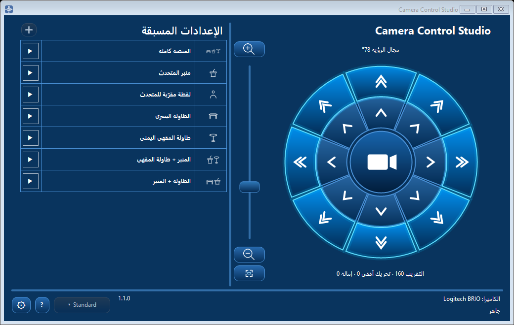
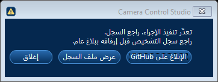

[English](../en/DAILY-USE.md) · [Dansk](../da/DAILY-USE.md) · [Deutsch](../de/DAILY-USE.md) · [ جميع لغات الدليل ](USER-GUIDES.md)

# الاستخدام اليومي

* مكتوب لـ Camera Control Studio 1.1.0.*

[استكشاف الأخطاء وإصلاحها](TROUBLESHOOTING.md)

ابدأ اجتماع البث الخاص بك في تطبيق مثل Zoom. ثم افتح **Camera Control Studio**.

## عام

انقر فوق **?** للحصول على المساعدة. قم بالتمرير فوق الزر لرؤية اسمه وإجراءاته. يتم قفل الاتجاه عند الحد الأخير الذي يمكن للكاميرا الوصول إليه. [كيفية عمل FOV الأوتوماتيكي](SETUP.md#%D8%B6%D8%A8%D8%B7-%D9%85%D8%AC%D8%A7%D9%84-%D8%A7%D9%84%D8%B1%D8%A4%D9%8A%D8%A9)

## 1. قم بتنشيط الإعداد المسبق

انقر فوق ◀ في أحد الصفوف في القائمة المعدة مسبقًا أو انقر نقرًا مزدوجًا فوق الاسم.
يمكنك أيضًا تحديد الصف والضغط على Enter.

| اللون | معنى |
| --- | --- |
| أصفر | يقوم التطبيق بتحريك الكاميرا نحو الإعداد المسبق. |
| أخضر | يُبلغ برنامج تشغيل الكاميرا أنه تم الوصول إلى الإحداثيات المحفوظة. |
| أزرق | لم يتم وضع علامة على الإعداد المسبق بأنه نشط. |

اللون الأخضر يعني أن برنامج التشغيل يبلغ عن الموقع المحفوظ وFOV، إذا تم حفظه. تحقق من الصورة في الدفق الخاص بك. إذا لم يتمكن برنامج التشغيل من تأكيد اللقطة في الوقت المناسب، يتحول الصف إلى اللون الأزرق. اقرأ رسالة الحالة لمعرفة ما حدث.

## 2. ضبط الإطار

### عموم

استخدم الحلقة الداخلية للحركات العادية والحلقة الخارجية للحركات السريعة. تحتوي كل حلقة على ثمانية أسهم. تتحرك الأقطار وتميل معًا بزاوية 45 درجة، مع 45% من سرعة الحلقة على كل محور. تؤدي النقرة إلى نقل خطوة سائق واحدة على الأقل لكل محور متاح. امسك السهم لمواصلة التحرك. حررها للتوقف.

### زر الكاميرا في وسط العجلة

- **انقر نقرتين لاختيار كاميرا.** يتم فتح قائمة الكاميرات.
- **أمسك واسحب.** ابدأ من أيقونة الكاميرا. اسحب جانبيًا للتحريك أو لأعلى ولأسفل للإمالة. اسحب قليلاً للحركة البطيئة أو أبعد لحركة أسرع، بما يصل إلى ضعف السرعة السريعة. حرر الزر أو حرك المؤشر مرة أخرى إلى حيث بدأت التوقف.

ضمن **الإعدادات → التحريك الأفقي**، يمكنك إيقاف السحب أو التبديل إلى نقرة واحدة لاختيار الكاميرا. يتم حفظ كلا الخيارين في ملف التعريف النشط.

### تكبير

استخدم أزرار المكبر للتكبير. اضغط باستمرار على الزر لتكرار الإجراء.
اسحب شريط التمرير لضبط التكبير/التصغير أثناء تحريكه.

### استعادة الإطار الكامل

انقر فوق الزر المربع الذي يحتوي على أيقونة الإطار أعلى أزرار المكبر. تقوم الكاميرا بالتصغير إلى أقصى حد ممكن وتختار مجال الرؤية الأوسع إذا كانت تدعم هذا الإعداد. هذا يغير صورة الكاميرا. تحافظ نافذة التطبيق على حجمها.

### توقف عن التحريك

اضغط على Esc لإيقاف عملية المقلاة.

> يؤدي التحريك اليدوي أو الإمالة أو التكبير/التصغير إلى إلغاء الانتقال إلى الإعداد المسبق ومسح اللون النشط.

### مفاتيح الأسهم

استخدم مفاتيح الأسهم عندما يكون التركيز على العجلة. اضغط مع الاستمرار على Ctrl للحركات الدقيقة أو Shift للحركات السريعة.

## 3. احفظ إعدادًا مسبقًا مؤقتًا

انقر فوق **+** أعلى القائمة المعدة مسبقًا، وأدخل اسمًا واحفظه. يظهر الموضع الحالي أسفل الإعدادات المسبقة الدائمة.
الإعدادات المسبقة المؤقتة ليس لها أيقونة. وهي تستمر حتى تغلق التطبيق ويتم الاحتفاظ بها بشكل منفصل لكل ملف تعريف وكاميرا.

حدد صفًا مؤقتًا وانقر فوق **×** أعلى القائمة المعدة مسبقًا لإزالته. تتم إزالة جميع الإعدادات المسبقة المؤقتة عند إغلاق التطبيق.
لاستخدام المركز لاحقًا، قم بإنشائه ضمن **الإعدادات → الإعدادات المسبقة**. لا يمكنك تحرير أو حذف الإعدادات المسبقة الدائمة في القائمة الرئيسية.

## 4. خروج

إذا فشل أحد عناصر التحكم، فاقرأ الرسالة في منطقة الحالة بالأسفل. قد لا تدعم الكاميرا هذه الميزة أو قد تكون غير متوفرة.

أغلق التطبيق بشكل طبيعي. يتذكر التطبيق الملف الشخصي النشط وتخطيط النافذة.

## 5. الإبلاغ عن المشكلات

إذا ظهر **يتوفر إصدار جديد** في التذييل، فحدده لفتح الإصدار على GitHub وشاهد التنزيلات.

<https://github.com/bkristensen/Camera-Ctrl-Pressets-Studio/releases>

أبلغ عن مشكلة أو اقترح ميزة من **التواصل وحول التطبيق → التواصل**.

راجع [Setup](SETUP.md) لمعرفة اتجاه الكاميرا والإعدادات المسبقة الدائمة وإعدادات الصورة وملفات التعريف وخطوات الحركة.

## مربع حوار الخطأ

إذا أوقف خطأ غير متوقع إجراءً ما، فأغلق مربع الحوار وحاول مرة أخرى. إذا ذكر الحوار أن التطبيق سيُغلق، فأعد فتحه.

يحدد زر **عرض ملف السجل** سجل التشخيص في مستكشف الملفات إذا كان متاحًا. يعرض زر **الإبلاغ على GitHub** حفظ ملف ZIP للدعم، ثم يفتح قالب الإبلاغ عن خطأ على GitHub. قد يحتوي الملف على لقطة لمربع الحوار والسجلات وإعدادات الملف الشخصي والنافذة وتقرير عن النظام. راجع الملف وأرفقه بالمسودة بنفسك.
