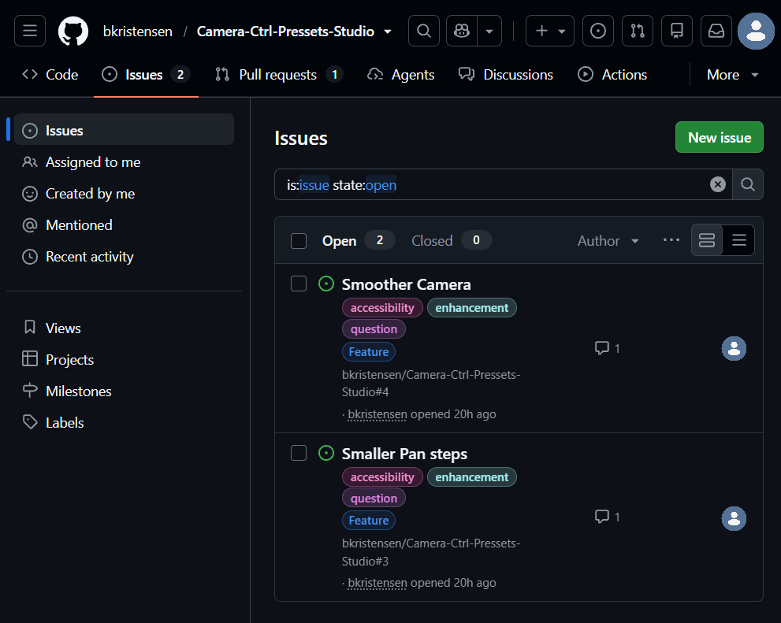

# الإبلاغ عن مشكلة أو متابعتها

* مكتوب لـ Camera Control Studio 1.0.1.*

[استكشاف الأخطاء وإصلاحها](TROUBLESHOOTING.md)

## البحث قبل الإبلاغ

** أبلغ عن خطأ أو اقترح ميزة **\
<https://github.com/bkristensen/Camera-Ctrl-Pressets-Studio/issues?q=is%3Aissue>\
رمز 

1. افتح علامة التبويب [Issues الخاصة بالمشروع ](https://github.com/bkristensen/Camera-Ctrl-Pressets-Studio/issues?q=is%3Aissue). ابحث عن المصطلحات الأساسية من العرض أو الطلب، مثل `is:issue Brio zoom` أو `is:issue label:enhancement preset`.
2. التحقق من النتائج المفتوحة والمغلقة. اقرأ التقارير المشابهة لمطابقة الأعراض والحلول البديلة.
3. في حالة المطابقة، حدد **Subscribe** في الشريط الجانبي لتلقي التحديثات، أو تفاعل باستخدام 👍 لإظهار مدى تأثيرها عليك. أضف تعليقًا إذا كان بإمكانك المساهمة بتفاصيل مثل كاميرا مختلفة أو نتيجة اختبار أو نسخة موثوقة.

## افتح تقريرًا

افتح جزء الإعدادات. اختر **التواصل وحول التطبيق → التواصل**. اختر **الإبلاغ عن مشكلة** أو **طلب ميزة جديدة** لفتح المسودة المناسبة على GitHub. عند الإبلاغ عن مشكلة، يعرض التطبيق حفظ ملف دعم ZIP. راجعه وأرفقه بنفسك بالمسودة. [الإبلاغ عن مشكلة](Report%20a%20bug.md) · [طلب ميزة جديدة](Request%20a%20feature.md)

بالنسبة للأخطاء، قم بتضمين إصدار Camera Control Studio، وإصدار Windows، وطراز الكاميرا، والكاميرا ذات الصلة أو برنامج الالتقاط، والترتيب الذي بدأت به التطبيقات. صف الخطوات الدقيقة، وما توقعته، وما حدث وعدد المرات. بالنسبة للطلب، قم بوصف المهمة التي تريد إنجازها وكيف ستستخدم هذه الميزة.

محرر مشكلات 

إذا كان **Type** متاحًا، فاستخدم **Bug** للسلوك غير المتوقع، أو **Feature** لطلب، أو **Task** لجزء محدد من العمل. إذا كان بإمكانك تطبيق التصنيفات، فاستخدم التصنيفات الأكثر صلة، مثل `bug` أو `enhancement` أو `documentation` أو `accessibility`. يمكن للمشرفين إضافة البيانات الوصفية بعد الإرسال.

قائمة نوع مشكلة 

## إرفاق الأدلة

اختر **التواصل وحول التطبيق → التواصل → حفظ ملف الدعم ZIP** وحدد مكان الحفظ. يعرض التطبيق مسار الملف.

يحتوي ZIP على لقطة للتطبيق وملف `profiles.json` المحفوظ وتخطيط النافذة في `window.json` والسجلات المتاحة في `Logs`.

راجع الأرشيف واحذف المعلومات الخاصة مثل أسماء الملفات الشخصية ومعرّفات الكاميرا ومسارات الملفات. اسحب ملف ZIP أو الملفات المفيدة بنفسك إلى وصف المسودة.

راجع الوصف والمرفقات في **Preview**، ثم اختر **Create**.

مرجع البحث عن مشكلات [GitHub](https://docs.github.com/en/search-github/searching-on-github/searching-issues-and-pull-requests)
