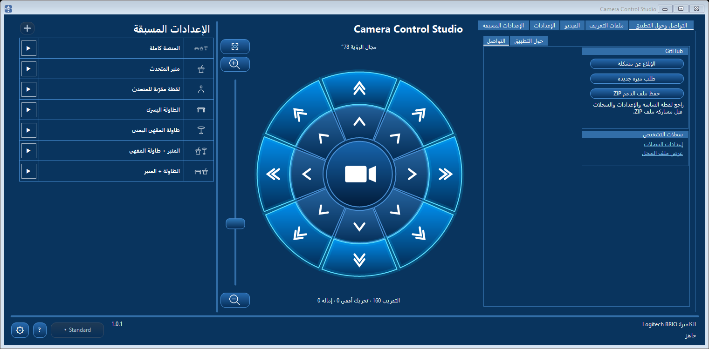

# الإبلاغ عن مشكلة

1. افتح جزء الإعدادات. اختر **التواصل وحول التطبيق → التواصل → الإبلاغ عن مشكلة**.
2. إذا توفر إصدار أحدث، اختر **نعم** لفتح صفحة التنزيل. ثبّته وتحقق مما إذا كان بإمكانك إعادة إظهار المشكلة. اختر **لا** للانتقال إلى المسودة على GitHub.
3. إذا اقترح التطبيق حفظ ملف دعم ZIP، اختر **نعم** وحدد مكان الحفظ. اختر **لا** لفتح المسودة دون إنشاء الملف.

## إضافة التفاصيل وإرفاق ملف ZIP

يفتح الزر قالب **Bug report** على GitHub. اذكر النتيجة المتوقعة وما حدث وخطوات إعادة إظهار المشكلة. اذكر إصدار التطبيق وإصدار Windows. أضف معلومات الكاميرا وتطبيق التسجيل إذا كانت ذات صلة. املأ كل قسم يحمل نجمة حمراء.

اختر **التواصل وحول التطبيق → التواصل → حفظ ملف الدعم ZIP** وحدد مكان الحفظ. يعرض التطبيق مسار الملف.

يحتوي ZIP على لقطة للتطبيق وملف `profiles.json` المحفوظ وتخطيط النافذة في `window.json` والسجلات المتاحة في `Logs`.

راجع الأرشيف واحذف المعلومات الخاصة مثل أسماء الملفات الشخصية ومعرّفات الكاميرا ومسارات الملفات. اسحب ملف ZIP أو الملفات المفيدة بنفسك إلى وصف المسودة.

## التحقق من النوع والتصنيفات

يطلب القالب **Bug** في **Type** و`bug` في **Labels**. إذا لم تظهر القيم وكانت الحقول قابلة للتعديل، فاخترها من الشريط الجانبي الأيمن. إذا لم تستطع تعديلها، أرسل المسودة. يمكن لأحد مشرفي المشروع إضافتها لاحقًا.

راجع الوصف والمرفقات في **Preview**، ثم اختر **Create**.
