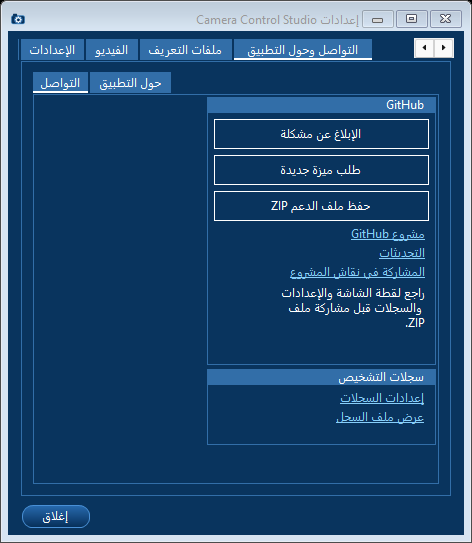

# طلب ميزة جديدة

* مكتوب لـ Camera Control Studio 1.1.1.*

1. انقر على الترس أسفل النافذة لفتح الإعدادات. اختر **التواصل وحول التطبيق → التواصل → طلب ميزة جديدة**.
2. إذا توفر إصدار أحدث، اختر **نعم** لفتح صفحة التنزيل. ثبّته وتحقق مما إذا كان يتضمن الميزة بالفعل. اختر **لا** للانتقال إلى المسودة على GitHub.
3. في قالب **Feature request** على GitHub، صف المهمة وكيف ستفيدك الميزة وما النتيجة التي تدل على أنها تعمل. املأ كل قسم يحمل نجمة حمراء.

يمكنك أيضًا استخدام أزرار GitHub نفسها في عارض الأدلة.

## إرفاق مثال

اختر **التواصل وحول التطبيق → التواصل → حفظ ملف الدعم ZIP** وحدد مكان الحفظ. يعرض التطبيق مسار الملف.

يحتوي ZIP على لقطة للتطبيق وملف `profiles.json` المحفوظ وتخطيط النافذة في `window.json` والسجلات المتاحة في `Logs`.

راجع الأرشيف واحذف المعلومات الخاصة مثل أسماء الملفات الشخصية ومعرّفات الكاميرا ومسارات الملفات. اسحب ملف ZIP أو الملفات المفيدة بنفسك إلى وصف المسودة.

## التحقق من النوع والتصنيفات

يطلب القالب **Feature** في **Type** و`enhancement` في **Labels**. إذا لم تظهر القيم وكانت الحقول قابلة للتعديل، فاخترها من الشريط الجانبي الأيمن. إذا لم تستطع تعديلها، أرسل المسودة. يمكن لأحد مشرفي المشروع إضافتها لاحقًا.

راجع الوصف والمرفقات في **Preview**، ثم اختر **Create**.
