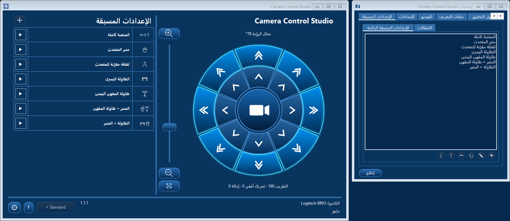

[English](../en/SETUP.md) · [Dansk](../da/SETUP.md) · [Deutsch](../de/SETUP.md) · [ جميع لغات الدليل ](USER-GUIDES.md)

# قم بإعداد التطبيق

* مكتوب لـ Camera Control Studio 1.1.1.*

[استكشاف الأخطاء وإصلاحها](TROUBLESHOOTING.md)

انقر على الترس أسفل النافذة لفتح الإعدادات. تفتح الإعدادات في نافذة مستقلة. يمكنك متابعة استخدام النافذة الرئيسية.

## تثبيت والتحقق من التنزيل

نزّل **Camera Control Studio** من Microsoft Store عندما يتوفر فيه. ابحث عن اسم التطبيق في المتجر. توقّع Microsoft حزمة المتجر وتوفّر تحديثاتها.

إذا لم يتوفر التطبيق بعد في Microsoft Store، فحمّل المثبّت أو ملف ZIP المحمول من [إصدارات GitHub](https://github.com/bkristensen/Camera-Ctrl-Pressets-Studio/releases). شغّل المثبّت أو فك ضغط ملف ZIP كاملًا قبل فتح التطبيق. إذا توفرت قيمة تحقق SHA-256، فقارنها بنتيجة `Get-FileHash -Algorithm SHA256`.

يمكن أن يعرض Microsoft Defender SmartScreen تحذيرًا باللون الأزرق عندما يكون التطبيق الذي تم تنزيله أو ناشره ذا سمعة سيئة. خذ الأمر على محمل الجد. إذا حصلت على الملف المتوقع من الإصدار الرسمي وتثق في المصدر، فحدد ** مزيد من المعلومات** وراجع اسم الملف والناشر. حدد **Run على أي حال ** فقط إذا اخترت الوثوق بهذا الملف وكان Windows يوفر هذا الخيار. وإلا أغلق التحذير. اتبع سياسة الأجهزة الخاصة بمؤسستك. [إرشادات Microsoft SmartScreen](https://learn.microsoft.com/windows/apps/package-and-deploy/smartscreen-reputation)

<https://learn.microsoft.com/windows/apps/package-and-deploy/smartscreen-reputation>

إذا كان عارض الدليل يحتاج إلى WebView2، فقم بتنزيل وقت التشغيل من Microsoft.\
<https://developer.microsoft.com/microsoft-edge/webview2/>

اختر ملفًا شخصيًا من أسفل النافذة الرئيسية. في الوضع الافتراضي، انقر مرتين على زر الكاميرا في وسط العجلة لاختيار المصدر. يتذكر الملف الكاميرا. اختر مصدرًا آخر إذا لم تجدها.

تتبع الأقسام ترتيب علامات التبويب في نافذة الإعدادات. غالبًا ما يحتاج الزر الباهت إلى تحديد عنصر. في تبويب الفيديو، يحدد برنامج تشغيل الكاميرا الخيارات المتاحة. تحقق من النتيجة في تطبيق الالتقاط.

**إغلاق**. غيّر حجم النافذتين وموضعهما، أو اسحب الفاصل في النافذة الرئيسية. يتذكر الملف هذه القيم. انقر زر الإغلاق أسفل الإعدادات. تبقى النافذة الرئيسية مفتوحة.

## الإعدادات المسبقة

### الإعدادات المسبقة الدائمة

وجّه الكاميرا أولًا. يحفظ الموضع الدائم قيم الحركة الأفقية والميل والتكبير التي تدعمها الكاميرا. ويحفظ مجال الرؤية إذا أبلغت عنه. يرتبط الموضع بكاميرا واحدة في ملف شخصي واحد.

- **+ إضافة إعداد مسبق دائم**. احفظ الإطار الحالي. اختر رمزًا وأدخل اسمًا فريدًا. قد يقترح الرمز اسمًا إذا كان الحقل فارغًا. اكتب اسمًا لتفعيل الحفظ. يبقي الإلغاء القائمة كما كانت.
- **✎ تعديل الاسم والأيقونة**. غيّر اسم الموضع المحدد أو رمزه. يبقى الإطار المحفوظ كما هو.
- **↻ الاستبدال بالموضع الحالي**. استبدل الإطار المحفوظ بالوضع الحالي للكاميرا. أكّد التغيير. يبقى الاسم والرمز كما هما.
- **− حذف الإعداد المسبق الدائم**. احذف الموضع المحدد بعد التأكيد.
- **↑ / ↓ نقل الإعداد المسبق المحدد لأعلى · نقل الإعداد المسبق المحدد لأسفل**. انقل الموضع سطرًا واحدًا في القائمتين. يكون سهم الأعلى باهتًا في أول سطر، وسهم الأسفل في آخر سطر.

حدّد موضعًا قبل تعديله أو استبداله أو حذفه أو نقله. تتطلب الإضافة والاستبدال ملفًا شخصيًا محمّلًا ومحورًا واحدًا قابلًا للتحكم على الأقل. قد يحاول التطبيق توصيل الكاميرا إذا كانت مفصولة.

### ضبط التحولات المحددة مسبقا

- **استخدام السرعة عند تبديل المواضع**. عند إيقافه تكون المدة ثابتة. عند تشغيله تحدد السرعة مدة الحركة، فتكتمل المسافة القصيرة أسرع. تصل المحاور المتحركة معًا.
- **مدة الانتقال (ثانية)**. اضبط مدة الانتقال. القيمة الافتراضية ثانية واحدة. يكون الحقل باهتًا في وضع السرعة.
- **سرعة الانتقال (%/ث)**. اضبط السرعة كنسبة من مدى المحور الذي يحدد الحركة في الثانية. القيمة الافتراضية 30٪. يكون الحقل باهتًا في وضع المدة الثابتة.

## الإعدادات

### التحريك الأفقي

- **السرعة الدقيقة (% من العادية)**. اضغط باستمرار على Ctrl واستخدم أحد الأسهم للضبط الدقيق. السرعة الافتراضية 50٪ من السرعة العادية.
- **خطوات التدوير العادي**. حدّد عدد خطوات أسهم الحلقة الداخلية. القيمة الافتراضية خطوة واحدة.
- **خطوات التدوير السريع**. حدّد عدد خطوات أسهم الحلقة الخارجية. القيمة الافتراضية أربع خطوات. يغيّر هذا أيضًا سرعة الحركة عند سحب زر الكاميرا.
- **عكس حركة الكاميرا يسارًا ويمينًا**. اعكس اليسار واليمين إذا تحركت الكاميرا في الاتجاه الخطأ.
- **عكس حركة الكاميرا لأعلى ولأسفل**. اعكس الأعلى والأسفل، مثلًا إذا كانت الكاميرا مركّبة بالمقلوب. يغيّر الخياران اتجاه التحكم. يبقى اتجاه الصورة كما هو.
- **اسحب زر الكاميرا لتحريكها أفقياً أو عمودياً**. اسحب الزر في وسط العجلة لتوجيه الكاميرا. أوقف الخيار إذا أردت استخدام الأسهم.
- **انقر زر الكاميرا نقرتين لاختيار المصدر**. عند التشغيل، يفتح النقر المزدوج قائمة الكاميرات. عند الإيقاف، تكفي نقرة واحدة.

يمكن ضبط الحركة قبل توصيل الكاميرا. يحدد برنامج التشغيل حجم الخطوة والمحاور المتاحة وحدودها.

### ضبط خطوات التكبير

- **خطوات التقريب**. اضبط عدد خطوات التكبير عند الضغط على + أو −. القيمة الافتراضية خطوة واحدة يحددها برنامج التشغيل. يمكنك تغييرها قبل الاتصال، وتعمل إذا دعمت الكاميرا التكبير. يضبط شريط التمرير التكبير داخل مجال الرؤية الحالي.

### التطبيق

- **السؤال عمّا إذا كان البث قد بدأ قبل استخدام الكاميرا**. شغّل الخيار إذا كان تطبيق الالتقاط يحتاج إلى بدء البث أولًا. سيطلب أول إجراء للكاميرا التأكيد. اختر نعم عندما تكون جاهزًا، أو لا لتبقى الكاميرا مفصولة. يتكرر السؤال بعد إعادة التشغيل أو تغيير الملف أو تعديل الخيار. إيقاف الخيار يسمح بالاتصال عند البدء.
- **إبقاء النافذة في المقدمة**. أبقِ النافذة الرئيسية فوق التطبيقات الأخرى. أوقف الخيار كي يمكن للنوافذ الأخرى تغطيتها.
- **لغة ملف التعريف · تلقائي**. اختر لغة من 12 لغة. يستخدم الوضع التلقائي لغة عرض Windows إذا كانت مدعومة، وإلا يستخدم الإنجليزية. أعد التشغيل لتطبيق الاختيار. يتذكر كل ملف لغته.

## الفيديو

- **تحميل إعدادات الصورة**. صِل الكاميرا لإظهار أدوات ضبط الصورة. يظهر الزر عندما تكون مفصولة. إذا لم يوفّر برنامج التشغيل أدوات للصورة، تبقى علامة تبويب مجال الرؤية وحدها.
- **تلقائي**. يحدد برنامج التشغيل ما يظهر من علامات وأشرطة. يتيح الوضع التلقائي للكاميرا ضبط القيمة. أوقفه لاستخدام الشريط. إذا كان الضبط تلقائيًا فقط، يبقى الشريط باهتًا وقد يكون مربع التحديد مقفلًا. إذا كان الضبط يدويًا فقط، يختفي المربع.
- **استعادة إعدادات الصورة الافتراضية لبرنامج التشغيل**. أعد جميع قيم الصورة المدعومة إلى إعدادات برنامج التشغيل الافتراضية. يظهر الزر في علامات تبويب الصورة ويختفي في مجال الرؤية. تحفظ القيم لكل كاميرا وملف.

### التركيز والتعريض

- **الكسب**. قوِّ الإشارة لجعل الصورة أسطع. قد تزيد القيمة العالية التشويش.
- **التعريض الضوئي**. حدّد مدة استقبال المستشعر للضوء. المدة الأطول تزيد السطوع وقد تجعل الحركة ضبابية.
- **التركيز البؤري**. اضبط مسافة التركيز. تأكد من وضوح الهدف في تطبيق الالتقاط.

### اللون

- **توازن اللون الأبيض**. صحح لون الإضاءة حتى يبدو الأبيض أبيض.
- **التشبّع**. اجعل الألوان أقوى أو أهدأ.
- **غاما**. غيّر سطوع الدرجات المتوسطة.
- **درجة اللون**. حرّك الألوان على عجلة الألوان.

### الإضاءة والتفاصيل

- **التباين**. غيّر الفرق بين المناطق المضيئة والداكنة.
- **السطوع**. اجعل الصورة كلها أسطع أو أغمق.
- **تعويض الإضاءة الخلفية**. اجعل الهدف أكثر سطوعًا عندما يأتي ضوء قوي من خلفه.
- **الحدّة**. اجعل الحواف أوضح أو أنعم.

### ضبط مجال الرؤية

مجال الرؤية (FOV) هو مقدار المشهد داخل الإطار. الزاوية الأكبر تعرض أكثر. يغيّر التكبير القص داخل الزاوية الحالية.

- **مجال الرؤية عند التشغيل · أوسع مجال متاح · أبقِ الإعداد الحالي**. اختر أوسع زاوية، أو أبقِ الحالية، أو اختر زاوية يوفرها برنامج التشغيل. يحاول التطبيق تطبيقها عند أول اتصال في الجلسة. تصبح القائمة متاحة حين تبلغ الكاميرا المتصلة عن زاوية واحدة على الأقل.
- **السماح بتغيير مجال الرؤية يدويًا**. أظهر قائمة الزوايا أسفل العجلة. عند إيقاف الخيار، يعرض التطبيق الزاوية الحالية إن أمكن قراءتها. يكون الخيار باهتًا عند توفر أقل من زاويتين.
- **تغيير مجال الرؤية عند حدود التكبير والتحريك**. اضغط مجددًا عند بلوغ حد التكبير. يجرب التطبيق زاوية أوسع عند التصغير وأضيق عند التكبير. عند حد الحركة الأفقية يجرب زاوية تتيح مزيدًا من الحركة. يحاول إبقاء الإطار قريبًا ويعيده إذا تعذر التقدم. يعمل مع إيقاف الاختيار اليدوي. يكون الخيار باهتًا عند توفر أقل من زاويتين.

مثلًا، عندما تكون كاميرا Brio عند 65° وأقل تكبير، قد يؤدي الضغط على التصغير إلى 78°. اضغط مرة أخرى للتصغير في الزاوية الجديدة. يحاول زر الإطار استخدام أوسع زاوية وأقل تكبير معًا. افحص النتيجة إذا كان تطبيق آخر يتحكم بالكاميرا أيضًا.

## ملفات التعريف

- **+ ملف تعريف جديد**. أنشئ ملفًا بالقيم الافتراضية وفعّله. أعطه اسمًا فريدًا.
- **⧉ نسخ ملف التعريف النشط**. انسخ إعدادات الملف النشط ومواضعه، ثم انتقل إلى النسخة. اختيار سطر آخر لا يغيّر الملف المنسوخ.
- **✎ إعادة تسمية ملف التعريف المحدد**. أعد تسمية الملف المحدد. يكون الزر باهتًا دون تحديد أو عند تحديد Standard. يلزم ملف محمّل للإنشاء والنسخ. أدخل اسمًا لتفعيل التأكيد في الحوارات الثلاثة.
- **الإبقاء على الموضع والتخطيط الحاليين**. انقر مرتين على ملف لفتح حوار التبديل. فعّل خيار التخطيط لنقل مواضع النوافذ وأحجامها والفاصل. أوقفه لاستخدام التخطيط المحفوظ في الملف المختار. يعيد التبديل تشغيل التطبيق ويمحو المواضع المؤقتة.

## التواصل وحول التطبيق

### التواصل

- **الإبلاغ عن مشكلة**. افتح نموذج الإبلاغ عن خطأ في GitHub. إذا توفّر إصدار أحدث، يعرض التطبيق فتحه أولًا. إذا تابعت، يعرض حفظ ملف دعم ZIP قبل فتح المسودة.
- **طلب ميزة جديدة**. افتح نموذج طلب ميزة. إذا توفّر إصدار أحدث، جرّبه أولًا. قد تجد الميزة فيه.
- **حفظ ملف الدعم ZIP**. احفظ لقطة الشاشة والسجلات المتاحة وبيانات الملفات الشخصية وتخطيط النوافذ في ZIP. راجع المعلومات الخاصة. أرفق الملف بنفسك بالمسودة. تصبح الأزرار الثلاثة باهتة مؤقتًا أثناء الإجراء.
- **مشروع GitHub · إصدارات GitHub · المشاركة في نقاش المشروع**. تفتح روابط GitHub الثلاثة شفرة المشروع أو تنزيلات الإصدارات أو المناقشات.

[الإبلاغ عن مشكلة](Report%20a%20bug.md) · [طلب ميزة جديدة](Request%20a%20feature.md)

### سجلات التشخيص

- **إعدادات السجلات**. افتح إعدادات السجل. تنطبق على جميع الملفات الشخصية. يطبّق الحفظ التغييرات. يبقي الإلغاء القيم كما كانت.
- **اختر مجلدًا · تلقائي**. اختر مجلدًا أو استخدم الوضع التلقائي. حقل المسار للقراءة فقط. يستخدم الوضع التلقائي مجلد التطبيق ثم `%LOCALAPPDATA%\CamPressets\Logs` عند الحاجة.
- **الحجم الأقصى لكل ملف (MiB)**. حدّد متى يبدأ التطبيق ملف سجل جديدًا. الافتراضي 1 MiB لكل ملف.
- **أقصى عدد للسجلات (بما فيها السجل الحالي)**. حدّد عدد الملفات التي تبقى، بما فيها الملف الحالي. الافتراضي ملفان.
- **عرض ملف السجل**. حدّد أحدث سجل في مستكشف الملفات. يعرض التطبيق رسالة إذا لم يوجد سجل.

### حول التطبيق

- **ادعمني بفنجان قهوة**. اطّلع على الإصدار المثبّت واسم المطوّر. مرّر المؤشر فوق الإصدار لترى معرّف البناء الكامل. يفتح رابط الدعم صفحة دعم المطوّر.
- **افتح الأدلة**. افتح الأدلة من هذه العلامة. يفتحها أيضًا زر المساعدة في النافذة الرئيسية.

للنسخ الاحتياطي، أغلق التطبيق وانسخ `%LOCALAPPDATA%\CamPressets`. تبقى المواضع المؤقتة للجلسة الحالية فقط.

[الاستخدام اليومي](DAILY-USE.md)

## مربع حوار الخطأ

إذا أوقف خطأ غير متوقع إجراءً ما، فأغلق مربع الحوار وحاول مرة أخرى. إذا ذكر الحوار أن التطبيق سيُغلق، فأعد فتحه.

يحدد زر **عرض ملف السجل** سجل التشخيص في مستكشف الملفات إذا كان متاحًا. يعرض زر **الإبلاغ على GitHub** حفظ ملف ZIP للدعم، ثم يفتح قالب الإبلاغ عن خطأ على GitHub. قد يحتوي الملف على لقطة لمربع الحوار والسجلات وإعدادات الملف الشخصي والنافذة وتقرير عن النظام. راجع الملف وأرفقه بالمسودة بنفسك.
