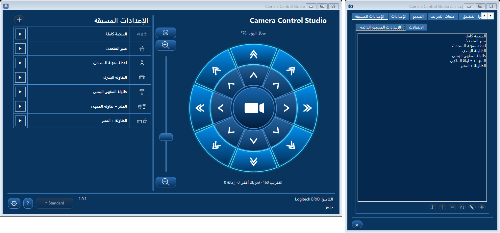
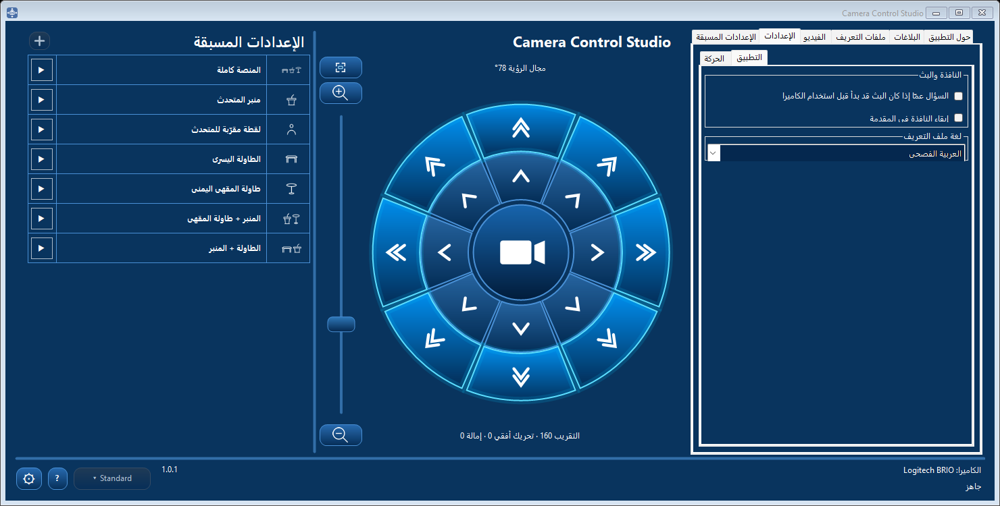
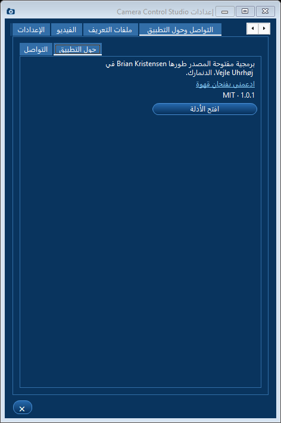
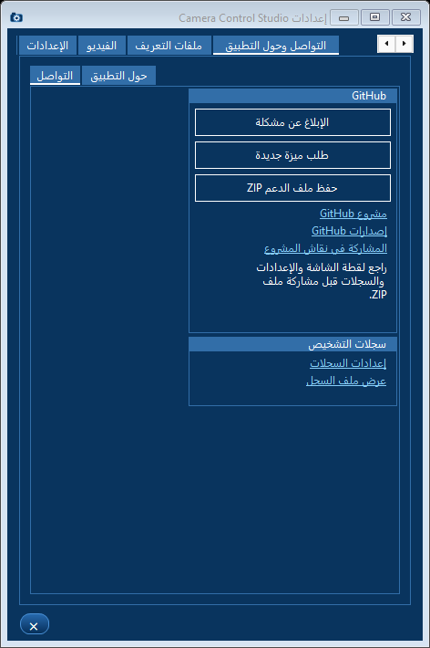

[English](../en/SETUP.md) · [Dansk](../da/SETUP.md) · [Deutsch](../de/SETUP.md) · [ جميع لغات الدليل ](USER-GUIDES.md)

# قم بإعداد التطبيق

* مكتوب لـ Camera Control Studio 1.0.1.*

[استكشاف الأخطاء وإصلاحها](TROUBLESHOOTING.md)

انقر على الترس أسفل النافذة لفتح الإعدادات. تفتح الإعدادات في نافذة مستقلة. يمكنك متابعة استخدام النافذة الرئيسية.

## تثبيت والتحقق من التنزيل

قم بتنزيل برنامج التثبيت أو ZIP المحمول من إصدارات [GitHub الخاصة بالمشروع ](https://github.com/bkristensen/Camera-Ctrl-Pressets-Studio/releases). قم بتشغيل برنامج التثبيت أو قم باستخراج ZIP بالكامل قبل تشغيل التطبيق. إذا تم نشر المجموع الاختباري SHA-256، فقارنه مع `Get-FileHash -Algorithm SHA256` للتنزيل.

** التنزيل الرسمي **\
<https://github.com/bkristensen/Camera-Ctrl-Pressets-Studio/releases>\
رمز 

يمكن أن يعرض Microsoft Defender SmartScreen تحذيرًا باللون الأزرق عندما يكون التطبيق الذي تم تنزيله أو ناشره ذا سمعة سيئة. خذ الأمر على محمل الجد. إذا حصلت على الملف المتوقع من الإصدار الرسمي وتثق في المصدر، فحدد ** مزيد من المعلومات** وراجع اسم الملف والناشر. حدد **Run على أي حال ** فقط إذا اخترت الوثوق بهذا الملف وكان Windows يوفر هذا الخيار. وإلا أغلق التحذير. اتبع سياسة الأجهزة الخاصة بمؤسستك. [إرشادات Microsoft SmartScreen](https://learn.microsoft.com/windows/apps/package-and-deploy/smartscreen-reputation)

<https://learn.microsoft.com/windows/apps/package-and-deploy/smartscreen-reputation>

إذا كان عارض الدليل يحتاج إلى WebView2، فقم بتنزيل وقت التشغيل من Microsoft.\
<https://developer.microsoft.com/microsoft-edge/webview2/>

## 1. اختر ملف التعريف والكاميرا

استخدم منتقي ملف التعريف في التذييل لتحديد ملف تعريف. لإنشاء واحد، افتح **الإعدادات → ملفات التعريف**. اختر **New** للإعدادات الافتراضية أو **Copy** لنسخة من ملف التعريف النشط. قم بتسميته على اسم شخص أو إعداد. الملفات الشخصية الجديدة تصبح نشطة. في **ملفات التعريف**، حدد ملف تعريف وانقر فوق **✎** لإعادة تسميته. ملف التعريف القياسي له اسم ثابت.

انقر نقرًا مزدوجًا فوق رمز الكاميرا الموجود في منتصف عجلة الاتجاه لتحديد الكاميرا. البرنامج يتذكره. إذا كانت تلك الكاميرا مفقودة، فاختر مصدرًا آخر. المواقف تنتمي إلى الكاميرا داخل الملف الشخصي.

علامة التبويب 

## 2. قرر متى يمكن أن يبدأ التحكم في الكاميرا

ضمن **الإعدادات → التطبيق**، قم بتمكين **السؤال عمّا إذا كان البث قد بدأ قبل استخدام الكاميرا** إذا كان يجب أن يبدأ برنامج الالتقاط الخاص بك أولاً. هذا الخيار معطل بشكل افتراضي.

مع تمكين الخيار، يسأل الإجراء الأول للكاميرا ما إذا كان البث قد بدأ أم لا. اختر **Yes** فقط عندما يكون موجودًا. اختر **No** لإبقاء التحكم في الكاميرا غير متصل. بعد نعم، لا يتم المطالبة بإجراءات أخرى مرة أخرى حتى تقوم بتغيير ملف التعريف أو تغيير هذا الخيار أو إعادة تشغيل التطبيق. لا يكتشف التطبيق جلسة البث أو يبدأها لك.

إذا كنت بحاجة إلى هذا الطلب عند الاستخدام لأول مرة، فاضبط الخيار قبل الجلسة التالية. يسمح الإعداد الافتراضي للتطبيق بالاتصال عند بدء التشغيل.

## 3. ضبط الحركة والتكبير

افتح **الإعدادات → التحريك الأفقي** لتعيين خطوات التحريك والإمالة والاتجاهات العكسية واختيار كيفية عمل زر الكاميرا. ابدأ بخطوات صغيرة. اختبر النتيجة في برنامج الالتقاط الخاص بك.

علامة تبويب 

| الإعداد | ما يتغير | الافتراضي |
| --- | --- | --- |
| السرعة الدقيقة (% من العادية) | قم بالتقييم أثناء الضغط على Ctrl ومفتاح السهم | 50% |
| خطوات عموم عادية | حلقة السهم الأوسط | 1 |
| خطوات عموم سريعة | حلقة السهم الخارجية | 4 |

خطوة واحدة تعني خطوة واحدة يدعمها برنامج تشغيل الكاميرا. إنها ليست مسافة ثابتة أو نسبة مئوية. يحد برنامج التشغيل من الحركة والنعومة.

بالنسبة للكاميرا المقلوبة، قم بتمكين **عكس حركة الكاميرا لأعلى ولأسفل** واختبر لأعلى. قم بتمكين **عكس حركة الكاميرا يسارًا ويمينًا** فقط إذا تحرك اليسار في الاتجاه الخاطئ. تعمل هذه الإعدادات على تغيير عناصر التحكم. لا يقومون بتدوير الفيديو.

### ضبط خطوات التكبير

افتح **الإعدادات → التقريب** لاختيار مدى تحرك أزرار الزائد والناقص في خطوة واحدة. الافتراضي هو خطوة واحدة للسائق. [ راجع علامة التبويب "تكبير/تصغير" ](../images/screenshots/settings-tabs/en/zoom.png).

### ضبط التحولات المحددة مسبقا

افتح **الإعدادات المسبقة → الانتقالات** لاختيار كيفية تحرك الكاميرا بين المواضع المحفوظة. [ راجع علامة التبويب "الانتقالات" ](../images/screenshots/settings-tabs/en/transitions.png).

| الإعداد | ما يتغير | الافتراضي |
| --- | --- | --- |
| استخدم السرعة للتحولات المحددة مسبقًا | دع مسافة السفر تحدد المدة | إيقاف |
| سرعة الانتقال (%/s) | معدل السرعة كنسبة مئوية من نطاق محور التحكم في الثانية | 30% |
| الانتقال (ثانية) | الوقت لكل تغيير محدد مسبقًا في وضع المدة الثابتة | 1.0 |

مع التحولات القائمة على السرعة، تستغرق الحركة القصيرة وقتًا أقل من الحركة الطويلة. يقوم التطبيق بالتسريع والكبح، وتشترك جميع المحاور المتحركة في نفس التقدم حتى تتمكن من الوصول إلى الهدف معًا.

### ضبط مجال الرؤية

افتح **الفيديو → مجال الرؤية**. ضمن **مجال الرؤية عند التشغيل**، اختر **أوسع مجال متاح**، وهي الزاوية التي أبلغ عنها برنامج تشغيل الكاميرا، أو **أبقِ الإعداد الحالي** للاحتفاظ بالعرض الحالي. يستخدم التطبيق هذا الاختيار في المرة الأولى التي يتصل فيها. قم بتشغيل **السماح بتغيير مجال الرؤية يدويًا** للاختيار من بين الزوايا المذكورة أسفل عجلة الاتجاه. إذا أبلغ برنامج التشغيل عن عدم وجود زوايا قابلة للتحديد، فسيتم تعطيل عناصر التحكم FOV. لا يزال بإمكانك استخدام التكبير/التصغير إذا كانت الكاميرا تدعمه. [ راجع علامة التبويب "مجال العرض" ](../images/screenshots/settings-tabs/en/field-of-view.png).

يتم تشغيل **تغيير مجال الرؤية عند حدود التكبير والتحريك** بشكل افتراضي. يمكنك استخدامه مع إخفاء المنتقي اليدوي. يعمل عندما يدعم برنامج التشغيل FOV.

- **التصغير:** عند الحد الأدنى من التكبير/التصغير في جهاز Brio المضبوط على 65 درجة، اضغط على التصغير مرة أخرى للتبديل إلى 78 درجة. يؤدي هذا الضغط إلى تغيير FOV وضبط التكبير/التصغير لإبقاء اللقطة قريبة. يتم التصغير بالضغط التالي بشكل طبيعي. نفس الخطوات تأخذك من 78 درجة إلى 90 درجة. يتوقف الزر عند 90 درجة والحد الأدنى من التكبير.
- **تكبير:** عند الحد الأقصى للتكبير/التصغير، اضغط مرة أخرى للتحرك نحو FOV الأضيق. إذا أبلغ برنامج التشغيل عن 90 درجة و78 درجة و65 درجة، فسيستخدمها التطبيق بهذا الترتيب. يتوقف الزر عند أضيق زاوية متاحة والحد الأقصى للتكبير/التصغير.
- ** تحريك لليسار أو لليمين:** عند الحافة، يحاول التطبيق الحصول على عرض أوسع أولاً. يقوم بضبط التكبير/التصغير لإبقاء المحصول قريبًا. ويمكنه أيضًا تجربة عرض أضيق إذا كان التكبير/التصغير يسمح بذلك. إذا لم يكن هناك عرض يسمح لها بالانتقال إلى مسافة أبعد، فإنها تستعيد اللقطة السابقة. يتحكم برنامج التشغيل في مدى قرب المباراة.

استخدم الزر المربع مع رمز الإطار للانتقال مباشرة إلى FOV الأوسع والحد الأدنى من التكبير/التصغير. لا يزال شريط التمرير يضبط التكبير/التصغير ضمن FOV الحالي. قم بإيقاف تشغيل FOV التلقائي للحفاظ على التكبير/التصغير والتحريك ضمن العرض الحالي.

تقوم الإعدادات المسبقة بحفظ التحريك والإمالة والتكبير/التصغير وFOV التي أبلغ عنها برنامج التشغيل. تحتفظ الإعدادات المسبقة الأقدم بـ FOV الحالي. تحقق من الصورة الحية إذا كان Zoom أو Logitech Brio Control أو أي تطبيق آخر يتحكم في الاقتصاص. خطوات اختبار [Brio والتكبير ](VALIDATION.md#%D9%85%D8%AC%D8%A7%D9%84-%D8%A7%D9%84%D8%B1%D8%A4%D9%8A%D8%A9-%D8%A8%D8%B1%D9%8A%D9%88-%D9%88%D8%A7%D9%84%D8%AA%D9%83%D8%A8%D9%8A%D8%B1)

## 4. اضبط الصورة واحفظ المواضع الدائمة

[عناصر التحكم في الفيديو قبل التحميل](../images/screenshots/settings-tabs/en/video.png) · [اللون](../images/screenshots/1.0.1/en/video-colour.png) · [الضوء والتفاصيل](../images/screenshots/1.0.1/en/video-light-detail.png)

افتح **الفيديو** في جزء الإعدادات، ثم قم بتحميل عناصر التحكم في الصورة إذا لزم الأمر. اختر مجموعة مثل **التركيز والتعريض**، أو **اللون**، أو **الإضاءة والتفاصيل**. تظهر فقط عناصر التحكم التي كشفها برنامج التشغيل. اضبط السطوع أو التباين أو تشبع اللون أو التركيز أو توازن اللون الأبيض عندما يكون ذلك متاحًا. قم بإيقاف تشغيل الوضع التلقائي قبل الضبط اليدوي. يتم حفظ قيم الصورة لكل كاميرا وملف شخصي. يقوم زر إعادة الضبط باستعادة الإعدادات الافتراضية للسائق.

حرك الكاميرا أولاً. افتح **الإعدادات المسبقة** في جزء الإعدادات. انقر فوق **+** لإضافة إعداد مسبق دائم. حدد أيقونة في الأعلى، وتحقق من الاسم، ثم احفظ. إذا كان الاسم فارغًا وغير مستخدم، فإن اختيار أيقونة يوحي باسمه. تُظهر الرموز المجمعة موضوعاتها من اليسار إلى اليمين.

ضمن **الإعدادات المسبقة الدائمة**، حدد موضعًا. قم بالتمرير فوق رمز لعمله. استخدم **✎** لتحرير اسمها ورمزها، **↻** لحفظ موضع الكاميرا الحالي في مكانه، و**−** لحذفه. استخدم **↑** و**↓** لتغيير الترتيب في كلتا القائمتين. تظل المناصب الدائمة في أعلى القائمة الرئيسية بالخط العريض.

يؤدي تحديد صف دائم في القائمة الرئيسية أيضًا إلى تحديد ذلك الإعداد المسبق في الإعدادات. يتم تحديد إعداد مسبق محفوظ حديثًا في الإعدادات.

علامة التبويب 

## 5. تعيين التخطيط واللغة

اسحب الفاصل بين عناصر التحكم في الكاميرا وقائمة الإعدادات المسبقة. يحفظ ملفك الشخصي موضع الفاصل. الحجم الأولي هو 900 × 500، والحد الأدنى هو 670 × 450. تبدأ الإعدادات مغلقة. عند فتحها لأول مرة بعد الإطلاق، يتم تحديد علامة التبويب الأولى. قم بالتمرير لأسفل في **التحريك الأفقي** أو **التطبيق** إذا كانت بعض الحقول موجودة أسفل النافذة. يحفظ ملفك الشخصي موضع النافذتين وحجمهما.

عند تحديد ملف تعريف في التذييل، اترك **الإبقاء على الموضع والتخطيط الحاليين** بدون تحديد لاستعادة تخطيط ملف التعريف هذا. قم بفحصه لنقل التخطيط الحالي إلى ملف التعريف المحدد. يتم تذكر الاختيار في الملف الشخصي الذي تتركه؛ يتم حفظ التخطيط المحمول في ملف تعريف الوجهة.

اختر لغة ضمن **الإعدادات → التطبيق → لغة ملف التعريف**، ثم أعد تشغيلها لتطبيقها. يستخدم **تلقائي** لغة عرض Windows إذا كانت مدعومة واللغة الإنجليزية بخلاف ذلك. يؤدي تبديل ملفات التعريف إلى إعادة تشغيل التطبيق بلغة ملف التعريف المحدد. تنتهي الإعدادات المسبقة المؤقتة عند إعادة التشغيل.

## 6. معلومات الإصدار والمشروع

افتح **التواصل وحول التطبيق → حول التطبيق** لرؤية الإصدار وروابط المشروع. مرر المؤشر فوق الإصدار لقراءة معرّف البناء الكامل. أضفه إذا كانت المشكلة تخص ذلك البناء.

## 7. سجلات التشخيص والإبلاغ عن المشكلات

افتح **التواصل وحول التطبيق → التواصل** لاختيار مجلد السجلات والحد الأقصى لحجم الملف وعدد الملفات، بما فيها الملف الحالي. يستخدم التطبيق مجلده أو `%LOCALAPPDATA%\CamPressets\Logs` عند تعذّر ذلك.

اختر **الإبلاغ عن مشكلة** أو **طلب ميزة جديدة** لفتح المسودة المناسبة على GitHub. عند الإبلاغ عن مشكلة، يعرض التطبيق حفظ ملف دعم ZIP. راجعه وأرفقه بنفسك بالمسودة. [الإبلاغ عن مشكلة أو متابعتها](ISSUES.md)

** أبلغ عن خطأ أو اقترح ميزة **\
<https://github.com/bkristensen/Camera-Ctrl-Pressets-Studio/issues?q=is%3Aissue>\
رمز 

التالي: [الاستخدام اليومي](DAILY-USE.md). للحصول على نسخة احتياطية، أغلق التطبيق وانسخ `%LOCALAPPDATA%\CamPressets`. المواقف المؤقتة ليست جزءًا من النسخة الاحتياطية.
