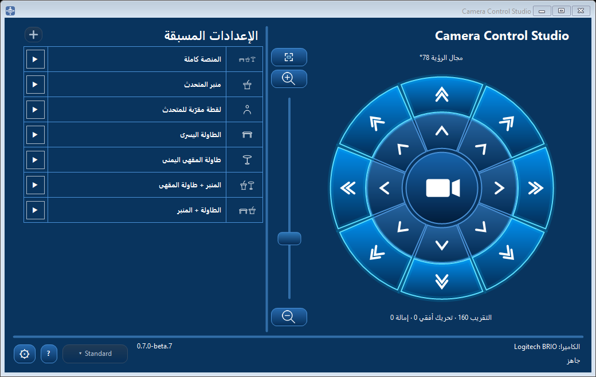
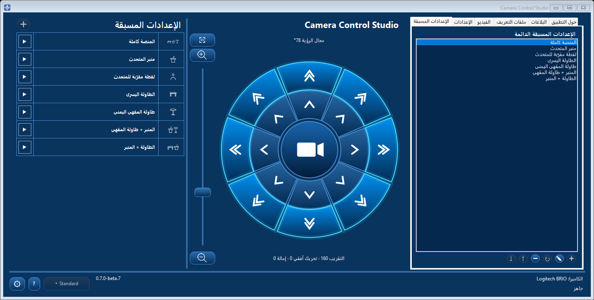
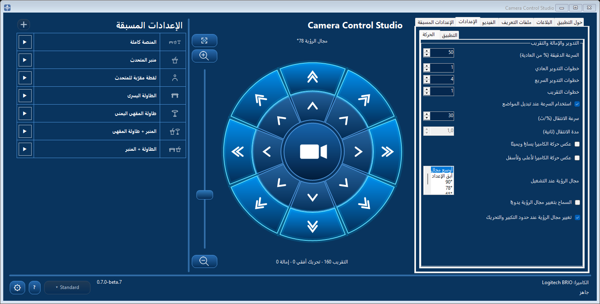
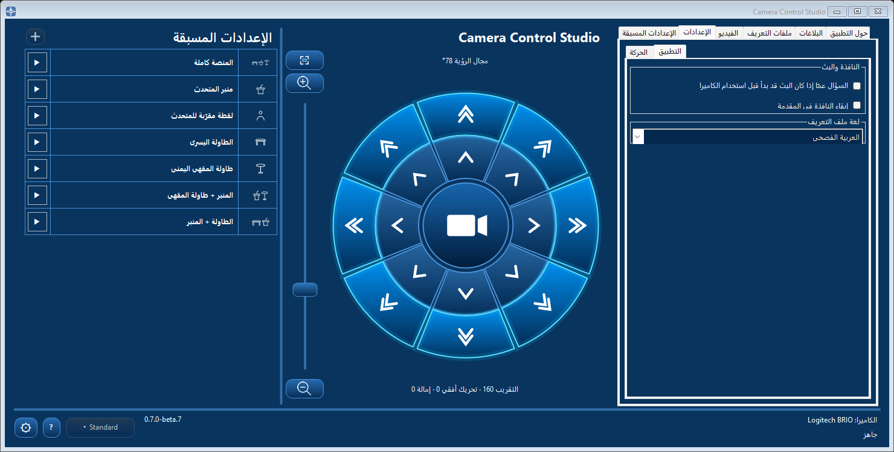

# الاستخدام والإعدادات

[العربية الفصحى · Camera Control Studio](../USER-GUIDES.md)

ابدأ أولًا الاجتماع الذي تريد بثّه، مثلًا في Zoom، ثم افتح **Camera Control Studio**.

افتح الدليل بزر **?**. مرّر المؤشر فوق الزر لمعرفة وظيفته. يتوقف كل اتجاه عند آخر حد تسمح به الكاميرا.

1. **تفعيل إعداد مسبق**

   اضغط على ▶ في صف الإعداد المسبق، أو انقر مرتين على اسمه، أو حدّد صفه واضغط Enter.

   | اللون | المعنى |
   | --- | --- |
   | أصفر | الكاميرا تتحرك نحو الموضع المحفوظ. |
   | أخضر | أبلغ برنامج تشغيل الكاميرا عن بلوغ الإحداثيات المحفوظة. |
   | أزرق | الإعداد المسبق غير مميّز على أنه نشط. |

   يؤكد اللون الأخضر الإحداثيات التي أبلغ عنها برنامج التشغيل. تحقّق من الصورة الفعلية في البث. إذا لم يُبلِغ برنامج التشغيل عن بلوغ الموضع في الوقت المحدد، يتحوّل الصف إلى الأزرق وتظهر رسالة في منطقة الحالة. تبقى الأيقونات ظاهرة طوال الوقت.

2. **ضبط تأطير الصورة**

   **التحريك الأفقي**

   استخدم الحلقة الداخلية للحركة العادية والخارجية للحركة السريعة. تحرّك الأسهم المائلة المحورين معًا بزاوية 45° وبنسبة 45% من سرعة الحلقة لكل محور. اضغط مطولًا لتستمر الحركة. اترك الزر للتوقف.

   

   **زر الكاميرا في وسط العجلة**

   - **انقر نقرتين لاختيار كاميرا.** تظهر قائمة الكاميرات.
   - **اضغط مطولًا واسحب.** ابدأ من رمز الكاميرا. اسحب يمينًا أو يسارًا لتدوير الكاميرا أفقيًا، أو لأعلى أو لأسفل لإمالتها. اسحب قليلًا للحركة البطيئة، أو أبعد لحركة أسرع تصل إلى ضعف السرعة السريعة. للتوقف، اترك الزر أو أعد المؤشر إلى نقطة البداية.

   من **الإعدادات ← الحركة**، يمكنك إيقاف التحريك بالسحب أو اختيار الكاميرا بنقرة واحدة. يُحفظ الخياران في ملف التعريف النشط.

   **التقريب والإبعاد**

   اضغط زري العدسة للتقريب أو الإبعاد. اضغط مطولًا لتكرار الحركة. يتغير التقريب أثناء سحب الشريط.

   **استعادة الإطار الكامل**

   انقر الزر المربع الذي يحمل رمز إطار فوق زري العدسة. تُبعد الكاميرا الصورة إلى أقصى حد ممكن وتختار أوسع مجال رؤية إذا كانت تدعم هذا الإعداد. يتغير تأطير الصورة ويبقى حجم نافذة التطبيق كما هو.

   **إيقاف التحريك الأفقي**

   اضغط Esc لإيقاف التحريك الأفقي الجاري.

   > التحريك الأفقي أو الإمالة أو تغيير التقريب يدويًا يوقف الانتقال إلى الموضع المحفوظ ويزيل لون الإعداد المسبق النشط.

   **مفاتيح الأسهم**

   استخدم مفاتيح الأسهم عندما يكون التركيز على عجلة التوجيه. اضغط مطولًا على Shift لتنفيذ خطوات سريعة.

3. **حفظ إعداد مسبق مؤقت**

   اضغط **+** أعلى القائمة، وأدخل اسمًا، ثم احفظ. يظهر الموضع الحالي أسفل الإعدادات المسبقة الدائمة. لا تحمل الإعدادات المؤقتة أيقونات، وتُحفظ لكل ملف تعريف وكاميرا على حدة حتى إغلاق التطبيق.

   لإزالة إعداد مؤقت، حدّد صفه واضغط **×** أعلى القائمة. تُزال جميع الإعدادات المؤقتة عند إغلاق التطبيق. لاستخدام موضع لاحقًا، أنشئ إعدادًا مسبقًا دائمًا من **الإعدادات → الإعدادات المسبقة**. لا يمكن تعديل الإعدادات الدائمة أو حذفها من القائمة الرئيسية.

4. **إغلاق التطبيق**

   إذا تعذّر تنفيذ أمر، اقرأ الرسالة في منطقة الحالة أسفل النافذة. قد لا تدعم الكاميرا الوظيفة أو قد تكون غير متاحة.

   أغلق التطبيق كالمعتاد. يتذكّر التطبيق ملف التعريف النشط وتخطيط النافذة.

   **الإبلاغ عن المشكلات**

   أبلغ عن أي خلل أو ميزة تفتقدها من **الإعدادات → البلاغات**.

5. **الإعدادات**

   اختر ملف التعريف من أسفل النافذة. لاختيار الكاميرا، انقر نقرتين على رمزها في وسط عجلة التوجيه.

   لحفظ موضع دائم، افتح زر الترس أسفل النافذة واختر **الإعدادات المسبقة** ثم **إضافة إعداد مسبق دائم**. حدّد الاسم والأيقونة ثم احفظ.

   

   تتضمن الإعدادات خطوات السرعة العادية والعالية ومدة الانتقال وعكس الاتجاهات. تعرض علامة تبويب **الفيديو** عناصر التحكم التي يتيحها برنامج التشغيل. استخدم **ملفات التعريف** لإنشاء ملفات التعريف أو نسخها. فعّل تأكيد البث إذا كان برنامج الالتقاط يحتاج إلى الاتصال أولًا.

   

   

6. اسحب الفاصل العمودي لتغيير عرض المنطقتين. يبدأ التطبيق ولوحة الإعدادات مغلقة. غيّر اللغة من **الإعدادات → التطبيق → لغة ملف التعريف** ثم أعد تشغيل التطبيق. أشر بالماوس إلى زر صغير لقراءة تلميحه.

## مجال الرؤية أثناء الحركة

**تغيير مجال الرؤية عند حدود التكبير والتحريك**

هذا الخيار مفعّل افتراضيًا. على كاميرا Brio، اضغط مرة أخرى عند بلوغ حد التكبير لتغيير مجال الرؤية. عند التصغير يتسع المجال من 65° إلى 78° ثم 90°. ينعكس الترتيب عند التكبير. بعد كل تغيير، يعود التكبير إلى خطواته العادية. عند بلوغ حد التحريك الأفقي، يجرّب التطبيق مجالًا أوسع ويضبط التكبير للحفاظ على الإطار قدر الإمكان. أوقف الخيار للإبقاء على المجال الحالي.

تحفظ الإعدادات المسبقة مجال الرؤية عندما يتيح برنامج التشغيل قراءته.

[التثبيت وSmartScreen (بالإنجليزية)](../en/SETUP.md)

<https://github.com/bkristensen/Camera-Ctrl-Pressets-Studio/blob/main/Source/docs/en/SETUP.md>

## التنزيل والدعم

**التنزيل الرسمي**\
<https://github.com/bkristensen/Camera-Ctrl-Pressets-Studio/releases>\

**الإبلاغ عن مشكلة أو اقتراح ميزة**\
<https://github.com/bkristensen/Camera-Ctrl-Pressets-Studio/issues?q=is%3Aissue>\

