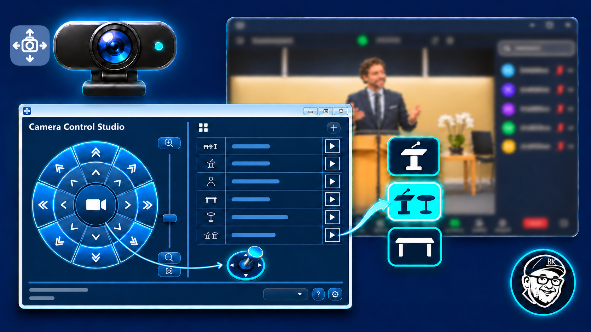
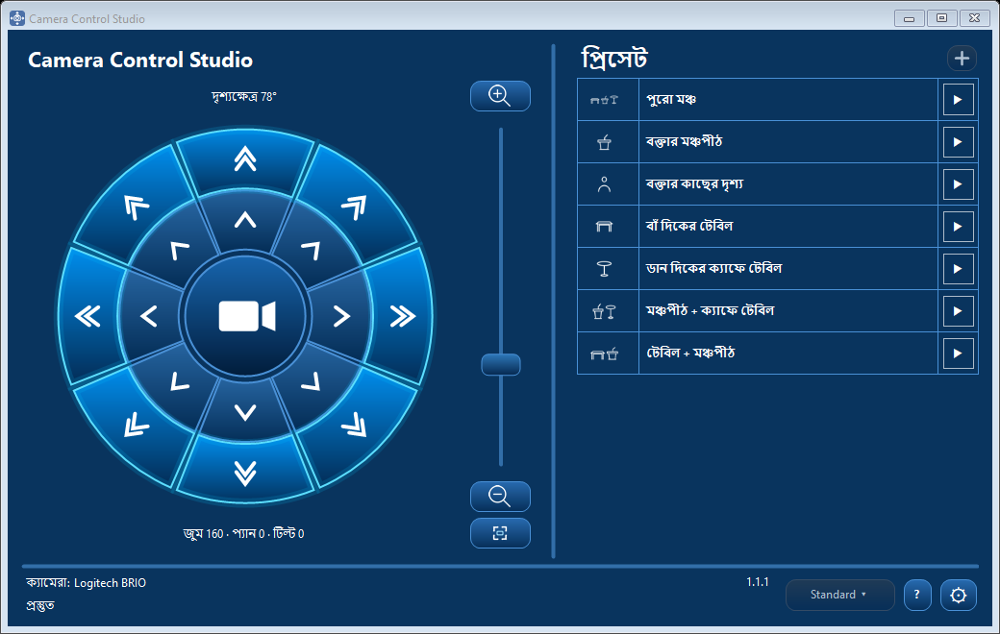
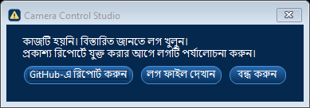

[English](../en/DAILY-USE.md) · [Dansk](../da/DAILY-USE.md) · [Deutsch](../de/DAILY-USE.md) · [সব গাইড ভাষা](USER-GUIDES.md)

# দৈনিক ব্যবহার

* Camera Control Studio 1.1.1.* এর জন্য লেখা

[সমস্যা নিবারণ](TROUBLESHOOTING.md)

জুমের মতো অ্যাপে আপনার স্ট্রিমিং মিটিং শুরু করুন। তারপর **Camera Control Studio** খুলুন।

## সাধারণ

সাহায্যের জন্য **?** ক্লিক করুন। এটির নাম এবং ক্রিয়া দেখতে একটি বোতামের উপর হোভার করুন৷ ক্যামেরা যে শেষ সীমাতে পৌঁছাতে পারে সেখানে একটি দিক লক হয়ে যায়। [কিভাবে স্বয়ংক্রিয় FOV কাজ করে](SETUP.md#%E0%A6%A6%E0%A6%B6%E0%A6%AF%E0%A6%B0-%E0%A6%95%E0%A6%B7%E0%A6%A4%E0%A6%B0-%E0%A6%B8%E0%A6%9F-%E0%A6%95%E0%A6%B0%E0%A6%A8)

## 1. একটি প্রিসেট সক্রিয় করুন৷

পূর্বনির্ধারিত তালিকার একটি সারিতে ▶ ক্লিক করুন বা নামটিতে ডাবল-ক্লিক করুন।
আপনি সারিটি নির্বাচন করতে পারেন এবং এন্টার টিপুন।

| রঙ | অর্থ |
| --- | --- |
| হলুদ | অ্যাপটি ক্যামেরাকে প্রিসেটের দিকে নিয়ে যাচ্ছে। |
| সবুজ | ক্যামেরা ড্রাইভার রিপোর্ট করে যে সংরক্ষিত স্থানাঙ্ক পৌঁছে গেছে। |
| নীল | প্রিসেট সক্রিয় হিসাবে চিহ্নিত করা হয় না. |

সবুজ মানে ড্রাইভার সংরক্ষিত অবস্থান এবং FOV রিপোর্ট করে, যদি সংরক্ষিত হয়। আপনার স্ট্রীমে ছবি চেক করুন. ড্রাইভার সময়মতো শট নিশ্চিত করতে না পারলে, সারিটি নীল হয়ে যায়। কি ঘটেছে দেখতে স্ট্যাটাস বার্তা পড়ুন.

## 2. ফ্রেমিংটি সূক্ষ্ম সুর করুন

### প্যান

স্বাভাবিক নড়াচড়ার জন্য ভিতরের রিং এবং দ্রুত চলার জন্য বাইরের রিং ব্যবহার করুন। প্রতিটি রিং আটটি তীর আছে. প্রতিটি অক্ষে রিংয়ের গতির 45% সহ তির্যকগুলি 45° এ প্যান এবং কাত হয়ে একত্রে চলে। একটি ক্লিক উপলব্ধ অক্ষ প্রতি অন্তত একটি ড্রাইভার পদক্ষেপ সরানো. চলমান রাখতে একটি তীর ধরুন। বন্ধ করতে এটি ছেড়ে দিন।

### চাকার মাঝখানে ক্যামেরা বোতাম

- **ক্যামেরা বেছে নিতে ডাবল ক্লিক করুন।** ক্যামেরা তালিকা খোলে৷
- ** ধরে রাখুন এবং টেনে আনুন। ** ক্যামেরা আইকনে শুরু করুন। প্যান করার জন্য পাশের দিকে টেনে আনুন বা কাত করার জন্য উপরে এবং নীচে। ধীর গতির জন্য একটু টেনে আনুন বা দ্রুত নড়াচড়ার জন্য আরও দূরে, দ্রুত গতির দ্বিগুণ পর্যন্ত। বোতামটি ছেড়ে দিন বা পয়েন্টারটিকে যেখানে আপনি থামতে শুরু করেছিলেন সেখানে নিয়ে যান।

**সেটিংস → প্যানিং** এর অধীনে, ক্যামেরা নির্বাচনের জন্য আপনি টেনে আনা বন্ধ করতে পারেন বা একক ক্লিকে স্যুইচ করতে পারেন। উভয় বিকল্প সক্রিয় প্রোফাইলে সংরক্ষিত হয়.

### জুম

জুম করতে ম্যাগনিফায়ার বোতাম ব্যবহার করুন। ক্রিয়াটি পুনরাবৃত্তি করতে একটি বোতাম চেপে ধরে রাখুন।
আপনি এটি সরানোর সাথে সাথে জুম সামঞ্জস্য করতে স্লাইডারটিকে টেনে আনুন৷

### সম্পূর্ণ ফ্রেম পুনরুদ্ধার করুন

জুম আউট বোতামের নিচে ফ্রেম আইকন সহ বর্গাকার বোতামে ক্লিক করুন। ক্যামেরাটি যতদূর সম্ভব জুম আউট করে এবং সেটির প্রশস্ত ক্ষেত্র নির্বাচন করে যদি এটি সেই সেটিংটিকে সমর্থন করে। এটি ক্যামেরার ছবি পরিবর্তন করে। অ্যাপ উইন্ডো তার আকার রাখে।

### প্যানিং বন্ধ করুন

চলমান একটি প্যান থামাতে Esc টিপুন।

> ম্যানুয়াল প্যান, টিল্ট বা জুম প্রিসেট এ সরানো বাতিল করে এবং সক্রিয় রঙ পরিষ্কার করে।

### তীর কী

চাকার ফোকাস থাকলে তীর কীগুলি ব্যবহার করুন। সূক্ষ্ম পদক্ষেপের জন্য Ctrl বা দ্রুত পদক্ষেপের জন্য Shift ধরে রাখুন।

## 3. একটি অস্থায়ী প্রিসেট সংরক্ষণ করুন

প্রিসেট তালিকার উপরে **+** ক্লিক করুন, একটি নাম লিখুন এবং সংরক্ষণ করুন। বর্তমান অবস্থান স্থায়ী প্রিসেট নীচে প্রদর্শিত হবে.
অস্থায়ী প্রিসেটের কোন আইকন নেই। আপনি অ্যাপটি বন্ধ না করা পর্যন্ত এগুলি স্থায়ী হয় এবং প্রতিটি প্রোফাইল এবং ক্যামেরার জন্য আলাদাভাবে রাখা হয়।

একটি অস্থায়ী সারি নির্বাচন করুন এবং এটি সরাতে প্রিসেট তালিকার উপরে **×** ক্লিক করুন৷ অ্যাপটি বন্ধ হয়ে গেলে সমস্ত অস্থায়ী প্রিসেট মুছে ফেলা হয়।
পরে একটি অবস্থান ব্যবহার করতে, এটি **সেটিংস → প্রিসেট** এর অধীনে তৈরি করুন। আপনি প্রধান তালিকায় স্থায়ী প্রিসেট সম্পাদনা বা মুছে ফেলতে পারবেন না।

## 4. প্রস্থান করুন

যদি একটি নিয়ন্ত্রণ ব্যর্থ হয়, নীচের স্থিতি এলাকায় বার্তা পড়ুন. ক্যামেরা বৈশিষ্ট্য সমর্থন নাও হতে পারে বা অনুপলব্ধ হতে পারে.

অ্যাপটি স্বাভাবিকভাবে বন্ধ করুন। অ্যাপটি সক্রিয় প্রোফাইল এবং উইন্ডো লেআউট মনে রাখে।

## 5. সমস্যা রিপোর্ট করুন

**নতুন সংস্করণ উপলব্ধ** ফুটারে উপস্থিত হলে, GitHub এ রিলিজ খুলতে এবং ডাউনলোডগুলি দেখতে এটি নির্বাচন করুন।

<https://github.com/bkristensen/Camera-Ctrl-Pressets-Studio/releases>

সমস্যা জানাতে বা ফিচারের প্রস্তাব দিতে **যোগাযোগ ও পরিচিতি → যোগাযোগ** খুলুন।

ক্যামেরার দিকনির্দেশ, স্থায়ী প্রিসেট, চিত্র সেটিংস, প্রোফাইল এবং নড়াচড়ার পদক্ষেপের জন্য [Setup](SETUP.md) দেখুন।

## ত্রুটির ডায়ালগ

অপ্রত্যাশিত ত্রুটিতে কোনো কাজ থেমে গেলে ডায়ালগ বন্ধ করে আবার চেষ্টা করুন। ডায়ালগে অ্যাপ বন্ধ হওয়ার কথা জানালে অ্যাপটি আবার খুলুন।

লগ থাকলে **লগ ফাইল দেখান** ফাইল এক্সপ্লোরারে ডায়াগনস্টিক লগটি নির্বাচন করে। **GitHub-এ রিপোর্ট করুন** সাপোর্ট ZIP সংরক্ষণের সুযোগ দেয়, তারপর GitHub-এর বাগ টেমপ্লেট খোলে। ZIP-এ ডায়ালগের স্ক্রিনশট, লগ, প্রোফাইল ও উইন্ডোর সেটিংস এবং সিস্টেম রিপোর্ট থাকতে পারে। ZIP দেখে নিন এবং খসড়ায় নিজে সংযুক্ত করুন।
