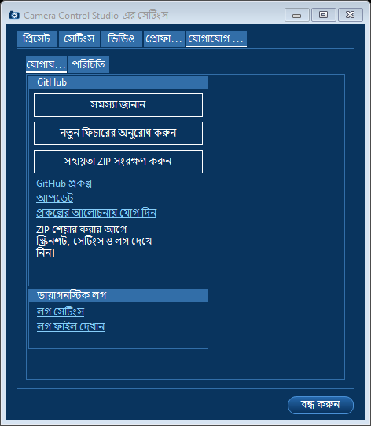

# নতুন ফিচারের অনুরোধ করুন

* Camera Control Studio 1.1.0.* এর জন্য লেখা

1. উইন্ডোর নিচে গিয়ার বোতামে ক্লিক করে সেটিংস খুলুন। **যোগাযোগ ও পরিচিতি → যোগাযোগ → নতুন ফিচারের অনুরোধ করুন** বেছে নিন।
2. নতুন সংস্করণ থাকলে ডাউনলোড পাতা খুলতে **হ্যাঁ** বেছে নিন। সেটি ইনস্টল করে ফিচারটি ইতিমধ্যে আছে কি না দেখুন। GitHub খসড়ায় যেতে **না** বেছে নিন।
3. GitHub-এর **Feature request** টেমপ্লেটে আপনার কাজ, ফিচারটি কীভাবে সাহায্য করবে এবং কোন ফল পেলে বুঝবেন এটি কাজ করছে তা লিখুন। লাল তারকা চিহ্ন দেওয়া সব অংশ পূরণ করুন।

গাইড ভিউয়ারেও একই GitHub বোতাম আছে।

## একটি উদাহরণ সংযুক্ত করুন

প্যাকেজ সেভ করতে **যোগাযোগ ও পরিচিতি → যোগাযোগ → সহায়তা ZIP সংরক্ষণ করুন** বেছে নিয়ে স্থান ঠিক করুন। অ্যাপ ফাইলের পাথ দেখায়।

ZIP-এ অ্যাপের স্ক্রিনশট, সেভ করা `profiles.json`, উইন্ডোর বিন্যাসসহ `window.json` এবং `Logs`-এ থাকা লগ রয়েছে।

শেয়ার করার আগে প্রোফাইলের নাম, ক্যামেরার ID ও ফাইলের পাথের মতো ব্যক্তিগত তথ্য সরান। ZIP বা দরকারি ফাইলগুলো নিজে খসড়ার বিবরণে টেনে দিন।

## ধরন ও লেবেল যাচাই করুন

টেমপ্লেট **Type**-এ **Feature** এবং **Labels**-এ `enhancement` চায়। মানগুলো না থাকলে এবং সম্পাদনার সুযোগ থাকলে ডান দিকের সাইডবার থেকে বেছে নিন। সুযোগ না থাকলে খসড়া জমা দিন। প্রকল্পের রক্ষণাবেক্ষণকারীরা পরে যোগ করতে পারবেন।

**Preview**-তে বিবরণ ও সংযুক্ত ফাইল দেখুন। তারপর **Create** বেছে নিন।
