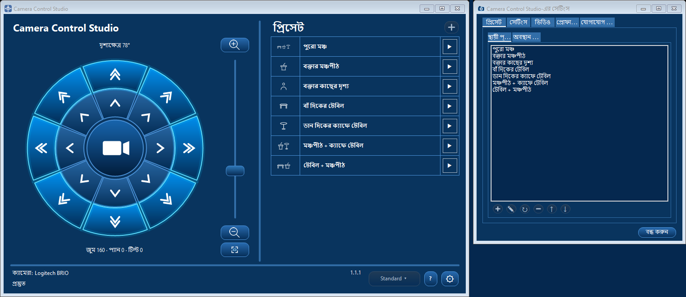
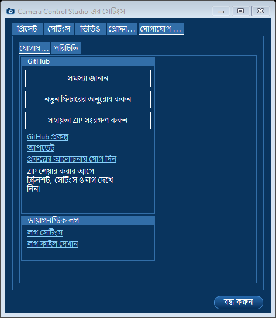
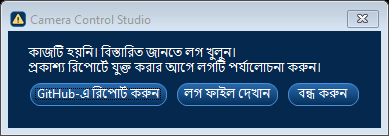

[English](../en/SETUP.md) · [Dansk](../da/SETUP.md) · [Deutsch](../de/SETUP.md) · [সব গাইড ভাষা](USER-GUIDES.md)

# অ্যাপ্লিকেশন সেট আপ করুন

* Camera Control Studio 1.1.1.* এর জন্য লেখা

[সমস্যা নিবারণ](TROUBLESHOOTING.md)

উইন্ডোর নিচে গিয়ার বোতামে ক্লিক করে সেটিংস খুলুন। সেটিংস আলাদা উইন্ডোতে খোলে। মূল উইন্ডো ব্যবহার করতে পারবেন।

## ইনস্টল করুন এবং ডাউনলোডটি যাচাই করুন

**Camera Control Studio** Microsoft Store-এ পাওয়া গেলে সেখান থেকে ডাউনলোড করুন। স্টোরে অ্যাপটির নাম লিখে খুঁজুন। Microsoft স্টোরের প্যাকেজে স্বাক্ষর করে এবং আপডেট দেয়।

Microsoft Store-এ অ্যাপটি এখনও না থাকলে [GitHub রিলিজ](https://github.com/bkristensen/Camera-Ctrl-Pressets-Studio/releases) থেকে ইনস্টলার বা পোর্টেবল ZIP ডাউনলোড করুন। অ্যাপ খোলার আগে ইনস্টলার চালান অথবা পুরো ZIP আনজিপ করুন। রিলিজে SHA-256 চেকসাম থাকলে `Get-FileHash -Algorithm SHA256`-এর ফলের সঙ্গে মিলিয়ে দেখুন।

Microsoft Defender SmartScreen একটি নীল সতর্কতা দেখাতে পারে যখন একটি ডাউনলোড করা অ্যাপ বা এর প্রকাশকের খ্যাতি কম থাকে। সিরিয়াসলি নিন। আপনি যদি অফিসিয়াল রিলিজ থেকে প্রত্যাশিত ফাইলটি পেয়ে থাকেন এবং উৎসে বিশ্বাস করেন, তাহলে **More info** নির্বাচন করুন এবং ফাইলের নাম এবং প্রকাশক পর্যালোচনা করুন। **Run যাইহোক ** নির্বাচন করুন যদি আপনি সেই ফাইলটিকে বিশ্বাস করতে চান এবং উইন্ডোজ বিকল্পটি অফার করে। অন্যথায় সতর্কতা বন্ধ করুন। আপনার প্রতিষ্ঠানের ডিভাইস নীতি অনুসরণ করুন। [Microsoft স্মার্টস্ক্রিন নির্দেশিকা](https://learn.microsoft.com/windows/apps/package-and-deploy/smartscreen-reputation)

<https://learn.microsoft.com/windows/apps/package-and-deploy/smartscreen-reputation>

গাইড দর্শকের যদি WebView2 প্রয়োজন হয়, তাহলে Microsoft থেকে রানটাইম ডাউনলোড করুন।\
<https://developer.microsoft.com/microsoft-edge/webview2/>

আরও তথ্য সহ  এ দেখানো হয়েছে

 এ দেখানো হয়েছে

মূল উইন্ডোর নিচে প্রোফাইল বেছে নিন। সাধারণ সেটিংসে ক্যামেরার উৎস বেছে নিতে চাকার মাঝের ক্যামেরা বোতামে দুবার ক্লিক করুন। প্রোফাইল ক্যামেরাটি মনে রাখে। ক্যামেরা না পেলে অন্য উৎস বেছে নিন।

বিভাগগুলো সেটিংসের ট্যাবের ক্রমে আছে। কোনো বোতাম ম্লান হলে আগে তালিকা থেকে কিছু বেছে নিতে হতে পারে। ভিডিও ট্যাবে কোন নিয়ন্ত্রণ দেখা যাবে তা ক্যামেরার ড্রাইভার ঠিক করে। ফল ক্যাপচার অ্যাপে দেখুন।

**বন্ধ করুন**. দুই উইন্ডোর আকার বা জায়গা বদলান, অথবা মূল উইন্ডোর বিভাজক টানুন। প্রোফাইল এসব মান মনে রাখে। নিচের বন্ধ করুন বোতামটি সেটিংস বন্ধ করে। মূল উইন্ডো খোলা থাকে।

## প্রিসেট

### স্থায়ী প্রিসেট

আগে ক্যামেরা ঠিক দিকে তাক করুন। স্থায়ী প্রিসেট সমর্থিত প্যান, টিল্ট ও জুমের মান রাখে। ক্যামেরা জানালে দৃষ্টিক্ষেত্রও সেভ হয়। প্রিসেট একটি প্রোফাইলের একটি ক্যামেরার জন্য।

- **+ স্থায়ী প্রিসেট যোগ করুন**. বর্তমান ফ্রেম সেভ করুন। চিহ্ন বেছে আলাদা নাম দিন। নামের ঘর খালি হলে চিহ্ন একটি নাম প্রস্তাব করতে পারে। সেভ করতে নাম দিতে হবে। বাতিল করলে তালিকা আগের মতো থাকে।
- **✎ নাম ও আইকন বদলান**. বেছে নেওয়া প্রিসেটের নাম বা চিহ্ন বদলান। সেভ করা ফ্রেম একই থাকে।
- **↻ বর্তমান অবস্থান দিয়ে প্রতিস্থাপন করুন**. বেছে নেওয়া প্রিসেটের ফ্রেমের জায়গায় ক্যামেরার বর্তমান অবস্থান রাখুন। পরিবর্তন নিশ্চিত করুন। নাম ও চিহ্ন একই থাকে।
- **− স্থায়ী প্রিসেট মুছুন**. নিশ্চিত করার পর বেছে নেওয়া প্রিসেট মুছুন।
- **↑ / ↓ নির্বাচিত প্রিসেট ওপরে সরান · নির্বাচিত প্রিসেট নিচে সরান**. দুই তালিকাতেই প্রিসেটকে এক সারি ওপরে বা নিচে নিন। প্রথম সারিতে ওপরের তির ম্লান। শেষ সারিতে নিচের তির ম্লান।

সম্পাদনা, বদল, মোছা বা সরানোর আগে প্রিসেট বেছে নিন। যোগ বা বদল করতে একটি লোড করা প্রোফাইল চাই। ক্যামেরার প্যান, টিল্ট বা জুমের অন্তত একটি নিয়ন্ত্রণ করতে হবে। ক্যামেরা বিচ্ছিন্ন থাকলে অ্যাপ সংযোগের চেষ্টা করতে পারে।

### প্রিসেট ট্রানজিশন সেট করুন

- **প্রিসেট বদলাতে গতি ব্যবহার করুন**. বন্ধ থাকলে সময় নির্দিষ্ট। চালু থাকলে গতি নির্দিষ্ট, তাই ছোট দূরত্ব দ্রুত শেষ হয়। চলমান অক্ষগুলো একসঙ্গে পৌঁছায়।
- **অবস্থান বদলের সময় (সেকেন্ড)**. প্রিসেট বদলাতে কত সময় লাগবে ঠিক করুন। ডিফল্ট ১ সেকেন্ড। গতি মোডে ঘরটি ম্লান থাকে।
- **বদলের গতি (%/সেকেন্ড)**. যে অক্ষ গতি ঠিক করে, তার পুরো সীমার কত শতাংশ প্রতি সেকেন্ডে যাবে ঠিক করুন। ডিফল্ট ৩০%। নির্দিষ্ট সময় মোডে ঘরটি ম্লান।

## সেটিংস

### প্যানিং

- **সূক্ষ্ম গতি (স্বাভাবিকের %)**. সূক্ষ্ম নিয়ন্ত্রণের জন্য Ctrl চেপে তিরচিহ্নের কী চাপুন। ডিফল্ট গতি স্বাভাবিকের ৫০%।
- **স্বাভাবিক প্যানের ধাপ**. ভেতরের বলয়ের সাধারণ তিরের ধাপ ঠিক করুন। ডিফল্ট ১ ধাপ।
- **দ্রুত প্যানের ধাপ**. বাইরের বলয়ের দ্রুত তিরের ধাপ ঠিক করুন। ডিফল্ট ৪ ধাপ। ক্যামেরা বোতাম টানার গতিও এতে বদলায়।
- **ক্যামেরার বাম ও ডান চলাচল উল্টান**. ক্যামেরা উল্টো দিকে চললে ডান ও বাম অদলবদল করুন।
- **ক্যামেরার ওপর ও নিচ চলাচল উল্টান**. ওপর ও নিচ অদলবদল করুন। ক্যামেরা উল্টো করে বসানো থাকলে এটি কাজে লাগে। দুটি বিকল্পই নিয়ন্ত্রণের দিক পাল্টায়। ছবির দিক একই থাকে।
- **ক্যামেরা ঘোরাতে ক্যামেরা বোতাম টানুন**. ক্যামেরা ঘোরাতে চাকার মাঝের বোতাম টানুন। তির দিয়ে চালাতে চাইলে বিকল্পটি বন্ধ করুন।
- **উৎস বেছে নিতে ক্যামেরা বোতামে ডাবল ক্লিক করুন**. চালু থাকলে দুবার ক্লিকে ক্যামেরার তালিকা খোলে। বন্ধ থাকলে একবার ক্লিকেই খোলে।

ক্যামেরা যুক্ত করার আগেও চলাচলের মান বদলানো যায়। ধাপের আকার, চলার দিক ও সীমা ড্রাইভার ঠিক করে।

### জুম ধাপ সেট করুন

- **জুমের ধাপ**. + বা − চাপলে জুম কত ধাপ বদলাবে ঠিক করুন। ডিফল্ট ড্রাইভারের ১ ধাপ। সংযোগের আগেও এটি বদলাতে পারেন। কাজ করতে ক্যামেরায় জুম থাকতে হবে। স্লাইডার বর্তমান দৃষ্টিক্ষেত্রের মধ্যে জুম বেছে নেয়।

### অ্যাপ

- **ক্যামেরা ব্যবহারের আগে স্ট্রিমিং শুরু হয়েছে কি না জিজ্ঞাসা করুন**. ক্যাপচার অ্যাপকে আগে স্ট্রিম চালু করতে হলে এই বিকল্প চালু করুন। পরের ক্যামেরা কাজটি নিশ্চিত করতে বলবে। প্রস্তুত হলে হ্যাঁ দিন। না দিলে ক্যামেরা বিচ্ছিন্ন থাকে। অ্যাপ আবার চালু করলে, প্রোফাইল পাল্টালে বা এই বিকল্প বদলালে প্রশ্নটি ফের আসে। বন্ধ রাখলে অ্যাপ খোলার সময় সংযোগ করা যায়।
- **সব সময় সামনে রাখুন**. মূল উইন্ডোকে অন্য অ্যাপের ওপরে রাখুন। বন্ধ করলে অন্য উইন্ডো এটি ঢাকতে পারে।
- **প্রোফাইলের ভাষা · স্বয়ংক্রিয়**. ১২টি ভাষার একটি বেছে নিন। স্বয়ংক্রিয় বিকল্প Windows-এর ভাষা সমর্থিত হলে সেটি ব্যবহার করে, না হলে ইংরেজি। বদল কার্যকর করতে অ্যাপ আবার চালু করুন। প্রতিটি প্রোফাইলের নিজের ভাষা থাকে।

## ভিডিও

- **ছবির নিয়ন্ত্রণ লোড করুন**. ছবির নিয়ন্ত্রণ দেখাতে ক্যামেরা যুক্ত করুন। ক্যামেরা বিচ্ছিন্ন থাকলে বোতামটি দেখা যায়। ড্রাইভার ছবির নিয়ন্ত্রণ না দিলে শুধু দৃষ্টিক্ষেত্রের ট্যাব থাকে।
- **স্বয়ংক্রিয়**. ড্রাইভার ঠিক করে কোন ট্যাব ও স্লাইডার দেখা যায়। স্বয়ংক্রিয় চালু থাকলে ক্যামেরা মান ঠিক করে। স্লাইডার ব্যবহার করতে বিকল্পটি বন্ধ করুন। শুধু স্বয়ংক্রিয় নিয়ন্ত্রণ থাকলে স্লাইডার ম্লান থাকে এবং বাক্সটি লক থাকতে পারে। শুধু হাতে নিয়ন্ত্রণ থাকলে বাক্স দেখা যায় না।
- **ড্রাইভারের ডিফল্ট ছবি সেটিংস ফিরিয়ে আনুন**. সব সমর্থিত ছবির মান ড্রাইভারের ডিফল্টে ফেরান। ছবির ট্যাবে বোতামটি দেখা যায়। দৃষ্টিক্ষেত্রের ট্যাবে এটি লুকানো থাকে। মান ক্যামেরা ও প্রোফাইল অনুযায়ী সেভ হয়।

### ফোকাস ও এক্সপোজার

- **গেইন**. সিগন্যাল বাড়িয়ে ছবি উজ্জ্বল করুন। বেশি গেইনে দানা বাড়তে পারে।
- **এক্সপোজার**. সেন্সর কতক্ষণ আলো নেবে ঠিক করুন। বেশি সময়ে ছবি উজ্জ্বল হয়, তবে চলন্ত বস্তু ঝাপসা হতে পারে।
- **ফোকাস**. কোন দূরত্বে ছবি স্পষ্ট হবে ঠিক করুন। ক্যাপচার অ্যাপে বিষয়টি পরিষ্কার দেখাচ্ছে কি না দেখুন।

### রং

- **হোয়াইট ব্যালান্স**. আলোর রঙের প্রভাব কমান, যাতে সাদা জিনিস সাদা দেখায়।
- **স্যাচুরেশন**. রং আরও গাঢ় বা ফিকে করুন।
- **গামা**. মাঝারি টোনের উজ্জ্বলতা বদলান।
- **রঙের আভা**. রঙের চাকার ওপর রঙের অবস্থান সরান।

### আলো ও সূক্ষ্মতা

- **বৈপরীত্য**. আলো ও অন্ধকার অংশের পার্থক্য বদলান।
- **উজ্জ্বলতা**. পুরো ছবি উজ্জ্বল বা গাঢ় করুন।
- **পেছনের আলোর ক্ষতিপূরণ**. পেছনে তীব্র আলো থাকলে সামনের বিষয় উজ্জ্বল করুন।
- **তীক্ষ্ণতা**. কিনারা বেশি স্পষ্ট বা নরম করুন।

### দৃশ্যের ক্ষেত্র সেট করুন

দৃষ্টিক্ষেত্র (FOV) হলো ফ্রেমে দৃশ্যের কতটা দেখা যায়। বড় কোণে বেশি দেখা যায়। জুম সেই কোণের মধ্যে ছবির কাটছাঁট বদলায়।

- **চালুর সময় দৃশ্যক্ষেত্র · সবচেয়ে প্রশস্ত · যেমন আছে রাখুন**. সবচেয়ে বড় কোণ নিন, বর্তমান কোণ রাখুন, অথবা ড্রাইভারের দেওয়া কোণ বাছুন। অ্যাপ এই সেশনের প্রথম সংযোগে সেটি প্রয়োগের চেষ্টা করে। যুক্ত ক্যামেরা অন্তত একটি কোণ না জানানো পর্যন্ত তালিকা ম্লান থাকে।
- **দৃশ্যক্ষেত্র নিজে বদলাতে দিন**. চাকার নিচে কোণ বেছে নেওয়ার তালিকা দেখান। বিকল্পটি বন্ধ থাকলে অ্যাপ পড়তে পারা বর্তমান কোণ দেখায়। দুটির কম কোণ থাকলে বিকল্পটি ম্লান।
- **জুম ও প্যানের সীমায় দৃশ্যক্ষেত্র বদলান**. জুমের সীমায় আবার চাপুন। জুম কমালে অ্যাপ বড় কোণ এবং জুম বাড়ালে ছোট কোণ চেষ্টা করে। বাঁ বা ডান দিকে শেষ সীমায় বেশি জায়গা দেয় এমন কোণ খোঁজে। ফ্রেম কাছাকাছি রাখার চেষ্টা করে এবং আর সরতে না পারলে পুরোনো ফ্রেম ফেরায়। হাতে কোণ বাছা বন্ধ থাকলেও এটি চলে। দুটির কম কোণ থাকলে বিকল্পটি ম্লান।

যেমন Brio ৬৫° ও সর্বনিম্ন জুমে থাকলে − চাপলে ৭৮° চেষ্টা করতে পারে। সেই কোণে জুম কমাতে আবার চাপুন। ফ্রেম বোতাম একসঙ্গে সবচেয়ে বড় কোণ ও সর্বনিম্ন জুম চেষ্টা করে। অন্য অ্যাপও ক্যামেরা চালালে ফল দেখে নিন।

## প্রোফাইল

- **+ নতুন প্রোফাইল**. ডিফল্ট সেটিংস দিয়ে একটি প্রোফাইল তৈরি করে চালু করুন। আলাদা নাম দিন।
- **⧉ সক্রিয় প্রোফাইল কপি করুন**. সক্রিয় প্রোফাইলের সেটিংস ও প্রিসেট কপি করুন। অ্যাপ কপিটিতে যায়। অন্য সারি বাছলেও কপির উৎস বদলায় না।
- **✎ নির্বাচিত প্রোফাইলের নাম বদলান**. বেছে নেওয়া প্রোফাইলের নাম বদলান। কিছু বাছা না থাকলে বা Standard বাছলে বোতাম ম্লান। নতুন বা কপি করতে একটি প্রোফাইল লোড থাকতে হবে। তিনটি নামের ঘরেই নিশ্চিত করতে নাম দিতে হবে।
- **বর্তমান অবস্থান ও বিন্যাস রাখুন**. বদলের ডায়ালগ খুলতে প্রোফাইলে দুবার ক্লিক করুন। লেআউট বিকল্প চালু করলে বর্তমান উইন্ডোর জায়গা, আকার ও বিভাজক সঙ্গে যায়। বন্ধ রাখলে গন্তব্য প্রোফাইলের সেভ করা লেআউট ব্যবহৃত হয়। বদল করলে অ্যাপ আবার চালু হয় এবং অস্থায়ী প্রিসেট মুছে যায়।

## যোগাযোগ ও পরিচিতি

### যোগাযোগ

- **সমস্যা জানান**. GitHub-এ ত্রুটি জানানোর ছাঁচ খুলুন। নতুন সংস্করণ থাকলে অ্যাপ আগে সেটি খুলতে বলে। চালিয়ে গেলে খসড়ার আগে সাপোর্ট ZIP সেভ করার বিকল্প দেয়।
- **নতুন ফিচারের অনুরোধ করুন**. নতুন সুবিধা চাওয়ার ছাঁচ খুলুন। নতুন সংস্করণ থাকলে আগে চেষ্টা করুন। সুবিধাটি তাতে থাকতে পারে।
- **সহায়তা ZIP সংরক্ষণ করুন**. স্ক্রিনশট, পাওয়া লগ, প্রোফাইলের তথ্য ও উইন্ডোর লেআউট একটি ZIP-এ রাখুন। ব্যক্তিগত তথ্য যাচাই করুন। GitHub-এর খসড়ায় ফাইল নিজে যোগ করুন। কাজ চলার সময় তিনটি বোতাম সাময়িক ম্লান থাকে।
- **GitHub প্রকল্প · GitHub রিলিজ · প্রকল্পের আলোচনায় যোগ দিন**. তিনটি GitHub লিংক প্রকল্পের কোড, সংস্করণের ডাউনলোড বা আলোচনা খোলে।

[সমস্যা জানান](Report%20a%20bug.md) · [নতুন ফিচারের অনুরোধ করুন](Request%20a%20feature.md)

### ডায়াগনস্টিক লগ

- **লগ সেটিংস**. লগের সেটিংস খুলুন। এগুলো সব প্রোফাইলে প্রযোজ্য। সেভ করলে বদল কার্যকর হয়। বাতিল করলে আগের মান থাকে।
- **ফোল্ডার বেছে নিন · স্বয়ংক্রিয়**. ফোল্ডার বাছুন বা স্বয়ংক্রিয় রাখুন। ঠিকানার ঘরে সরাসরি লেখা যায় না। স্বয়ংক্রিয় বিকল্প অ্যাপের ফোল্ডার ব্যবহার করে। প্রয়োজনে `%LOCALAPPDATA%\CamPressets\Logs` ব্যবহার করে।
- **প্রতি ফাইলের সর্বোচ্চ আকার (MiB)**. কখন নতুন লগ শুরু হবে ঠিক করুন। ডিফল্ট প্রতি ফাইলে ১ MiB।
- **সর্বোচ্চ লগ ফাইল (সক্রিয়টিসহ)**. বর্তমানটি সহ কতটি লগ থাকবে ঠিক করুন। ডিফল্ট ২টি।
- **লগ ফাইল দেখান**. ফাইল এক্সপ্লোরারে সর্বশেষ লগ বেছে দেখান। লগ না থাকলে অ্যাপ জানায়।

### পরিচিতি

- **আমাকে এক কাপ কফি কিনে দিন**. ইনস্টল করা সংস্করণ ও ডেভেলপারের নাম দেখুন। পুরো বিল্ড আইডি দেখতে সংস্করণের ওপর মাউস রাখুন। সহায়তার লিংক ডেভেলপারের সহায়তা পাতা খোলে।
- **নির্দেশিকা খুলুন**. এই ট্যাবে গাইড খুলুন। মূল উইন্ডোর সাহায্য বোতামও গাইড খোলে।

ব্যাকআপ নিতে অ্যাপ বন্ধ করে `%LOCALAPPDATA%\CamPressets` কপি করুন। অস্থায়ী প্রিসেট কেবল বর্তমান সেশন পর্যন্ত থাকে।

[দৈনন্দিন ব্যবহার](DAILY-USE.md)

## ত্রুটির ডায়ালগ

অপ্রত্যাশিত ত্রুটিতে কোনো কাজ থেমে গেলে ডায়ালগ বন্ধ করে আবার চেষ্টা করুন। ডায়ালগে অ্যাপ বন্ধ হওয়ার কথা জানালে অ্যাপটি আবার খুলুন।

লগ থাকলে **লগ ফাইল দেখান** ফাইল এক্সপ্লোরারে ডায়াগনস্টিক লগটি নির্বাচন করে। **GitHub-এ রিপোর্ট করুন** সাপোর্ট ZIP সংরক্ষণের সুযোগ দেয়, তারপর GitHub-এর বাগ টেমপ্লেট খোলে। ZIP-এ ডায়ালগের স্ক্রিনশট, লগ, প্রোফাইল ও উইন্ডোর সেটিংস এবং সিস্টেম রিপোর্ট থাকতে পারে। ZIP দেখে নিন এবং খসড়ায় নিজে সংযুক্ত করুন।
