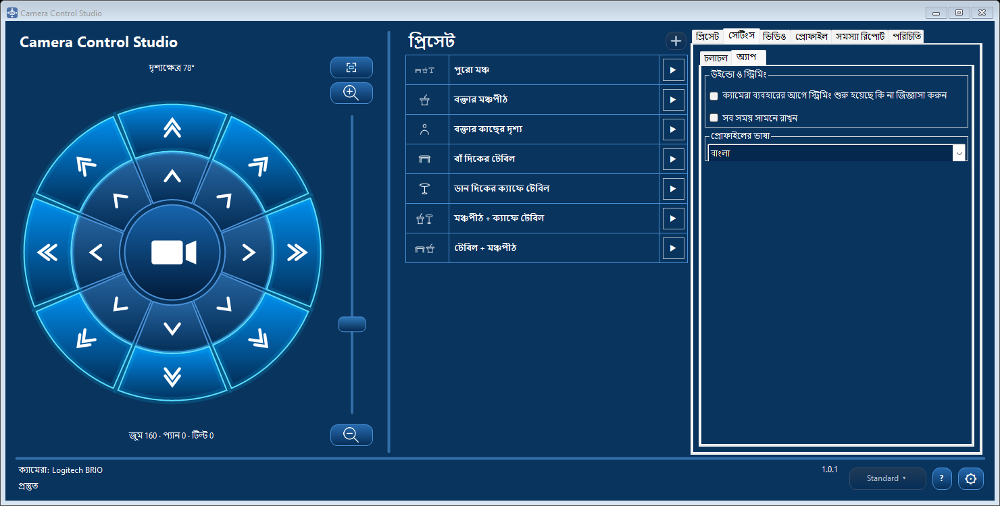
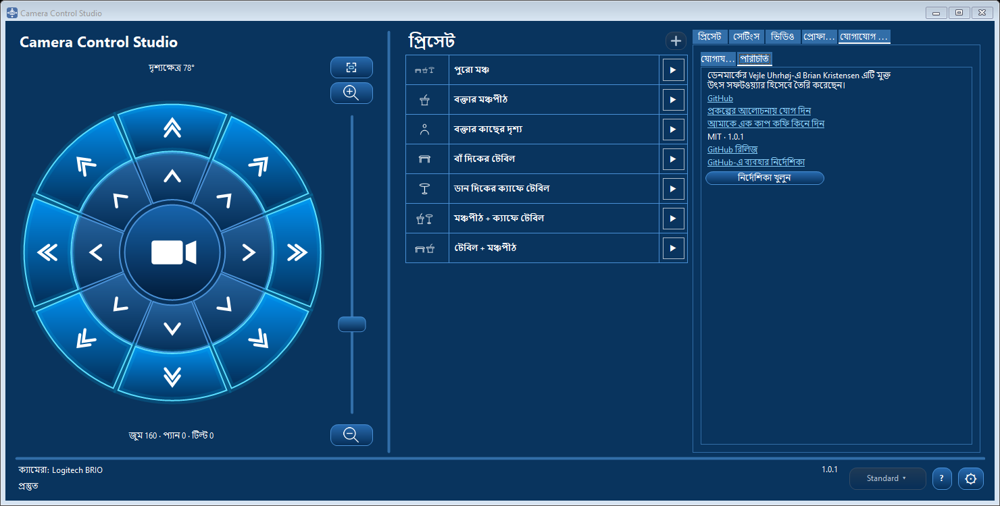
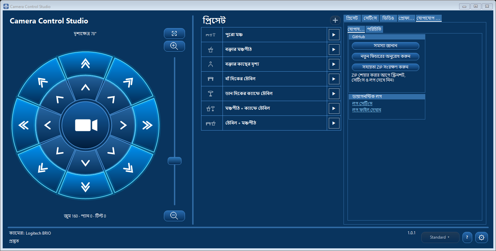

[English](../en/SETUP.md) · [Dansk](../da/SETUP.md) · [Deutsch](../de/SETUP.md) · [সব গাইড ভাষা](USER-GUIDES.md)

# অ্যাপ্লিকেশন সেট আপ করুন

* Camera Control Studio 1.0.1.* এর জন্য লেখা

[সমস্যা নিবারণ](TROUBLESHOOTING.md)

ফুটারে গিয়ার খুলুন। সেটিংস ডানদিকে খোলা। আপনার অবস্থানের তালিকা দৃশ্যমান থাকে।

## ইনস্টল করুন এবং ডাউনলোডটি যাচাই করুন

ইনস্টলার বা পোর্টেবল ডাউনলোড করুন ZIP প্রকল্প থেকে [GitHub প্রকাশ করে](https://github.com/bkristensen/Camera-Ctrl-Pressets-Studio/releases). ইনস্টলার চালান বা সম্পূর্ণ নিষ্কাশন ZIP অ্যাপটি চালু করার আগে। যদি ক SHA-256 চেকসাম প্রকাশিত হয়েছে, এর সাথে তুলনা করুন `Get-FileHash -Algorithm SHA256` আপনার ডাউনলোডের জন্য।

**অফিশিয়াল ডাউনলোড**\
<https://github.com/bkristensen/Camera-Ctrl-Pressets-Studio/releases>\

Microsoft Defender SmartScreen একটি নীল সতর্কতা দেখাতে পারে যখন একটি ডাউনলোড করা অ্যাপ বা এর প্রকাশকের খ্যাতি কম থাকে। সিরিয়াসলি নিন। আপনি যদি অফিসিয়াল রিলিজ থেকে প্রত্যাশিত ফাইলটি পেয়ে থাকেন এবং উৎসে বিশ্বাস করেন, তাহলে **More info** নির্বাচন করুন এবং ফাইলের নাম এবং প্রকাশক পর্যালোচনা করুন। **Run যাইহোক ** নির্বাচন করুন যদি আপনি সেই ফাইলটিকে বিশ্বাস করতে চান এবং উইন্ডোজ বিকল্পটি অফার করে। অন্যথায় সতর্কতা বন্ধ করুন। আপনার প্রতিষ্ঠানের ডিভাইস নীতি অনুসরণ করুন। [Microsoft স্মার্টস্ক্রিন নির্দেশিকা](https://learn.microsoft.com/windows/apps/package-and-deploy/smartscreen-reputation)

<https://learn.microsoft.com/windows/apps/package-and-deploy/smartscreen-reputation>

গাইড দর্শকের যদি WebView2 প্রয়োজন হয়, তাহলে Microsoft থেকে রানটাইম ডাউনলোড করুন।\
<https://developer.microsoft.com/microsoft-edge/webview2/>

আরও তথ্য সহ  এ দেখানো হয়েছে

 এ দেখানো হয়েছে

## 1. একটি প্রোফাইল এবং ক্যামেরা চয়ন করুন৷

একটি প্রোফাইল নির্বাচন করতে ফুটারে প্রোফাইল পিকার ব্যবহার করুন। একটি তৈরি করতে, **সেটিংস → প্রোফাইল** খুলুন। ডিফল্ট সেটিংসের জন্য **New** বা সক্রিয় প্রোফাইলের একটি অনুলিপির জন্য **Copy** বেছে নিন। একজন ব্যক্তি বা সেটআপের পরে এটির নাম দিন। নতুন প্রোফাইল সক্রিয় হয়ে ওঠে। **প্রোফাইল**-এ, একটি প্রোফাইল নির্বাচন করুন এবং এটির নাম পরিবর্তন করতে **✎** এ ক্লিক করুন। স্ট্যান্ডার্ড প্রোফাইলের একটি নির্দিষ্ট নাম আছে।

একটি ক্যামেরা নির্বাচন করতে দিক চাকার কেন্দ্রে ক্যামেরা চিহ্নে ডাবল-ক্লিক করুন। প্রোগ্রাম এটা মনে রাখে. সেই ক্যামেরাটি অনুপস্থিত থাকলে, অন্য একটি উৎস বেছে নিন। অবস্থানগুলি একটি প্রোফাইলের মধ্যে একটি ক্যামেরার অন্তর্গত৷

 সহ প্রোফাইল ট্যাব

## 2. ক্যামেরা নিয়ন্ত্রণ কখন শুরু হতে পারে তা স্থির করুন৷

**সেটিংস → অ্যাপ** এর অধীনে, **ক্যামেরা ব্যবহারের আগে স্ট্রিমিং শুরু হয়েছে কি না জিজ্ঞাসা করুন** সক্ষম করুন যদি আপনার ক্যাপচার প্রোগ্রাম প্রথমে শুরু করতে হয়। এই বিকল্পটি ডিফল্টরূপে বন্ধ।

বিকল্পটি সক্ষম করার সাথে, প্রথম ক্যামেরা অ্যাকশন জিজ্ঞাসা করে যে স্ট্রিমিং শুরু হয়েছে কিনা। শুধুমাত্র তখনই **Yes** বেছে নিন। ক্যামেরা নিয়ন্ত্রণ বিচ্ছিন্ন রাখতে **No** বেছে নিন। হ্যাঁ এর পরে, আপনি প্রোফাইল পরিবর্তন না করা পর্যন্ত, এই বিকল্পটি পরিবর্তন না করা বা অ্যাপটি পুনরায় চালু না করা পর্যন্ত পরবর্তী ক্রিয়াকলাপ আবার জিজ্ঞাসা করা হবে না। অ্যাপটি আপনার জন্য একটি স্ট্রিমিং সেশন সনাক্ত বা শুরু করে না।

আপনার যদি প্রথম ব্যবহারে এই অর্ডারের প্রয়োজন হয়, আপনার পরবর্তী সেশনের আগে বিকল্পটি সেট করুন। ডিফল্ট অ্যাপটিকে স্টার্টআপে সংযোগ করার অনুমতি দেয়।

## 3. আন্দোলন এবং জুম সেট করুন

প্যান এবং কাত পদক্ষেপগুলি সেট করতে, বিপরীত দিকনির্দেশ, এবং ক্যামেরা বোতাম কীভাবে কাজ করে তা চয়ন করতে **সেটিংস → প্যানিং** খুলুন৷ ছোট পদক্ষেপ দিয়ে শুরু করুন। আপনার ক্যাপচার প্রোগ্রামে ফলাফল পরীক্ষা করুন.

| সেটিং | এটা কি পরিবর্তন | ডিফল্ট |
| --- | --- | --- |
| সূক্ষ্ম গতি (সাধারণের%) | Ctrl এবং একটি তীর কী ধরে রাখার সময় রেট করুন | 50% |
| সাধারণ প্যান ধাপ | মাঝের তীর রিং | 1 |
| দ্রুত প্যান পদক্ষেপ | বাইরের তীর রিং | 4 |

এক ধাপ মানে ক্যামেরা ড্রাইভার দ্বারা সমর্থিত এক ধাপ। এটি একটি নির্দিষ্ট দূরত্ব বা শতাংশ নয়। ড্রাইভার চলাচল এবং মসৃণতা সীমিত করে।

একটি উলটো-ডাউন ক্যামেরার জন্য, **ক্যামেরার ওপর ও নিচ চলাচল উল্টান** সক্ষম করুন এবং পরীক্ষা করুন। **ক্যামেরার বাম ও ডান চলাচল উল্টান** সক্ষম করুন শুধুমাত্র যদি বামে ভুল পথে চলে যায়। এই সেটিংস নিয়ন্ত্রণ পরিবর্তন. তারা ভিডিও ঘোরান না।

### জুম ধাপ সেট করুন

প্লাস এবং মাইনাস বোতামগুলি এক ধাপে কতদূর সরে যায় তা চয়ন করতে **সেটিংস → জুম** খুলুন৷ ডিফল্ট হল এক ড্রাইভার ধাপ। [ জুম ট্যাব](../images/screenshots/settings-tabs/en/zoom.png) দেখুন।

### প্রিসেট ট্রানজিশন সেট করুন

ক্যামেরা কীভাবে সংরক্ষিত অবস্থানের মধ্যে চলে তা চয়ন করতে **প্রিসেট → অবস্থান পরিবর্তন** খুলুন৷ [ ট্রানজিশন ট্যাব](../images/screenshots/settings-tabs/en/transitions.png) দেখুন।

| সেটিং | এটা কি পরিবর্তন | ডিফল্ট |
| --- | --- | --- |
| প্রিসেট ট্রানজিশনের জন্য গতি ব্যবহার করুন | ভ্রমণের দূরত্ব সময়কাল নির্ধারণ করুন | বন্ধ |
| স্থানান্তর গতি (%/s) | প্রতি সেকেন্ডে নিয়ন্ত্রণকারী অক্ষের পরিসরের শতাংশ হিসাবে ক্রুজ রেট | 30% |
| স্থানান্তর (সেকেন্ড) | নির্দিষ্ট সময়কাল মোডে প্রতিটি প্রিসেট পরিবর্তনের সময় | 1.0 |

গতি-ভিত্তিক ট্রানজিশনের সাথে, একটি ছোট সরে যেতে একটি দীর্ঘ সময়ের চেয়ে কম সময় লাগে। অ্যাপটি ত্বরান্বিত করে এবং ব্রেক করে, এবং সমস্ত চলমান অক্ষ একই অগ্রগতি ভাগ করে যাতে তারা একসাথে লক্ষ্যে পৌঁছাতে পারে।

### দৃশ্যের ক্ষেত্র সেট করুন

**ভিডিও → দৃশ্যক্ষেত্র** খুলুন। **চালুর সময় দৃশ্যক্ষেত্র** এর অধীনে, **সবচেয়ে প্রশস্ত**, ক্যামেরা ড্রাইভার দ্বারা রিপোর্ট করা একটি কোণ বা বর্তমান দৃশ্যটি রাখতে **যেমন আছে রাখুন** বেছে নিন। অ্যাপটি প্রথমবার সংযোগ করার সময় এই পছন্দটি ব্যবহার করে। দিক চাকার নীচে রিপোর্ট করা কোণগুলির মধ্যে বেছে নিতে **দৃশ্যক্ষেত্র নিজে বদলাতে দিন** চালু করুন। যদি ড্রাইভার কোন নির্বাচনযোগ্য কোণ না জানায়, তাহলে FOV নিয়ন্ত্রণ নিষ্ক্রিয় করা হয়। আপনি এখনও জুম ব্যবহার করতে পারেন যদি ক্যামেরা এটি সমর্থন করে। [ দেখার ক্ষেত্র ট্যাব](../images/screenshots/settings-tabs/en/field-of-view.png) দেখুন।

**জুম ও প্যানের সীমায় দৃশ্যক্ষেত্র বদলান** ডিফল্টরূপে চালু আছে। আপনি লুকানো ম্যানুয়াল পিকার দিয়ে এটি ব্যবহার করতে পারেন। ড্রাইভার FOV সমর্থন করলে এটি কাজ করে।

- **Zoom out:** একটি Brio-এ ন্যূনতম জুম 65° সেট করে, 78° এ স্যুইচ করতে আবার জুম আউট টিপুন। সেই প্রেসটি FOV পরিবর্তন করে এবং শটটিকে কাছাকাছি রাখতে জুম সামঞ্জস্য করে। পরবর্তী প্রেস স্বাভাবিকভাবে জুম আউট. একই পদক্ষেপগুলি আপনাকে 78° থেকে 90° পর্যন্ত নিয়ে যায়। বোতামটি 90° এবং সর্বনিম্ন জুম এ থামে।
- **Zoom in:** সর্বাধিক জুমে, একটি সংকীর্ণ FOV এর দিকে যেতে আবার টিপুন৷ ড্রাইভার যদি 90°, 78° এবং 65° রিপোর্ট করে, অ্যাপটি সেই ক্রমে সেগুলি ব্যবহার করে। বোতামটি সংকীর্ণ উপলব্ধ কোণ এবং সর্বাধিক জুমে থামে।
- **Pan বাম বা ডান:** প্রান্তে, অ্যাপটি প্রথমে একটি বিস্তৃত দৃশ্য চেষ্টা করে। ক্রপ বন্ধ রাখতে এটি জুম সামঞ্জস্য করে। এটি একটি সংকীর্ণ দৃশ্য চেষ্টা করতে পারে যদি জুম এটির অনুমতি দেয়। যদি কোন ভিউ এটিকে আরও প্যান করতে না দেয় তবে এটি পূর্ববর্তী শটটি পুনরুদ্ধার করে। চালক নিয়ন্ত্রণ করেন ম্যাচ কতটা কাছাকাছি।

চওড়া FOV এবং সর্বনিম্ন জুমে সরাসরি যেতে ফ্রেম প্রতীক সহ বর্গাকার বোতামটি ব্যবহার করুন৷ স্লাইডারটি এখনও বর্তমান FOV এর মধ্যে জুম সেট করে। বর্তমান দৃশ্যের মধ্যে জুম এবং প্যান রাখতে স্বয়ংক্রিয় FOV বন্ধ করুন।

প্রিসেটগুলি প্যান, টিল্ট, জুম এবং ড্রাইভার দ্বারা রিপোর্ট করা FOV সংরক্ষণ করে৷ পুরানো প্রিসেট বর্তমান FOV রাখে। জুম, লজিটেক ব্রায়ো কন্ট্রোল বা অন্য অ্যাপ ক্রপ নিয়ন্ত্রণ করে কিনা তা লাইভ ইমেজ চেক করুন। [Brio এবং জুম পরীক্ষার ধাপ ](VALIDATION.md#brio-%E0%A6%AB%E0%A6%B2%E0%A6%A1-%E0%A6%85%E0%A6%AC-%E0%A6%AD%E0%A6%89-%E0%A6%8F%E0%A6%AC-%E0%A6%9C%E0%A6%AE)

## 4. চিত্র সামঞ্জস্য করুন এবং স্থায়ী অবস্থান সংরক্ষণ করুন

[ভিডিও নিয়ন্ত্রণ লোড করার আগে](../images/screenshots/settings-tabs/en/video.png) · [রঙ](../images/screenshots/1.0.1/en/video-colour.png) · [হালকা এবং বিস্তারিত](../images/screenshots/1.0.1/en/video-light-detail.png)

সেটিংস প্যানে **ভিডিও** খুলুন, তারপর প্রয়োজন হলে চিত্র নিয়ন্ত্রণগুলি লোড করুন৷ **ফোকাস ও এক্সপোজার**, **রং**, বা **আলো ও সূক্ষ্মতা** এর মতো একটি গ্রুপ বেছে নিন। শুধুমাত্র ড্রাইভার দ্বারা উন্মুক্ত নিয়ন্ত্রণ প্রদর্শিত হয়. উজ্জ্বলতা, বৈসাদৃশ্য, রঙ স্যাচুরেশন, ফোকাস বা সাদা ভারসাম্য যখন উপলব্ধ হবে তখন সামঞ্জস্য করুন। ম্যানুয়াল সামঞ্জস্য করার আগে স্বয়ংক্রিয় মোড বন্ধ করুন। ছবির মান ক্যামেরা এবং প্রোফাইল প্রতি সংরক্ষণ করা হয়. রিসেট বোতামটি ড্রাইভারের ডিফল্টগুলি পুনরুদ্ধার করে।

প্রথমে ক্যামেরা সরান। সেটিংস প্যানে **প্রিসেট** খুলুন। একটি স্থায়ী প্রিসেট যোগ করতে **+** ক্লিক করুন। শীর্ষে একটি আইকন নির্বাচন করুন, নাম পরীক্ষা করুন, তারপর সংরক্ষণ করুন৷ যদি নামটি ফাঁকা এবং অব্যবহৃত হয়, তাহলে একটি আইকন নির্বাচন করা তার নাম প্রস্তাব করে। সম্মিলিত প্রতীকগুলি তাদের বিষয়গুলিকে বাম থেকে ডানে দেখায়।

**স্থায়ী প্রিসেট** এর অধীনে, একটি অবস্থান নির্বাচন করুন। তার কর্মের জন্য একটি প্রতীকের উপর হোভার করুন। এটির নাম এবং প্রতীক সম্পাদনা করতে **✎** ব্যবহার করুন, বর্তমান ক্যামেরার অবস্থানটি তার জায়গায় সংরক্ষণ করতে **↻** এবং এটি মুছতে **−** ব্যবহার করুন৷ উভয় তালিকার ক্রম পরিবর্তন করতে **↑** এবং **↓** ব্যবহার করুন৷ স্থায়ী পদগুলি মোটা অক্ষরে প্রধান তালিকার শীর্ষে থাকে।

মূল তালিকায় একটি স্থায়ী সারি নির্বাচন করা সেটিংসে সেই প্রিসেটটিকেও নির্বাচন করে। একটি নতুন সংরক্ষিত প্রিসেট সেটিংসে নির্বাচন করা হয়েছে৷

## 5. লেআউট এবং ভাষা সেট করুন

ক্যামেরা নিয়ন্ত্রণ এবং প্রিসেট তালিকার মধ্যে বিভাজকটি টেনে আনুন। আপনার প্রোফাইল ডিভাইডার এবং উইন্ডোর আকার এবং অবস্থান সংরক্ষণ করে। প্রাথমিক আকার হল 900 × 500, এবং সর্বনিম্ন হল 670 × 450৷ সেটিংস বন্ধ করা শুরু৷ লঞ্চের পরে আপনি যখন প্রথম এগুলি খুলবেন, প্রথম ট্যাবটি নির্বাচন করা হবে। কিছু ক্ষেত্র উইন্ডোর নিচে থাকলে **প্যানিং** বা **অ্যাপ**-এ স্ক্রোল করুন। অ্যাপটি সেটিংস বন্ধ করে উইন্ডোর প্রস্থ সংরক্ষণ করে।

ফুটারে একটি প্রোফাইল নির্বাচন করার সময়, সেই প্রোফাইলের বিন্যাস পুনরুদ্ধার করতে **বর্তমান অবস্থান ও বিন্যাস রাখুন** টিক চিহ্ন ছাড়াই ছেড়ে দিন। নির্বাচিত প্রোফাইলে বর্তমান লেআউট বহন করতে এটি পরীক্ষা করুন। পছন্দটি আপনার ছেড়ে যাওয়া প্রোফাইলে মনে রাখা হয়; বাহিত বিন্যাস গন্তব্য প্রোফাইলে সংরক্ষিত হয়।

**সেটিংস → অ্যাপ → প্রোফাইলের ভাষা** এর অধীনে একটি ভাষা চয়ন করুন, তারপর এটি প্রয়োগ করতে পুনরায় চালু করুন। **স্বয়ংক্রিয়** সমর্থিত হলে Windows প্রদর্শন ভাষা ব্যবহার করে এবং অন্যথায় ইংরেজি। প্রোফাইল স্যুইচ করা নির্বাচিত প্রোফাইলের ভাষা দিয়ে অ্যাপ্লিকেশন পুনরায় আরম্ভ করে। অস্থায়ী প্রিসেটগুলি পুনরায় চালু হলে শেষ হয়।

## 6. সংস্করণ এবং প্রকল্পের তথ্য

অ্যাপের সংস্করণ ও প্রকল্পের লিঙ্ক দেখতে **যোগাযোগ ও পরিচিতি → পরিচিতি** খুলুন। সম্পূর্ণ বিল্ড ID দেখতে সংস্করণের উপর পয়েন্টার রাখুন। সমস্যা নির্দিষ্ট বিল্ডে হলে সেই ID লিখুন।

## 7. ডায়াগনস্টিক লগ এবং সমস্যা রিপোর্টিং

লগের ফোল্ডার, সর্বোচ্চ ফাইলের আকার ও বর্তমান ফাইলসহ মোট সংখ্যা ঠিক করতে **যোগাযোগ ও পরিচিতি → যোগাযোগ** খুলুন। অ্যাপ সাধারণত নিজের ফোল্ডার ব্যবহার করে। সেটি না পেলে `%LOCALAPPDATA%\CamPressets\Logs` ব্যবহার করে।

সঠিক GitHub খসড়া খুলতে **সমস্যা জানান** বা **নতুন ফিচারের অনুরোধ করুন** বেছে নিন। সমস্যা জানালে অ্যাপ সহায়তা ZIP সেভ করার সুযোগ দেয়। ZIP দেখে নিজে খসড়ায় যোগ করুন। [সমস্যা জানান বা অনুসরণ করুন](ISSUES.md)

** একটি বাগ রিপোর্ট করুন বা একটি বৈশিষ্ট্য ** প্রস্তাব করুন৷\
<https://github.com/bkristensen/Camera-Ctrl-Pressets-Studio/issues?q=is%3Aissue>\

পরবর্তী: [ প্রতিদিন ](DAILY-USE.md) ব্যবহার করুন। ব্যাকআপের জন্য, অ্যাপ বন্ধ করুন এবং `%LOCALAPPDATA%\CamPressets` অনুলিপি করুন। অস্থায়ী অবস্থানগুলি ব্যাকআপের অংশ নয়।
