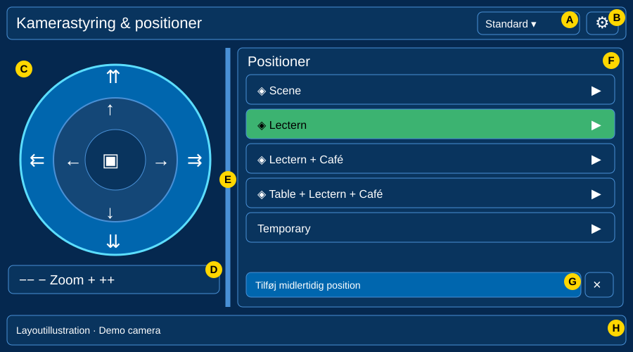

[English](../en/DAILY-USE.md) · [Dansk](../da/DAILY-USE.md) · [Deutsch](../de/DAILY-USE.md)

# Daglig brug

Start først dit optageprogram og din stream, hvis din opstilling kræver det. Åbn **Camera Control Studio.exe**.

*Layoutillustration, ikke et Windows-skærmbillede. Bogstaverne henviser til knapperne nedenfor. Se [optagelse af billeder](../SCREENSHOTS.md).*

## 1. Vælg din opstilling

Tryk **A**, og vælg profil. Lad fluebenet for vinduets udseende være slået fra for at hente profilens gemte vindue. Sæt det kun, hvis du vil beholde det nuværende udseende.

Programmet bruger det seneste kamera. Skift kamera ved at trykke på kamerasymbolet i **C**. Hvis du bliver spurgt om streaming, skal du først svare Ja, når den er startet. Nej lader kameraet være frakoblet.

## 2. Aktivér en position

Tryk ▶ på en række i **F**, eller dobbeltklik på navnet. Du kan også markere rækken og trykke Enter.

| Farve | Betydning |
| --- | --- |
| Gul | Programmet flytter mod positionen. |
| Grøn | Kameradriveren melder, at de gemte koordinater er nået. |
| Blå | Positionen er ikke markeret som aktiv. |

Grøn bekræfter de meldte koordinater. Kontrollér selve billedet i dit optageprogram. Melder driveren ikke positionen nået i tide, bliver rækken blå, og **H** viser en besked. Ikonerne bliver stående hele tiden.

## 3. Finjustér billedudsnittet

Brug de inderste pile i **C** til normal bevægelse. De yderste pile bruger større trin. I **D** giver − og + normal zoom. −− og ++ giver hurtig zoom. Hold en knap nede for at gentage bevægelsen.

Manuel panorering, lodret bevægelse eller zoom afbryder positionsskiftet og fjerner den aktive farve. Escape stopper et skift. Når hjulet har fokus, kan du bruge piletasterne. Hold Shift nede for hurtige trin.

## 4. Gem en midlertidig position

Tryk **G**, skriv et navn, og gem. Den aktuelle position vises under de faste positioner. Midlertidige positioner har intet ikon. De gælder kun, indtil programmet lukkes, og holdes adskilt for hver profil og hvert kamera.

Markér en midlertidig række, og tryk på sletteknappen ved **G** for at fjerne den. Alle midlertidige positioner forsvinder, når programmet lukkes. Skal en position bruges senere, skal du oprette den under **B → Positioner**. Faste positioner kan ikke rettes eller slettes i hovedlisten.

## 5. Afslut

Læs beskeden i **H**, hvis en funktion fejler. Kameraet kan mangle funktionen eller være utilgængeligt.

Luk programmet normalt. Den aktive profil og vinduets udseende huskes. Programmet har ikke videovisning eller optagelse. Se billedet i dit optageprogram.

Se [Opsætning](SETUP.md) for billedindstillinger, profiler og bevægelsestrin.
