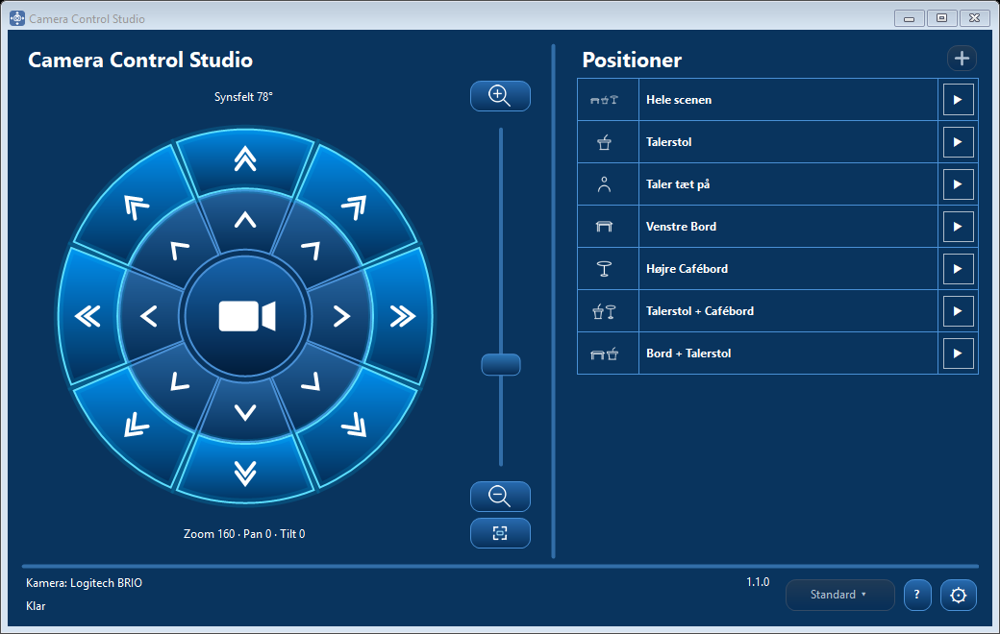
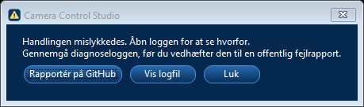

[English](../en/DAILY-USE.md) · [Dansk](DAILY-USE.md) · [Deutsch](../de/DAILY-USE.md) · [Alle guidesprog](USER-GUIDES.md)

# Daglig brug

*Skrevet til Camera Control Studio 1.1.0.*

[Fejlfinding](TROUBLESHOOTING.md)

Start mødet i f.eks. Zoom. Åbn derefter **Camera Control Studio**.

## Generelt
Klik på **?** for at få hjælp. Hold musen over en knap for at se, hvad den gør. En retning stopper ved den sidste grænse, kameraet kan nå. [Sådan virker automatisk synsfelt](SETUP.md#indstil-synsfeltet)

## 1. Aktivér en position

Tryk ▶ på en række i positionslisten, eller dobbeltklik på navnet.
Du kan også markere rækken og trykke Enter.

| Farve | Betydning |
| --- | --- |
| Gul | Programmet flytter mod positionen. |
| Grøn | Kameradriveren melder, at de gemte koordinater er nået. |
| Blå | Positionen er ikke markeret som aktiv. |

Grøn betyder, at driveren melder de gemte koordinater og et eventuelt gemt synsfelt tilbage. Tjek billedet i din udsendelse. Rækken bliver blå, hvis driveren ikke kan bekræfte udsnittet i tide. Læs statusbeskeden for at se hvorfor.

## 2. Finjustér billedudsnittet

### Panorering
Brug den inderste ring til normale bevægelser og den yderste til hurtige. Hver ring har otte pile. De skrå pile flytter i 45° retninger med 45 % af ringens hastighed på hver akse. Ét klik flytter mindst ét drivertrin på hver akse, der kan flyttes. Hold en pil nede for at fortsætte. Slip for at stoppe.

### Kameraknappen midt i hjulet

- **Dobbeltklik for at vælge kamera.** Så åbner listen med kameraer.
- **Hold nede og træk.** Start på kameraikonet. Træk til siden for at panorere eller op og ned for at vippe kameraet. Et kort træk giver langsom bevægelse, og et længere træk øger farten op til det dobbelte af den hurtige hastighed. Slip knappen, eller før markøren tilbage til startpunktet for at stoppe.

Under **Indstillinger → Panorering** kan du slå træk fra eller vælge kamera med ét klik. Begge valg gemmes i den aktive profil.

### Zoom
Brug lupknapperne til at zoome. Hold en lupknap nede for at gentage.
Træk i skyderen for at justere zoom løbende.

### Gendan fuldt billede

Klik på den firkantede knap med rammeikonet over lupknapperne. Kameraet zoomer så langt ud som muligt og vælger det bredeste synsfelt, hvis kameraet understøtter det. Knappen ændrer kamerabilledet. Vinduet beholder sin størrelse.

### Afbryd panorering
Du kan afbryde en startet panorering ved at trykke på ESC.

> Manuel panorering, lodret bevægelse eller zoom afbryder positionsskiftet og fjerner den aktive farve.

### Piletaster
Brug piletasterne, når hjulet har fokus. Hold Ctrl nede for fine bevægelser eller Shift for hurtige.

## 3. Gem en midlertidig position

Tryk **+** over positionslisten, skriv et navn, og gem. Den aktuelle position vises under de faste positioner.
Midlertidige positioner har intet ikon. De gælder kun, indtil programmet lukkes, og holdes adskilt for hver profil og hvert kamera.

Markér en midlertidig række, og tryk på **×** over positionslisten for at fjerne den. Alle midlertidige positioner forsvinder, når programmet lukkes.
Skal en position bruges senere, skal du oprette den under **Indstillinger → Positioner**. Faste positioner kan ikke rettes eller slettes i hovedlisten.

## 4. Afslut

Hvis **Ny version tilgængelig** vises i bunden, kan du klikke på linket for at åbne udgivelsen og dens downloads på GitHub.

<https://github.com/bkristensen/Camera-Ctrl-Pressets-Studio/releases>

Læs beskeden i statusområdet i bunden, hvis en funktion fejler. Kameraet kan mangle funktionen eller være utilgængeligt.

Luk programmet normalt. Den aktive profil og vinduets udseende huskes.

## 5. Fejl eller mangler
Rapportér fejl eller foreslå funktioner under **Kontakt & Om → Kontakt**.

Se [Opsætning](SETUP.md) for kamera retning, permanente positioner, billedindstillinger, profiler og bevægelsestrin.

## Fejldialog

Luk dialogen, og prøv igen, hvis en uventet fejl stopper en handling. Hvis dialogen siger, at programmet lukker, skal du åbne det igen.

**Vis logfil** markerer diagnoseloggen i Stifinder, når den er tilgængelig. **Rapportér på GitHub** tilbyder at gemme en support-ZIP og åbner derefter fejlskabelonen på GitHub. ZIP-filen kan indeholde et skærmbillede af dialogen, logfiler, profil- og vinduesindstillinger samt en systemrapport. Gennemgå filen, og vedhæft den selv til kladden.
