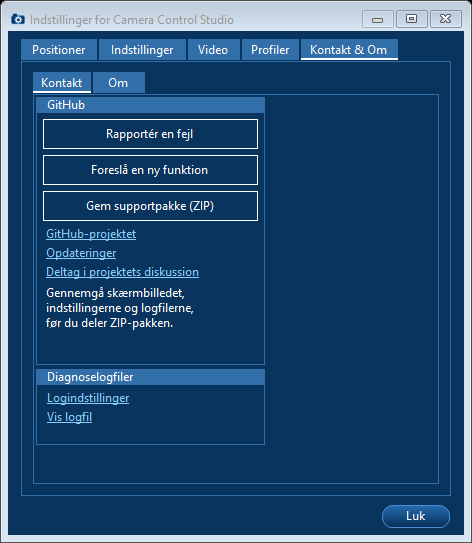

# Rapportér en fejl

*Skrevet til Camera Control Studio 1.1.0.*

1. Klik på tandhjulet nederst for at åbne Indstillinger. Vælg **Kontakt & Om → Kontakt → Rapportér en fejl**.
2. Hvis appen finder en nyere version, så vælg **Ja** for at åbne siden, hvor du kan hente den. Installér den, og prøv at genskabe fejlen. Vælg **Nej** for at fortsætte til udkastet på GitHub.
3. Når appen spørger, om du vil gemme en supportpakke, så vælg **Ja**, og vælg, hvor den skal gemmes. Vælg **Nej** for at åbne udkastet uden at gemme en pakke.

De samme GitHub-knapper findes i GuideViewer.

## Beskriv fejlen og vedhæft ZIP-filen

Knappen åbner GitHubs skabelon **Bug report**. Udfyld alle afsnit med en rød stjerne. Skriv, hvad du forventede, hvad der skete, og hvordan fejlen kan genskabes. Angiv appversion og Windows-version. Tilføj kamera og optageopsætning, hvis det er relevant.

Du kan altid oprette den samme pakke med **Kontakt & Om → Kontakt → Gem supportpakke (ZIP)**. Den indeholder et skærmbillede af Camera Control Studio, den gemte `profiles.json`, vinduets layout i `window.json` og tilgængelige logfiler i `Logs`. Appen viser stien til den gemte fil.

Gennemgå ZIP-filen for private oplysninger som profilnavne, kamera-id’er og filstier. Træk ZIP-filen eller de relevante filer ind i beskrivelsen i udkastet. Du vedhæfter selv filen.

## Tjek type og labels

Skabelonen angiver **Bug** under **Type** og `bug` under **Labels**. Hvis de mangler, og du kan ændre felterne, så vælg **Bug** under **Type** i højre side og `bug` under **Labels**. Hvis du ikke kan ændre felterne, så opret sagen. En vedligeholder kan tilføje dem senere.

Tjek beskrivelsen og de vedhæftede filer i **Preview**, og vælg **Create**.
