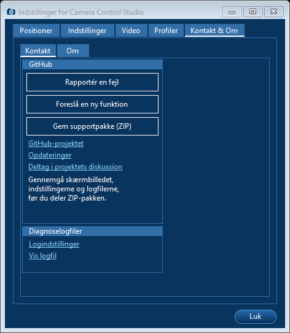

# Foreslå en ny funktion

*Skrevet til Camera Control Studio 1.1.0.*

1. Klik på tandhjulet nederst for at åbne Indstillinger. Vælg **Kontakt & Om → Kontakt → Foreslå en ny funktion**.
2. Hvis appen finder en nyere version, så vælg **Ja** for at åbne siden, hvor du kan hente den. Installér den, og se, om den allerede har funktionen. Vælg **Nej** for at fortsætte til udkastet på GitHub.
3. Udfyld alle afsnit med en rød stjerne i GitHubs skabelon **Feature request**. Beskriv opgaven, hvordan funktionen vil hjælpe, og hvilket resultat der viser, at den virker.

De samme GitHub-knapper findes i GuideViewer.

## Vedhæft et eksempel

Tilføj et skærmbillede eller en skitse, hvis det gør forslaget lettere at forstå. Hvis din opsætning er relevant, så vælg **Kontakt & Om → Kontakt → Gem supportpakke (ZIP)**. Vælg, hvor pakken skal gemmes. Appen viser stien til den gemte fil.

ZIP-filen indeholder et skærmbillede af Camera Control Studio, den gemte `profiles.json`, vinduets layout i `window.json` og tilgængelige logfiler i `Logs`. Gennemgå den for private oplysninger. Træk ZIP-filen eller de relevante filer ind i beskrivelsen, hvis opsætningen hjælper med at forklare forslaget.

## Tjek type og labels

Skabelonen angiver **Feature** under **Type** og `enhancement` under **Labels**. Hvis de mangler, og du kan ændre felterne, så vælg **Feature** under **Type** i højre side og `enhancement` under **Labels**. Hvis du ikke kan ændre felterne, så opret sagen. En vedligeholder kan tilføje dem senere.

Tjek forslaget og de vedhæftede filer i **Preview**, og vælg **Create**.
