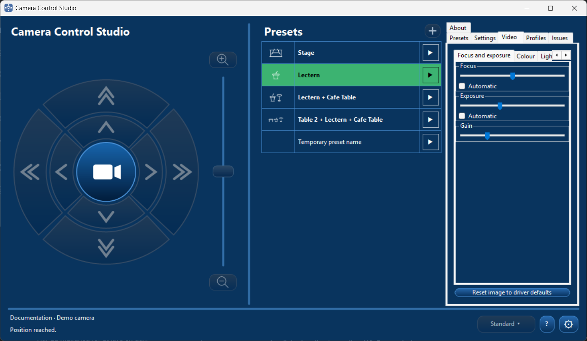
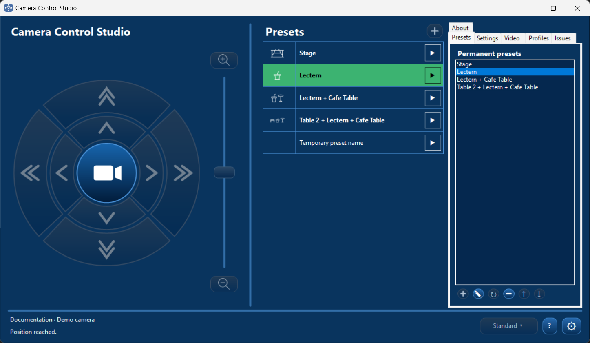

[English](../en/SETUP.md) · [Dansk](../da/SETUP.md) · [Deutsch](../de/SETUP.md) · [Alle guidesprog](../USER-GUIDES.md)

# Sæt programmet op

Tryk på tandhjulet i bunden. Indstillinger åbner til højre. Positionslisten bliver ved med at være synlig.

## 1. Vælg profil og kamera

Brug profilvælgeren i bunden til at vælge profil. Opret en profil under **Indstillinger → Profiler**. Vælg **Ny** for standardindstillinger eller **Kopiér** for at kopiere den aktive profil. Brug et navn for personen eller opstillingen. Den nye profil bliver aktiv. Markér en profil under **Profiler**, og klik på **✎** for at omdøbe den. Standardprofilen har et fast navn.

Tryk på kamerasymbolet midt i kamerahjulet for at vælge kamera. Programmet husker valget. Hvis kameraet mangler, skal du vælge en anden kilde. Positioner hører til et bestemt kamera i en profil.

## 2. Vælg, hvornår kamerastyringen må starte

Sæt flueben ved **Spørg om streaming er startet før kameraet bruges** under **Indstillinger → Program**, hvis dit optageprogram skal starte først. Fluebenet er slået fra som standard.

Med fluebenet sat spørger den første kamerafunktion, om streaming er startet. Vælg først **Ja**, når den er startet. **Nej** holder kamerastyringen frakoblet. Efter Ja spørger programmet ikke igen, før du skifter profil, ændrer fluebenet eller genstarter. Programmet registrerer eller starter ikke selv en stream.

Har du brug for denne rækkefølge, skal du sætte fluebenet før næste session. Standardindstillingen tillader forbindelse ved opstart.

## 3. Indstil bevægelse og zoom

Ret værdierne under **Indstillinger → Bevægelse**. Start med små trin. Se resultatet i dit optageprogram.

| Indstilling | Hvad den ændrer | Standard |
| --- | --- | --- |
| Normale panoreringstrin | Den inderste ring med pile | 1 |
| Hurtige panoreringstrin | Den yderste ring med pile | 4 |
| Zoomtrin | − og + | 1 |
| Skiftetid i sekunder | Ønsket tid til en gemt position | 1,0 |

Et trin er ét trin, som kameradriveren understøtter. Det er ikke en fast afstand eller procent. Kameraets driver sætter grænsen for bevægelse og bløde skift.

Hænger kameraet på hovedet, så prøv **Vend kamerapanorering op / ned**. Test pil op. Slå kun **Vend kamerapanorering venstre / højre** til, hvis venstre bevæger sig forkert. Disse valg vender styringen. De drejer ikke videobilledet.

## 4. Tilpas billedet og gem faste positioner

[Før videoindstillingerne indlæses](../images/screenshots/video.png) · [Farve](../images/screenshots/video-colour.png) · [Lys og detaljer](../images/screenshots/video-light-detail.png)

Vælg **Video** i indstillingspanelet. Indlæs billedindstillinger, hvis det er nødvendigt. Vælg **Fokus og eksponering**, **Farve** eller **Lys og detaljer**. Kun funktioner fra kameraets driver bliver vist. Du kan ændre lysstyrke, kontrast, farvemætning, fokus eller hvidbalance, hvis de findes. Slå automatik fra før manuel justering. Billedværdier gemmes for kameraet i profilen. Knappen til nulstilling gendanner driverens standarder.

Indstil først kameraet. Vælg **Positioner** i indstillingspanelet, og klik på **+** for at tilføje en fast position. Vælg ikon øverst. Kontrollér navnet, og gem. Er navnefeltet tomt, og er navnet ledigt, foreslår ikonet et navn. Kombinerede symboler viser motiverne fra venstre mod højre.

Under **Faste positioner** kan du holde musen over symbolerne for at se deres funktion. Vælg en position, og brug **✎** til navn og symbol, **↻** til at erstatte med kameraets aktuelle position og **−** til at slette. Flyt positionen med **↑** eller **↓**. Rækkefølgen gemmes og vises også i hovedlisten.

En fast position, du markerer i hovedlisten, markeres også i indstillingerne. Når du gemmer en ny fast position, markeres den i indstillingerne.

## 5. Tilpas udseende og sprog

Træk den lodrette skillelinje mellem styringen og positionslisten. Flyt vinduet, og ret størrelsen. Programmet gemmer placering, størrelse, skillelinje og valgt indstillingsfane i den aktive profil. Startstørrelsen er 900 × 500, og minimum er 670 × 450. Indstillingerne er altid lukket ved programstart. Vinduets gemte bredde svarer til bredden med indstillingerne lukket.

Når du vælger profil i bunden, skal **Behold nuværende placering og layout** være uden flueben for at hente profilens gemte udseende. Sæt flueben for at tage det nuværende udseende med. Valget huskes i profilen, du forlader. Det overførte udseende gemmes i den nye profil.

Vælg sprog under **Indstillinger → Program → Profilsprog**, og genstart for at anvende det. **Automatisk** følger Windows' visningssprog, hvis programmet understøtter det, og bruger ellers engelsk. Ved profilskift genstarter programmet med den valgte profils sprog. Midlertidige positioner forsvinder ved genstart.

## 6. Version og projektoplysninger

Åbn **Om** for at se den installerede version, udvikleren og links til projektet og support.

## 7. Diagnoselogfiler og fejlrapporter

Åbn fanen **Fejlrapport** for at vælge logmappe, maksimal filstørrelse og antal logfiler inklusive den aktive. Som standard skrives loggen i programmappen eller i `%LOCALAPPDATA%\CamPressets\Logs`, hvis programmappen ikke kan bruges.

**Rapportér på GitHub** åbner en kladde og den lokale mappe med rapportfilerne. Gennemgå filerne, og vedhæft dem i GitHub-editoren.

Fortsæt med [Daglig brug](DAILY-USE.md). Tag backup ved at lukke programmet og kopiere `%LOCALAPPDATA%\CamPressets`. Midlertidige positioner er ikke med i backup.
