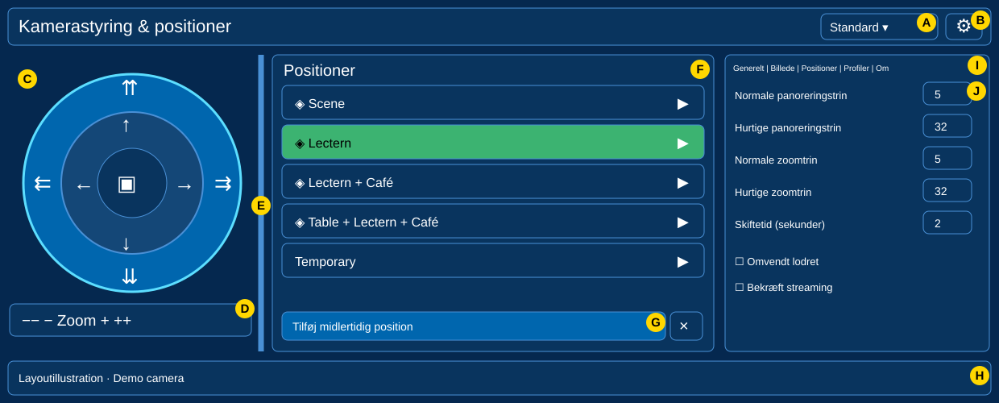
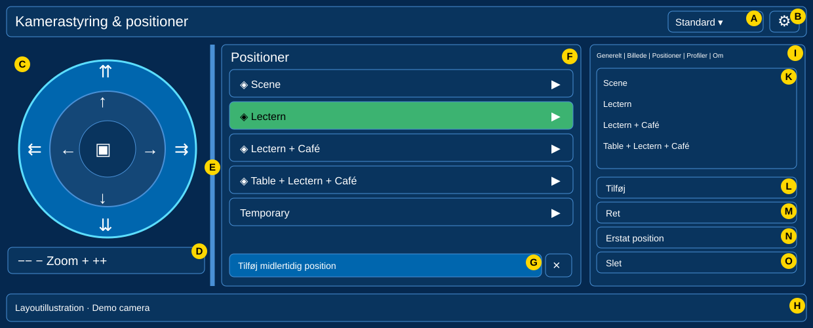

[English](../en/SETUP.md) · [Dansk](../da/SETUP.md) · [Deutsch](../de/SETUP.md)

# Sæt programmet op

Tryk på tandhjulet **B**. Indstillinger åbner til højre. Positionslisten bliver ved med at være synlig.

*Layoutillustration, ikke et Windows-skærmbillede. Bogstaverne svarer til forklaringerne nedenfor. Se [optagelse af billeder](../SCREENSHOTS.md).*

## 1. Vælg profil og kamera

Brug **A** i hovedvinduet til at vælge profil. Opret en profil under **Indstillinger → Profiler** (**I**). Vælg **Ny** for standardindstillinger eller **Kopiér** for at kopiere den aktive profil. Brug et navn for personen eller opstillingen. Den nye profil bliver aktiv.

Tryk på kamerasymbolet midt i **C** for at vælge kamera. Programmet husker valget. Hvis kameraet mangler, skal du vælge en anden kilde. Positioner hører til et bestemt kamera i en profil.

## 2. Vælg, hvornår kamerastyringen må starte

Sæt flueben ved **Spørg om streaming er startet før kameraet bruges** under **Indstillinger** (**J**), hvis dit optageprogram skal starte først. Fluebenet er slået fra som standard.

Med fluebenet sat spørger den første kamerafunktion, om streaming er startet. Vælg først **Ja**, når den er startet. **Nej** holder kamerastyringen frakoblet. Efter Ja spørger programmet ikke igen, før du skifter profil, ændrer fluebenet eller genstarter. Programmet registrerer eller starter ikke selv en stream.

Har du brug for denne rækkefølge, skal du sætte fluebenet før næste session. Standardindstillingen tillader forbindelse ved opstart.

## 3. Indstil bevægelse og zoom

Ret værdierne i **J**. Start med små trin. Se resultatet i dit optageprogram.

| Indstilling | Hvad den ændrer | Standard |
| --- | --- | --- |
| Normale panoreringstrin | Den inderste ring med pile | 5 |
| Hurtige panoreringstrin | Den yderste ring med pile | 32 |
| Normale zoomtrin | − og + | 5 |
| Hurtige zoomtrin | −− og ++ | 32 |
| Skiftetid i sekunder | Ønsket tid til en gemt position | 2 |

Et trin er ét trin, som kameradriveren understøtter. Det er ikke en fast afstand eller procent. Kameraets driver sætter grænsen for bevægelse og bløde skift.

Hænger kameraet på hovedet, så prøv **Omvend op / ned**. Test pil op. Slå kun **Omvend venstre / højre** til, hvis venstre bevæger sig forkert. Disse valg vender styringen. De drejer ikke videobilledet.

## 4. Tilpas billedet og gem faste positioner

Vælg **Billede** i **I**. Indlæs billedindstillinger, hvis det er nødvendigt. Kun funktioner fra kameraets driver bliver vist. Du kan ændre lysstyrke, kontrast, farvemætning, fokus eller hvidbalance, hvis de findes. Slå automatik fra før manuel justering. Billedværdier gemmes for kameraet i profilen. Knappen til nulstilling gendanner driverens standarder.

*Layoutillustration med mærker.*

Indstil først kameraet. Vælg **Positioner** i **I**, og tryk **Tilføj** (**L**). Vælg ikon øverst. Kontrollér navnet, og gem. Er navnefeltet tomt, og er navnet ledigt, foreslår ikonet et navn. Kombinerede symboler viser motiverne fra venstre mod højre.

Vælg en position i **K** for at ændre den. **M** ændrer navn og ikon. **N** erstatter koordinaterne med kameraets aktuelle position. **O** sletter efter bekræftelse. Faste positioner står altid øverst i hovedlisten med fed skrift.

## 5. Tilpas udseende og sprog

Træk skillelinjen **E** mellem styringen og positionslisten. Flyt vinduet, og ret størrelsen. Programmet gemmer placering, størrelse, skillelinje, åbne indstillinger og valgt indstillingsfane i den aktive profil. Startstørrelsen er 900 × 500 ved normal Windows-skalering.

Når du vælger profil med **A**, skal **Behold nuværende placering og layout** være uden flueben for at hente profilens gemte udseende. Sæt flueben for at tage det nuværende udseende med. Valget huskes i profilen, du forlader. Det overførte udseende gemmes i den nye profil.

Vælg sprog under **Indstillinger**, og genstart. Automatisk bruger dansk eller tysk, hvis Windows bruger det sprog. Ellers bruges engelsk. Sprogvalget gælder hele programmet, ikke kun en profil.

Fortsæt med [Daglig brug](DAILY-USE.md). Tag backup ved at lukke programmet og kopiere `%LOCALAPPDATA%\CamPressets`. Midlertidige positioner er ikke med i backup.
