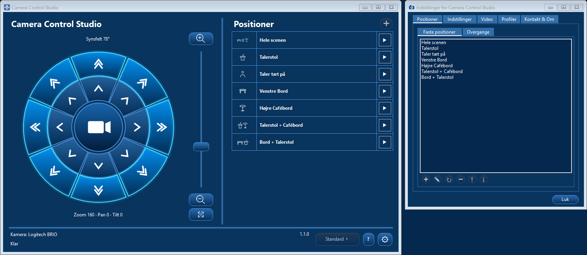
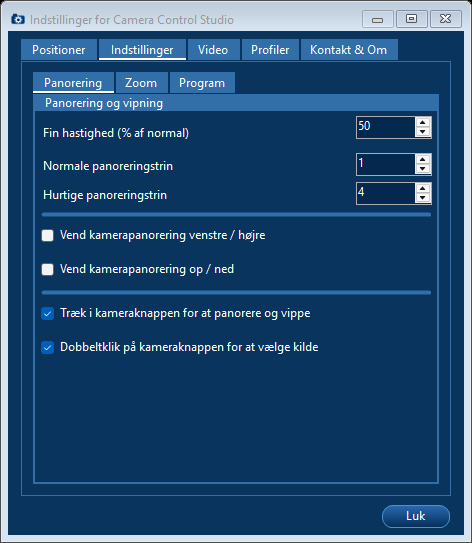

[English](../en/SETUP.md) · [Dansk](SETUP.md) · [Deutsch](../de/SETUP.md) · [Alle guidesprog](USER-GUIDES.md)

# Sæt programmet op

*Skrevet til Camera Control Studio 1.1.0.*

[Fejlfinding](TROUBLESHOOTING.md)

Klik på tandhjulet nederst for at åbne Indstillinger. Indstillinger åbner i et separat vindue. Du kan stadig bruge hovedvinduet.

## Installér og kontrollér downloadet

Hent **Camera Control Studio** fra Microsoft Store, når appen er tilgængelig dér. Søg efter appens navn i Microsoft Store. Microsoft signerer Store-pakken og leverer opdateringerne.

Hvis appen endnu ikke er tilgængelig i Microsoft Store, kan du hente installationsfilen eller den portable ZIP fra [GitHub-udgivelserne](https://github.com/bkristensen/Camera-Ctrl-Pressets-Studio/releases). Kør installationsfilen, eller pak hele ZIP-filen ud før start. Hvis udgivelsen har en SHA-256-kontrolsum, så sammenlign den med resultatet fra `Get-FileHash -Algorithm SHA256`.

Microsoft Defender SmartScreen kan vise en blå advarsel, når en fil eller udgiver har et begrænset omdømme. Tag advarslen alvorligt. Hvis du har hentet den forventede fil fra den officielle udgivelse og stoler på kilden, kan du vælge **Flere oplysninger** og kontrollere programnavn og udgiver. Vælg kun **Kør alligevel**, hvis du vil stole på netop den fil, og Windows tilbyder valget. Luk ellers advarslen. Følg eventuelle regler for din pc. [Microsofts SmartScreen-vejledning](https://learn.microsoft.com/windows/apps/package-and-deploy/smartscreen-reputation)

<https://learn.microsoft.com/windows/apps/package-and-deploy/smartscreen-reputation>

Hent WebView2 Runtime fra Microsoft, hvis guideviseren mangler den.\
<https://developer.microsoft.com/microsoft-edge/webview2/>

Start med den profil og det kamera, du vil bruge. Vælg profil nederst i hovedvinduet. Dobbeltklik som standard på kameraknappen i hjulet for at vælge kilde. Profilen husker kameraet. Hvis kameraet mangler, så vælg en anden kilde.

Afsnittene følger fanernes rækkefølge i indstillingsvinduet. En nedtonet knap kræver ofte, at du vælger noget først. Under Video afgør kameradriveren, hvilke valg du ser. Tjek ændringerne i dit optageprogram.

**Luk**. Tilpas begge vinduer, eller træk skillelinjen i hovedvinduet. Profilen husker begge vinduers placering og størrelse samt skillelinjen. Klik på Luk nederst i Indstillinger. Hovedvinduet forbliver åbent.

## Positioner

### Faste positioner

Ret først kameraet ind. En fast position gemmer den panorering, vipning og zoom, kameraet understøtter. Den gemmer også synsfeltet, hvis kameraet oplyser det. Positionen hører til ét kamera i én profil.

- **+ Tilføj permanent position**. Gem det aktuelle udsnit som en ny position. Vælg et symbol, og giv positionen et unikt navn. Et symbol kan foreslå et navn, hvis feltet er tomt. Gem-knappen kræver et navn. Annullér for at lade listen være som før.
- **✎ Ret navn og symbol**. Ret navn eller symbol på den valgte position. Det gemte udsnit ændres ikke.
- **↻ Erstat med aktuel position**. Erstat den valgte positions udsnit med kameraets aktuelle position. Bekræft ændringen. Navn og symbol bevares.
- **− Slet permanent position**. Slet den valgte position, når du har bekræftet.
- **↑ / ↓ Flyt valgt position op · Flyt valgt position ned**. Flyt den valgte position én plads op eller ned. Rækkefølgen ændres begge steder. Op er nedtonet på første linje. Ned er nedtonet på sidste linje.

Vælg en position for at bruge Redigér, Erstat, Slet og de relevante pile. Tilføj og Erstat kræver en indlæst profil og et kamera, hvor appen kan læse og styre mindst én af funktionerne panorering, vipning og zoom. Hvis kameraet endnu ikke er tilsluttet, kan knapperne forsøge at forbinde det.

### Indstil overgange mellem positioner

- **Brug hastighed ved skift af position**. Slå fra for at bruge en fast tid. Slå til for at bruge en hastighed, så korte bevægelser går hurtigere end lange. De akser, der flytter sig, når målet samtidig.
- **Skiftetid (sek.)**. Sæt tiden for en overgang. Standard er 1 sekund. Feltet er nedtonet, når du bruger hastighed.
- **Overgangshastighed (%/s)**. Sæt hastigheden som procent af det samlede område pr. sekund for den akse, der bestemmer overgangen. Standard er 30 %. Feltet er nedtonet, når du bruger fast tid.

## Indstillinger

### Panorering

- **Fin hastighed (% af normal)**. Hold Ctrl nede, og brug en piletast til finstyring. Standard er 50 % af normal hastighed.
- **Normale panoreringstrin**. Vælg antal trin for de normale pile i den indre ring. Standard er 1.
- **Hurtige panoreringstrin**. Vælg antal trin for de hurtige pile i den ydre ring. Standard er 4. Tallet ændrer også farten, når du trækker kameraknappen.
- **Vend kamerapanorering venstre / højre**. Byt om på højre og venstre. Brug det, hvis kameraet bevæger sig den forkerte vej.
- **Vend kamerapanorering op / ned**. Byt om på op og ned. Prøv det, hvis kameraet hænger på hovedet. De to valg ændrer styreretningen. De drejer ikke billedet.
- **Træk i kameraknappen for at panorere og vippe**. Træk knappen midt i hjulet for at styre kameraet. Slå valget fra, hvis du vil styre med pilene.
- **Dobbeltklik på kameraknappen for at vælge kilde**. Slå til for at åbne kameralisten med dobbeltklik. Slå fra for at åbne den med et enkelt klik.

Du kan ændre bevægelsesvalg før kameraet tilsluttes. Driveren bestemmer trinnenes størrelse, hvilke retninger kameraet kan flytte sig i, og hvor det stopper.

### Indstil zoomtrin

- **Zoomtrin**. Vælg, hvor mange trin + og − flytter zoom pr. tryk. Standard er ét trin fra driveren. Du kan ændre tallet før tilslutning. Kameraet skal understøtte zoom, før det har effekt. Skyderen vælger en zoomværdi inden for det aktuelle synsfelt.

### Program

- **Spørg om streaming er startet før kameraet bruges**. Slå til, hvis dit optageprogram skal streame først. Næste kamerahandling beder om bekræftelse. Vælg Ja, når du er klar. Vælg Nej for at holde kameraet frakoblet. Appen spørger igen efter genstart, profilskift eller ændring af dette valg. Slå fra for at tillade tilslutning ved start.
- **Altid øverst**. Hold hovedvinduet over andre programmer. Slå fra, hvis andre vinduer må dække det.
- **Profilsprog · Automatisk**. Vælg ét af de 12 sprog. Automatisk bruger Windows' visningssprog, hvis det understøttes, ellers engelsk. Genstart for at skifte sprog. Hver profil har sit eget valg.

## Video

- **Indlæs billedindstillinger**. Forbind kameraet, og vis dets billedindstillinger. Knappen vises, mens kameraet er frakoblet. Hvis driveren ikke tilbyder billedindstillinger efter tilslutning, vises kun fanen Synsfelt.
- **Automatisk**. Driveren bestemmer, hvilke skydere og faner der vises. Automatisk lader kameraet styre værdien. Slå det fra for selv at bruge skyderen. Hvis driveren kun tilbyder automatik, er skyderen nedtonet, og Automatik kan være låst til. Ved ren manuel styring skjules fluebenet.
- **Gendan driverens billedstandarder**. Gendan driverens standarder for alle understøttede billedindstillinger. Knappen vises på billedfanerne og skjules under Synsfelt. Billedværdier gemmes pr. kamera og profil.

### Fokus og eksponering

- **Forstærkning**. Forstærk kameraets signal for at gøre billedet lysere. Høj forstærkning kan give korn i billedet.
- **Eksponering**. Vælg, hvor længe sensoren samler lys. Længere tid giver et lysere billede, men kan sløre bevægelse.
- **Fokus**. Vælg den afstand, hvor motivet er skarpt. Tjek motivet i dit optageprogram.

### Farve

- **Hvidbalance**. Ret lysets farvestik, så hvidt ser hvidt ud.
- **Farveintensitet**. Gør farverne stærkere eller mere dæmpede.
- **Gamma**. Gør mellemtonerne lysere eller mørkere.
- **Farvetone**. Forskyd farverne rundt på farvehjulet.

### Lys og detaljer

- **Kontrast**. Ændr forskellen på lyse og mørke områder.
- **Lysstyrke**. Gør hele billedet lysere eller mørkere.
- **Modlyskompensation**. Gør motivet lysere, når der er kraftigt lys bag det.
- **Skarphed**. Gør billedets kanter mere eller mindre tydelige.

### Indstil synsfeltet

Synsfelt (FOV) er, hvor meget af scenen der er med på billedet. En større vinkel viser mere. Zoom ændrer udsnittet inden for den aktuelle vinkel.

- **Synsfelt ved opstart · Bredest muligt · Gør ingenting**. Vælg den bredeste vinkel, behold den nuværende, eller vælg en bestemt vinkel fra driveren. Appen prøver at bruge valget, første gang den forbinder i sessionen. Listen er nedtonet, indtil et tilsluttet kamera melder mindst én vinkel.
- **Tillad manuel ændring af synsfelt**. Vis en vinkelliste under hjulet. Når valget er slået fra, viser appen den aktuelle vinkel, hvis den kan læse den. Valget er nedtonet, hvis driveren melder færre end to vinkler.
- **Skift synsfelt ved grænsen for zoom og panorering**. Tryk igen ved en zoomgrænse for at prøve en bredere vinkel ved zoom ud eller en smallere ved zoom ind. Ved en vandret panoreringsgrænse prøver appen en anden vinkel, som kan give mere plads. Den prøver at bevare udsnittet og gendanner det, hvis bevægelsen ikke kan fortsætte. Det virker også uden manuelt valg. Valget er nedtonet, hvis driveren melder færre end to vinkler.

På en Brio ved 65° og mindste zoom kan et tryk på Zoom ud skifte til 78°. Tryk igen for at zoome ud i den nye vinkel. Knappen med rammesymbolet i hovedvinduet prøver at vælge bredeste vinkel og mindste zoom på én gang. Tjek billedet i dit optageprogram, hvis et andet program også styrer kameraet.

## Profiler

- **+ Ny profil**. Opret en profil med standardindstillinger, og gør den aktiv. Giv den et unikt navn.
- **⧉ Kopiér aktiv profil**. Kopiér den aktive profils indstillinger og positioner, og skift til kopien. Et valg i listen ændrer ikke, hvilken profil der kopieres.
- **✎ Omdøb valgt profil**. Omdøb den valgte profil. Knappen er nedtonet uden valg, og når Standard er valgt. Ny og Kopiér kræver en indlæst profil. I alle tre navnefelter skal du skrive et navn for at kunne bekræfte.
- **Behold nuværende placering og layout**. Dobbeltklik på en profil for at åbne skiftedialogen. Brug layoutvalget til at tage vinduernes placering, størrelse og skillelinjen med over. Slå det fra for at bruge den nye profils gemte layout. Profilskift genstarter appen og fjerner midlertidige positioner.

## Kontakt & Om

### Kontakt

- **Rapportér en fejl**. Åbn GitHubs fejlskabelon. Hvis der findes en nyere version, tilbyder appen at åbne den først. Hvis du fortsætter, tilbyder appen en supportpakke, før kladden åbnes.
- **Foreslå en ny funktion**. Åbn GitHubs skabelon til funktionsforslag. Hvis der findes en nyere version, så afprøv den først. Funktionen kan allerede være tilføjet.
- **Gem supportpakke (ZIP)**. Gem et skærmbillede, tilgængelige logfiler, profildata og en fil med vindueslayout i én ZIP. Tjek indholdet for private oplysninger. Vedhæft selv filen i GitHub-kladden. De tre knapper er kortvarigt nedtonet, mens en handling kører.
- **GitHub-projektet · Udgivelser på GitHub · Deltag i projektets diskussion**. Åbn kildekoden, udgivelserne eller projektets diskussioner med de tre GitHub-links.

[Rapportér en fejl](Report%20a%20bug.md) · [Foreslå en ny funktion](Request%20a%20feature.md)

### Diagnoselogfiler

- **Logindstillinger**. Åbn dialogen med logindstillinger. Valgene gælder på tværs af profiler. Gem anvender ændringerne. Annuller lader dem være som før.
- **Vælg mappe · Automatisk**. Vælg en mappe, eller brug Automatisk. Du kan ikke skrive direkte i stifeltet. Automatisk bruger programmappen og falder tilbage til `%LOCALAPPDATA%\CamPressets\Logs`.
- **Maksimal størrelse pr. fil (MiB)**. Sæt grænsen for, hvornår appen starter en ny logfil. Standard er 1 MiB pr. fil.
- **Maksimalt antal logfiler (inklusive den aktive)**. Vælg, hvor mange logfiler der bevares, inklusive den aktive. Standard er 2.
- **Vis logfil**. Find den seneste log i Stifinder. Appen giver besked, hvis der ingen log er.

### Om

- **Buy me a coffee**. Se den installerede version og udviklerens navn. Hold musen over versionen for at se det fulde build-id. Supportlinket åbner udviklerens støtteside.
- **Åbn vejledninger**. Åbn vejledningerne her. Hjælpeknappen i hovedvinduet åbner dem også.

Luk appen, og kopiér `%LOCALAPPDATA%\CamPressets` for at tage en sikkerhedskopi. Midlertidige positioner gælder kun i den aktuelle session.

[Daglig brug](DAILY-USE.md)

## Fejldialog

Luk dialogen, og prøv igen, hvis en uventet fejl stopper en handling. Hvis dialogen siger, at programmet lukker, skal du åbne det igen.

**Vis logfil** markerer diagnoseloggen i Stifinder, når den er tilgængelig. **Rapportér på GitHub** tilbyder at gemme en support-ZIP og åbner derefter fejlskabelonen på GitHub. ZIP-filen kan indeholde et skærmbillede af dialogen, logfiler, profil- og vinduesindstillinger samt en systemrapport. Gennemgå filen, og vedhæft den selv til kladden.
