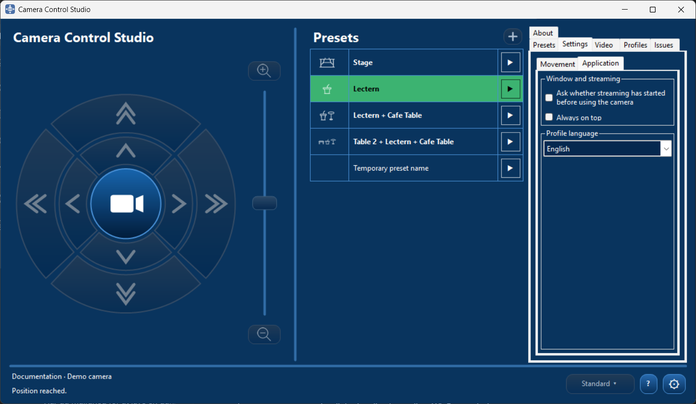

[English](../en/SETUP.md) · [Dansk](../da/SETUP.md) · [Deutsch](../de/SETUP.md) · [Alle guidesprog](../USER-GUIDES.md)

# Sæt programmet op

Tryk på tandhjulet i bunden. Indstillinger åbner til højre. Positionslisten bliver ved med at være synlig.

## Installér og kontrollér downloadet

Hent installationsfilen eller den portable ZIP fra projektets [GitHub-udgivelser](https://github.com/bkristensen/Camera-Ctrl-Pressets-Studio/releases). Kør installationsfilen, eller pak hele ZIP-filen ud før start. Hvis der er udgivet en SHA-256-kontrolsum, kan du sammenligne den med resultatet fra `Get-FileHash -Algorithm SHA256`.

Microsoft Defender SmartScreen kan vise en blå advarsel, når en fil eller udgiver har et begrænset omdømme. Tag advarslen alvorligt. Hvis du har hentet den forventede fil fra den officielle udgivelse og stoler på kilden, kan du vælge **Flere oplysninger** og kontrollere programnavn og udgiver. Vælg kun **Kør alligevel**, hvis du vil stole på netop den fil, og Windows tilbyder valget. Luk ellers advarslen. Følg eventuelle regler for din pc. [Microsofts SmartScreen-vejledning](https://learn.microsoft.com/windows/apps/package-and-deploy/smartscreen-reputation)

## 1. Vælg profil og kamera

Brug profilvælgeren i bunden til at vælge profil. Opret en profil under **Indstillinger → Profiler**. Vælg **Ny** for standardindstillinger eller **Kopiér** for at kopiere den aktive profil. Brug et navn for personen eller opstillingen. Den nye profil bliver aktiv. Markér en profil under **Profiler**, og klik på **✎** for at omdøbe den. Standardprofilen har et fast navn.

Tryk på kamerasymbolet midt i kamerahjulet for at vælge kamera. Programmet husker valget. Hvis kameraet mangler, skal du vælge en anden kilde. Positioner hører til et bestemt kamera i en profil.

## 2. Vælg, hvornår kamerastyringen må starte

Sæt flueben ved **Spørg om streaming er startet før kameraet bruges** under **Indstillinger → Program**, hvis dit optageprogram skal starte først. Fluebenet er slået fra som standard.

Med fluebenet sat spørger den første kamerafunktion, om streaming er startet. Vælg først **Ja**, når den er startet. **Nej** holder kamerastyringen frakoblet. Efter Ja spørger programmet ikke igen, før du skifter profil, ændrer fluebenet eller genstarter. Programmet registrerer eller starter ikke selv en stream.

Har du brug for denne rækkefølge, skal du sætte fluebenet før næste session. Standardindstillingen tillader forbindelse ved opstart.

## 3. Indstil bevægelse og zoom

Ret værdierne under **Indstillinger → Bevægelse**. Start med små trin. Se resultatet i dit optageprogram.

| Indstilling | Hvad den ændrer | Standard |
| --- | --- | --- |
| Fin hastighed (% af normal) | Hastighed, når Ctrl og en piletast holdes nede | 50 % |
| Normale panoreringstrin | Den midterste ring med pile | 1 |
| Hurtige panoreringstrin | Den yderste ring med pile | 4 |
| Zoomtrin | − og + | 1 |
| Skiftetid i sekunder | Tid til skift ved fast varighed | 1,0 |
| Brug hastighed ved skift af position | Afstanden bestemmer varigheden | Fra |
| Overgangshastighed (%/s) | Hastighed i procent af den styrende akses område pr. sekund | 30 % |

Ved hastighedsbaserede skift tager en kort bevægelse mindre tid end en lang. Appen accelererer og bremser og styrer alle akser sammen, så de kan nå målet samtidigt.

Et trin er ét trin, som kameradriveren understøtter. Det er ikke en fast afstand eller procent. Kameraets driver sætter grænsen for bevægelse og bløde skift.

Hænger kameraet på hovedet, så prøv **Vend kamerapanorering op / ned**. Test pil op. Slå kun **Vend kamerapanorering venstre / højre** til, hvis venstre bevæger sig forkert. Disse valg vender styringen. De drejer ikke videobilledet.

### Indstil synsfeltet

Åbn **Indstillinger → Bevægelse**. Vælg det bredeste synsfelt, en bestemt vinkel eller **Gør ingenting** under **Synsfelt ved opstart**. Valget gælder, første gang programmet forbinder. Slå **Tillad manuel ændring af synsfelt** til for at vise valglisten. Det aktuelle synsfelt står under kamerahjulet.

**Skift synsfelt ved grænsen for zoom og panorering** er slået til som standard. Det virker også, når valglisten er skjult, hvis driveren understøtter FOV.

- **Zoom ud:** Ved mindste zoom på en Brio med 65° skifter næste tryk til 78°. Trykket skifter synsfelt og justerer zoom, så udsnittet ændrer sig mindst muligt. Tryk igen for at zoome videre. Det samme sker fra 78° til 90°. Knappen stopper først ved 90° og mindste zoom.
- **Zoom ind:** Ved højeste zoom skifter næste tryk til et smallere synsfelt. På en Brio er rækkefølgen 90° → 78° → 65°. Knappen stopper ved 65° og højeste zoom.
- **Drej til venstre eller højre:** Ved kanten prøver programmet først et bredere synsfelt. Det justerer zoom, så udsnittet ændrer sig mindst muligt. Det kan også prøve et smallere synsfelt, hvis zoom tillader det. Hvis ingen af delene giver mere plads, gendanner programmet det forrige udsnit. Driveren afgør, hvor præcist udsnittet kan bevares.

Brug den firkantede knap med rammesymbolet for at gå direkte til bredeste synsfelt og mindste zoom. Skyderen ændrer zoom inden for det aktuelle synsfelt. Slå automatisk skift fra, hvis zoom og panorering skal holde sig inden for det valgte synsfelt.

Positioner gemmer pan, tilt, zoom og det synsfelt, driveren melder tilbage. Ældre positioner beholder kameraets aktuelle synsfelt. Tjek livebilledet, hvis Zoom, Logitech Brio Control eller et andet program også styrer udsnittet. [Testtrin for Brio og Zoom på engelsk](../VALIDATION.md#brio-field-of-view-and-zoom)

## 4. Tilpas billedet og gem faste positioner

[Før videoindstillingerne indlæses](../images/screenshots/video.png) · [Farve](../images/screenshots/video-colour.png) · [Lys og detaljer](../images/screenshots/video-light-detail.png)

Vælg **Video** i indstillingspanelet. Indlæs billedindstillinger, hvis det er nødvendigt. Vælg **Fokus og eksponering**, **Farve** eller **Lys og detaljer**. Kun funktioner fra kameraets driver bliver vist. Du kan ændre lysstyrke, kontrast, farvemætning, fokus eller hvidbalance, hvis de findes. Slå automatik fra før manuel justering. Billedværdier gemmes for kameraet i profilen. Knappen til nulstilling gendanner driverens standarder.

Indstil først kameraet. Vælg **Positioner** i indstillingspanelet, og klik på **+** for at tilføje en fast position. Vælg ikon øverst. Kontrollér navnet, og gem. Er navnefeltet tomt, og er navnet ledigt, foreslår ikonet et navn. Kombinerede symboler viser motiverne fra venstre mod højre.

Under **Faste positioner** kan du holde musen over symbolerne for at se deres funktion. Vælg en position, og brug **✎** til navn og symbol, **↻** til at erstatte med kameraets aktuelle position og **−** til at slette. Flyt positionen med **↑** eller **↓**. Rækkefølgen gemmes og vises også i hovedlisten.

En fast position, du markerer i hovedlisten, markeres også i indstillingerne. Når du gemmer en ny fast position, markeres den i indstillingerne.

## 5. Tilpas udseende og sprog

Træk skillelinjen mellem kamerastyringen og positionslisten. Profilen gemmer skillelinjen og vinduets placering og størrelse. Startstørrelsen er 900 × 500, og minimum er 670 × 450. Indstillingerne starter lukket. Første gang du åbner dem efter start, vises den første fane. Rul ned på **Bevægelse** eller **Program**, hvis nogle felter ligger uden for vinduet. Appen gemmer vinduets bredde med indstillingerne lukket.

Når du vælger profil i bunden, skal **Behold nuværende placering og layout** være uden flueben for at hente profilens gemte udseende. Sæt flueben for at tage det nuværende udseende med. Valget huskes i profilen, du forlader. Det overførte udseende gemmes i den nye profil.

Vælg sprog under **Indstillinger → Program → Profilsprog**, og genstart for at anvende det. **Automatisk** følger Windows' visningssprog, hvis programmet understøtter det, og bruger ellers engelsk. Ved profilskift genstarter programmet med den valgte profils sprog. Midlertidige positioner forsvinder ved genstart.

## 6. Version og projektoplysninger

Åbn **Om** for at se versionen og projektets links. Hold musen over versionen for at se det fulde build-id. Skriv det i en fejlrapport, hvis fejlen gælder en bestemt build.

## 7. Diagnoselogfiler og fejlrapporter

Åbn fanen **Fejlrapport** for at vælge logmappe, maksimal filstørrelse og antal logfiler inklusive den aktive. Som standard skrives loggen i programmappen eller i `%LOCALAPPDATA%\CamPressets\Logs`, hvis programmappen ikke kan bruges.

**Rapportér på GitHub** åbner en kladde og den lokale mappe med rapportfilerne. Gennemgå filerne, og vedhæft dem i GitHub-editoren.

Fortsæt med [Daglig brug](DAILY-USE.md). Tag backup ved at lukke programmet og kopiere `%LOCALAPPDATA%\CamPressets`. Midlertidige positioner er ikke med i backup.
