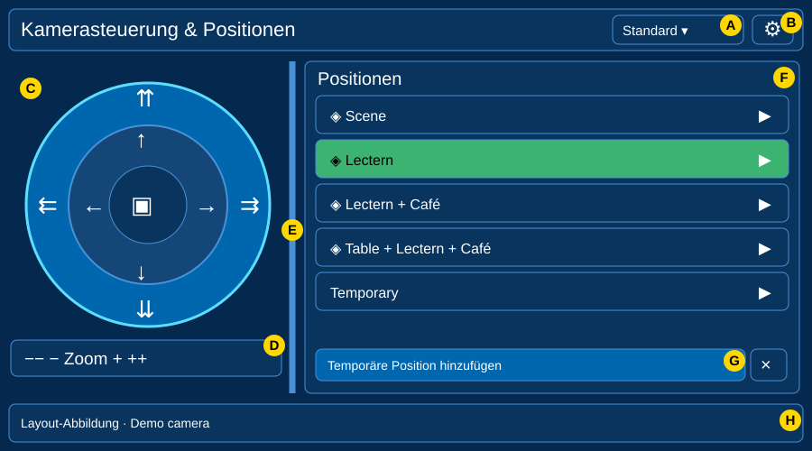

[English](../en/DAILY-USE.md) · [Dansk](../da/DAILY-USE.md) · [Deutsch](../de/DAILY-USE.md)

# Tägliche Nutzung

Starten Sie zuerst Ihr Aufnahmeprogramm und Ihren Stream, falls Ihr Aufbau dies erfordert. Öffnen Sie **Camera Control Studio.exe**.

*Layout-Abbildung, kein Windows-Screenshot. Die Buchstaben verweisen auf die Bedienelemente unten. Siehe [Bildaufnahme](../SCREENSHOTS.md).*

## 1. Aufbau wählen

Klicken Sie auf **A** und wählen Sie Ihr Profil. Lassen Sie die Layout-Option aus, um das gespeicherte Fenster zu laden. Aktivieren Sie sie nur, wenn Sie das aktuelle Layout behalten möchten.

Die Anwendung verwendet die letzte Kamera. Klicken Sie auf das Kamerasymbol in **C**, um sie zu wechseln. Falls die Streaming-Frage erscheint, antworten Sie erst nach Beginn der Sitzung mit Ja. Nein lässt die Kamera getrennt.

## 2. Position aktivieren

Klicken Sie auf ▶ in einer Zeile von **F**, oder doppelklicken Sie auf den Namen. Sie können auch eine Zeile auswählen und Enter drücken.

| Farbe | Bedeutung |
| --- | --- |
| Gelb | Die Anwendung fährt die Position an. |
| Grün | Der Kameratreiber meldet die gespeicherten Koordinaten. |
| Blau | Die Position ist nicht als aktiv markiert. |

Grün bestätigt die gemeldeten Koordinaten. Prüfen Sie das Bild in Ihrem Aufnahmeprogramm. Meldet der Treiber das Ziel nicht rechtzeitig, wird die Zeile blau und **H** zeigt eine Meldung. Die Symbole bleiben sichtbar.

## 3. Bildausschnitt anpassen

Die inneren Pfeile in **C** bewegen die Kamera normal. Die äußeren Pfeile nutzen größere Schritte. In **D** steuern − und + den normalen Zoom. −− und ++ steuern den schnellen Zoom. Halten Sie eine Taste gedrückt, um die Bewegung zu wiederholen.

Manuelles Schwenken, Neigen oder Zoomen bricht den Positionswechsel ab und entfernt die aktive Farbe. Escape stoppt einen Übergang. Hat das Steuerrad den Fokus, können Sie die Pfeiltasten verwenden. Shift wählt schnelle Schritte.

## 4. Temporäre Position speichern

Klicken Sie auf **G**, geben Sie einen Namen ein und speichern Sie. Die aktuelle Position erscheint unter den festen Positionen. Temporäre Positionen haben kein Symbol. Sie gelten nur bis zum Schließen der Anwendung und werden je Profil und Kamera getrennt gehalten.

Wählen Sie eine temporäre Zeile und klicken Sie auf die Löschtaste neben **G**, um sie zu entfernen. Beim Schließen gehen alle temporären Positionen verloren. Für spätere Sitzungen legen Sie eine feste Position unter **B → Positionen** an. Feste Positionen lassen sich nicht in der Hauptliste ändern oder löschen.

## 5. Beenden

Lesen Sie die Meldung in **H**, falls eine Funktion fehlschlägt. Die Kamera unterstützt die Funktion möglicherweise nicht oder ist nicht verfügbar.

Schließen Sie die Anwendung normal. Das aktive Profil und das Layout werden gespeichert. Diese Anwendung zeigt und speichert kein Video. Prüfen Sie das Bild in Ihrem Aufnahmeprogramm.

Siehe [Einrichtung](SETUP.md) für Bildwerte, Profile und Bewegungsschritte.
