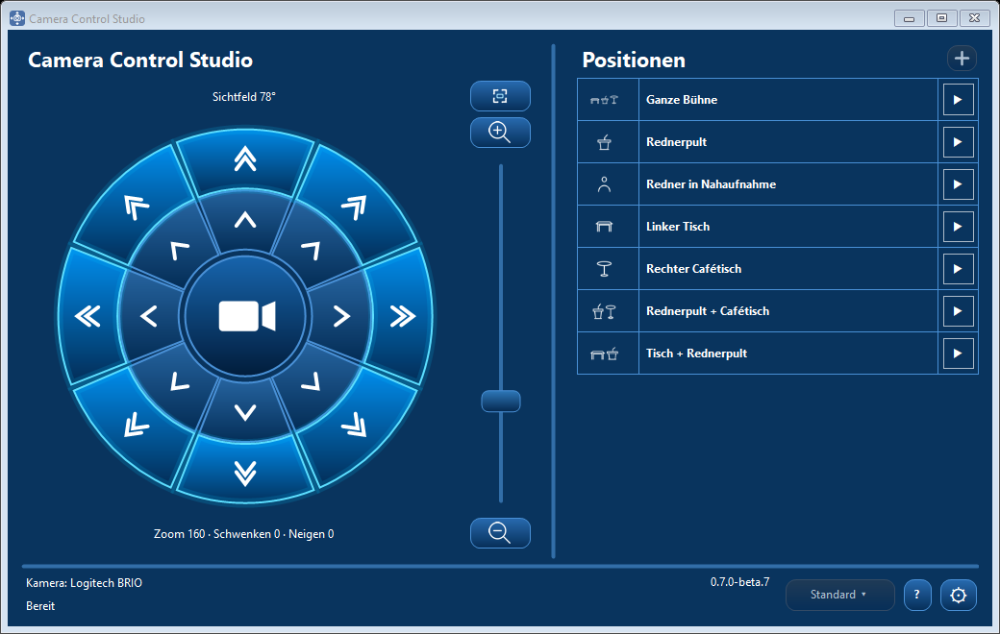

[English](../en/DAILY-USE.md) · [Dansk](../da/DAILY-USE.md) · [Deutsch](../de/DAILY-USE.md) · [Alle Sprachen](../USER-GUIDES.md)

# Tägliche Nutzung

Starten Sie zuerst Ihr Streaming-Meeting, zum Beispiel in Zoom. Öffnen Sie anschließend **Camera Control Studio**.

## Allgemeines

Klicken Sie auf **?**, um die Hilfe zu öffnen. Zeigen Sie auf eine Taste, um ihre Funktion zu sehen. Eine Richtung stoppt an der äußersten Grenze der Kamera. [So funktioniert der automatische Sichtfeldwechsel](SETUP.md#sichtfeld-einstellen)

## 1. Position aktivieren

Klicken Sie in einer Zeile der Positionsliste auf ▶ oder doppelklicken Sie auf den Namen.
Sie können die Zeile auch auswählen und die Eingabetaste drücken.

| Farbe | Bedeutung |
| --- | --- |
| Gelb | Die Anwendung fährt die Position an. |
| Grün | Der Kameratreiber meldet, dass die gespeicherten Koordinaten erreicht wurden. |
| Blau | Die Position ist nicht als aktiv markiert. |

Grün bedeutet, dass der Treiber die gespeicherte Position und gegebenenfalls das Sichtfeld meldet. Prüfen Sie das Bild im Stream. Kann der Treiber den Ausschnitt nicht rechtzeitig bestätigen, wird die Zeile blau. Lesen Sie die Statusmeldung.

## 2. Bildausschnitt feinjustieren

### Schwenken

Der innere Ring bewegt die Kamera normal, der äußere schnell. Jeder Ring hat acht Pfeile. Die diagonalen Pfeile bewegen beide Achsen in 45°-Richtung mit je 45 % des Ringtempos. Ein Klick bewegt jede verfügbare Achse um mindestens einen Treiberschritt. Halten Sie einen Pfeil, um weiterzufahren. Lassen Sie ihn zum Anhalten los.

Klicken Sie auf die Kamerataste, um eine Quelle zu wählen. Halten Sie die Taste und ziehen Sie in die gewünschte Richtung. Je weiter Sie ziehen, desto schneller fährt die Kamera, bis zum Doppelten des schnellen Tempos. Ziehen Sie zum Ausgangspunkt zurück oder lassen Sie die Taste zum Anhalten los.

### Zoomen

Verwenden Sie die Lupentasten zum Zoomen. Halten Sie eine Lupentaste gedrückt, um den Vorgang zu wiederholen.
Der Zoom ändert sich, während Sie den Schieberegler ziehen.

### Schwenken abbrechen

Drücken Sie Esc, um einen laufenden Schwenk abzubrechen.

> Manuelles Schwenken, Neigen oder Zoomen bricht den Positionswechsel ab und hebt die farbliche Markierung der aktiven Position auf.

### Pfeiltasten

Nutzen Sie die Pfeiltasten, wenn das Kamerarad den Fokus hat. Halten Sie Strg für feine oder Umschalt für schnelle Bewegungen.

## 3. Temporäre Position speichern

Klicken Sie über der Positionsliste auf **+**, geben Sie einen Namen ein und speichern Sie. Die aktuelle Position erscheint unter den festen Positionen.
Temporäre Positionen haben kein Symbol. Sie bleiben bis zum Schließen der Anwendung erhalten und werden für jedes Profil und jede Kamera getrennt gespeichert.

Wählen Sie eine temporäre Zeile aus und klicken Sie über der Positionsliste auf **×**, um sie zu entfernen. Beim Schließen der Anwendung werden alle temporären Positionen entfernt.
Wenn Sie eine Position später wiederverwenden möchten, legen Sie sie unter **Einstellungen → Positionen** an. Feste Positionen lassen sich in der Hauptliste weder bearbeiten noch löschen.

## 4. Beenden

Wenn unten **Neue Version verfügbar** erscheint, öffnet ein Klick auf den Link die Veröffentlichung mit den Downloads auf GitHub.

<https://github.com/bkristensen/Camera-Ctrl-Pressets-Studio/releases>

Lesen Sie bei einer Störung die Meldung im Statusbereich unten. Möglicherweise unterstützt die Kamera die Funktion nicht oder ist nicht verfügbar.

Schließen Sie die Anwendung wie gewohnt. Das aktive Profil und das Fensterlayout werden gespeichert.

## 5. Probleme melden

Melden Sie Fehler oder fehlende Funktionen unter **Einstellungen → Fehler melden**.

Siehe [Einrichtung](SETUP.md) für Kamerarichtung, feste Positionen, Bildeinstellungen, Profile und Bewegungsschritte.
