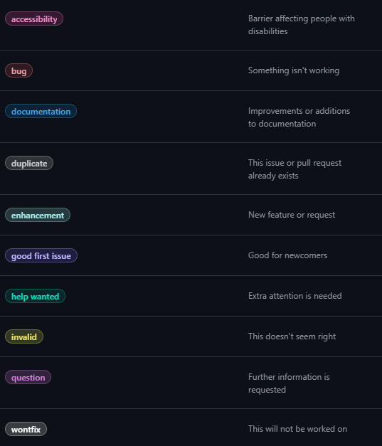

# Melden oder verfolgen Sie ein Problem

*Geschrieben für Camera Control Studio 1.0.1.*

[Fehlerbehebung](TROUBLESHOOTING.md)

## Suchen Sie vor der Meldung

**Melden Sie einen Fehler oder schlagen Sie eine Funktion vor**\
<https://github.com/bkristensen/Camera-Ctrl-Pressets-Studio/issues?q=is%3Aissue>\
 des Projekts

1. Öffnen Sie die Registerkarte [Issues](https://github.com/bkristensen/Camera-Ctrl-Pressets-Studio/issues?q=is%3Aissue) des Projekts. Suchen Sie nach Schlüsselbegriffen aus dem Symptom oder der Anfrage, z. B. `is:issue Brio zoom` oder `is:issue label:enhancement preset`.
2. Überprüfen Sie offene und geschlossene Ergebnisse. Lesen Sie ähnliche Berichte für passende Symptome und Problemumgehungen.
3. Wählen Sie bei einem passenden Problem in der Seitenleiste **Subscribe** aus, um Updates zu erhalten, oder reagieren Sie mit 👍, um anzuzeigen, dass es Sie betrifft. Fügen Sie einen Kommentar hinzu, wenn Sie Details wie eine andere Kamera, ein Testergebnis oder eine zuverlässige Reproduktion beisteuern können.

## Öffnen Sie einen Bericht

Öffnen Sie die Einstellungen. Wählen Sie **Kontakt & Info → Kontakt**. Wählen Sie **Fehler melden** oder **Neue Funktion vorschlagen**, um den passenden GitHub-Entwurf zu öffnen. Bei einer Fehlermeldung bietet die App ein Support-ZIP an. Prüfen Sie es und hängen Sie es selbst im Entwurf an. [Fehler melden](Report%20a%20bug.md) · [Neue Funktion vorschlagen](Request%20a%20feature.md)

Geben Sie bei einem Fehler die Camera Control Studio-Version, die Windows-Version, das Kameramodell, die relevante Kamera- oder Aufnahmesoftware und die Reihenfolge an, in der Sie die Apps gestartet haben. Beschreiben Sie die genauen Schritte, was Sie erwartet haben, was passiert ist und wie oft. Beschreiben Sie bei einer Anfrage die Aufgabe, die Sie erledigen möchten, und wie Sie die Funktion nutzen würden.

Wenn **Type** verfügbar ist, verwenden Sie **Bug** für unerwartetes Verhalten, **Feature** für eine Anfrage oder **Task** für eine definierte Arbeit. Wenn Sie Etiketten anwenden können, verwenden Sie die relevantesten, z. B. `bug`, `enhancement`, `documentation` oder `accessibility`. Betreuer können nach der Übermittlung Metadaten hinzufügen.

## Beweise beifügen

Erstellen Sie ein Paket über **Kontakt & Info → Kontakt → Support-ZIP speichern**. Wählen Sie einen Speicherort. Die App zeigt den vollständigen Dateipfad an.

Die ZIP-Datei enthält ein Bildschirmfoto der App, die gespeicherte Datei `profiles.json`, das Fensterlayout in `window.json` und vorhandene Protokolle unter `Logs`.

Prüfen Sie die Datei auf private Angaben wie Profilnamen, Kamera-IDs und Dateipfade. Ziehen Sie die ZIP-Datei oder die passenden Dateien selbst in die Beschreibung des Entwurfs.

Prüfen Sie Beschreibung und Anhänge unter **Preview**. Wählen Sie dann **Create**.

[GitHub-Problemsuchreferenz](https://docs.github.com/en/search-github/searching-on-github/searching-issues-and-pull-requests)
