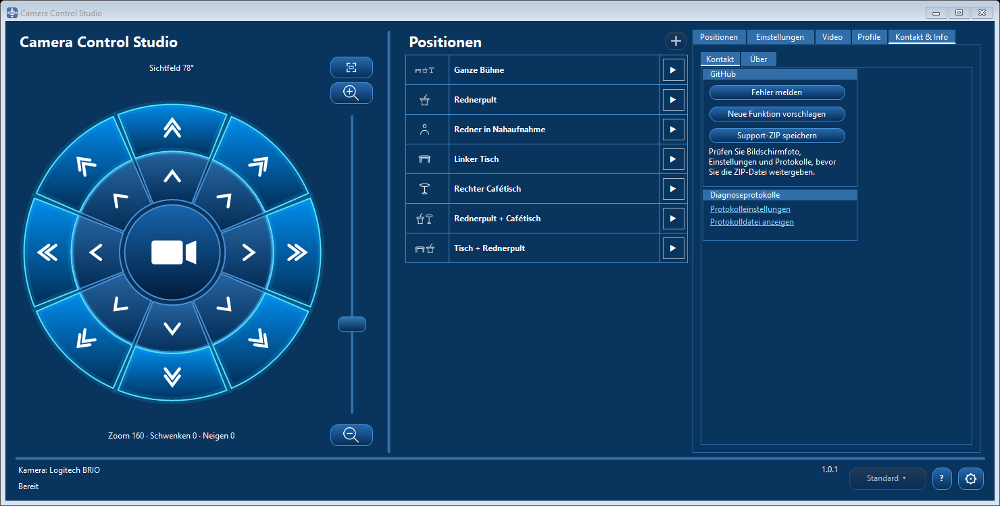

# Fehler melden

1. Öffnen Sie die Einstellungen. Wählen Sie **Kontakt & Info → Kontakt → Fehler melden**.
2. Wenn eine neuere Version verfügbar ist, wählen Sie **Ja**, um die Downloadseite zu öffnen. Installieren Sie sie und prüfen Sie, ob sich der Fehler reproduzieren lässt. Wählen Sie **Nein**, um zum GitHub-Entwurf zu gehen.
3. Wenn die App ein Support-ZIP anbietet, wählen Sie **Ja** und einen Speicherort. Mit **Nein** öffnen Sie den Entwurf ohne Paket.

## Details und ZIP-Datei hinzufügen

Die Schaltfläche öffnet die GitHub-Vorlage **Bug report**. Beschreiben Sie das erwartete Verhalten, den Fehler und die Schritte zur Reproduktion. Nennen Sie die App- und Windows-Version. Geben Sie bei Bedarf Kamera und Aufnahmeprogramm an. Füllen Sie alle Abschnitte mit einem roten Sternchen aus.

Erstellen Sie ein Paket über **Kontakt & Info → Kontakt → Support-ZIP speichern**. Wählen Sie einen Speicherort. Die App zeigt den vollständigen Dateipfad an.

Die ZIP-Datei enthält ein Bildschirmfoto der App, die gespeicherte Datei `profiles.json`, das Fensterlayout in `window.json` und vorhandene Protokolle unter `Logs`.

Prüfen Sie die Datei auf private Angaben wie Profilnamen, Kamera-IDs und Dateipfade. Ziehen Sie die ZIP-Datei oder die passenden Dateien selbst in die Beschreibung des Entwurfs.

## Typ und Labels prüfen

Die Vorlage fordert unter **Type** den Wert **Bug** und unter **Labels** `bug` an. Wenn die Werte fehlen und die Felder verfügbar sind, wählen Sie sie in der rechten Seitenleiste. Wenn Sie sie nicht ändern können, kann die Projektpflege sie nach dem Einreichen setzen.

Prüfen Sie Beschreibung und Anhänge unter **Preview**. Wählen Sie dann **Create**.
