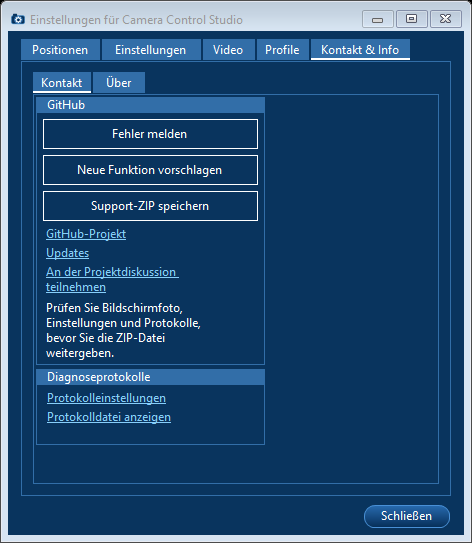

# Neue Funktion vorschlagen

*Geschrieben für Camera Control Studio 1.1.1.*

1. Klicken Sie unten auf das Zahnrad, um die Einstellungen zu öffnen. Wählen Sie **Kontakt & Info → Kontakt → Neue Funktion vorschlagen**.
2. Wenn eine neuere Version verfügbar ist, wählen Sie **Ja**, um die Downloadseite zu öffnen. Installieren Sie sie und prüfen Sie, ob sie die gewünschte Funktion enthält. Wählen Sie **Nein**, um zum GitHub-Entwurf zu gehen.
3. Beschreiben Sie in der GitHub-Vorlage **Feature request**, was Sie tun möchten, wie die Funktion helfen würde und woran Sie erkennen, dass sie funktioniert. Füllen Sie alle Abschnitte mit einem roten Sternchen aus.

Dieselben GitHub-Schaltflächen stehen im Handbuchfenster zur Verfügung.

## Ein Beispiel anhängen

Erstellen Sie ein Paket über **Kontakt & Info → Kontakt → Support-ZIP speichern**. Wählen Sie einen Speicherort. Die App zeigt den vollständigen Dateipfad an.

Die ZIP-Datei enthält ein Bildschirmfoto der App, die gespeicherte Datei `profiles.json`, das Fensterlayout in `window.json` und vorhandene Protokolle unter `Logs`.

Prüfen Sie die Datei auf private Angaben wie Profilnamen, Kamera-IDs und Dateipfade. Ziehen Sie die ZIP-Datei oder die passenden Dateien selbst in die Beschreibung des Entwurfs.

## Typ und Labels prüfen

Die Vorlage fordert unter **Type** den Wert **Feature** und unter **Labels** `enhancement` an. Wenn die Werte fehlen und die Felder verfügbar sind, wählen Sie sie in der rechten Seitenleiste. Wenn Sie sie nicht ändern können, kann die Projektpflege sie nach dem Einreichen setzen.

Prüfen Sie Beschreibung und Anhänge unter **Preview**. Wählen Sie dann **Create**.
