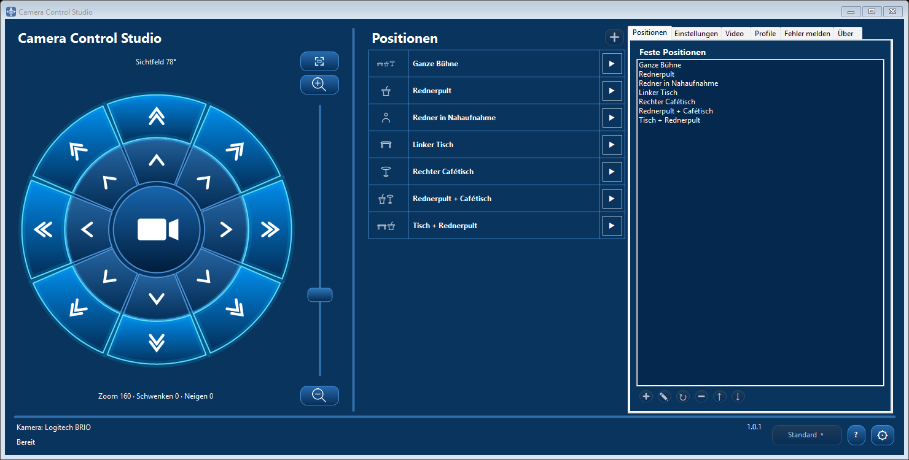
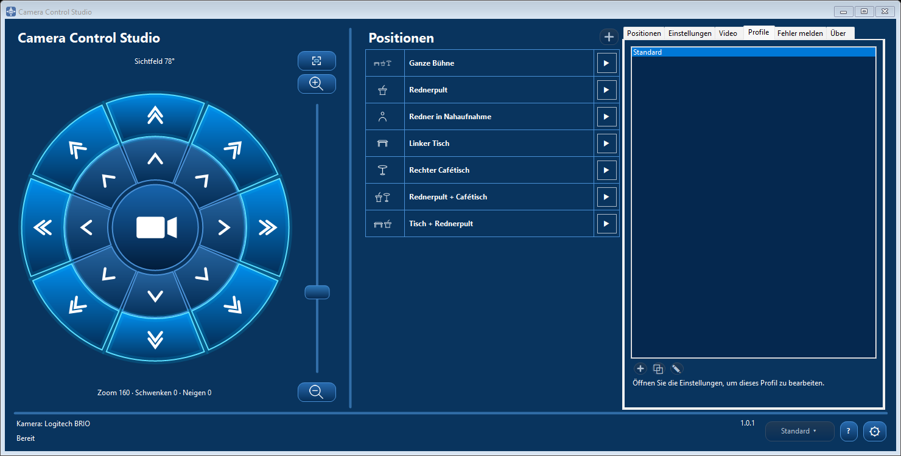
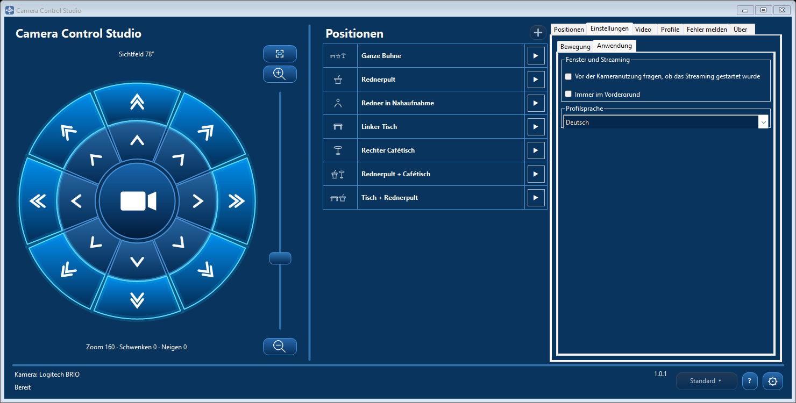
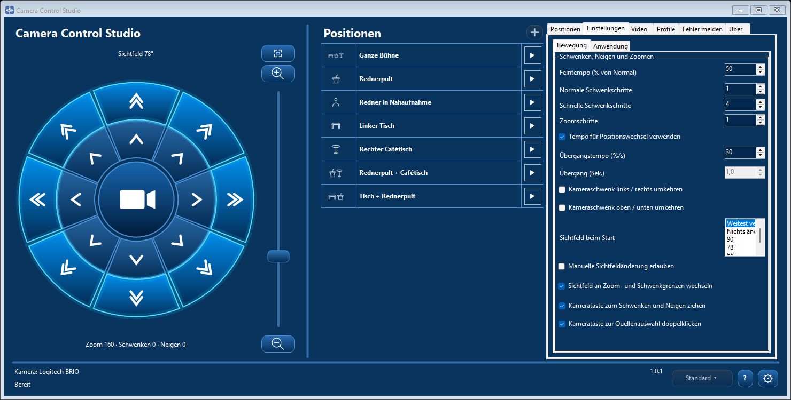
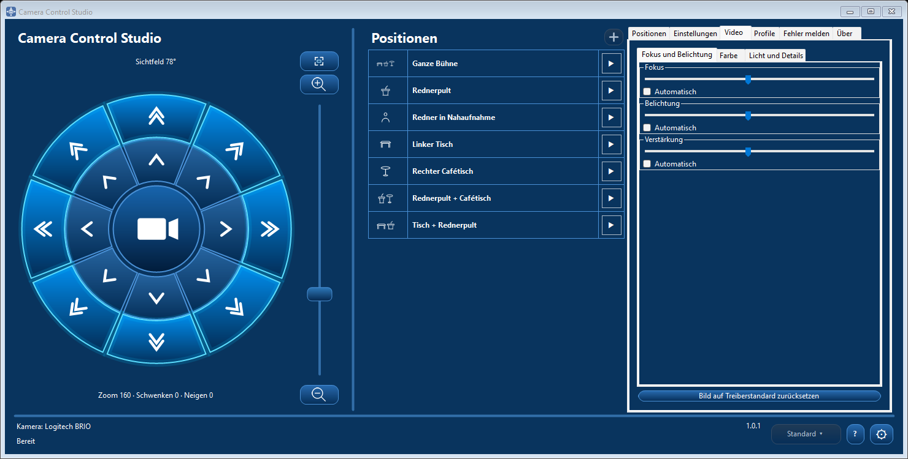
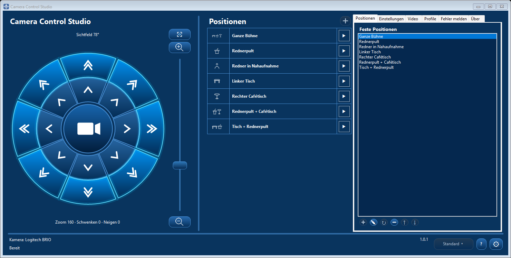
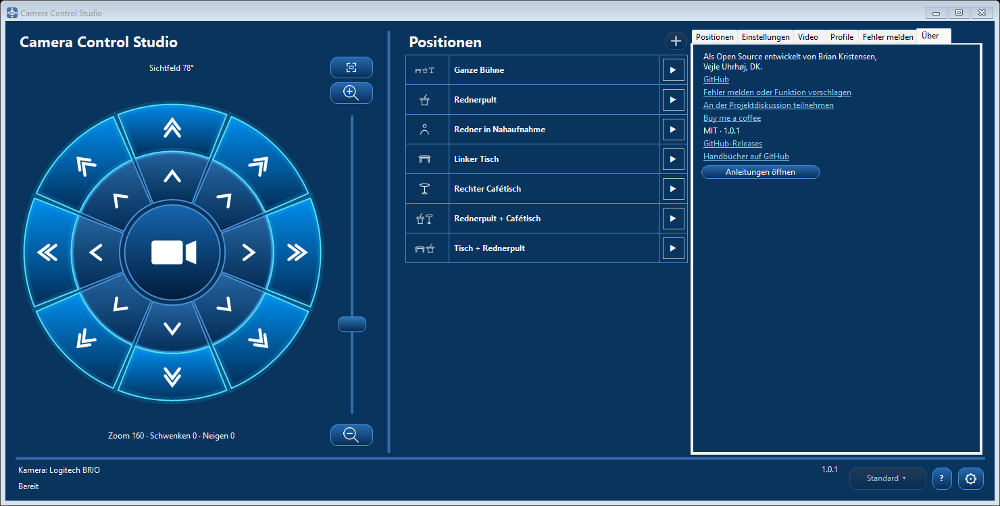
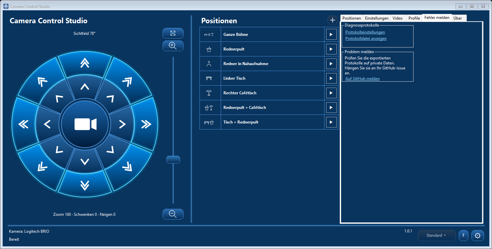

[English](../en/SETUP.md) · [Dansk](../da/SETUP.md) · [Deutsch](../de/SETUP.md) · [Alle Sprachen](../USER-GUIDES.md)

# Anwendung einrichten

*Geschrieben für Camera Control Studio 1.0.1.*

[Fehlerbehebung](TROUBLESHOOTING.md)

Klicken Sie unten auf das Zahnrad. Die Einstellungen öffnen sich rechts. Die Positionsliste bleibt sichtbar.

## Installation und Download prüfen

Laden Sie das Installationsprogramm oder die portable ZIP-Datei aus den [GitHub-Releases](https://github.com/bkristensen/Camera-Ctrl-Pressets-Studio/releases) herunter. Starten Sie das Installationsprogramm oder entpacken Sie die gesamte ZIP-Datei. Wenn eine SHA-256-Prüfsumme veröffentlicht wurde, vergleichen Sie sie mit der Ausgabe von `Get-FileHash -Algorithm SHA256`.

**Offizieller Download**\
<https://github.com/bkristensen/Camera-Ctrl-Pressets-Studio/releases>\

Microsoft Defender SmartScreen kann eine blaue Warnung anzeigen, wenn die Datei oder ihr Herausgeber über wenig etablierte Reputation verfügt. Nehmen Sie die Warnung ernst. Wenn Sie die erwartete Datei aus dem offiziellen Release bezogen haben und der Quelle vertrauen, wählen Sie **Weitere Informationen** und prüfen Sie Dateinamen und Herausgeber. Wählen Sie **Trotzdem ausführen** nur, wenn Sie der Datei vertrauen und Windows die Option anbietet. Schließen Sie andernfalls die Warnung. Beachten Sie die Richtlinien Ihrer Organisation. [Microsoft-Hinweise zu SmartScreen](https://learn.microsoft.com/windows/apps/package-and-deploy/smartscreen-reputation)

<https://learn.microsoft.com/windows/apps/package-and-deploy/smartscreen-reputation>

Falls der Leitfaden-Viewer WebView2 benötigt, laden Sie die Runtime bei Microsoft herunter.\
<https://developer.microsoft.com/microsoft-edge/webview2/>

## 1. Profil und Kamera wählen

Wählen Sie das Profil über die Profilauswahl unten. Öffnen Sie **Einstellungen → Profile**, um ein Profil anzulegen. **Neu** verwendet die Standardwerte. **Kopieren** kopiert das aktive Profil. Benennen Sie es nach einer Person oder einem Aufbau. Das neue Profil wird aktiv. Wählen Sie unter **Profile** einen Eintrag und klicken Sie zum Umbenennen auf **✎**. Das Standardprofil hat einen festen Namen.

Doppelklicken Sie auf das Kamerasymbol in der Mitte des Steuerrads, um die Kamera zu wählen. Die Anwendung merkt sich die Auswahl. Fehlt die Kamera, wählen Sie eine andere Quelle. Positionen gehören zu einer Kamera innerhalb eines Profils.

## 2. Kamerazugriff festlegen

Aktivieren Sie unter **Einstellungen → Anwendung** die Option **Vor der Kameranutzung fragen, ob das Streaming gestartet wurde**, wenn Ihr Aufnahmeprogramm zuerst starten muss. Die Option ist standardmäßig aus.

Mit dieser Option fragt die erste Kamerafunktion, ob das Streaming begonnen hat. Wählen Sie erst dann **Ja**. **Nein** lässt die Kamerasteuerung getrennt. Nach Ja wird erst wieder gefragt, wenn Sie das Profil wechseln, die Option ändern oder die Anwendung neu starten. Die Anwendung erkennt oder startet keinen Stream.

Wenn Sie diese Reihenfolge brauchen, aktivieren Sie die Option vor der nächsten Sitzung. Die Standardeinstellung erlaubt die Verbindung beim Start.

## 3. Bewegung und Zoom einstellen

Ändern Sie die Werte unter **Einstellungen → Bewegung**. Beginnen Sie mit kleinen Schritten. Prüfen Sie das Bild in Ihrem Aufnahmeprogramm.

| Einstellung | Wirkung | Standard |
| --- | --- | --- |
| Feintempo (% von Normal) | Tempo beim Gedrückthalten von Strg und einer Pfeiltaste | 50 % |
| Normale Schwenkschritte | Mittlerer Pfeilring | 1 |
| Schnelle Schwenkschritte | Äußerer Pfeilring | 4 |
| Zoomschritte | − und + | 1 |
| Übergang in Sekunden | Zeit für einen Positionswechsel bei fester Dauer | 1,0 |
| Tempo für Positionswechsel verwenden | Die Entfernung bestimmt die Dauer | Aus |
| Übergangstempo (%/s) | Tempo in Prozent des Bereichs der maßgeblichen Achse pro Sekunde | 30 % |

Bei tempobasierten Übergängen dauern kurze Bewegungen weniger lang als lange. Die App beschleunigt und bremst und steuert die Achsen gemeinsam, damit sie das Ziel gleichzeitig erreichen können.

Ein Schritt entspricht einem Schritt des Kameratreibers. Er ist keine feste Strecke oder Prozentzahl. Der Treiber begrenzt die Bewegung und ihre Gleichmäßigkeit.

Hängt die Kamera kopfüber, testen Sie **Kameraschwenk oben / unten umkehren** mit dem Pfeil nach oben. Aktivieren Sie **Kameraschwenk links / rechts umkehren** nur, wenn Links in die falsche Richtung führt. Diese Optionen ändern die Steuerung. Sie drehen das Videobild nicht.

### Sichtfeld einstellen

Öffnen Sie **Einstellungen → Bewegung**. Wählen Sie unter **Sichtfeld beim Start** das weiteste verfügbare Sichtfeld, einen vom Kameratreiber gemeldeten Winkel oder **Nichts ändern**, um das aktuelle Sichtfeld beizubehalten. Die App nutzt den Wert beim ersten Verbinden. Aktivieren Sie **Manuelle Sichtfeldänderung erlauben**, um die Winkel unter dem Kamerarad auszuwählen. Meldet der Treiber keine wählbaren Winkel, sind die Sichtfeldeinstellungen deaktiviert. Der Zoom bleibt verfügbar, wenn die Kamera ihn unterstützt.

**Sichtfeld an Zoom- und Schwenkgrenzen wechseln** ist standardmäßig aktiv. Es funktioniert auch bei ausgeblendeter Auswahl, wenn der Treiber das Sichtfeld steuern kann.

- **Herauszoomen:** Bei minimalem Zoom und 65° wechselt der nächste Tastendruck bei einer Brio auf 78°. Die App passt den Zoom an, um den Ausschnitt möglichst zu halten. Drücken Sie erneut, um normal weiter herauszuzoomen. Ebenso geht es von 78° auf 90°. Die Taste stoppt bei 90° und kleinstem Zoom.
- **Hineinzoomen:** Bei maximalem Zoom wechselt der nächste Druck zu einem engeren Sichtfeld. Meldet der Treiber 90°, 78° und 65°, nutzt die App sie in dieser Reihenfolge. Die Taste stoppt beim engsten verfügbaren Sichtfeld und größtem Zoom.
- **Nach links oder rechts schwenken:** An der Grenze versucht die App zuerst ein weiteres Sichtfeld. Sie passt den Zoom an, um den Ausschnitt möglichst zu halten. Lässt es der Zoom zu, testet sie auch ein engeres Sichtfeld. Kann sie in keinem Sichtfeld weiter schwenken, stellt sie den vorherigen Ausschnitt wieder her. Der Treiber bestimmt, wie genau der Ausschnitt erhalten bleibt.

Die quadratische Taste mit Rahmensymbol stellt das weiteste Sichtfeld und den kleinsten Zoom ein. Der Schieberegler zoomt im aktuellen Sichtfeld. Deaktivieren Sie den automatischen Wechsel, um dieses Sichtfeld beim Zoomen und Schwenken beizubehalten.

Positionen speichern Schwenk- und Neigewinkel, Zoom und das vom Treiber gemeldete Sichtfeld. Ältere Positionen behalten das aktuelle Sichtfeld. Prüfen Sie das Livebild, wenn Zoom, Logitech Brio Control oder eine andere App den Ausschnitt steuert. [Testschritte für Brio und Zoom auf Englisch](../VALIDATION.md#brio-field-of-view-and-zoom)

## 4. Bild anpassen und feste Positionen speichern

[Vor dem Laden der Videoregler](../images/screenshots/1.0.1/de/video.png) · [Farbe](../images/screenshots/1.0.1/de/video-colour.png) · [Licht und Details](../images/screenshots/1.0.1/de/video-light-detail.png)

Öffnen Sie **Video** im Einstellungsbereich. Laden Sie die Bildregler bei Bedarf. Wählen Sie **Fokus und Belichtung**, **Farbe** oder **Licht und Details**. Es erscheinen nur Funktionen, die der Treiber bereitstellt. Stellen Sie Helligkeit, Kontrast, Farbsättigung, Fokus oder Weißabgleich ein, soweit verfügbar. Schalten Sie die Automatik vor einer manuellen Änderung aus. Bildwerte werden pro Kamera und Profil gespeichert. Die Rücksetztaste stellt die Treiberstandardwerte wieder her.

Richten Sie zuerst die Kamera aus. Öffnen Sie **Positionen** im Einstellungsbereich und klicken Sie auf **+**, um eine feste Position hinzuzufügen. Wählen Sie oben ein Symbol. Prüfen Sie den Namen und speichern Sie. Ist das Namensfeld leer und der Name noch frei, schlägt das Symbol einen Namen vor. Kombinierte Symbole zeigen ihre Motive von links nach rechts.

Wählen Sie unter **Feste Positionen** einen Eintrag. Zeigen Sie auf die Symbole, um ihre Funktion zu sehen. Mit **✎** ändern Sie Name und Symbol, mit **↻** übernehmen Sie die aktuelle Kameraposition und mit **−** löschen Sie den Eintrag. **↑** und **↓** ändern die Reihenfolge in beiden Listen.

Eine feste Position, die in der Hauptliste ausgewählt ist, wird auch in den Einstellungen ausgewählt. Eine neu gespeicherte feste Position wird in den Einstellungen ausgewählt.

## 5. Layout und Sprache einstellen

Ziehen Sie die Trennlinie zwischen Kamerasteuerung und Positionsliste. Das Profil speichert die Trennlinie sowie Lage und Größe des Fensters. Die Anfangsgröße beträgt 900 × 500, die Mindestgröße 670 × 450. Die Einstellungen starten geschlossen. Beim ersten Öffnen nach dem Start erscheint die erste Registerkarte. Scrollen Sie unter **Bewegung** oder **Anwendung** nach unten, wenn Felder außerhalb des Fensters liegen. Die App speichert die Fensterbreite bei geschlossenen Einstellungen.

Lassen Sie beim Profilwechsel über die Profilauswahl unten die Option **Aktuelle Position und Anordnung beibehalten** aus, um das gespeicherte Layout zu laden. Aktivieren Sie sie, um das aktuelle Layout mitzunehmen. Die Wahl wird im verlassenen Profil gespeichert. Das übernommene Layout wird im Zielprofil gespeichert.

Wählen Sie die Sprache unter **Einstellungen → Anwendung → Profilsprache**. Starten Sie das Programm neu, um die Sprache anzuwenden. **Automatisch** verwendet die Windows-Anzeigesprache, sofern sie unterstützt wird, und sonst Englisch. Beim Profilwechsel startet das Programm mit der Sprache des gewählten Profils neu. Temporäre Positionen gehen beim Neustart verloren.

## 6. Version und Projektinformationen

Unter **Info** finden Sie die Version und Projektlinks. Zeigen Sie auf die Version, um die vollständige Build-ID zu sehen. Geben Sie sie an, wenn ein Fehler nur in einem bestimmten Build auftritt.

## 7. Diagnoseprotokolle und Fehlermeldungen

Unter **Fehler melden** können Sie den Protokollordner, die maximale Dateigröße und die Anzahl der aufzubewahrenden Dateien einschließlich des aktiven Protokolls einstellen. Standardmäßig nutzt die Anwendung den Programmordner oder ersatzweise `%LOCALAPPDATA%\CamPressets\Logs`.

**Auf GitHub melden** öffnet einen Entwurf und den lokalen Ordner mit den Berichtsdateien. Prüfen Sie die Dateien und hängen Sie sie im GitHub-Editor an.

**Fehler melden oder Funktion vorschlagen**\
<https://github.com/bkristensen/Camera-Ctrl-Pressets-Studio/issues?q=is%3Aissue>\

Weiter: [Tägliche Nutzung](DAILY-USE.md). Für eine Sicherung schließen Sie die Anwendung und kopieren `%LOCALAPPDATA%\CamPressets`. Temporäre Positionen sind nicht enthalten.
