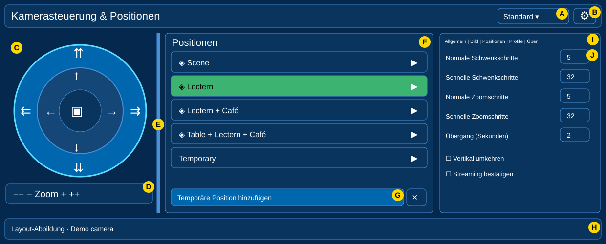
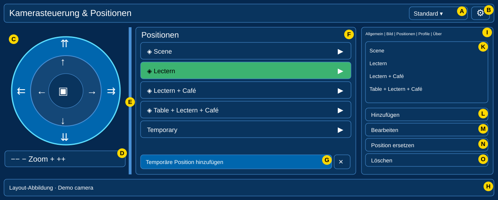

[English](../en/SETUP.md) · [Dansk](../da/SETUP.md) · [Deutsch](../de/SETUP.md)

# Anwendung einrichten

Klicken Sie auf das Zahnrad **B**. Die Einstellungen öffnen sich rechts. Die Positionsliste bleibt sichtbar.

*Layout-Abbildung, kein Windows-Screenshot. Die Buchstaben passen zu den Beschreibungen unten. Siehe [Bildaufnahme](../SCREENSHOTS.md).*

## 1. Profil und Kamera wählen

Wählen Sie das Profil über **A** im Hauptfenster. Öffnen Sie **Einstellungen → Profile** (**I**), um ein Profil anzulegen. **Neu** verwendet die Standardwerte. **Kopieren** kopiert das aktive Profil. Benennen Sie es nach einer Person oder einem Aufbau. Das neue Profil wird aktiv.

Klicken Sie auf das Kamerasymbol in der Mitte von **C**, um die Kamera zu wählen. Die Anwendung merkt sich die Auswahl. Fehlt die Kamera, wählen Sie eine andere Quelle. Positionen gehören zu einer Kamera innerhalb eines Profils.

## 2. Kamerazugriff festlegen

Aktivieren Sie unter **Einstellungen** (**J**) die Option **Vor der Kameranutzung fragen, ob das Streaming gestartet wurde**, wenn Ihr Aufnahmeprogramm zuerst starten muss. Die Option ist standardmäßig aus.

Mit dieser Option fragt die erste Kamerafunktion, ob das Streaming begonnen hat. Wählen Sie erst dann **Ja**. **Nein** lässt die Kamerasteuerung getrennt. Nach Ja wird erst wieder gefragt, wenn Sie das Profil wechseln, die Option ändern oder die Anwendung neu starten. Die Anwendung erkennt oder startet keinen Stream.

Wenn Sie diese Reihenfolge brauchen, aktivieren Sie die Option vor der nächsten Sitzung. Die Standardeinstellung erlaubt die Verbindung beim Start.

## 3. Bewegung und Zoom einstellen

Ändern Sie die Werte in **J**. Beginnen Sie mit kleinen Schritten. Prüfen Sie das Bild in Ihrem Aufnahmeprogramm.

| Einstellung | Wirkung | Standard |
| --- | --- | --- |
| Normale Schwenkschritte | Innerer Pfeilring | 5 |
| Schnelle Schwenkschritte | Äußerer Pfeilring | 32 |
| Normale Zoomschritte | − und + | 5 |
| Schnelle Zoomschritte | −− und ++ | 32 |
| Übergang in Sekunden | Gewünschte Dauer eines Positionswechsels | 2 |

Ein Schritt entspricht einem Schritt des Kameratreibers. Er ist keine feste Strecke oder Prozentzahl. Der Treiber begrenzt die Bewegung und ihre Gleichmäßigkeit.

Hängt die Kamera kopfüber, testen Sie **Oben / unten umkehren** mit dem Pfeil nach oben. Aktivieren Sie **Links / rechts umkehren** nur, wenn Links in die falsche Richtung führt. Diese Optionen ändern die Steuerung. Sie drehen das Videobild nicht.

## 4. Bild anpassen und feste Positionen speichern

Öffnen Sie **Bild** in **I**. Laden Sie die Bildregler bei Bedarf. Es erscheinen nur Funktionen, die der Treiber bereitstellt. Stellen Sie Helligkeit, Kontrast, Farbsättigung, Fokus oder Weißabgleich ein, soweit verfügbar. Schalten Sie die Automatik vor einer manuellen Änderung aus. Bildwerte werden pro Kamera und Profil gespeichert. Die Rücksetztaste stellt die Treiberstandardwerte wieder her.

*Beschriftete Layout-Abbildung.*

Richten Sie zuerst die Kamera aus. Öffnen Sie **Positionen** in **I** und wählen Sie **Hinzufügen** (**L**). Wählen Sie oben ein Symbol. Prüfen Sie den Namen und speichern Sie. Ist das Namensfeld leer und der Name noch frei, schlägt das Symbol einen Namen vor. Kombinierte Symbole zeigen ihre Motive von links nach rechts.

Wählen Sie eine Position in **K** zum Bearbeiten. **M** ändert Name und Symbol. **N** ersetzt die Koordinaten durch die aktuelle Kameraposition. **O** löscht nach Bestätigung. Feste Positionen stehen in der Hauptliste immer oben und in Fettschrift.

## 5. Layout und Sprache einstellen

Ziehen Sie die Trennlinie **E** zwischen Steuerung und Positionsliste. Verschieben Sie das Fenster oder ändern Sie seine Größe. Fensterlage, Größe, Trennlinie, Einstellungsbereich und gewählte Registerkarte werden im aktiven Profil gespeichert. Die Anfangsgröße beträgt 900 × 500 bei normaler Windows-Skalierung.

Lassen Sie beim Profilwechsel über **A** die Option **Aktuelle Position und Anordnung beibehalten** aus, um das gespeicherte Layout zu laden. Aktivieren Sie sie, um das aktuelle Layout mitzunehmen. Die Wahl wird im verlassenen Profil gespeichert. Das übernommene Layout wird im Zielprofil gespeichert.

Wählen Sie die Sprache unter **Einstellungen** und starten Sie die Anwendung neu. Automatisch verwendet Deutsch oder Dänisch, wenn Windows diese Sprache nutzt. Sonst wird Englisch verwendet. Die Sprachwahl gilt für die gesamte Anwendung, nicht nur für ein Profil.

Weiter: [Tägliche Nutzung](DAILY-USE.md). Für eine Sicherung schließen Sie die Anwendung und kopieren `%LOCALAPPDATA%\CamPressets`. Temporäre Positionen sind nicht enthalten.
