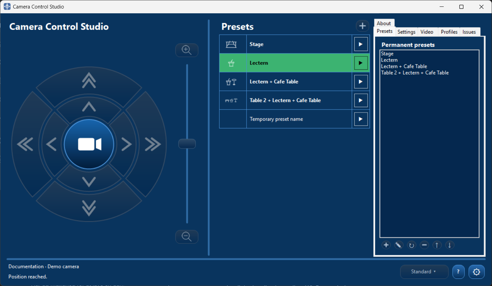

[English](../en/SETUP.md) · [Dansk](../da/SETUP.md) · [Deutsch](../de/SETUP.md) · [Alle Sprachen](../USER-GUIDES.md)

# Anwendung einrichten

Klicken Sie unten auf das Zahnrad. Die Einstellungen öffnen sich rechts. Die Positionsliste bleibt sichtbar.

## 1. Profil und Kamera wählen

Wählen Sie das Profil über die Profilauswahl unten. Öffnen Sie **Einstellungen → Profile**, um ein Profil anzulegen. **Neu** verwendet die Standardwerte. **Kopieren** kopiert das aktive Profil. Benennen Sie es nach einer Person oder einem Aufbau. Das neue Profil wird aktiv. Wählen Sie unter **Profile** einen Eintrag und klicken Sie zum Umbenennen auf **✎**. Das Standardprofil hat einen festen Namen.

Klicken Sie auf das Kamerasymbol in der Mitte des Steuerrads, um die Kamera zu wählen. Die Anwendung merkt sich die Auswahl. Fehlt die Kamera, wählen Sie eine andere Quelle. Positionen gehören zu einer Kamera innerhalb eines Profils.

## 2. Kamerazugriff festlegen

Aktivieren Sie unter **Einstellungen → Anwendung** die Option **Vor der Kameranutzung fragen, ob das Streaming gestartet wurde**, wenn Ihr Aufnahmeprogramm zuerst starten muss. Die Option ist standardmäßig aus.

Mit dieser Option fragt die erste Kamerafunktion, ob das Streaming begonnen hat. Wählen Sie erst dann **Ja**. **Nein** lässt die Kamerasteuerung getrennt. Nach Ja wird erst wieder gefragt, wenn Sie das Profil wechseln, die Option ändern oder die Anwendung neu starten. Die Anwendung erkennt oder startet keinen Stream.

Wenn Sie diese Reihenfolge brauchen, aktivieren Sie die Option vor der nächsten Sitzung. Die Standardeinstellung erlaubt die Verbindung beim Start.

## 3. Bewegung und Zoom einstellen

Ändern Sie die Werte unter **Einstellungen → Bewegung**. Beginnen Sie mit kleinen Schritten. Prüfen Sie das Bild in Ihrem Aufnahmeprogramm.

| Einstellung | Wirkung | Standard |
| --- | --- | --- |
| Feintempo (% von Normal) | Tempo beim Gedrückthalten eines Pfeils im inneren Ring | 50 % |
| Normale Schwenkschritte | Mittlerer Pfeilring | 1 |
| Schnelle Schwenkschritte | Äußerer Pfeilring | 4 |
| Zoomschritte | − und + | 1 |
| Übergang in Sekunden | Zeit für einen Positionswechsel bei fester Dauer | 1,0 |
| Tempo für Positionswechsel verwenden | Die Entfernung bestimmt die Dauer | Aus |
| Übergangstempo (%/s) | Tempo in Prozent des Bereichs der maßgeblichen Achse pro Sekunde | 30 % |

Bei tempobasierten Übergängen dauern kurze Bewegungen weniger lang als lange. Die App beschleunigt und bremst und steuert die Achsen gemeinsam, damit sie das Ziel gleichzeitig erreichen können.

Ein Schritt entspricht einem Schritt des Kameratreibers. Er ist keine feste Strecke oder Prozentzahl. Der Treiber begrenzt die Bewegung und ihre Gleichmäßigkeit.

Hängt die Kamera kopfüber, testen Sie **Kameraschwenk oben / unten umkehren** mit dem Pfeil nach oben. Aktivieren Sie **Kameraschwenk links / rechts umkehren** nur, wenn Links in die falsche Richtung führt. Diese Optionen ändern die Steuerung. Sie drehen das Videobild nicht.

## 4. Bild anpassen und feste Positionen speichern

[Vor dem Laden der Videoregler](../images/screenshots/video.png) · [Farbe](../images/screenshots/video-colour.png) · [Licht und Details](../images/screenshots/video-light-detail.png)

Öffnen Sie **Video** im Einstellungsbereich. Laden Sie die Bildregler bei Bedarf. Wählen Sie **Fokus und Belichtung**, **Farbe** oder **Licht und Details**. Es erscheinen nur Funktionen, die der Treiber bereitstellt. Stellen Sie Helligkeit, Kontrast, Farbsättigung, Fokus oder Weißabgleich ein, soweit verfügbar. Schalten Sie die Automatik vor einer manuellen Änderung aus. Bildwerte werden pro Kamera und Profil gespeichert. Die Rücksetztaste stellt die Treiberstandardwerte wieder her.

Richten Sie zuerst die Kamera aus. Öffnen Sie **Positionen** im Einstellungsbereich und klicken Sie auf **+**, um eine feste Position hinzuzufügen. Wählen Sie oben ein Symbol. Prüfen Sie den Namen und speichern Sie. Ist das Namensfeld leer und der Name noch frei, schlägt das Symbol einen Namen vor. Kombinierte Symbole zeigen ihre Motive von links nach rechts.

Wählen Sie unter **Feste Positionen** einen Eintrag. Zeigen Sie auf die Symbole, um ihre Funktion zu sehen. Mit **✎** ändern Sie Name und Symbol, mit **↻** übernehmen Sie die aktuelle Kameraposition und mit **−** löschen Sie den Eintrag. **↑** und **↓** ändern die Reihenfolge in beiden Listen.

Eine feste Position, die in der Hauptliste ausgewählt ist, wird auch in den Einstellungen ausgewählt. Eine neu gespeicherte feste Position wird in den Einstellungen ausgewählt.

## 5. Layout und Sprache einstellen

Ziehen Sie die vertikale Trennlinie zwischen Steuerung und Positionsliste. Verschieben Sie das Fenster oder ändern Sie seine Größe. Fensterlage, Größe, Trennlinie und gewählte Registerkarte werden im aktiven Profil gespeichert. Die Anfangsgröße beträgt 900 × 500 und die Mindestgröße 670 × 450. Der Einstellungsbereich ist bei jedem Programmstart geschlossen. Die Fensterbreite wird für den geschlossenen Einstellungsbereich gespeichert.

Lassen Sie beim Profilwechsel über die Profilauswahl unten die Option **Aktuelle Position und Anordnung beibehalten** aus, um das gespeicherte Layout zu laden. Aktivieren Sie sie, um das aktuelle Layout mitzunehmen. Die Wahl wird im verlassenen Profil gespeichert. Das übernommene Layout wird im Zielprofil gespeichert.

Wählen Sie die Sprache unter **Einstellungen → Anwendung → Profilsprache**. Starten Sie das Programm neu, um die Sprache anzuwenden. **Automatisch** verwendet die Windows-Anzeigesprache, sofern sie unterstützt wird, und sonst Englisch. Beim Profilwechsel startet das Programm mit der Sprache des gewählten Profils neu. Temporäre Positionen gehen beim Neustart verloren.

## 6. Version und Projektinformationen

Unter **Info** finden Sie die installierte Version, den Entwickler und Links zum Projekt und zum Support.

## 7. Diagnoseprotokolle und Fehlermeldungen

Unter **Fehler melden** können Sie den Protokollordner, die maximale Dateigröße und die Anzahl der aufzubewahrenden Dateien einschließlich des aktiven Protokolls einstellen. Standardmäßig nutzt die Anwendung den Programmordner oder ersatzweise `%LOCALAPPDATA%\CamPressets\Logs`.

**Auf GitHub melden** öffnet einen Entwurf und den lokalen Ordner mit den Berichtsdateien. Prüfen Sie die Dateien und hängen Sie sie im GitHub-Editor an.

Weiter: [Tägliche Nutzung](DAILY-USE.md). Für eine Sicherung schließen Sie die Anwendung und kopieren `%LOCALAPPDATA%\CamPressets`. Temporäre Positionen sind nicht enthalten.
