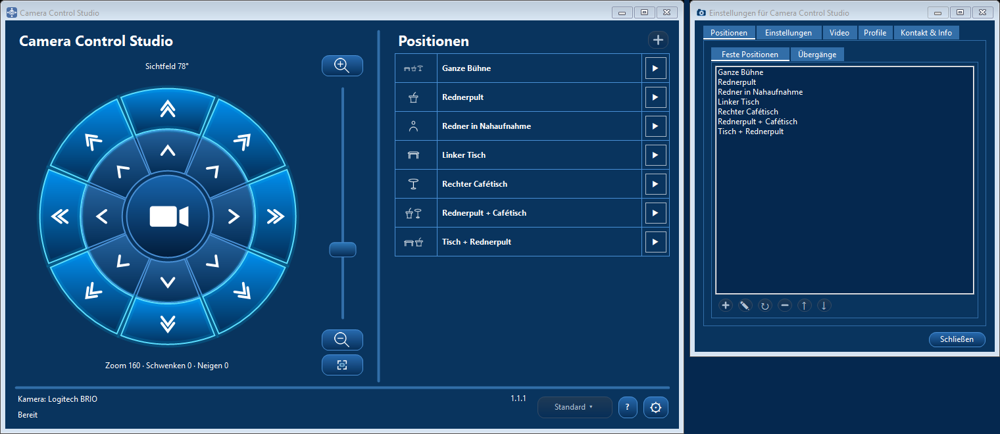
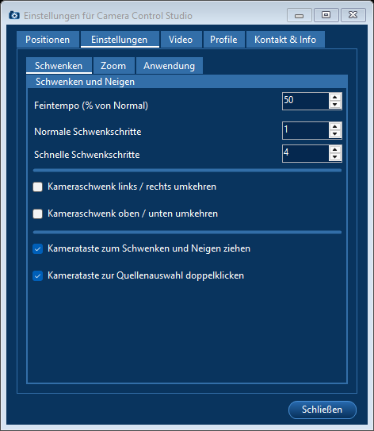
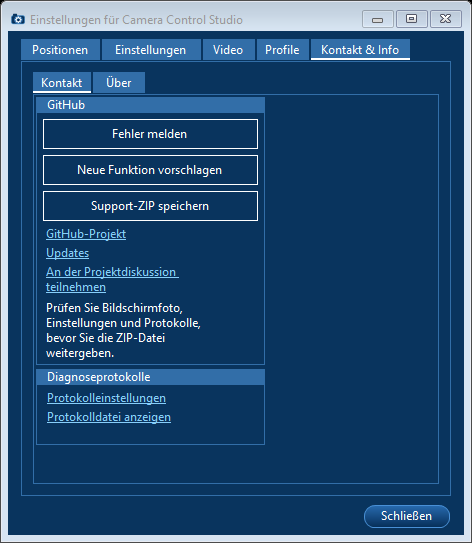
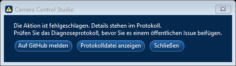

[English](../en/SETUP.md) · [Dansk](../da/SETUP.md) · [Deutsch](SETUP.md) · [Alle Sprachen](USER-GUIDES.md)

# Anwendung einrichten

*Geschrieben für Camera Control Studio 1.1.1.*

[Fehlerbehebung](TROUBLESHOOTING.md)

Klicken Sie unten auf das Zahnrad, um die Einstellungen zu öffnen. Die Einstellungen öffnen sich in einem eigenen Fenster. Sie können das Hauptfenster weiter nutzen.

## Installation und Download prüfen

Laden Sie **Camera Control Studio** aus dem Microsoft Store, sobald die App dort verfügbar ist. Suchen Sie im Store nach dem Namen der App. Microsoft signiert das Store-Paket und liefert die Updates.

Ist die App im Microsoft Store noch nicht verfügbar, laden Sie das Installationsprogramm oder die portable ZIP-Datei aus den [GitHub-Releases](https://github.com/bkristensen/Camera-Ctrl-Pressets-Studio/releases) herunter. Starten Sie den Installer oder entpacken Sie die gesamte ZIP-Datei. Gibt es eine SHA-256-Prüfsumme, vergleichen Sie sie mit dem Ergebnis von `Get-FileHash -Algorithm SHA256`.

Microsoft Defender SmartScreen kann eine blaue Warnung anzeigen, wenn die Datei oder ihr Herausgeber über wenig etablierte Reputation verfügt. Nehmen Sie die Warnung ernst. Wenn Sie die erwartete Datei aus dem offiziellen Release bezogen haben und der Quelle vertrauen, wählen Sie **Weitere Informationen** und prüfen Sie Dateinamen und Herausgeber. Wählen Sie **Trotzdem ausführen** nur, wenn Sie der Datei vertrauen und Windows die Option anbietet. Schließen Sie andernfalls die Warnung. Beachten Sie die Richtlinien Ihrer Organisation. [Microsoft-Hinweise zu SmartScreen](https://learn.microsoft.com/windows/apps/package-and-deploy/smartscreen-reputation)

<https://learn.microsoft.com/windows/apps/package-and-deploy/smartscreen-reputation>

Falls der Leitfaden-Viewer WebView2 benötigt, laden Sie die Runtime bei Microsoft herunter.\
<https://developer.microsoft.com/microsoft-edge/webview2/>

Wählen Sie unten im Hauptfenster das passende Profil. Doppelklicken Sie in der Grundeinstellung auf die Kamerataste im Steuerrad und wählen Sie eine Quelle. Das Profil merkt sich die Kamera. Fehlt sie, wählen Sie eine andere.

Die Abschnitte folgen der Reihenfolge im Einstellungsfenster. Ist eine Taste grau, fehlt oft eine Auswahl. Unter Video bestimmt der Kameratreiber, welche Regler erscheinen. Prüfen Sie das Ergebnis in Ihrer Aufnahme-App.

**Schließen**. Ändern Sie Größe und Position beider Fenster und ziehen Sie die Trennlinie im Hauptfenster. Das Profil merkt sich alles. Schließen schließt das Einstellungsfenster. Das Hauptfenster bleibt offen.

## Positionen

### Feste Positionen

Richten Sie die Kamera aus. Eine feste Position speichert unterstützte Werte für Schwenken, Neigen und Zoom sowie das gemeldete Sichtfeld. Die Position gehört zu einer Kamera in einem Profil.

- **+ Dauerhaftes Preset hinzufügen**. Speichern Sie den aktuellen Ausschnitt. Wählen Sie ein Symbol und tragen Sie einen eindeutigen Namen ein. Bei leerem Feld kann das Symbol einen Namen vorschlagen. Speichern setzt einen Namen voraus. Abbrechen lässt die Liste unverändert.
- **✎ Name und Symbol bearbeiten**. Ändern Sie Name oder Symbol der gewählten Position. Der Ausschnitt bleibt gleich.
- **↻ Durch aktuelle Position ersetzen**. Ersetzen Sie den Ausschnitt durch die aktuelle Kameraposition. Bestätigen Sie den Vorgang. Name und Symbol bleiben erhalten.
- **− Dauerhaftes Preset löschen**. Entfernen Sie die gewählte Position nach der Bestätigung.
- **↑ / ↓ Ausgewählte Position nach oben verschieben · Ausgewählte Position nach unten verschieben**. Verschieben Sie die Auswahl in beiden Listen um eine Zeile. Oben ist der Aufwärtspfeil grau, unten der Abwärtspfeil.

Wählen Sie zuerst eine Position für Bearbeiten, Ersetzen, Löschen oder Verschieben. Für Hinzufügen und Ersetzen braucht die App ein geladenes Profil und mindestens eine steuerbare Achse. Ist die Kamera getrennt, kann die App versuchen, sie dabei zu verbinden.

### Positionswechsel einstellen

- **Tempo für Positionswechsel verwenden**. Aus verwendet eine feste Dauer. Ein verwendet eine Geschwindigkeit. Kurze Wege sind dann schneller fertig. Die bewegten Achsen erreichen das Ziel zusammen.
- **Übergang (Sek.)**. Legen Sie die Zeit pro Wechsel fest. Der Standard ist 1 Sekunde. Im Geschwindigkeitsmodus ist das Feld grau.
- **Übergangstempo (%/s)**. Legen Sie die Geschwindigkeit in Prozent des Bereichs der maßgeblichen Achse pro Sekunde fest. Der Standard ist 30 %. Bei fester Dauer ist das Feld grau.

## Einstellungen

### Schwenken

- **Feintempo (% von Normal)**. Halten Sie Strg gedrückt und drücken Sie eine Pfeiltaste. Der Standard für die Feinsteuerung ist 50 % der normalen Geschwindigkeit.
- **Normale Schwenkschritte**. Legen Sie die Schritte für den inneren Ring fest. Der Standard ist 1.
- **Schnelle Schwenkschritte**. Legen Sie die Schritte für den äußeren Ring fest. Der Standard ist 4. Der Wert beeinflusst auch das Ziehen der Kamerataste.
- **Kameraschwenk links / rechts umkehren**. Vertauschen Sie links und rechts, falls die Kamera in die falsche Richtung fährt.
- **Kameraschwenk oben / unten umkehren**. Vertauschen Sie oben und unten, etwa bei einer kopfüber montierten Kamera. Beide Optionen ändern die Steuerung. Das Bild bleibt gleich.
- **Kamerataste zum Schwenken und Neigen ziehen**. Ziehen Sie die Taste in der Mitte des Steuerrads, um die Kamera auszurichten. Bei ausgeschalteter Option steuern Sie über die Pfeile.
- **Kamerataste zur Quellenauswahl doppelklicken**. Ein öffnet die Kameraliste per Doppelklick. Aus öffnet sie per Einzelklick.

Sie können die Werte vor dem Verbinden ändern. Der Treiber bestimmt die Schrittgröße, die verfügbaren Achsen und ihre Grenzen.

### Zoomschritte einstellen

- **Zoomschritte**. Bestimmen Sie die Bewegung von + und − pro Druck. Der Standard ist 1 Treiberschritt. Der Wert lässt sich vorher einstellen und wirkt bei Kameras mit Zoom. Der Schieber wählt einen Zoomwert im aktuellen Sichtfeld.

### Anwendung

- **Vor der Kameranutzung fragen, ob das Streaming gestartet wurde**. Aktivieren Sie die Abfrage, wenn zuerst der Stream laufen muss. Wählen Sie bei der nächsten Kameraaktion Ja, sobald Sie bereit sind. Bei Nein bleibt die Kamera getrennt. Nach Neustart, Profilwechsel oder Änderung der Option fragt die App erneut. Aus erlaubt die Verbindung beim Start.
- **Immer im Vordergrund**. Halten Sie das Hauptfenster über anderen Apps. Schalten Sie die Option aus, damit andere Fenster es überdecken können.
- **Profilsprache · Automatisch**. Wählen Sie eine von zwölf Sprachen. Automatisch nutzt die Windows-Anzeigesprache, sofern verfügbar, sonst Englisch. Starten Sie die App neu. Die Sprache gehört zum Profil.

## Video

- **Bildeinstellungen laden**. Verbinden Sie die Kamera und laden Sie die Bildregler. Die Taste erscheint bei getrennter Kamera. Meldet der Treiber nach dem Verbinden keine Bildregler, bleibt nur die Registerkarte für das Sichtfeld.
- **Automatisch**. Der Treiber bestimmt, welche Regler und Registerkarten erscheinen. Automatisch lässt die Kamera den Wert regeln. Schalten Sie es für den Schieber aus. Unterstützt der Treiber nur Automatik, ist der Schieber grau und die Automatik kann gesperrt sein. Bei reiner Handsteuerung fehlt das Kästchen.
- **Bild auf Treiberstandard zurücksetzen**. Setzen Sie alle unterstützten Bildwerte auf die Treiberstandards zurück. Die Taste erscheint auf den Bildregisterkarten. In der Sichtfeldansicht fehlt sie. Das Profil speichert die Werte je Kamera.

### Fokus und Belichtung

- **Verstärkung**. Verstärken Sie das Signal für ein helleres Bild. Hohe Verstärkung kann Bildrauschen erzeugen.
- **Belichtung**. Bestimmen Sie, wie lange der Sensor Licht sammelt. Längere Belichtung macht das Bild heller. Bewegung kann dabei verschwimmen.
- **Fokus**. Stellen Sie auf den Abstand des Motivs scharf. Prüfen Sie das Bild in Ihrer Aufnahme-App.

### Farbe

- **Weißabgleich**. Korrigieren Sie Farbstiche, damit Weiß weiß aussieht.
- **Sättigung**. Machen Sie die Farben kräftiger oder blasser.
- **Gamma**. Ändern Sie die Helligkeit der Mitteltöne.
- **Farbton**. Verschieben Sie die Farben auf dem Farbkreis.

### Licht und Details

- **Kontrast**. Ändern Sie den Unterschied zwischen hellen und dunklen Bereichen.
- **Helligkeit**. Machen Sie das ganze Bild heller oder dunkler.
- **Gegenlichtkompensation**. Hellen Sie ein Motiv auf, wenn starkes Licht von hinten kommt.
- **Schärfe**. Lassen Sie Kanten stärker oder schwächer hervortreten.

### Sichtfeld einstellen

Das Sichtfeld (FOV) bestimmt, wie viel ins Bild passt. Ein größerer Winkel zeigt mehr. Zoom verändert den Ausschnitt innerhalb dieses Winkels.

- **Sichtfeld beim Start · Weitest verfügbar · Nichts ändern**. Wählen Sie den weitesten Winkel, behalten Sie den aktuellen bei oder wählen Sie einen angebotenen Winkel. Die App versucht, ihn bei der ersten Verbindung der Sitzung zu setzen. Die Liste bleibt grau, bis die verbundene Kamera mindestens einen Winkel meldet.
- **Manuelle Sichtfeldänderung erlauben**. Zeigen Sie die Winkelliste unter dem Steuerrad. Bei Aus zeigt die App den aktuellen Winkel, wenn sie ihn lesen kann. Bei weniger als zwei Winkeln ist der Schalter grau.
- **Sichtfeld an Zoom- und Schwenkgrenzen wechseln**. Drücken Sie an der Zoomgrenze erneut. Die App versucht beim Herauszoomen einen weiteren und beim Hineinzoomen einen engeren Winkel. An der horizontalen Schwenkgrenze versucht sie einen Winkel, der mehr Spielraum lässt. Sie hält den Bildausschnitt möglichst ähnlich und stellt ihn wieder her, wenn kein weiterer Schritt möglich ist. Das geht auch bei ausgeschalteter Handwahl. Bei weniger als zwei Winkeln ist der Schalter grau.

Bei einer Brio mit 65° und kleinstem Zoom kann ein Druck auf Zoom − zu 78° wechseln. Der nächste Druck zoomt im neuen Sichtfeld weiter heraus. Die Rahmentaste versucht, den weitesten Winkel und kleinsten Zoom zugleich einzustellen. Prüfen Sie das Bild, wenn eine andere App die Kamera mitsteuert.

## Profile

- **+ Neues Profil**. Legen Sie ein Profil mit Standardwerten an und aktivieren Sie es. Wählen Sie einen eindeutigen Namen.
- **⧉ Aktives Profil kopieren**. Kopieren Sie Einstellungen und feste Positionen des aktiven Profils. Die App wechselt zur Kopie. Die Auswahl in der Liste ändert die Quelle der Kopie nicht.
- **✎ Ausgewähltes Profil umbenennen**. Benennen Sie das gewählte Profil um. Ohne Auswahl und bei Standard ist die Taste grau. Neu und Kopieren brauchen ein geladenes Profil. In allen drei Dialogen setzt die Bestätigung einen Namen voraus.
- **Aktuelle Position und Anordnung beibehalten**. Doppelklicken Sie auf ein Profil. Die Layoutoption übernimmt die aktuellen Fensterpositionen, Größen und die Trennlinie. Ohne Häkchen gilt das gespeicherte Layout des Zielprofils. Der Wechsel startet die App neu und leert die temporären Positionen.

## Kontakt & Info

### Kontakt

- **Fehler melden**. Öffnen Sie die Fehlervorlage auf GitHub. Bei einer neueren Version bietet die App zuerst den Download an. Wenn Sie fortfahren, bietet sie vor dem Entwurf eine Support-ZIP an.
- **Neue Funktion vorschlagen**. Öffnen Sie die Vorlage für Funktionswünsche. Prüfen Sie eine neuere Version zuerst, falls sie die Funktion schon enthält.
- **Support-ZIP speichern**. Speichern Sie Screenshot, verfügbare Protokolle, Profildaten und Fensterlayout als ZIP. Prüfen Sie die Datei auf private Angaben. Hängen Sie sie selbst an den Entwurf an. Die drei Tasten sind während einer Aktion vorübergehend grau.
- **GitHub-Projekt · GitHub-Releases · An der Projektdiskussion teilnehmen**. Die drei GitHub-Links öffnen den Quellcode, die Downloads oder die Diskussionen.

[Fehler melden](Report%20a%20bug.md) · [Neue Funktion vorschlagen](Request%20a%20feature.md)

### Diagnoseprotokolle

- **Protokolleinstellungen**. Öffnen Sie den Dialog für Protokolle. Die Einstellungen gelten für alle Profile. Speichern übernimmt sie. Abbrechen lässt sie unverändert.
- **Ordner auswählen · Automatisch**. Wählen Sie einen Ordner oder Automatisch. Der Pfad ist schreibgeschützt. Automatisch nutzt den Programmordner und weicht bei Bedarf auf `%LOCALAPPDATA%\CamPressets\Logs` aus.
- **Maximale Dateigröße (MiB)**. Legen Sie fest, ab wann eine neue Datei beginnt. Der Standard ist 1 MiB pro Datei.
- **Maximale Anzahl an Protokollen (inklusive aktivem)**. Legen Sie fest, wie viele Dateien einschließlich der aktuellen erhalten bleiben. Der Standard ist 2.
- **Protokolldatei anzeigen**. Markieren Sie die jüngste Datei im Explorer. Fehlt ein Protokoll, zeigt die App einen Hinweis.

### Über

- **Buy me a coffee**. Hier stehen die installierte Version und der Entwickler. Zeigen Sie auf die Version, um die vollständige Build-ID zu sehen. Der Unterstützungslink öffnet die Seite des Entwicklers.
- **Anleitungen öffnen**. Öffnen Sie hier die Handbücher. Die Hilfetaste im Hauptfenster öffnet dieselbe Ansicht.

Schließen Sie die App und kopieren Sie `%LOCALAPPDATA%\CamPressets` für eine Sicherung. Temporäre Positionen gelten für die laufende Sitzung.

[Tägliche Nutzung](DAILY-USE.md)

## Fehlerdialog

Wenn ein unerwarteter Fehler einen Vorgang stoppt, schließe den Dialog und versuche es erneut. Wenn der Dialog das Ende der App ankündigt, starte sie neu.

**Protokolldatei anzeigen** markiert das Diagnoseprotokoll im Datei-Explorer, sofern es vorhanden ist. **Auf GitHub melden** bietet an, eine Support-ZIP zu speichern, und öffnet dann die Fehlervorlage auf GitHub. Die ZIP-Datei kann ein Bildschirmfoto des Dialogs, Protokolle, Profil- und Fenstereinstellungen sowie einen Systembericht enthalten. Prüfe die Datei und hänge sie selbst an den Entwurf an.
