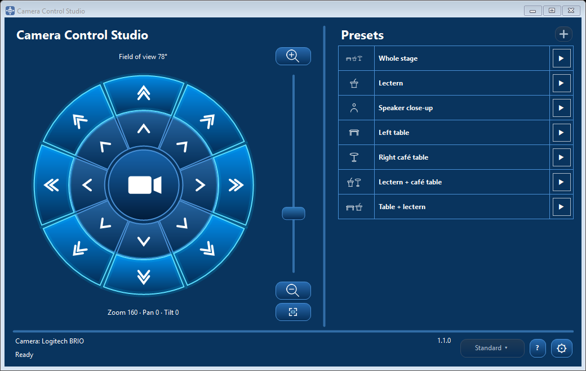
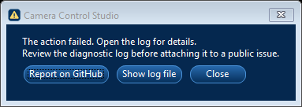

[English](../en/DAILY-USE.md) · [Dansk](../da/DAILY-USE.md) · [Deutsch](../de/DAILY-USE.md) · [All guide languages](../USER-GUIDES.md)

# Daily use

*Written for Camera Control Studio 1.1.0.*

[Troubleshooting](TROUBLESHOOTING.md)

Start your streaming meeting in an app such as Zoom. Then open **Camera Control Studio**.

## General

Click **?** for help. Hover over a button to see its name and action. A direction locks at the last limit the camera can reach. [How automatic FOV works](SETUP.md#set-the-field-of-view)

## 1. Activate a preset

Click ▶ on a row in the preset list or double-click the name.
You can also select the row and press Enter.

| Colour | Meaning |
| --- | --- |
| Yellow | The app is moving the camera towards the preset. |
| Green | The camera driver reports that the saved coordinates have been reached. |
| Blue | The preset is not marked as active. |

Green means the driver reports the saved position and FOV, if saved. Check the picture in your stream. If the driver cannot confirm the shot in time, the row turns blue. Read the status message to see what happened.

## 2. Fine-tune the framing

### Pan

Use the inner ring for normal moves and the outer ring for fast moves. Each ring has eight arrows. The diagonals move pan and tilt together at 45°, with 45% of the ring’s speed on each axis. A click moves at least one driver step per available axis. Hold an arrow to keep moving. Release it to stop.

### Camera button in the centre of the wheel

- **Double-click to choose a camera.** The camera list opens.
- **Hold and drag.** Start on the camera icon. Drag sideways to pan or up and down to tilt. Drag a little for slow movement or farther for faster movement, up to twice the fast speed. Release the button or move the pointer back to where you started to stop.

Under **Settings → Panning**, you can turn off dragging or switch to a single click for camera selection. Both options are saved in the active profile.

### Zoom

Use the magnifier buttons to zoom. Hold a button down to repeat the action.
Drag the slider to adjust the zoom as you move it.

### Restore full frame

Click the square button with the frame icon above the magnifier buttons. The camera zooms out as far as it can and selects its widest field of view if it supports that setting. This changes the camera picture. The app window keeps its size.

### Stop panning

Press Esc to stop a pan in progress.

> Manual pan, tilt or zoom cancels the move to the preset and clears the active colour.

### Arrow keys

Use the arrow keys when the wheel has focus. Hold Ctrl for fine moves or Shift for fast moves.

## 3. Save a temporary preset

Click **+** above the preset list, enter a name and save. The current position appears below the permanent presets.
Temporary presets have no icon. They last until you close the app and are kept separately for each profile and camera.

Select a temporary row and click **×** above the preset list to remove it. All temporary presets are removed when the app closes.
To use a position later, create it under **Settings → Presets**. You cannot edit or delete permanent presets in the main list.

## 4. Exit

If a control fails, read the message in the status area at the bottom. The camera may not support the feature or may be unavailable.

Close the app normally. The app remembers the active profile and window layout.

## 5. Report issues

If **New release available** appears in the footer, select it to open the release on GitHub and see the downloads.

<https://github.com/bkristensen/Camera-Ctrl-Pressets-Studio/releases>

Report problems or request features under **Contact & About → Contact**.

See [Setup](SETUP.md) for camera direction, permanent presets, image settings, profiles and movement steps.

## Error dialog

Close the dialog and try again if an unexpected error stops an action. If the dialog says the app will close, open it again.

**Show log file** selects the diagnostic log in File Explorer if a log is available. **Report on GitHub** offers to save a support ZIP, then opens GitHub’s bug template. The ZIP can include a screenshot of the dialog, logs, profile and window settings, and a system report. Review it and attach it to the draft yourself.
