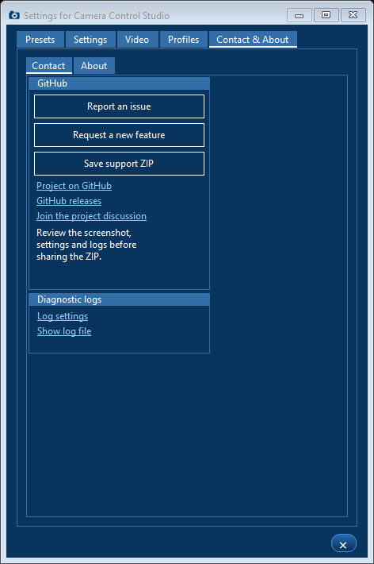

# Report a bug

1. Click the gear at the bottom to open Settings. Choose **Contact & About → Contact → Report an issue**.
2. If the app finds a newer release, choose **Yes** to open its download page. Install it and try to reproduce the bug. Choose **No** to continue to the GitHub draft.
3. When the app asks whether to save a support ZIP, choose **Yes** and pick a location. Choose **No** to open the draft without making a package.

The same GitHub buttons are available in GuideViewer.

## Add details and attach the ZIP

The button opens GitHub’s **Bug report** template. Fill in every section marked with a red asterisk. Say what you expected, what happened, and how to reproduce it. Include the app and Windows versions. Add the camera and capture setup if relevant.

You can create the same package at any time with **Contact & About → Contact → Save support ZIP**. It contains a screenshot of Camera Control Studio, the saved `profiles.json`, a `window.json` with the window layout, and available logs under `Logs`. The app shows the saved file path.

Review the ZIP for private details such as profile names, camera IDs and file paths. Drag the ZIP or the relevant files into the draft’s description. You attach the file yourself.

## Check the type and labels

The template requests **Bug** under **Type** and `bug` under **Labels**. If they are missing and the controls are available, select **Bug** in the right sidebar under **Type** and select `bug` under **Labels**. If you cannot edit these fields, submit the report. A maintainer can set them later.

Check your description and attachments in **Preview**, then choose **Create**.
