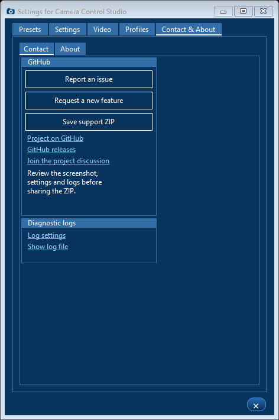

# Request a feature

1. Click the gear at the bottom to open Settings. Choose **Contact & About → Contact → Request a new feature**.
2. If the app finds a newer release, choose **Yes** to open its download page. Install it and check whether it has the feature. Choose **No** to continue to the GitHub draft.
3. In GitHub’s **Feature request** template, fill in every section marked with a red asterisk. Describe the task, how the feature would help, and what result would show it works.

The same GitHub buttons are available in GuideViewer.

## Attach an example

Add a screenshot or mockup if it helps show the idea. To share your setup, choose **Contact & About → Contact → Save support ZIP**. Pick a location on disk. The app shows the saved file path.

The ZIP contains a screenshot of Camera Control Studio, the saved `profiles.json`, a `window.json` with the window layout, and available logs under `Logs`. Review it for private details. Drag the ZIP or the relevant files into the draft’s description when your setup helps explain the request.

## Check the type and labels

The template requests **Feature** under **Type** and `enhancement` under **Labels**. If they are missing and the controls are available, select **Feature** in the right sidebar under **Type** and select `enhancement` under **Labels**. If you cannot edit these fields, submit the request. A maintainer can set them later.

Check your request and attachments in **Preview**, then choose **Create**.
