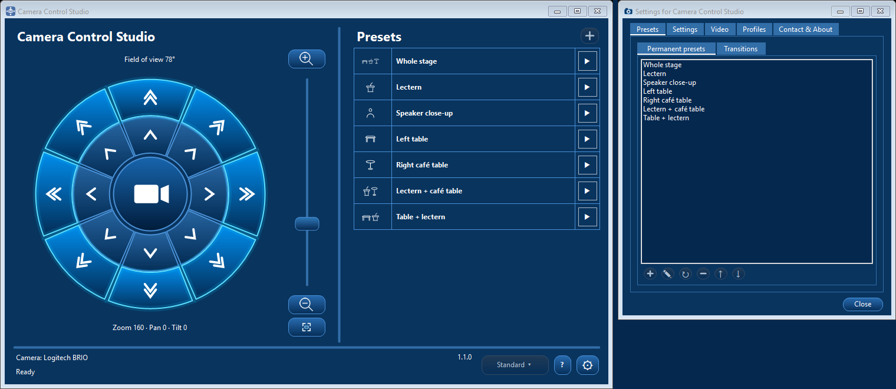
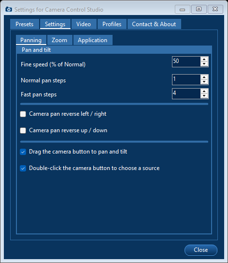
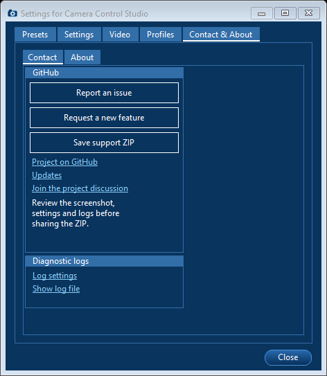
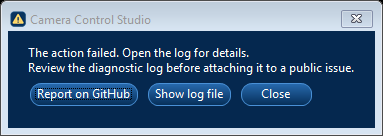

[English](../en/SETUP.md) · [Dansk](../da/SETUP.md) · [Deutsch](../de/SETUP.md) · [All guide languages](../USER-GUIDES.md)

# Set up the application

*Written for Camera Control Studio 1.1.0.*

[Troubleshooting](TROUBLESHOOTING.md)

Click the gear at the bottom to open Settings. Settings opens in a separate window. You can still use the main window.

## Install and verify the download

Get **Camera Control Studio** from Microsoft Store when it is available there. Search for the app by name in Microsoft Store. Microsoft signs the Store package and delivers its updates.

If the app is unavailable in Microsoft Store, get the installer or portable ZIP from [GitHub releases](https://github.com/bkristensen/Camera-Ctrl-Pressets-Studio/releases). Run the installer or extract the whole ZIP before starting the app. If the release includes a SHA-256 checksum, compare it with the result from `Get-FileHash -Algorithm SHA256`.

Microsoft Defender SmartScreen can show a blue warning when a downloaded app or its publisher has little established reputation. Take it seriously. If you obtained the expected file from the official release and trust the source, select **More info** and review the filename and publisher. Select **Run anyway** only if you choose to trust that file and Windows offers the option. Otherwise close the warning. Follow your organisation’s device policy. [Microsoft SmartScreen guidance](https://learn.microsoft.com/windows/apps/package-and-deploy/smartscreen-reputation)

<https://learn.microsoft.com/windows/apps/package-and-deploy/smartscreen-reputation>

If the guide viewer needs WebView2, download the runtime from Microsoft.\
<https://developer.microsoft.com/microsoft-edge/webview2/>

Start with the profile and camera you plan to use. Choose a profile in the footer. By default, double-click the camera button in the wheel to choose a source. The profile remembers the camera. If it is missing, choose another source.

The tabs below follow the order in the Settings window. A dimmed button often needs a selection first. Under Video, the camera driver decides which controls appear. Check changes in your capture app.

**Close**. Resize either window or drag the divider in the main window. The profile remembers both window positions and sizes and the divider position. Select Close at the bottom of Settings. The main window stays open.

## Presets

### Permanent presets

Aim the camera first. A permanent preset saves the supported pan, tilt and zoom values. It also saves the field of view if the camera reports it. Presets belong to one camera in one profile.

- **+ Add permanent preset**. Save the current framing as a new preset. Choose a symbol and enter a unique name. Choosing a symbol can suggest a name if the field is empty. The editor's Save button needs a name. Cancel leaves the list as it was.
- **✎ Edit name and symbol**. Change the selected preset's name or symbol. The saved framing stays the same.
- **↻ Replace with current position**. Replace the selected preset's framing with the current camera position. Confirm the change. The name and symbol stay the same.
- **− Delete permanent preset**. Remove the selected preset after you confirm.
- **↑ / ↓ Move selected preset up · Move selected preset down**. Move the selected preset one place up or down. The order changes in Settings and in the main list. Up is dimmed on the first row. Down is dimmed on the last row.

Select a preset to enable Edit, Replace, Delete and the applicable arrows. Add and Replace need a loaded profile and a camera that lets the app read and set at least one of pan, tilt or zoom. With no camera connected yet, either action can attempt to connect instead.

### Set preset transitions

- **Use speed for preset transitions**. Off uses a fixed duration. On sets a rate so short moves finish sooner than long moves. The moving axes reach the target together.
- **Transition (sec.)**. Set the time for a preset move. The default is 1 second. This field is dimmed when speed mode is on.
- **Transition speed (%/s)**. Set the rate as a percentage of the range of the axis that governs the move, per second. The default is 30%. This field is dimmed when speed mode is off.

## Settings

### Panning

- **Fine speed (% of Normal)**. Hold Ctrl and an arrow key for fine control. The default rate is 50% of normal.
- **Normal pan steps**. Set how many steps the normal arrows move on the inner ring. The default is 1.
- **Fast pan steps**. Set how many steps the fast arrows move on the outer ring. The default is 4. It also changes the rate when you drag the camera button.
- **Camera pan reverse left / right**. Swap left and right. Use it if the camera moves the wrong way.
- **Camera pan reverse up / down**. Swap up and down. Try it if the camera is mounted upside down. These two options only change which way the controls move the camera.
- **Drag the camera button to pan and tilt**. Drag the button in the middle of the wheel to aim the camera. Turn this off if you want to steer with the arrows.
- **Double-click the camera button to choose a source**. On opens the camera list with a double-click. Off opens it with a single click.

The movement settings can be edited before the camera connects. The driver sets the step size, which axes move, and where they stop.

### Set zoom steps

- **Zoom steps**. Set how far the + and − zoom buttons move per press. The default is 1 driver step. You can set it before connecting. The camera needs zoom support for the setting to take effect. The zoom slider sets a position within the current field of view.

### Application

- **Ask whether streaming has started before using the camera**. Turn this on if your capture app must start streaming first. The next camera action asks for confirmation. Choose Yes when ready, or No to leave the camera disconnected. The app asks again after a restart, profile switch or change to this option. Off allows a connection at startup. The app relies on your answer.
- **Always on top**. Keep the main window above other apps. Turn this off to let other windows cover it.
- **Profile language · Automatic**. Choose one of the 12 languages. Automatic uses the Windows display language if supported, or English otherwise. Restart to apply the change. Each profile has its own choice.

## Video

- **Load image controls**. Connect to the camera and show its image controls. This button appears while the camera is disconnected. If the camera driver offers no image controls after connecting, only the Field of view tab remains.
- **Automatic**. The driver decides which sliders and tabs appear. Automatic lets the camera adjust that value. Turn it off to move the slider yourself. If the driver only offers automatic control, the slider stays dimmed and Automatic can be locked on. If it only offers manual control, the Automatic box is hidden.
- **Reset image to driver defaults**. Restore all supported image settings to the driver's defaults. The button is visible on image tabs. It is hidden on Field of view. Image values are saved per camera and profile.

### Focus and exposure

- **Gain**. Boost the camera signal to brighten the image. Too much gain can add grain.
- **Exposure**. Set how long the sensor collects light. A longer exposure brightens the image but can blur motion.
- **Focus**. Set the distance that looks sharp. Check the subject in your capture app.

### Colour

- **White balance**. Correct the colour cast from the lights so white looks white.
- **Saturation**. Make colours stronger or more muted.
- **Gamma**. Change the brightness of midtones.
- **Hue**. Shift colours around the colour wheel.

### Light and detail

- **Contrast**. Increase or reduce the difference between light and dark areas.
- **Brightness**. Raise or lower the overall brightness.
- **Backlight compensation**. Brighten a subject with strong light behind it.
- **Sharpness**. Increase or reduce how strongly edges stand out.

### Set the field of view

Field of view (FOV) is how much of the scene fits in the frame. A larger angle shows more. Zoom changes the crop within the current angle.

- **Field of view at startup · Widest available · Do nothing**. Choose the widest angle, leave the current angle as it is, or choose a specific angle the driver reports. The app tries to apply it on the first connection of the session. The list is dimmed until a connected camera reports at least one angle.
- **Allow manual FOV changes**. Show an angle picker below the wheel. With this off, the app shows the current angle if it can read it. The switch is dimmed if the driver reports fewer than two angles.
- **Adjust field of view at zoom and pan limits**. At a zoom limit, press again to try a wider angle when zooming out or a narrower one when zooming in. At a left or right pan limit, the app tries another angle that may leave more room. It tries to keep the framing close and restores it if the pan cannot continue. This works with manual changes off. The switch is dimmed if the driver reports fewer than two angles.

For example, on a Brio at 65° and minimum zoom, press Zoom out to try 78°. Press again to zoom out in the new view. The frame button in the main window tries the widest angle and minimum zoom in one action. Use your capture app to check the result if another app also controls the camera.

[Field of view](../VALIDATION.md#brio-field-of-view-and-zoom)

## Profiles

- **+ New profile**. Create a profile with default settings and make it active. Give it a unique name.
- **⧉ Copy active profile**. Copy the active profile, including its settings and presets, and switch to the copy. Selecting another row does not change what gets copied.
- **✎ Rename selected profile**. Change the selected profile's name. The rename button is dimmed if there is no selection or if you select Standard. New and Copy need a loaded profile. In all three name dialogs, enter a name to enable confirmation.
- **Keep current position and layout**. Double-click a profile to open the switch dialog. Enable the layout option there to carry the current position, size and divider into the selected profile. Leave it off to use that profile's saved layout. A switch restarts the app and clears temporary presets.

## Contact & About

### Contact

- **Report an issue**. Open GitHub's bug template. If a newer release is available, the app offers to open it first. If you continue with the report, the app offers a support ZIP before opening the draft.
- **Request a new feature**. Open GitHub's feature template. If a newer release is available, try it first to see whether it already has the feature.
- **Save support ZIP**. Save a screenshot, available log files, profile data and a window layout file in one ZIP. Open it to check for private details. Attach it yourself in the GitHub draft. The three buttons are temporarily dimmed while an action runs.
- **Project on GitHub · GitHub releases · Join the project discussion**. Open the source project, release downloads or project discussions with the three GitHub links.

[Report an issue](Report%20a%20bug.md) · [Request a new feature](Request%20a%20feature.md)

### Diagnostic logs

- **Log settings**. Open the log settings dialog. These settings apply across profiles. Save applies them. Cancel leaves them unchanged.
- **Choose folder · Automatic**. Choose a folder or use Automatic. The path is read-only. Automatic uses the application folder, with `%LOCALAPPDATA%\CamPressets\Logs` as a fallback.
- **Maximum size per file (MiB)**. Set when the app starts a new log file. The default is 1 MiB per file.
- **Maximum log files (including current)**. Set how many log files to retain, including the one in use. The default is 2.
- **Show log file**. Select the latest log in File Explorer. If there is no log, the app tells you.

### About

- **Buy me a coffee**. Find the installed version and developer credit. Hover over the version to see the full build ID. The support link opens the developer's support page.
- **Open guides**. Open the guides from this tab. The Help button in the main window also opens them.

To back up profiles, close the app and copy `%LOCALAPPDATA%\CamPressets`. Temporary presets are kept for the current session.

[Daily use](DAILY-USE.md)

## Error dialog

Close the dialog and try again if an unexpected error stops an action. If the dialog says the app will close, open it again.

**Show log file** selects the diagnostic log in File Explorer if a log is available. **Report on GitHub** offers to save a support ZIP, then opens GitHub’s bug template. The ZIP can include a screenshot of the dialog, logs, profile and window settings, and a system report. Review it and attach it to the draft yourself.
