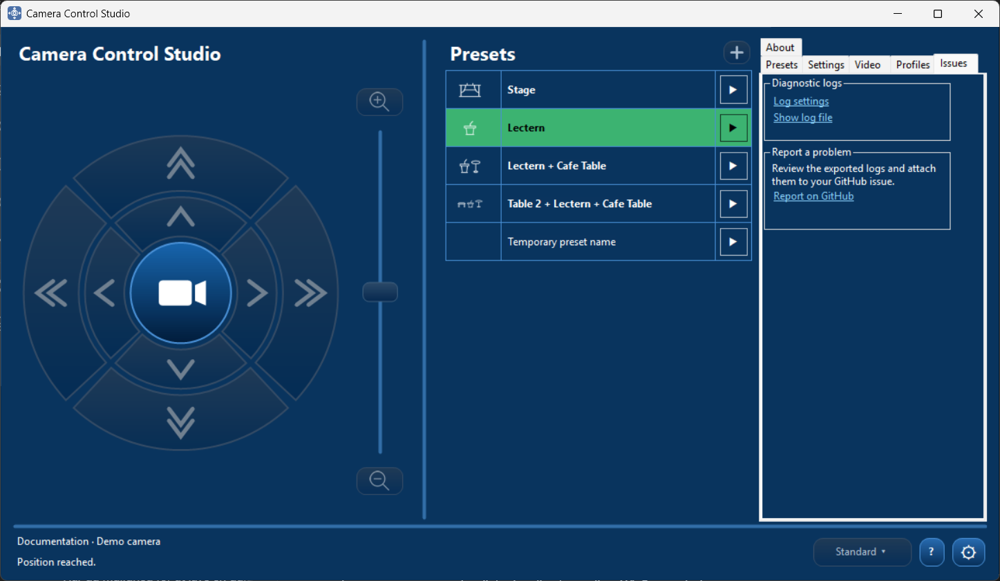

[English](../en/SETUP.md) · [Dansk](../da/SETUP.md) · [Deutsch](../de/SETUP.md) · [All guide languages](../USER-GUIDES.md)

# Set up the application

Open the gear in the footer. Settings open on the right. Your position list stays visible.

## Install and verify the download

Download the installer or portable ZIP from the project’s [GitHub releases](https://github.com/bkristensen/Camera-Ctrl-Pressets-Studio/releases). Run the installer or extract the entire ZIP before launching the app. If a SHA-256 checksum is published, compare it with `Get-FileHash -Algorithm SHA256` for your download.

Microsoft Defender SmartScreen can show a blue warning when a downloaded app or its publisher has little established reputation. Take it seriously. If you obtained the expected file from the official release and trust the source, select **More info** and review the filename and publisher. Select **Run anyway** only if you choose to trust that file and Windows offers the option. Otherwise close the warning. Follow your organisation’s device policy. [Microsoft SmartScreen guidance](https://learn.microsoft.com/windows/apps/package-and-deploy/smartscreen-reputation)

## 1. Choose a profile and camera

Use the profile picker in the footer to select a profile. To create one, open **Settings → Profiles**. Choose **New** for default settings or **Copy** for a copy of the active profile. Name it after a person or setup. New profiles become active. In **Profiles**, select a profile and click **✎** to rename it. The Standard profile has a fixed name.

Click the camera symbol in the centre of the direction wheel to select a camera. The program remembers it. If that camera is missing, choose another source. Positions belong to a camera within a profile.

## 2. Decide when camera control may start

Under **Settings → Application**, enable **Ask whether streaming has started before using the camera** if your capture program must start first. This option is off by default.

With the option enabled, the first camera action asks whether streaming has started. Choose **Yes** only when it has. Choose **No** to keep camera control disconnected. After Yes, further actions do not ask again until you change profile, change this option or restart the app. The app does not detect or start a streaming session for you.

If you need this order on first use, set the option before your next session. The default allows the app to connect at startup.

## 3. Set movement and zoom

Change the values under **Settings → Movement**. Start with small steps. Test the result in your capture program.

| Setting | What it changes | Default |
| --- | --- | --- |
| Fine speed (% of Normal) | Rate while holding an inner-ring arrow | 50% |
| Normal pan steps | Middle arrow ring | 1 |
| Fast pan steps | Outer arrow ring | 4 |
| Zoom steps | − and + | 1 |
| Transition (sec.) | Time for each preset change in fixed-duration mode | 1.0 |
| Use speed for preset transitions | Let travel distance determine the duration | Off |
| Transition speed (%/s) | Cruise rate as a percentage of the controlling axis’s range per second | 30% |

With speed-based transitions, a short move takes less time than a long one. The app accelerates and brakes, and all moving axes share the same progress so they can reach the target together.

One step means one step supported by the camera driver. It is not a fixed distance or percentage. The driver limits movement and smoothness.

For an upside-down camera, enable **Camera pan reverse up / down** and test Up. Enable **Camera pan reverse left / right** only if Left moves the wrong way. These settings change the controls. They do not rotate the video.

### Set the field of view

Open **Settings → Movement**. Set **Field of view at startup** to the widest view, a specific angle, or **Do nothing**. The app uses this choice the first time it connects. Turn on **Allow manual FOV changes** to show the FOV picker. The current view appears below the direction wheel.

**Adjust field of view at zoom and pan limits** is on by default. You can use it with the manual picker hidden. It works when the driver supports FOV.

- **Zoom out:** At minimum zoom on a Brio set to 65°, press zoom out again to switch to 78°. That press changes the FOV and adjusts zoom to keep the shot close. The next press zooms out normally. The same steps take you from 78° to 90°. The button stops at 90° and minimum zoom.
- **Zoom in:** At maximum zoom, press again to move toward a narrower FOV. On a Brio the order is 90° → 78° → 65°. The button stops at 65° and maximum zoom.
- **Pan left or right:** At the edge, the app tries a wider view first. It adjusts zoom to keep the crop close. It can also try a narrower view if the zoom allows it. If no view lets it pan farther, it restores the previous shot. The driver controls how close the match is.

Use the square button with the frame symbol to go straight to the widest FOV and minimum zoom. The slider still sets zoom within the current FOV. Turn off automatic FOV to keep zoom and pan within the current view.

Presets save pan, tilt, zoom and the FOV reported by the driver. Older presets keep the current FOV. Check the live image if Zoom, Logitech Brio Control, or another app controls the crop. [Brio and Zoom test steps](../VALIDATION.md#brio-field-of-view-and-zoom)

## 4. Adjust the image and save permanent positions

[Before loading video controls](../images/screenshots/video.png) · [Colour](../images/screenshots/video-colour.png) · [Light and detail](../images/screenshots/video-light-detail.png)

Open **Video** in the settings pane, then load the image controls if needed. Choose a group such as **Focus and exposure**, **Colour**, or **Light and detail**. Only controls exposed by the driver appear. Adjust brightness, contrast, colour saturation, focus or white balance when available. Turn automatic mode off before manual adjustment. Image values are saved per camera and profile. The reset button restores the driver's defaults.

Move the camera first. Open **Presets** in the settings pane. Click **+** to add a permanent preset. Select an icon at the top, check the name, then save. If the name is blank and unused, choosing an icon suggests its name. Combined symbols show their subjects from left to right.

Under **Permanent presets**, select a position. Hover over a symbol for its action. Use **✎** to edit its name and symbol, **↻** to save the current camera position in its place, and **−** to delete it. Use **↑** and **↓** to change the order in both lists. Permanent positions stay at the top of the main list in bold.

Selecting a permanent row in the main list also selects that preset in Settings. A newly saved preset is selected in Settings.

## 5. Set layout and language

Drag the vertical divider between the controller and position list. Resize or move the window. The app saves the window bounds, divider and selected settings tab in the active profile. The initial size is 900 × 500, and the minimum is 670 × 450. The settings pane starts closed on every launch. The saved window width is measured with the settings pane closed.

When selecting a profile in the footer, leave **Keep current position and layout** unchecked to restore that profile's layout. Check it to carry the current layout into the selected profile. The choice is remembered in the profile you leave; the carried layout is saved in the destination profile.

Choose a language under **Settings → Application → Profile language**, then restart to apply it. **Automatic** uses the Windows display language if supported and English otherwise. Switching profiles restarts the application with the selected profile’s language. Temporary presets end at restart.

## 6. Version and project information

Open **About** to see the installed version and project links. Hover over the version to see the full build ID. Include it when you report a problem with a specific build.

## 7. Diagnostic logs and issue reporting

Open **Issues** in the settings pane to choose a log folder, a maximum file size, and the number of log files to keep, including the current file. By default, logs go in the application folder or to `%LOCALAPPDATA%\CamPressets\Logs` if the first location is unavailable.

**Report on GitHub** opens an issue draft and the local folder with the diagnostic report files. Review the files and attach them in the issue editor.

Next: [Daily use](DAILY-USE.md). For a backup, close the app and copy `%LOCALAPPDATA%\CamPressets`. Temporary positions are not part of the backup.
