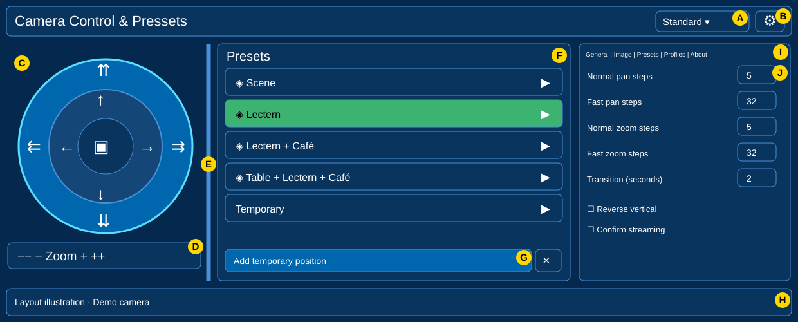
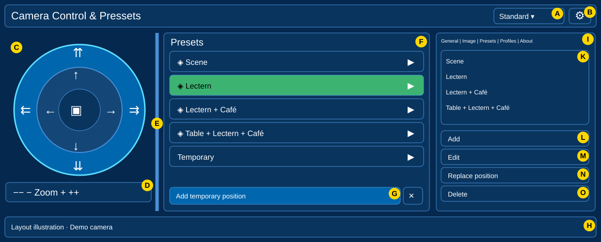

[English](../en/SETUP.md) · [Dansk](../da/SETUP.md) · [Deutsch](../de/SETUP.md)

# Set up the application

Open the gear button **B**. Settings open on the right. Your position list stays visible.

*Layout illustration, not a Windows screenshot. Letters match the controls described below. See [image capture](../SCREENSHOTS.md).*

## 1. Choose a profile and camera

Use **A** in the main window to select a profile. To create one, open **Settings → Profiles** (**I**). Choose **New** for default settings or **Copy** for a copy of the active profile. Name it after a person or setup. New profiles become active.

Click the camera symbol in the middle of **C** to select a camera. The program remembers it. If that camera is missing, choose another source. Positions belong to a camera within a profile.

## 2. Decide when camera control may start

Under **Settings** (**J**), enable **Ask whether streaming has started before using the camera** if your capture program must start first. This option is off by default.

With the option enabled, the first camera action asks whether streaming has started. Choose **Yes** only when it has. Choose **No** to keep camera control disconnected. After Yes, further actions do not ask again until you change profile, change this option or restart the app. The app does not detect or start a streaming session for you.

If you need this order on first use, set the option before your next session. The default allows the app to connect at startup.

## 3. Set movement and zoom

Change the values in **J**. Start with small steps. Test the result in your capture program.

| Setting | What it changes | Default |
| --- | --- | --- |
| Normal pan steps | Inner arrow ring | 5 |
| Fast pan steps | Outer arrow ring | 32 |
| Normal zoom steps | − and + | 5 |
| Fast zoom steps | −− and ++ | 32 |
| Transition seconds | Time requested for a preset change | 2 |

One step means one step supported by the camera driver. It is not a fixed distance or percentage. The driver limits movement and smoothness.

For an upside-down camera, enable **Reverse up / down** and test Up. Enable **Reverse left / right** only if Left moves the wrong way. These settings change the controls. They do not rotate the video.

## 4. Adjust the image and save permanent positions

Open **Image** in **I**, then load the image controls if needed. Only controls exposed by the driver appear. Adjust brightness, contrast, colour saturation, focus or white balance when available. Turn automatic mode off before manual adjustment. Image values are saved per camera and profile. The reset button restores the driver's defaults.

*Labelled layout illustration.*

Move the camera first. Open **Presets** in **I**. Choose **Add** (**L**). Select an icon at the top, check the name, then save. If the name is blank and unused, choosing an icon suggests its name. Combined symbols show their subjects from left to right.

Select a position in **K** to change it. **M** changes name and icon. **N** replaces its coordinates with the current camera position. **O** deletes it after confirmation. Permanent positions stay at the top of the main list in bold.

## 5. Set layout and language

Drag the divider **E** between the controller and position list. Resize or move the window. The app saves the window bounds, divider, settings panel and selected settings tab in the active profile. The initial window is 900 × 500 at normal Windows scaling.

When selecting a profile with **A**, leave **Keep current position and layout** unchecked to restore that profile's layout. Check it to carry the current layout into the selected profile. The choice is remembered in the profile you leave; the carried layout is saved in the destination profile.

Choose the language in **Settings**, then restart. Automatic uses Danish or German when Windows uses that language. Otherwise it uses English. The language choice applies to the application, not to an individual profile.

Next: [Daily use](DAILY-USE.md). For a backup, close the app and copy `%LOCALAPPDATA%\CamPressets`. Temporary positions are not part of the backup.
