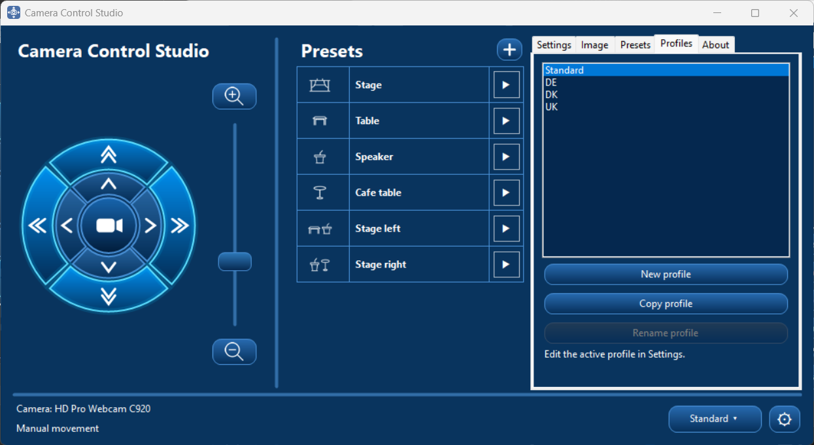
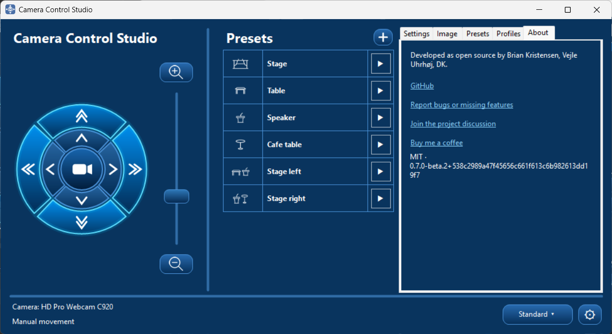

[English](../en/SETUP.md) · [Dansk](../da/SETUP.md) · [Deutsch](../de/SETUP.md) · [All guide languages](../USER-GUIDES.md)

# Set up the application

Open the gear in the footer. Settings open on the right. Your position list stays visible.

## 1. Choose a profile and camera

Use the profile picker in the footer to select a profile. To create one, open **Settings → Profiles**. Choose **New** for default settings or **Copy** for a copy of the active profile. Name it after a person or setup. New profiles become active.

Click the camera symbol in the centre of the direction wheel to select a camera. The program remembers it. If that camera is missing, choose another source. Positions belong to a camera within a profile.

## 2. Decide when camera control may start

Under **Settings**, enable **Ask whether streaming has started before using the camera** if your capture program must start first. This option is off by default.

With the option enabled, the first camera action asks whether streaming has started. Choose **Yes** only when it has. Choose **No** to keep camera control disconnected. After Yes, further actions do not ask again until you change profile, change this option or restart the app. The app does not detect or start a streaming session for you.

If you need this order on first use, set the option before your next session. The default allows the app to connect at startup.

## 3. Set movement and zoom

Change the values on the **Settings** tab. Start with small steps. Test the result in your capture program.

| Setting | What it changes | Default |
| --- | --- | --- |
| Normal pan steps | Inner arrow ring | 5 |
| Fast pan steps | Outer arrow ring | 32 |
| Normal zoom steps | − and + | 5 |
| Fast zoom steps | Shift + a zoom button | 32 |
| Transition seconds | Time requested for a preset change | 2 |

One step means one step supported by the camera driver. It is not a fixed distance or percentage. The driver limits movement and smoothness.

For an upside-down camera, enable **Reverse up / down** and test Up. Enable **Reverse left / right** only if Left moves the wrong way. These settings change the controls. They do not rotate the video.

## 4. Adjust the image and save permanent positions

Open **Image** in the settings pane, then load the image controls if needed. Only controls exposed by the driver appear. Adjust brightness, contrast, colour saturation, focus or white balance when available. Turn automatic mode off before manual adjustment. Image values are saved per camera and profile. The reset button restores the driver's defaults.

Move the camera first. Open **Presets** in the settings pane. Choose **Add**. Select an icon at the top, check the name, then save. If the name is blank and unused, choosing an icon suggests its name. Combined symbols show their subjects from left to right.

Select a position in the settings list to change it. Use **Edit name and symbol** to rename it, **Replace with current position** to update its coordinates, or **Delete permanent preset** to remove it. Permanent positions stay at the top of the main list in bold.

Selecting a permanent row in the main list also selects that preset in Settings. A newly saved preset is selected in Settings.

## 5. Set layout and language

Drag the vertical divider between the controller and position list. Resize or move the window. The app saves the window bounds, divider and selected settings tab in the active profile. The initial size is 900 × 500, and the minimum is 670 × 450. The settings pane starts closed on every launch.

When selecting a profile in the footer, leave **Keep current position and layout** unchecked to restore that profile's layout. Check it to carry the current layout into the selected profile. The choice is remembered in the profile you leave; the carried layout is saved in the destination profile.

Choose the language in **Settings**, then restart. Automatic follows the Windows display language when the app supports it and uses English otherwise. The language choice applies to the whole application.

## 6. Version and project information

Open **About** to find the installed version, developer credit and links to the project and support.

Next: [Daily use](DAILY-USE.md). For a backup, close the app and copy `%LOCALAPPDATA%\CamPressets`. Temporary positions are not part of the backup.
