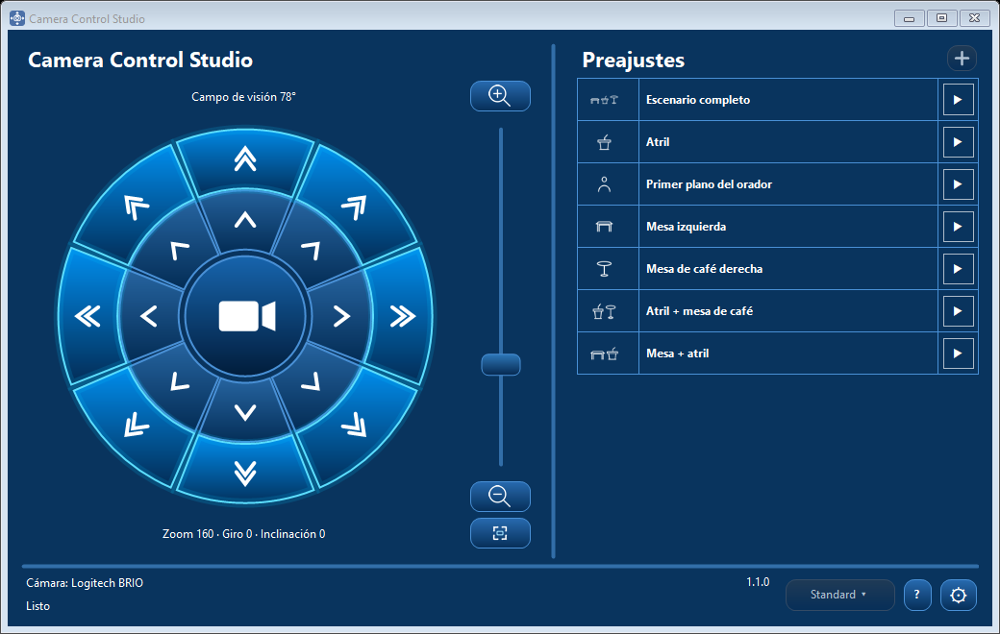
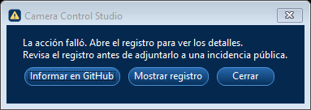

[English](../en/DAILY-USE.md) · [Dansk](../da/DAILY-USE.md) · [Deutsch](../de/DAILY-USE.md) · [Todos los idiomas de la guía](USER-GUIDES.md)

# Uso diario

*Escrito para Camera Control Studio 1.1.0.*

[Solución de problemas](TROUBLESHOOTING.md)

Inicie su reunión de transmisión en una aplicación como Zoom. Luego abra **Camera Control Studio**.

## generales

Haga clic en **?** para obtener ayuda. Pase el cursor sobre un botón para ver su nombre y acción. Una dirección se bloquea en el último límite que puede alcanzar la cámara. [Cómo funciona el FOV automático](SETUP.md#establecer-el-campo-de-visi%C3%B3n)

## 1. Activar un preajuste

Haga clic en ▶ en una fila de la lista preestablecida o haga doble clic en el nombre.
También puede seleccionar la fila y presionar Enter.

| Color | Significado |
| --- | --- |
| amarillo | La aplicación mueve la cámara hacia el valor preestablecido. |
| Verde | El conductor de la cámara informa que se han alcanzado las coordenadas guardadas. |
| azul | El preset no está marcado como activo. |

Verde significa que el controlador informa la posición guardada y FOV, si se guarda. Comprueba la imagen en tu transmisión. Si el controlador no puede confirmar el disparo a tiempo, la fila se vuelve azul. Lea el mensaje de estado para ver qué sucedió.

## 2. Afina el encuadre

### sartén

Utilice el anillo interior para movimientos normales y el anillo exterior para movimientos rápidos. Cada anillo tiene ocho flechas. Las diagonales se mueven de forma horizontal y vertical a 45°, con el 45% de la velocidad del anillo en cada eje. Un clic mueve al menos un paso del controlador por eje disponible. Mantén presionada una flecha para seguir moviéndote. Suéltalo para detenerlo.

### Botón de cámara en el centro de la rueda.

- **Haz doble clic para elegir una cámara.** Se abre la lista de cámaras.
- **Mantenga presionado y arrastre.** Inicie en el ícono de la cámara. Arrastre hacia los lados para realizar una panorámica o hacia arriba y hacia abajo para inclinarla. Arrastre un poco para un movimiento lento o más lejos para un movimiento más rápido, hasta el doble de la velocidad rápida. Suelta el botón o mueve el puntero hacia donde empezaste a detenerte.

En **Configuración → Paneo**, puede desactivar el arrastre o cambiar a un solo clic para seleccionar la cámara. Ambas opciones se guardan en el perfil activo.

### Ampliar

Utilice los botones de lupa para hacer zoom. Mantenga presionado un botón para repetir la acción.
Arrastre el control deslizante para ajustar el zoom a medida que lo mueve.

### Restaurar fotograma completo

Haga clic en el botón cuadrado con el icono de marco encima de los botones de lupa. La cámara se aleja lo más que puede y selecciona su campo de visión más amplio si admite esa configuración. Esto cambia la imagen de la cámara. La ventana de la aplicación mantiene su tamaño.

### detener la panorámica

Presione Esc para detener una sartén en progreso.

> La función de giro, inclinación o zoom manual cancela el movimiento al valor preestablecido y borra el color activo.

### teclas de flecha

Utilice las teclas de flecha cuando la rueda esté enfocada. Mantenga presionado Ctrl para movimientos finos o Shift para movimientos rápidos.

## 3. Guarde un ajuste preestablecido temporal

Haga clic en **+** encima de la lista preestablecida, ingrese un nombre y guarde. La posición actual aparece debajo de los ajustes preestablecidos permanentes.
Los ajustes preestablecidos temporales no tienen icono. Duran hasta que cierras la aplicación y se guardan por separado para cada perfil y cámara.

Seleccione una fila temporal y haga clic en **×** encima de la lista preestablecida para eliminarla. Todos los ajustes preestablecidos temporales se eliminan cuando se cierra la aplicación.
Para utilizar una posición más adelante, créela en **Configuración → Preajustes**. No puede editar ni eliminar ajustes preestablecidos permanentes en la lista principal.

## 4. Salir

Si falla un control, lea el mensaje en el área de estado en la parte inferior. Es posible que la cámara no admita la función o que no esté disponible.

Cierra la aplicación normalmente. La aplicación recuerda el perfil activo y el diseño de la ventana.

## 5. Informar problemas

Si aparece **Nueva versión disponible** en el pie de página, selecciónelo para abrir la versión en GitHub y ver las descargas.

<https://github.com/bkristensen/Camera-Ctrl-Pressets-Studio/releases>

Informa de los fallos o solicita funciones en **Contacto y acerca de → Contacto**.

Consulte [Setup](SETUP.md) para conocer la dirección de la cámara, ajustes preestablecidos permanentes, configuraciones de imagen, perfiles y pasos de movimiento.

## Cuadro de error

Si un error inesperado detiene una acción, cierra el cuadro y vuelve a intentarlo. Si indica que la aplicación se cerrará, ábrela de nuevo.

**Mostrar registro** selecciona el registro de diagnóstico en el Explorador de archivos si está disponible. **Informar en GitHub** te ofrece guardar un ZIP de soporte y luego abre la plantilla de errores en GitHub. El ZIP puede incluir una captura del cuadro, registros, ajustes de perfil y ventana, y un informe del sistema. Revisa el ZIP y adjúntalo al borrador.
