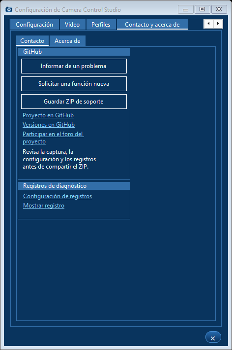

# Informar de un problema

1. Haz clic en el engranaje de la parte inferior para abrir la configuración. Elige **Contacto y acerca de → Contacto → Informar de un problema**.
2. Si hay una versión más reciente, elige **Sí** para abrir la página de descarga. Instálala y comprueba si puedes reproducir el fallo. Elige **No** para continuar al borrador de GitHub.
3. Si la aplicación ofrece guardar un ZIP de soporte, elige **Sí** y selecciona dónde guardarlo. Elige **No** para abrir el borrador sin crear el archivo.

Los mismos botones de GitHub están disponibles en el visor de guías.

## Añadir detalles y adjuntar el ZIP

El botón abre la plantilla **Bug report** de GitHub. Indica qué esperabas, qué ocurrió y cómo reproducirlo. Incluye las versiones de la aplicación y de Windows. Añade la cámara y el programa de captura si son relevantes. Rellena todos los apartados marcados con un asterisco rojo.

Para guardar el paquete, elige **Contacto y acerca de → Contacto → Guardar ZIP de soporte** y selecciona una ubicación. La aplicación muestra la ruta del archivo.

El ZIP incluye una captura de la aplicación, el archivo guardado `profiles.json`, la disposición de la ventana en `window.json` y los registros disponibles en `Logs`.

Revisa el ZIP para retirar datos privados, como nombres de perfiles, ID de cámaras y rutas. Arrastra tú mismo el ZIP o los archivos pertinentes a la descripción del borrador.

## Comprobar el tipo y las etiquetas

La plantilla pide **Bug** en **Type** y `bug` en **Labels**. Si faltan y puedes editar los campos, selecciónalos en la barra lateral derecha. Si no puedes, envía el borrador y una persona responsable del proyecto podrá añadirlos.

Revisa la descripción y los archivos en **Preview**. Después elige **Create**.
