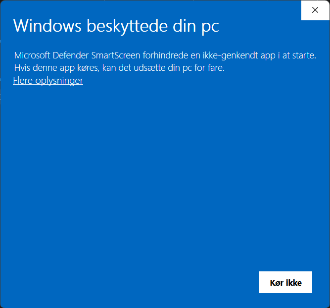
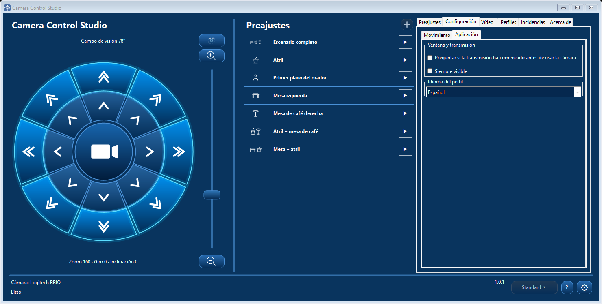
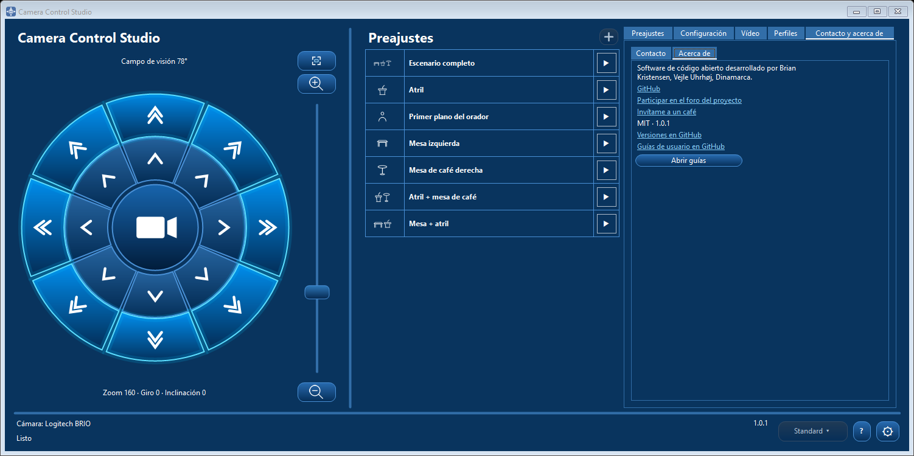

[English](../en/SETUP.md) · [Dansk](../da/SETUP.md) · [Deutsch](../de/SETUP.md) · [Todos los idiomas de la guía](USER-GUIDES.md)

# Configurar la aplicación

*Escrito para Camera Control Studio 1.0.1.*

[Solución de problemas](TROUBLESHOOTING.md)

Abra el engranaje en el pie de página. La configuración se abre a la derecha. Su lista de posiciones permanece visible.

## Instalar y verificar la descarga.

Descargue el instalador o ZIP portátil desde las versiones [GitHub del proyecto](https://github.com/bkristensen/Camera-Ctrl-Pressets-Studio/releases). Ejecute el instalador o extraiga el ZIP completo antes de iniciar la aplicación. Si se publica una suma de comprobación SHA-256, compárela con `Get-FileHash -Algorithm SHA256` para su descarga.

**Descarga oficial**\
<https://github.com/bkristensen/Camera-Ctrl-Pressets-Studio/releases>\
Código 

Microsoft Defender SmartScreen puede mostrar una advertencia azul cuando una aplicación descargada o su editor tiene poca reputación establecida. Tómalo en serio. Si obtuvo el archivo esperado de la versión oficial y confía en la fuente, seleccione **Más información** y revise el nombre del archivo y el editor. Seleccione **Ejecutar de todos modos** solo si elige confiar en ese archivo y Windows ofrece la opción. De lo contrario, cierre la advertencia. Siga la política de dispositivos de su organización. [Guía de pantalla inteligente de Microsoft](https://learn.microsoft.com/windows/apps/package-and-deploy/smartscreen-reputation)

<https://learn.microsoft.com/windows/apps/package-and-deploy/smartscreen-reputation>

Si el visor de la guía necesita WebView2, descargue el tiempo de ejecución de Microsoft.\
<https://developer.microsoft.com/microsoft-edge/webview2/>

## 1. Elige un perfil y una cámara.

Utilice el selector de perfiles en el pie de página para seleccionar un perfil. Para crear uno, abra **Configuración → Perfiles**. Elija **New** para la configuración predeterminada o **Copy** para una copia del perfil activo. Nómbralo después de una persona o configuración. Los nuevos perfiles se activan. En **Perfiles**, seleccione un perfil y haga clic en **✎** para cambiarle el nombre. El perfil Estándar tiene un nombre fijo.

Haga doble clic en el símbolo de la cámara en el centro de la rueda de dirección para seleccionar una cámara. El programa lo recuerda. Si falta esa cámara, elija otra fuente. Las posiciones pertenecen a una cámara dentro de un perfil.

## 2. Decida cuándo puede comenzar el control de la cámara

En **Configuración → Aplicación**, habilite **Preguntar si la transmisión ha comenzado antes de usar la cámara** si su programa de captura debe iniciarse primero. Esta opción está desactivada de forma predeterminada.

Con la opción habilitada, la primera acción de la cámara pregunta si ha comenzado la transmisión. Elija **Yes** solo cuando así sea. Elija **No** para mantener el control de la cámara desconectado. Después de Sí, no se volverán a preguntar más acciones hasta que cambie de perfil, cambie esta opción o reinicie la aplicación. La aplicación no detecta ni inicia una sesión de transmisión por usted.

Si necesita este pedido en el primer uso, configure la opción antes de su próxima sesión. El valor predeterminado permite que la aplicación se conecte al inicio.

## 3. Establecer movimiento y zoom

Abra **Configuración → Paneo** para configurar los pasos de giro e inclinación, invertir direcciones y elegir cómo funciona el botón de la cámara. Comience con pequeños pasos. Pruebe el resultado en su programa de captura.

| Configuración | que cambia | Predeterminado |
| --- | --- | --- |
| Velocidad fina (% de normal) | Califica mientras mantienes presionado Ctrl y una tecla de flecha | 50% |
| Pasos panorámicos normales | Anillo de flecha media | 1 |
| Pasos panorámicos rápidos | Anillo de flecha exterior | 4 |

Un paso significa un paso respaldado por el controlador de la cámara. No es una distancia fija ni un porcentaje. El conductor limita el movimiento y la suavidad.

Para una cámara invertida, habilite **Invertir giro de cámara arriba/abajo** y pruebe Up. Habilite **Invertir giro de cámara izquierda/derecha** solo si la izquierda se mueve en dirección incorrecta. Estas configuraciones cambian los controles. No rotan el video.

### Establecer pasos de zoom

Abra **Configuración → Zoom** para elegir hasta dónde se mueven los botones más y menos en un solo paso. El valor predeterminado es un paso del controlador. [Ver la pestaña Zoom](../images/screenshots/settings-tabs/en/zoom.png).

### Establecer transiciones preestablecidas

Abra **Preajustes → Transiciones** para elegir cómo se mueve la cámara entre las posiciones guardadas. [Consulte la pestaña Transiciones](../images/screenshots/settings-tabs/en/transitions.png).

| Configuración | que cambia | Predeterminado |
| --- | --- | --- |
| Usar velocidad para transiciones preestablecidas | Deje que la distancia recorrida determine la duración. | Apagado |
| Velocidad de transición (%/s) | Velocidad de crucero como porcentaje del rango del eje de control por segundo | 30% |
| Transición (seg.) | Tiempo para cada cambio preestablecido en modo de duración fija | 1.0 |

Con las transiciones basadas en la velocidad, un movimiento corto lleva menos tiempo que uno largo. La aplicación acelera y frena, y todos los ejes en movimiento comparten el mismo progreso para poder alcanzar el objetivo juntos.

### Establecer el campo de visión

Abra **Vídeo → Campo de visión**. En **Campo de visión al iniciar**, elija **Más amplio disponible**, un ángulo informado por el controlador de la cámara, o **No cambiar** para mantener la vista actual. La aplicación utiliza esta opción la primera vez que se conecta. Encienda **Permitir cambios manuales del campo de visión** para elegir entre los ángulos informados debajo de la rueda de dirección. Si el controlador informa que no hay ángulos seleccionables, los controles del FOV están deshabilitados. Aún puedes usar el zoom si la cámara lo admite. [Consulte la pestaña Campo de visión](../images/screenshots/settings-tabs/en/field-of-view.png).

**Cambiar el campo de visión al llegar al límite de zoom o giro** está activado de forma predeterminada. Puedes usarlo con el selector manual oculto. Funciona cuando el controlador admite FOV.

- **ZAlejar:** Con el zoom mínimo en un Brio configurado en 65°, presione alejar nuevamente para cambiar a 78°. Esa presión cambia el FOV y ajusta el zoom para mantener la toma cerca. La siguiente pulsación se aleja normalmente. Los mismos pasos lo llevan de 78° a 90°. El botón se detiene en 90° y zoom mínimo.
- **ZAcercar:** Con el zoom máximo, presione nuevamente para moverse hacia un FOV más estrecho. Si el controlador informa 90°, 78° y 65°, la aplicación los usa en ese orden. El botón se detiene en el ángulo más estrecho disponible y en el zoom máximo.
- **Desplazamiento hacia la izquierda o hacia la derecha:** En el borde, la aplicación intenta primero una vista más amplia. Ajusta el zoom para mantener el recorte cerca. También puede probar una vista más estrecha si el zoom lo permite. Si ninguna vista le permite desplazarse más, restaura la toma anterior. El conductor controla qué tan reñido está el partido.

Utilice el botón cuadrado con el símbolo del marco para ir directamente al FOV más amplio y al zoom mínimo. El control deslizante aún establece el zoom dentro del FOV actual. Desactive el FOV automático para mantener el zoom y la panorámica dentro de la vista actual.

Los ajustes preestablecidos guardan panorámica, inclinación, zoom y el FOV informado por el controlador. Los ajustes preestablecidos más antiguos mantienen el FOV actual. Verifique la imagen en vivo si Zoom, Logitech Brio Control u otra aplicación controla el recorte. [Pasos de prueba de Brio y Zoom](VALIDATION.md#campo-de-visi%C3%B3n-brio-y-zoom)

## 4. Ajusta la imagen y guarda posiciones permanentes.

[Antes de cargar controles de vídeo](../images/screenshots/settings-tabs/en/video.png) · [Color](../images/screenshots/1.0.1/en/video-colour.png) · [Luz y detalle](../images/screenshots/1.0.1/en/video-light-detail.png)

Abra **Vídeo** en el panel de configuración, luego cargue los controles de imagen si es necesario. Elija un grupo como **Enfoque y exposición**, **Color** o **Luz y detalle**. Sólo aparecen los controles expuestos por el controlador. Ajuste el brillo, el contraste, la saturación del color, el enfoque o el balance de blancos cuando esté disponible. Apague el modo automático antes del ajuste manual. Los valores de imagen se guardan por cámara y perfil. El botón de reinicio restaura los valores predeterminados del controlador.

Mueve la cámara primero. Abra **Preajustes** en el panel de configuración. Haga clic en **+** para agregar un ajuste preestablecido permanente. Seleccione un ícono en la parte superior, verifique el nombre y luego guarde. Si el nombre está en blanco y no se utiliza, al elegir un icono se sugiere su nombre. Los símbolos combinados muestran a sus sujetos de izquierda a derecha.

En **Preajustes permanentes**, seleccione una posición. Pase el cursor sobre un símbolo para conocer su acción. Utilice **✎** para editar su nombre y símbolo, **↻** para guardar la posición actual de la cámara en su lugar y **−** para eliminarla. Utilice ** ↑** y **↓** para cambiar el orden en ambas listas. Los puestos permanentes permanecen en la parte superior de la lista principal en negrita.

Al seleccionar una fila permanente en la lista principal también se selecciona ese ajuste preestablecido en Configuración. Un ajuste preestablecido recién guardado se selecciona en Configuración.

## 5. Establecer diseño e idioma

Arrastre el divisor entre los controles de la cámara y la lista preestablecida. Su perfil guarda el divisor y el tamaño y posición de la ventana. El tamaño inicial es 900 × 500 y el mínimo es 670 × 450. La configuración comienza cerrada. Cuando los abre por primera vez después del lanzamiento, se selecciona la primera pestaña. Desplácese hacia abajo en **Paneo** o **Aplicación** si algunos campos están debajo de la ventana. La aplicación guarda el ancho de la ventana con la Configuración cerrada.

Al seleccionar un perfil en el pie de página, deje **Mantener la posición y la disposición actuales** sin marcar para restaurar el diseño de ese perfil. Márquelo para llevar el diseño actual al perfil seleccionado. La elección se recuerda en el perfil que dejas; el diseño transportado se guarda en el perfil de destino.

Elija un idioma en **Configuración → Aplicación → Idioma del perfil**, luego reinicie para aplicarlo. **Automático** utiliza el idioma de visualización de Windows si es compatible y el inglés en caso contrario. Al cambiar de perfil se reinicia la aplicación con el idioma del perfil seleccionado. Los ajustes preestablecidos temporales finalizan al reiniciar.

## 6. Versión e información del proyecto.

Abre **Contacto y acerca de → Acerca de** para ver la versión y los enlaces del proyecto. Pasa el puntero sobre la versión para ver el identificador completo. Inclúyelo si el fallo afecta a esa compilación.

## 7. Registros de diagnóstico e informes de problemas

Abre **Contacto y acerca de → Contacto** para elegir la carpeta de registros, el tamaño máximo y cuántos archivos guardar, incluido el actual. De forma predeterminada se usa la carpeta de la aplicación o, si no está disponible, `%LOCALAPPDATA%\CamPressets\Logs`.

Elige **Informar de un problema** o **Solicitar una función nueva** para abrir el borrador adecuado en GitHub. Para un fallo, la aplicación ofrece guardar un ZIP de soporte. Revísalo y adjúntalo tú mismo al borrador. [Informar o seguir una incidencia](ISSUES.md)

**Informar un error o sugerir una característica**\
<https://github.com/bkristensen/Camera-Ctrl-Pressets-Studio/issues?q=is%3Aissue>\
Código 

Siguiente: [Uso diario](DAILY-USE.md). Para realizar una copia de seguridad, cierre la aplicación y copie `%LOCALAPPDATA%\CamPressets`. Los puestos temporales no forman parte del respaldo.
