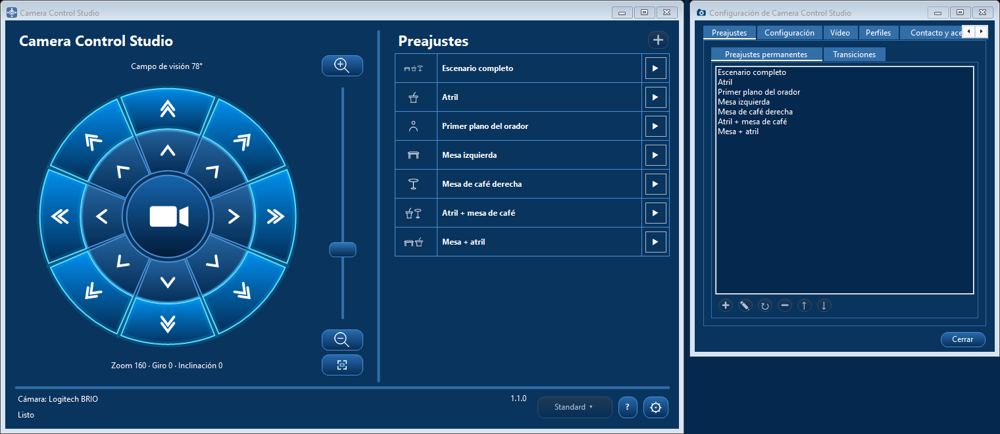
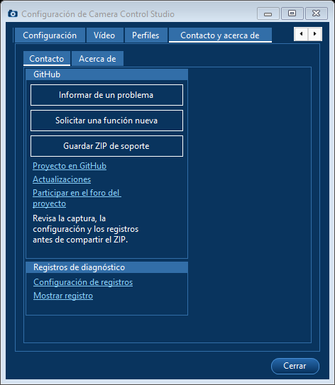
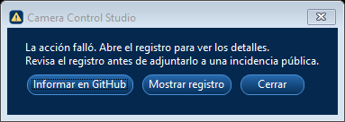

[English](../en/SETUP.md) · [Dansk](../da/SETUP.md) · [Deutsch](../de/SETUP.md) · [Todos los idiomas de la guía](USER-GUIDES.md)

# Configurar la aplicación

*Escrito para Camera Control Studio 1.1.0.*

[Solución de problemas](TROUBLESHOOTING.md)

Haz clic en el engranaje de la parte inferior para abrir la configuración. La configuración se abre en otra ventana. Puedes seguir usando la ventana principal.

## Instalar y verificar la descarga.

Descarga **Camera Control Studio** desde Microsoft Store cuando esté disponible allí. Busca la aplicación por su nombre en la tienda. Microsoft firma el paquete de la tienda y distribuye las actualizaciones.

Si la aplicación aún no está disponible en Microsoft Store, descarga el instalador o el ZIP portátil desde las [versiones de GitHub](https://github.com/bkristensen/Camera-Ctrl-Pressets-Studio/releases). Ejecuta el instalador o extrae el ZIP completo antes de abrir la aplicación. Si la versión incluye una suma SHA-256, compárala con el resultado de `Get-FileHash -Algorithm SHA256`.

Microsoft Defender SmartScreen puede mostrar una advertencia azul cuando una aplicación descargada o su editor tiene poca reputación establecida. Tómalo en serio. Si obtuvo el archivo esperado de la versión oficial y confía en la fuente, seleccione **Más información** y revise el nombre del archivo y el editor. Seleccione **Ejecutar de todos modos** solo si elige confiar en ese archivo y Windows ofrece la opción. De lo contrario, cierre la advertencia. Siga la política de dispositivos de su organización. [Guía de pantalla inteligente de Microsoft](https://learn.microsoft.com/windows/apps/package-and-deploy/smartscreen-reputation)

<https://learn.microsoft.com/windows/apps/package-and-deploy/smartscreen-reputation>

Si el visor de la guía necesita WebView2, descargue el tiempo de ejecución de Microsoft.\
<https://developer.microsoft.com/microsoft-edge/webview2/>

Selecciona el perfil al pie de la ventana principal. De forma predeterminada, haz doble clic en el botón de cámara de la rueda y elige una fuente. El perfil recuerda la cámara. Si falta, selecciona otra.

Los apartados siguen el orden de las pestañas. Un botón atenuado suele requerir una selección. En Vídeo, el controlador decide qué ajustes aparecen. Comprueba el resultado en tu aplicación de captura.

**Cerrar**. Cambia el tamaño o la posición de las ventanas y arrastra el separador de la ventana principal. El perfil recuerda esos valores. Cerrar cierra la ventana de configuración. La principal sigue abierta.

## Preajustes

### Preajustes permanentes

Apunta la cámara. Una posición permanente guarda los valores compatibles de paneo, inclinación y zoom. También guarda el campo de visión si la cámara lo informa. Cada posición pertenece a una cámara en un perfil.

- **+ Añadir preajuste permanente**. Guarda el encuadre actual. Elige un símbolo y escribe un nombre único. Si el campo está vacío, el símbolo puede sugerir un nombre. Para guardar, hace falta un nombre. Si cancelas, la lista queda igual.
- **✎ Cambiar nombre e icono**. Cambia el nombre o el símbolo de la posición seleccionada. El encuadre guardado queda igual.
- **↻ Reemplazar por la posición actual**. Sustituye el encuadre seleccionado por la posición actual de la cámara. Confirma el cambio. El nombre y el símbolo se conservan.
- **− Eliminar preajuste permanente**. Elimina la posición seleccionada después de confirmar.
- **↑ / ↓ Subir el preajuste seleccionado · Bajar el preajuste seleccionado**. Mueve la posición una fila en ambas listas. La flecha hacia arriba se atenúa en la primera fila. La flecha hacia abajo se atenúa en la última.

Selecciona una posición para editarla, sustituirla, borrarla o moverla. Añadir y sustituir requieren un perfil cargado y al menos un eje controlable de paneo, inclinación o zoom. Si la cámara está desconectada, la aplicación puede intentar conectarla.

### Establecer transiciones preestablecidas

- **Usar velocidad al cambiar de posición**. Desactivado usa una duración fija. Activado usa una velocidad y los recorridos cortos terminan antes. Los ejes que se mueven llegan juntos.
- **Transición (s)**. Fija el tiempo de cada transición. El valor inicial es 1 segundo. El campo se atenúa cuando usas velocidad.
- **Velocidad de transición (%/s)**. Fija la velocidad como porcentaje del recorrido del eje que determina el movimiento por segundo. El valor inicial es 30 %. El campo se atenúa en el modo de tiempo fijo.

## Configuración

### Paneo

- **Velocidad fina (% de normal)**. Mantén Ctrl y pulsa una flecha para hacer un ajuste fino. El valor inicial es el 50 % de la velocidad normal.
- **Pasos de giro normal**. Fija los pasos de las flechas del anillo interior. El valor inicial es 1.
- **Pasos de giro rápido**. Fija los pasos de las flechas del anillo exterior. El valor inicial es 4. También afecta a la velocidad al arrastrar el botón de cámara.
- **Invertir giro de cámara izquierda/derecha**. Intercambia izquierda y derecha. Úsalo si la cámara se mueve en sentido contrario.
- **Invertir giro de cámara arriba/abajo**. Intercambia arriba y abajo. Pruébalo si la cámara está montada boca abajo. Estas opciones cambian los mandos y mantienen la orientación de la imagen.
- **Arrastrar el botón de cámara para girar e inclinar**. Arrastra el botón central para apuntar la cámara. Desactiva la opción si prefieres usar las flechas.
- **Hacer doble clic en el botón de cámara para elegir la fuente**. Activado abre la lista de cámaras con doble clic. Desactivado la abre con un clic.

Puedes ajustar estos valores antes de conectar. El controlador determina el tamaño del paso, los ejes disponibles y sus límites.

### Establecer pasos de zoom

- **Pasos de zoom**. Fija la distancia que avanza el zoom al pulsar + o −. El valor inicial es 1 paso del controlador. Puedes ajustarlo antes de conectar. Hace falta una cámara compatible con zoom. El deslizador elige un valor dentro del campo de visión actual.

### Aplicación

- **Preguntar si la transmisión ha comenzado antes de usar la cámara**. Actívalo si la aplicación de captura debe empezar a emitir primero. La siguiente acción de cámara pide confirmación. Elige Sí cuando la emisión esté lista. No deja la cámara desconectada. Se vuelve a preguntar tras reiniciar, cambiar de perfil o cambiar esta opción. Desactivado permite conectar al iniciar.
- **Siempre visible**. Mantiene la ventana principal sobre otras aplicaciones. Desactívalo si quieres que otras ventanas puedan cubrirla.
- **Idioma del perfil · Automático**. Elige uno de los 12 idiomas. Automático usa el idioma de Windows si está disponible y, en otro caso, el inglés. Reinicia para aplicarlo. Cada perfil guarda su idioma.

## Vídeo

- **Cargar controles de imagen**. Conecta la cámara para mostrar los ajustes de imagen. El botón aparece mientras está desconectada. Si el controlador no admite ajustes de imagen, solo queda la pestaña de campo de visión.
- **Automático**. El controlador decide qué deslizadores y pestañas aparecen. Automático deja que la cámara ajuste el valor. Desactívalo para usar el deslizador. Si solo hay modo automático, el deslizador se atenúa y la casilla puede quedar bloqueada. Si solo hay modo manual, la casilla se oculta.
- **Restablecer los ajustes de imagen del controlador**. Restaura los valores de imagen compatibles a los valores del controlador. El botón aparece en las pestañas de imagen y se oculta en la de campo de visión. Los valores se guardan por cámara y perfil.

### Enfoque y exposición

- **Ganancia**. Amplifica la señal para aclarar la imagen. Un valor alto puede producir grano.
- **Exposición**. Fija cuánto tiempo recoge luz el sensor. Una exposición larga aclara la imagen y puede emborronar el movimiento.
- **Enfoque**. Ajusta la distancia de enfoque. Mira el sujeto en tu aplicación de captura.

### Color

- **Balance de blancos**. Corrige el color de la iluminación para que el blanco se vea blanco.
- **Saturación**. Aumenta o reduce la intensidad del color.
- **Gamma**. Aclara u oscurece los tonos medios.
- **Tono**. Desplaza los colores en el círculo cromático.

### Luz y detalle

- **Contraste**. Cambia la diferencia entre las zonas claras y oscuras.
- **Brillo**. Aclara u oscurece toda la imagen.
- **Compensación de contraluz**. Aclara el sujeto si tiene una luz intensa detrás.
- **Nitidez**. Hace que los bordes destaquen más o menos.

### Establecer el campo de visión

El campo de visión (FOV) indica cuánto cabe en el encuadre. Un ángulo mayor muestra más. El zoom cambia el recorte dentro de ese ángulo.

- **Campo de visión al iniciar · Más amplio disponible · No cambiar**. Elige el ángulo más amplio, conserva el actual o elige uno de los que ofrece el controlador. La aplicación intenta aplicarlo en la primera conexión de la sesión. La lista se atenúa hasta que una cámara conectada informa de al menos un ángulo.
- **Permitir cambios manuales del campo de visión**. Muestra un selector de ángulo bajo la rueda. Si está desactivado, aparece el ángulo actual cuando se puede leer. La opción se atenúa si hay menos de dos ángulos.
- **Cambiar el campo de visión al llegar al límite de zoom o giro**. Al llegar al límite de zoom, vuelve a pulsar. La aplicación prueba un ángulo más amplio al alejar y uno más estrecho al acercar. En el límite de paneo horizontal, prueba otro ángulo. Intenta conservar el encuadre y lo restaura si no puede seguir. Funciona con la selección manual desactivada. La opción se atenúa si hay menos de dos ángulos.

Por ejemplo, con una Brio a 65° y en el zoom mínimo, pulsar − puede cambiar a 78°. Pulsa otra vez para alejar en el nuevo ángulo. El botón con un marco intenta aplicar el ángulo más amplio y el zoom mínimo juntos. Comprueba el vídeo si otra aplicación controla la cámara.

## Perfiles

- **+ Nuevo perfil**. Crea un perfil con los ajustes iniciales y actívalo. Dale un nombre único.
- **⧉ Copiar el perfil activo**. Copia los ajustes y las posiciones del perfil activo y cambia a la copia. La fila seleccionada da igual para la copia.
- **✎ Renombrar el perfil seleccionado**. Cambia el nombre del perfil seleccionado. El botón se atenúa sin selección o al elegir Standard. Nuevo y Copiar requieren un perfil cargado. Los tres cuadros de nombre necesitan texto para confirmar.
- **Mantener la posición y la disposición actuales**. Haz doble clic en un perfil. Marca la opción de diseño para conservar la posición y el tamaño de las ventanas y el separador. Déjala sin marcar para usar el diseño del perfil elegido. El cambio reinicia la aplicación y borra las posiciones temporales.

## Contacto y acerca de

### Contacto

- **Informar de un problema**. Abre la plantilla de errores en GitHub. Si hay una versión nueva, la aplicación ofrece abrirla primero. Si sigues, ofrece guardar un ZIP antes de abrir el borrador.
- **Solicitar una función nueva**. Abre la plantilla de sugerencias. Si hay una versión nueva, pruébala primero. Puede que ya incluya la función.
- **Guardar ZIP de soporte**. Guarda una captura, los registros disponibles, los perfiles y el diseño de las ventanas en un ZIP. Revisa los datos privados. Adjunta el archivo en el borrador. Los tres botones se atenúan durante una acción.
- **Proyecto en GitHub · Versiones en GitHub · Participar en el foro del proyecto**. Los tres enlaces de GitHub abren el código, las descargas y los debates del proyecto.

[Informar de un problema](Report%20a%20bug.md) · [Solicitar una función nueva](Request%20a%20feature.md)

### Registros de diagnóstico

- **Configuración de registros**. Abre la configuración de registros. Afecta a todos los perfiles. Guardar aplica los cambios. Cancelar los descarta.
- **Elegir carpeta · Automático**. Elige una carpeta o usa Automático. La ruta es de solo lectura. Automático usa la carpeta de la aplicación o, si hace falta, `%LOCALAPPDATA%\CamPressets\Logs`.
- **Tamaño máximo por archivo (MiB)**. Fija cuándo se inicia un archivo de registro nuevo. El valor inicial es 1 MiB por archivo.
- **Máximo de registros (incluido el actual)**. Fija cuántos archivos se conservan, incluido el actual. El valor inicial es 2.
- **Mostrar registro**. Selecciona el registro más reciente en el Explorador de archivos. Si no existe, la aplicación te avisa.

### Acerca de

- **Invítame a un café**. Consulta la versión instalada y el nombre del desarrollador. Pasa el cursor por la versión para ver el identificador de compilación completo. El enlace de apoyo abre la página del desarrollador.
- **Abrir guías**. Abre las guías en esta pestaña. El botón de ayuda de la ventana principal también las abre.

Cierra la aplicación y copia `%LOCALAPPDATA%\CamPressets` para hacer una copia de seguridad. Las posiciones temporales duran una sesión.

[Uso diario](DAILY-USE.md)

## Cuadro de error

Si un error inesperado detiene una acción, cierra el cuadro y vuelve a intentarlo. Si indica que la aplicación se cerrará, ábrela de nuevo.

**Mostrar registro** selecciona el registro de diagnóstico en el Explorador de archivos si está disponible. **Informar en GitHub** te ofrece guardar un ZIP de soporte y luego abre la plantilla de errores en GitHub. El ZIP puede incluir una captura del cuadro, registros, ajustes de perfil y ventana, y un informe del sistema. Revisa el ZIP y adjúntalo al borrador.
