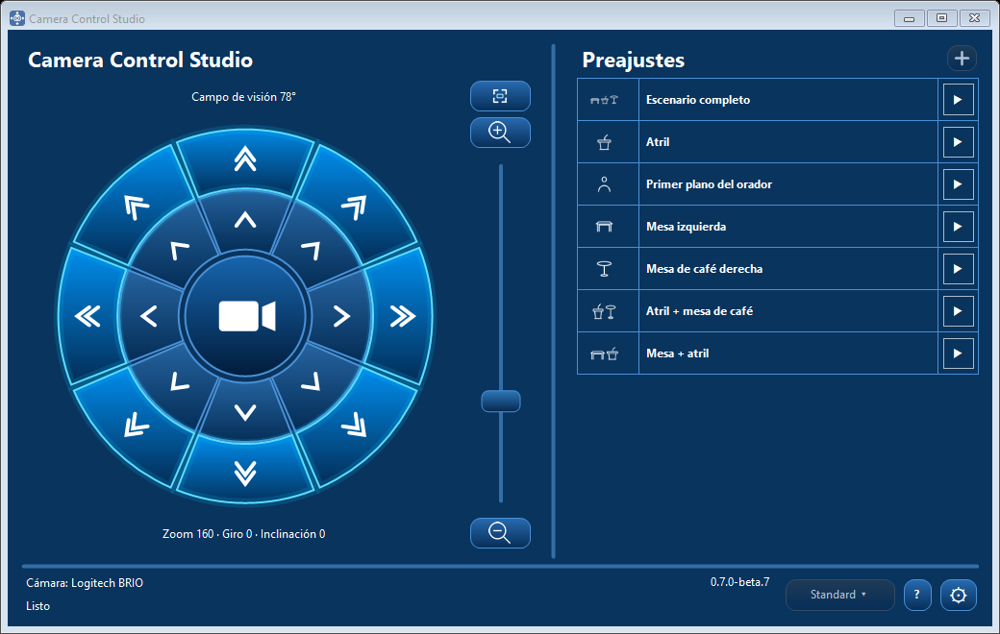
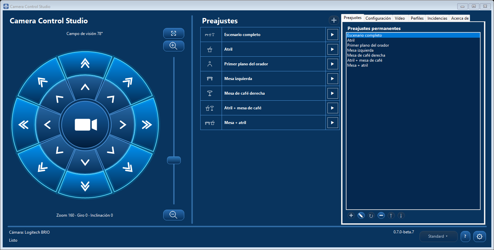
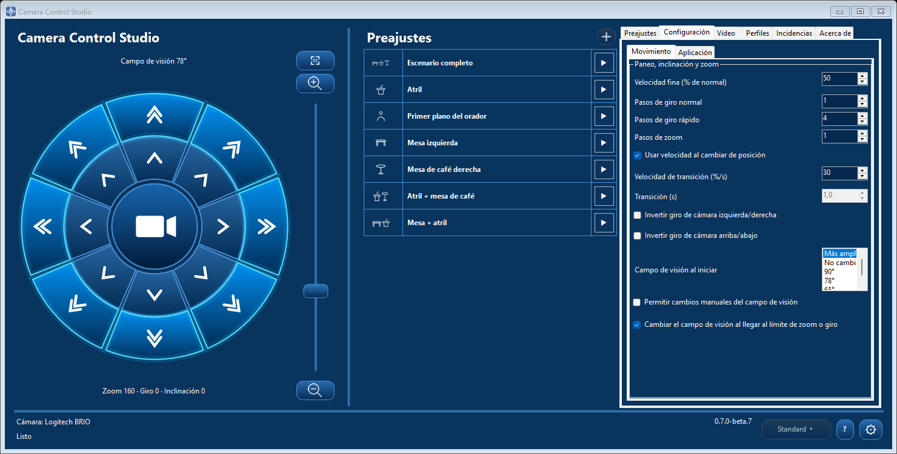
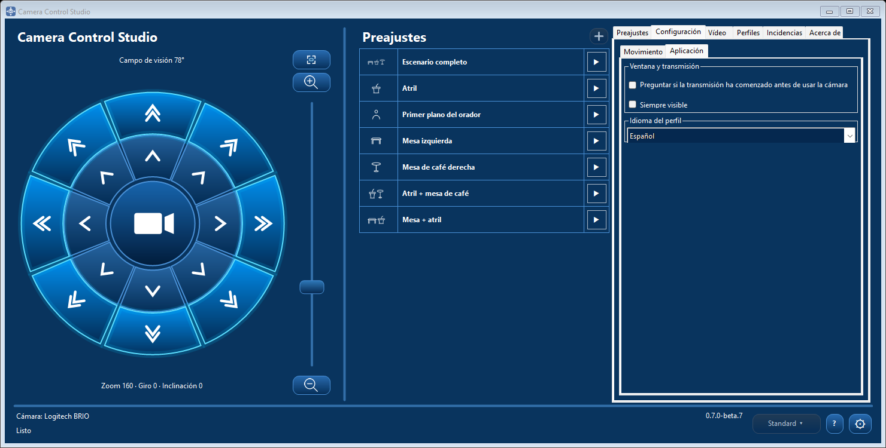

# Uso y configuración

[Español · Camera Control Studio](../USER-GUIDES.md)

Inicia primero la reunión que vas a transmitir, por ejemplo, en Zoom. Luego abre **Camera Control Studio**.

Pulsa **?** para abrir la ayuda. Pasa el cursor sobre un botón para ver qué hace. Cada dirección se detiene al alcanzar el último límite de la cámara.

1. **Activa un preajuste**

   Pulsa ▶ en la fila del preajuste, haz doble clic en su nombre o selecciona la fila y pulsa Intro.

   | Color | Significado |
   | --- | --- |
   | Amarillo | La cámara se está moviendo hacia la posición. |
   | Verde | El controlador indica que la cámara ha alcanzado las coordenadas guardadas. |
   | Azul | El preajuste no está marcado como activo. |

   El verde confirma las coordenadas que indica el controlador. Comprueba la imagen en la transmisión. Si el controlador no confirma la llegada a tiempo, la fila se vuelve azul y aparece un mensaje en el área de estado. Los iconos siguen visibles.

2. **Ajusta el encuadre**

   **Giro**

   Usa el anillo interior para el movimiento normal y el exterior para el rápido. Las flechas diagonales mueven ambos ejes a 45°, al 45 % de la velocidad del anillo por eje. Mantén pulsada una flecha para seguir. Suéltala para parar.

   

   **Botón de cámara en el centro de la rueda**

   - **Haz clic y suelta sin arrastrar.** Se abre la lista para elegir una cámara.
   - **Mantén pulsado y arrastra.** Empieza sobre el icono de la cámara. Arrastra hacia un lado para girarla o hacia arriba o abajo para inclinarla. Arrastra un poco para moverte despacio o más lejos para ir más rápido, hasta el doble de la velocidad rápida. Para detenerla, suelta el botón o lleva el puntero al punto de partida.

   **Zoom**

   Usa los botones de lupa para acercar o alejar. Mantén pulsado para repetir. El zoom cambia mientras arrastras el deslizador.

   **Restaurar el encuadre completo**

   Haz clic en el botón cuadrado con el icono de marco encima de las lupas. La cámara se aleja todo lo que puede y selecciona el campo de visión más amplio si admite ese ajuste. Cambia el encuadre de la cámara. La ventana conserva su tamaño.

   **Interrumpir el giro**

   Pulsa Esc para detener un giro en curso.

   > El giro, la inclinación o el zoom manuales cancelan el cambio de preajuste y quitan el color de la posición activa.

   **Teclas de flecha**

   Cuando la rueda tiene el foco, usa las teclas de flecha. Mantén pulsada Mayús para dar pasos rápidos.

3. **Guarda un preajuste temporal**

   Pulsa **+** encima de la lista, escribe un nombre y guarda. La posición actual aparece debajo de los preajustes permanentes. Los temporales no tienen icono y se mantienen por separado para cada perfil y cámara hasta que cierres la aplicación.

   Para eliminar uno, selecciona su fila y pulsa **×** encima de la lista. Al cerrar la aplicación se eliminan todos. Si quieres volver a usar una posición más adelante, créala en **Configuración → Preajustes**. Los preajustes permanentes no se pueden editar ni eliminar en la lista principal.

4. **Cierra la aplicación**

   Si falla un control, lee el mensaje del área de estado inferior. Puede que la cámara no admita esa función o no esté disponible.

   Cierra la aplicación como de costumbre. Se guardan el perfil activo y la disposición de la ventana.

   **Comunica incidencias**

   Si encuentras un fallo o echas en falta alguna función, comunícalo en **Configuración → Incidencias**.

5. **Configuración**

   Selecciona el perfil en la parte inferior y pulsa el icono de cámara en el centro de la rueda para elegir la cámara.

   Para guardar una posición de forma permanente, abre el engranaje inferior, selecciona **Preajustes → Añadir preajuste permanente**, elige un nombre y un icono y guarda.

   

   En Configuración puedes ajustar los pasos de movimiento y zoom, el tiempo de transición y las direcciones. **Vídeo** muestra los controles disponibles del controlador. **Perfiles** permite crear o copiar perfiles. Activa la confirmación de transmisión si el programa de captura debe conectarse antes.

   

   

6. Arrastra el separador vertical para cambiar el ancho de ambas zonas. La configuración está cerrada al arrancar. Cambia el idioma en **Configuración → Aplicación → Idioma del perfil** y reinicia la aplicación. Sitúa el cursor sobre los botones pequeños para ver su función.

## Campo de visión al mover la cámara

**Cambiar el campo de visión al llegar al límite de zoom o giro**

La opción está activada de forma predeterminada. Con una Brio, un paso adicional cambia de campo al llegar al límite del zoom. Al alejarte pasa de 65° a 78° y luego a 90°. Al acercarte va al revés. Entre cambios, el zoom vuelve a avanzar por pasos. Si el giro se detiene en el borde, la app prueba un campo más amplio y ajusta el zoom para conservar el encuadre. Desactiva la opción para mantener el campo actual.

Los preajustes guardan el campo de visión cuando el controlador lo permite.

[Instalación y SmartScreen (inglés)](../en/SETUP.md)

<https://github.com/bkristensen/Camera-Ctrl-Pressets-Studio/blob/main/Source/docs/en/SETUP.md>

## Descarga y asistencia

**Descarga oficial**\
<https://github.com/bkristensen/Camera-Ctrl-Pressets-Studio/releases>\

**Informa de un problema o sugiere una función**\
<https://github.com/bkristensen/Camera-Ctrl-Pressets-Studio/issues?q=is%3Aissue>\

