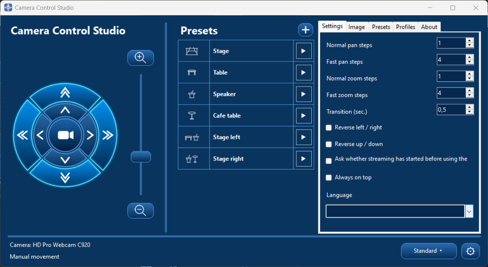

# Uso y configuración

[Español · Camera Control Studio](../USER-GUIDES.md)

1. Si tu equipo necesita que el programa de captura o transmisión se conecte primero, inícialo antes de abrir Camera Control Studio. Selecciona el perfil en la parte inferior y pulsa el icono de cámara en el centro de la rueda para elegir la cámara.
2. Usa las flechas interiores para el giro y la inclinación normales y las exteriores para pasos más rápidos. Acerca o aleja con los botones de lupa. Mantén pulsada **Mayús** para dar pasos más grandes. Arrastra y suelta el control vertical para ajustar el zoom directamente. Al llegar a un límite, se desactiva esa dirección.
3. Pulsa ▶, haz doble clic en el nombre o selecciona la fila y pulsa Intro. El amarillo indica que la cámara se está moviendo. El verde indica que el controlador ha comunicado la posición guardada. Comprueba el encuadre en el programa de captura.
4. Pulsa **+** encima de la lista para guardar un preajuste temporal. Selecciona su fila y pulsa **×** para eliminarlo. Los temporales se borran al cerrar la aplicación. Para guardarlo de forma permanente, abre el engranaje inferior y selecciona **Preajustes → Añadir preajuste permanente**. Elige un nombre y un icono.

   

5. En Configuración puedes ajustar los pasos de movimiento y zoom, el tiempo de transición y las direcciones. **Imagen** muestra los controles disponibles del controlador. **Perfiles** permite crear o copiar perfiles. Activa la confirmación de transmisión si el programa de captura debe conectarse antes.

   

6. Arrastra el separador vertical para cambiar el ancho de ambas zonas. La configuración está cerrada al arrancar. Cambia el idioma en **Configuración → Idioma** y reinicia. Sitúa el cursor sobre los botones pequeños para ver su función.
