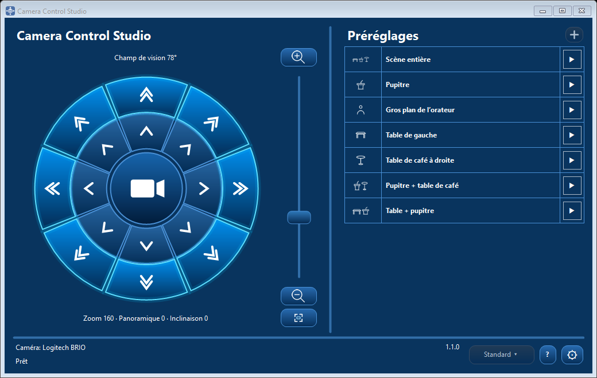
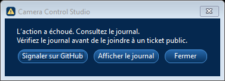

[English](../en/DAILY-USE.md) · [Dansk](../da/DAILY-USE.md) · [Deutsch](../de/DAILY-USE.md) · [Atoutes les langues du guide](USER-GUIDES.md)

# Utilisation quotidienne

*Écrit pour Camera Control Studio 1.1.0.*

[Dépannage](TROUBLESHOOTING.md)

Démarrez votre réunion en streaming dans une application telle que Zoom. Ensuite, ouvrez **Camera Control Studio**.

## Général

Cliquez sur **?** pour obtenir de l'aide. Passez la souris sur un bouton pour voir son nom et son action. Une direction se verrouille à la dernière limite que la caméra peut atteindre. [Comment fonctionne le FOV automatique](SETUP.md#d%C3%A9finir-le-champ-de-vision)

## 1. Activez un préréglage

Cliquez ▶ sur une ligne de la liste des préréglages ou double-cliquez sur le nom.
Vous pouvez également sélectionner la ligne et appuyer sur Entrée.

| Couleur | Signification |
| --- | --- |
| Jaune | L'application déplace la caméra vers le préréglage. |
| Vert | Le pilote de la caméra signale que les coordonnées enregistrées ont été atteintes. |
| Bleu | Le préréglage n'est pas marqué comme actif. |

Vert signifie que le conducteur signale la position enregistrée et FOV, si elle est enregistrée. Vérifiez l'image dans votre flux. Si le conducteur ne peut pas confirmer le tir à temps, la ligne devient bleue. Lisez le message d'état pour voir ce qui s'est passé.

## 2. Affiner le cadrage

### Poêle

Utilisez l'anneau intérieur pour les mouvements normaux et l'anneau extérieur pour les mouvements rapides. Chaque anneau comporte huit flèches. Les diagonales déplacent ensemble le panoramique et l’inclinaison à 45°, avec 45 % de la vitesse de l’anneau sur chaque axe. Un clic déplace au moins un pas du pilote par axe disponible. Maintenez une flèche pour continuer à avancer. Relâchez-le pour arrêter.

### Bouton caméra au centre de la roue

- **Double-cliquez pour choisir une caméra.** La liste des caméras s'ouvre.
- **HMaintenez et faites glisser.** Démarrez sur l'icône de l'appareil photo. Faites glisser latéralement pour effectuer un panoramique ou de haut en bas pour incliner. Faites glisser un peu pour un mouvement lent ou plus loin pour un mouvement plus rapide, jusqu'à deux fois la vitesse rapide. Relâchez le bouton ou ramenez le pointeur là où vous avez commencé à vous arrêter.

Sous **Paramètres → Panoramique**, vous pouvez désactiver le glisser-déposer ou passer à un simple clic pour la sélection de la caméra. Les deux options sont enregistrées dans le profil actif.

### Zoomer

Utilisez les boutons de la loupe pour zoomer. Maintenez un bouton enfoncé pour répéter l'action.
Faites glisser le curseur pour ajuster le zoom à mesure que vous le déplacez.

### Restaurer le plein cadre

Cliquez sur le bouton carré avec l'icône en forme de cadre au-dessus des boutons de loupe. La caméra effectue un zoom arrière aussi loin que possible et sélectionne son champ de vision le plus large si elle prend en charge ce paramètre. Cela modifie l'image de la caméra. La fenêtre de l'application conserve sa taille.

### Arrêter le panoramique

Appuyez sur Esc pour arrêter un panoramique en cours.

> Le panoramique, l'inclinaison ou le zoom manuel annulent le passage au préréglage et effacent la couleur active.

### Touches fléchées

Utilisez les touches fléchées lorsque la roue a le focus. Maintenez Ctrl pour des mouvements fins ou Shift pour des mouvements rapides.

## 3. Enregistrez un préréglage temporaire

Cliquez sur **+** au-dessus de la liste des préréglages, entrez un nom et enregistrez. La position actuelle apparaît sous les préréglages permanents.
Les préréglages temporaires n'ont pas d'icône. Ils durent jusqu'à la fermeture de l'application et sont conservés séparément pour chaque profil et caméra.

Sélectionnez une ligne temporaire et cliquez sur **×** au-dessus de la liste prédéfinie pour la supprimer. Tous les préréglages temporaires sont supprimés à la fermeture de l'application.
Pour utiliser une position ultérieurement, créez-la sous **Paramètres → Préréglages**. Vous ne pouvez pas modifier ou supprimer les préréglages permanents dans la liste principale.

## 4. Quitter

Si un contrôle échoue, lisez le message dans la zone d'état en bas. La caméra peut ne pas prendre en charge cette fonctionnalité ou être indisponible.

Fermez l'application normalement. L'application mémorise le profil actif et la disposition des fenêtres.

## 5. Signaler les problèmes

Si **Nouvelle version disponible** apparaît dans le pied de page, sélectionnez-le pour ouvrir la version sur GitHub et voir les téléchargements.

<https://github.com/bkristensen/Camera-Ctrl-Pressets-Studio/releases>

Signalez les problèmes ou proposez des fonctionnalités dans **Contact et à propos → Contact**.

Voir [Setup](SETUP.md) pour la direction de la caméra, les préréglages permanents, les paramètres d'image, les profils et les étapes de mouvement.

## Boîte de dialogue d’erreur

Si une erreur inattendue bloque une action, fermez la boîte de dialogue et réessayez. Si elle annonce la fermeture de l’application, relancez-la.

**Afficher le journal** sélectionne le journal de diagnostic dans l’Explorateur de fichiers s’il est disponible. **Signaler sur GitHub** propose d’enregistrer un ZIP de support, puis ouvre le modèle de rapport de bogue sur GitHub. Le ZIP peut contenir une capture de la boîte de dialogue, les journaux, les réglages du profil et de la fenêtre et un rapport système. Vérifiez le ZIP, puis joignez-le au brouillon.
