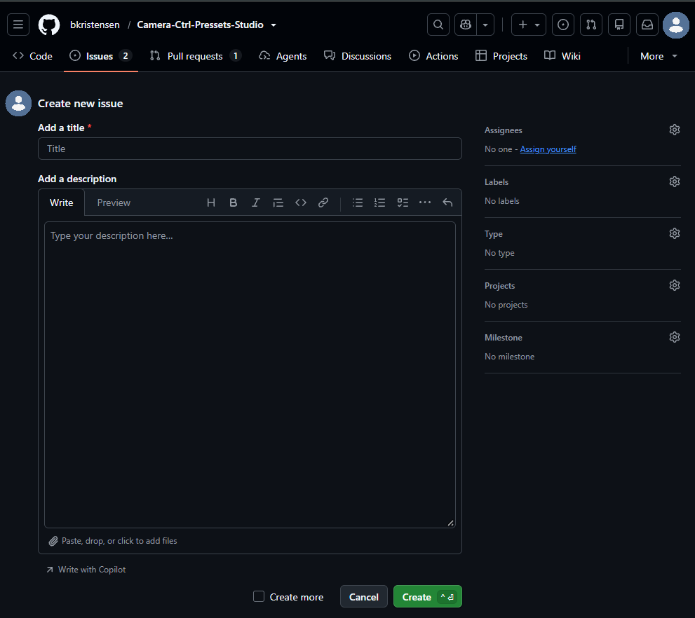

# Signaler ou suivre un problème

*Écrit pour Camera Control Studio 1.0.1.*

[Dépannage](TROUBLESHOOTING.md)

## Rechercher avant de signaler

**Signaler un bug ou suggérer une fonctionnalité**\
<https://github.com/bkristensen/Camera-Ctrl-Pressets-Studio/issues?q=is%3Aissue>\
Code 

1. Ouvrez le projet [Onglet Problèmes](https://github.com/bkristensen/Camera-Ctrl-Pressets-Studio/issues?q=is%3Aissue). Recherchez des termes clés à partir du symptôme ou de la demande, tels que `is:issue Brio zoom` ou `is:issue label:enhancement preset`.
2. Vérifiez les résultats ouverts et fermés. Lisez des rapports similaires pour faire correspondre les symptômes et les solutions de contournement.
3. En cas de problème de correspondance, sélectionnez **Subscribe** dans la barre latérale pour recevoir des mises à jour, ou réagissez avec 👍 pour montrer que cela vous affecte. Ajoutez un commentaire si vous pouvez apporter des détails tels qu'une caméra différente, un résultat de test ou une reproduction fiable.

## Ouvrir un rapport

Ouvrez le volet des paramètres. Sélectionnez **Contact et à propos → Contact**. Choisissez **Signaler un problème** ou **Proposer une fonctionnalité** pour ouvrir le bon brouillon GitHub. Pour un problème, l’application propose un ZIP de support. Vérifiez-le et joignez-le vous-même au brouillon. [Signaler un problème](Report%20a%20bug.md) · [Proposer une fonctionnalité](Request%20a%20feature.md)

Pour un bug, indiquez la version Camera Control Studio, la version Windows, le modèle d'appareil photo, l'appareil photo ou le logiciel de capture concerné et l'ordre dans lequel vous avez démarré les applications. Décrivez les étapes exactes, ce à quoi vous vous attendiez, ce qui s'est passé et à quelle fréquence. Pour une demande, décrivez la tâche que vous souhaitez accomplir et comment vous utiliseriez la fonctionnalité.

Si **Type** est disponible, utilisez **Bug** pour un comportement inattendu, **Feature** pour une demande ou **Task** pour un travail défini. Si vous pouvez appliquer des étiquettes, utilisez les plus pertinentes, telles que `bug`, `enhancement`, `documentation` ou `accessibility`. Les responsables peuvent ajouter des métadonnées après la soumission.

## Joindre des preuves

Choisissez **Contact et à propos → Contact → Enregistrer le ZIP de support** pour enregistrer l’archive. Sélectionnez le dossier de destination. L’application affiche le chemin du fichier.

Le ZIP contient une capture de l’application, le fichier `profiles.json` enregistré, la disposition de la fenêtre dans `window.json` et les journaux disponibles dans `Logs`.

Vérifiez si le ZIP contient des données privées, comme des noms de profil, des identifiants de caméra ou des chemins. Glissez vous-même le ZIP ou les fichiers utiles dans la description du brouillon.

Vérifiez la description et les pièces jointes dans **Preview**, puis choisissez **Create**.

[Référence de recherche de problèmes GitHub](https://docs.github.com/en/search-github/searching-on-github/searching-issues-and-pull-requests)
