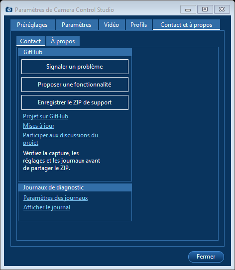
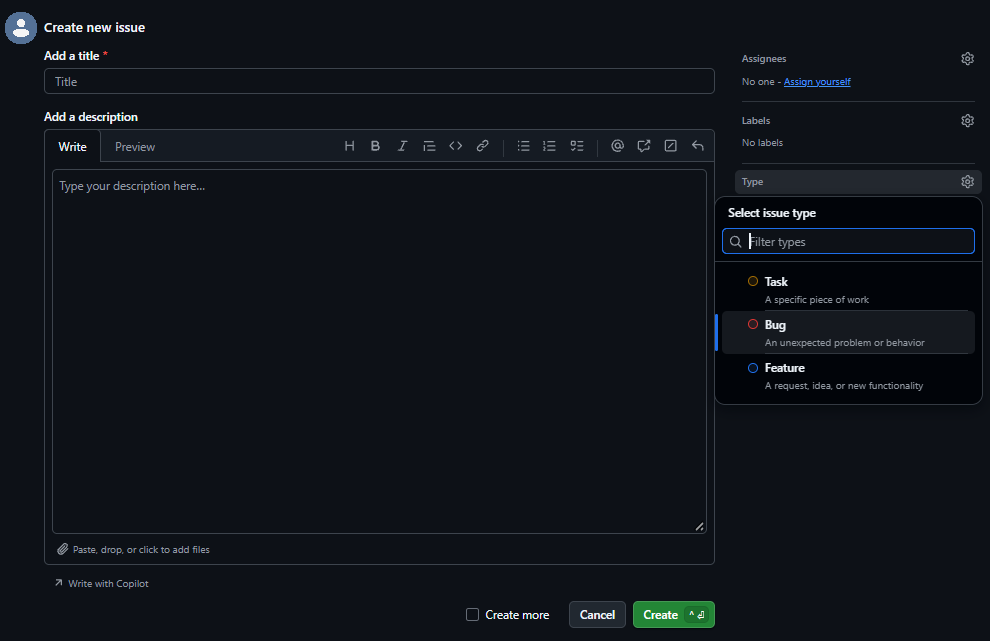

# Proposer une fonctionnalité

*Écrit pour Camera Control Studio 1.1.1.*

1. Cliquez sur la roue dentée en bas pour ouvrir les paramètres. Sélectionnez **Contact et à propos → Contact → Proposer une fonctionnalité**.
2. Si une version plus récente existe, choisissez **Oui** pour ouvrir sa page de téléchargement. Installez-la et vérifiez si elle contient déjà la fonctionnalité. Choisissez **Non** pour continuer vers le brouillon GitHub.
3. Dans le modèle **Feature request** de GitHub, décrivez la tâche, l’intérêt de la fonctionnalité et le résultat qui montrerait qu’elle fonctionne. Remplissez toutes les sections signalées par un astérisque rouge.

Le lecteur de guides propose les mêmes boutons GitHub.

## Joindre un exemple

Choisissez **Contact et à propos → Contact → Enregistrer le ZIP de support** pour enregistrer l’archive. Sélectionnez le dossier de destination. L’application affiche le chemin du fichier.

Le ZIP contient une capture de l’application, le fichier `profiles.json` enregistré, la disposition de la fenêtre dans `window.json` et les journaux disponibles dans `Logs`.

Vérifiez si le ZIP contient des données privées, comme des noms de profil, des identifiants de caméra ou des chemins. Glissez vous-même le ZIP ou les fichiers utiles dans la description du brouillon.

## Vérifier le type et les étiquettes

Le modèle demande **Feature** dans **Type** et `enhancement` dans **Labels**. Si ces valeurs manquent et que les champs sont modifiables, sélectionnez-les dans la barre latérale de droite. Sinon, envoyez le ticket. Une personne responsable du projet pourra les ajouter.

Vérifiez la description et les pièces jointes dans **Preview**, puis choisissez **Create**.
