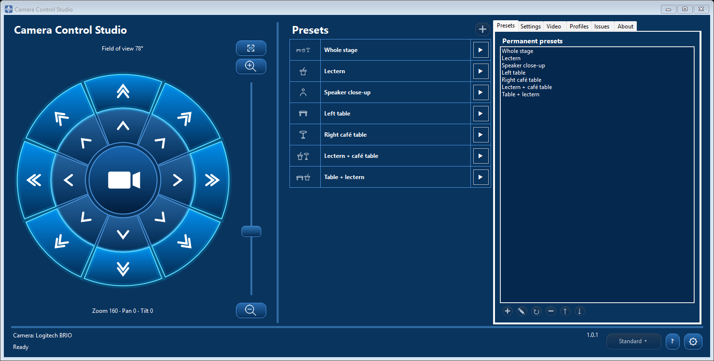
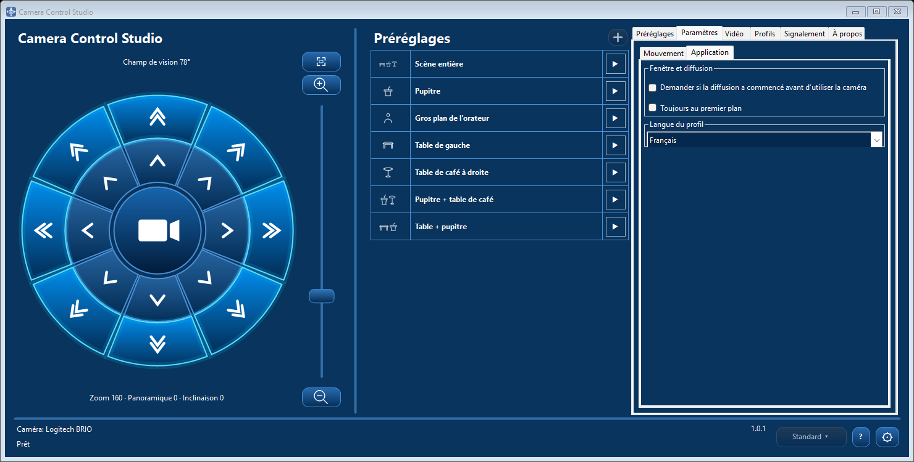
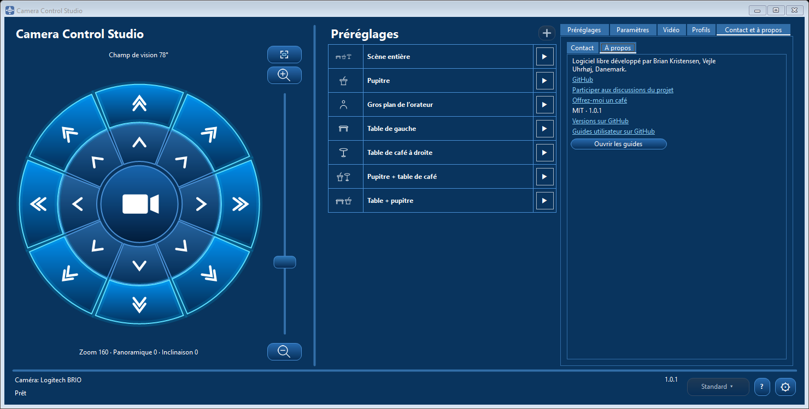
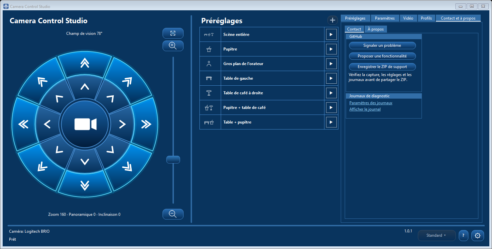

[English](../en/SETUP.md) · [Dansk](../da/SETUP.md) · [Deutsch](../de/SETUP.md) · [Atoutes les langues du guide](USER-GUIDES.md)

# Configurer l'application

*Écrit pour Camera Control Studio 1.0.1.*

[Dépannage](TROUBLESHOOTING.md)

Ouvrez l'engrenage dans le pied de page. Les paramètres s'ouvrent à droite. Votre liste de postes reste visible.

## Installez et vérifiez le téléchargement

Téléchargez le programme d'installation ou le portable ZIP à partir des versions [GitHub du projet ](https://github.com/bkristensen/Camera-Ctrl-Pressets-Studio/releases). Exécutez le programme d'installation ou extrayez l'intégralité du ZIP avant de lancer l'application. Si une somme de contrôle SHA-256 est publiée, comparez-la avec `Get-FileHash -Algorithm SHA256` pour votre téléchargement.

**Téléchargement officiel**\
<https://github.com/bkristensen/Camera-Ctrl-Pressets-Studio/releases>\
Code 

Microsoft Defender SmartScreen peut afficher un avertissement bleu lorsqu'une application téléchargée ou son éditeur a une réputation peu établie. Prenez-le au sérieux. Si vous avez obtenu le fichier attendu à partir de la version officielle et que vous faites confiance à la source, sélectionnez **Plus d'informations** et vérifiez le nom du fichier et l'éditeur. Sélectionnez **RExécuter quand même** uniquement si vous choisissez de faire confiance à ce fichier et que Windows propose cette option. Sinon, fermez l'avertissement. Suivez la politique relative aux appareils de votre organisation. [Guide Microsoft SmartScreen](https://learn.microsoft.com/windows/apps/package-and-deploy/smartscreen-reputation)

<https://learn.microsoft.com/windows/apps/package-and-deploy/smartscreen-reputation>

Si la visionneuse de guide a besoin de WebView2, téléchargez le runtime depuis Microsoft.\
<https://developer.microsoft.com/microsoft-edge/webview2/>

## 1. Choisissez un profil et une caméra

Utilisez le sélecteur de profil dans le pied de page pour sélectionner un profil. Pour en créer un, ouvrez **Paramètres → Profils**. Choisissez **New** pour les paramètres par défaut ou **Copy** pour une copie du profil actif. Nommez-le d'après une personne ou une configuration. De nouveaux profils deviennent actifs. Dans **Profils**, sélectionnez un profil et cliquez sur **✎** pour le renommer. Le profil Standard a un nom fixe.

Double-cliquez sur le symbole de la caméra au centre de la roue de direction pour sélectionner une caméra. Le programme s'en souvient. Si cette caméra est manquante, choisissez une autre source. Les positions appartiennent à une caméra dans un profil.

## 2. Décidez quand le contrôle de la caméra peut commencer

Sous **Paramètres → Application**, activez **Demander si la diffusion a commencé avant d’utiliser la caméra** si votre programme de capture doit démarrer en premier. Cette option est désactivée par défaut.

Avec l'option activée, la première action de la caméra demande si la diffusion a commencé. Choisissez **Yes** uniquement lorsque c'est le cas. Choisissez **No** pour garder le contrôle de la caméra déconnecté. Après Oui, aucune autre action ne vous sera demandée jusqu'à ce que vous changiez de profil, modifiiez cette option ou redémarriez l'application. L'application ne détecte pas et ne démarre pas de session de streaming pour vous.

Si vous avez besoin de cette commande lors de la première utilisation, définissez l'option avant votre prochaine session. La valeur par défaut permet à l'application de se connecter au démarrage.

## 3. Définir le mouvement et le zoom

Ouvrez **Paramètres → Panoramique** pour définir les étapes de panoramique et d'inclinaison, inverser les directions et choisir le fonctionnement du bouton de l'appareil photo. Commencez par de petites étapes. Testez le résultat dans votre programme de capture.

| Paramètre | Ce que ça change | Par défaut |
| --- | --- | --- |
| Vitesse fine (% de la normale) | Évaluez en maintenant Ctrl et une touche fléchée | 50% |
| Étapes de panoramique normales | Anneau de flèche du milieu | 1 |
| Étapes de panoramique rapide | Anneau de flèche extérieur | 4 |

Une étape signifie une étape prise en charge par le pilote de la caméra. Il ne s'agit pas d'une distance ou d'un pourcentage fixe. Le conducteur limite le mouvement et la douceur.

Pour une caméra à l’envers, activez **Inverser le mouvement haut/bas** et testez Up. Activez **Inverser le mouvement gauche/droite** uniquement si la gauche se déplace dans le mauvais sens. Ces paramètres modifient les contrôles. Ils ne font pas pivoter la vidéo.

### Définir les étapes de zoom

Ouvrez **Paramètres → Zoom** pour choisir la distance dans laquelle les boutons plus et moins se déplacent en une seule étape. La valeur par défaut est une étape du pilote. [Voir l'onglet Zoom](../images/screenshots/settings-tabs/en/zoom.png).

### Définir des transitions prédéfinies

Ouvrez **Préréglages → Transitions** pour choisir la façon dont la caméra se déplace entre les positions enregistrées. [Voir l'onglet Transitions](../images/screenshots/settings-tabs/en/transitions.png).

| Paramètre | Ce que ça change | Par défaut |
| --- | --- | --- |
| Utiliser la vitesse pour les transitions prédéfinies | Laissez la distance parcourue déterminer la durée | Désactivé |
| Vitesse de transition (%/s) | Taux de croisière en pourcentage de la plage de l'axe de contrôle par seconde | 30% |
| Transition (sec.) | Temps pour chaque changement de préréglage en mode durée fixe | 1.0 |

Avec les transitions basées sur la vitesse, un mouvement court prend moins de temps qu’un long. L'application accélère et freine, et tous les axes mobiles partagent la même progression afin qu'ils puissent atteindre la cible ensemble.

### Définir le champ de vision

Ouvrez **Vidéo → Champ de vision**. Sous **Champ de vision au démarrage**, choisissez **Le plus large disponible**, un angle signalé par le pilote de la caméra, ou **Ne rien changer** pour conserver la vue actuelle. L'application utilise ce choix lors de sa première connexion. Activez **Autoriser le réglage manuel du champ de vision** pour choisir parmi les angles signalés sous la roue de direction. Si le conducteur ne signale aucun angle sélectionnable, les commandes du FOV sont désactivées. Vous pouvez toujours utiliser le zoom si l'appareil photo le prend en charge. [Voir l'onglet Champ de vision](../images/screenshots/settings-tabs/en/field-of-view.png).

**Changer de champ de vision aux limites du zoom et du panoramique** est activé par défaut. Vous pouvez l'utiliser avec le sélecteur manuel caché. Cela fonctionne lorsque le pilote prend en charge FOV.

- **Zoom out :** Au zoom minimum sur un Brio réglé à 65°, appuyez à nouveau sur le zoom arrière pour passer à 78°. Cette pression modifie le FOV et ajuste le zoom pour garder la photo proche. La pression suivante effectue un zoom arrière normalement. Les mêmes pas vous font passer de 78° à 90°. Le bouton s'arrête à 90° et zoom minimum.
- **Zoom in:** Au zoom maximum, appuyez à nouveau pour vous déplacer vers un FOV plus étroit. Si le conducteur signale 90°, 78° et 65°, l'application les utilise dans cet ordre. Le bouton s'arrête à l'angle disponible le plus étroit et au zoom maximum.
- **Pan gauche ou droite :** Au bord, l'application essaie d'abord une vue plus large. Il ajuste le zoom pour garder le recadrage proche. Il peut également essayer une vue plus étroite si le zoom le permet. Si aucune vue ne lui permet de faire un panoramique plus loin, il restaure la prise de vue précédente. Le conducteur contrôle à quel point le match est serré.

Utilisez le bouton carré avec le symbole du cadre pour accéder directement au FOV le plus large et au zoom minimum. Le curseur définit toujours le zoom dans le FOV actuel. Désactivez le FOV automatique pour conserver le zoom et le panoramique dans la vue actuelle.

Les préréglages enregistrent le panoramique, l'inclinaison, le zoom et le FOV signalé par le conducteur. Les préréglages plus anciens conservent le FOV actuel. Vérifiez l'image en direct si Zoom, Logitech Brio Control ou une autre application contrôle le recadrage. [Étapes de test Brio et Zoom](VALIDATION.md#champ-de-vision-brio-et-zoom)

## 4. Ajustez l'image et enregistrez les positions permanentes

[Avant de charger les contrôles vidéo](../images/screenshots/settings-tabs/en/video.png) · [Couleur](../images/screenshots/1.0.1/en/video-colour.png) · [Lumière et détails](../images/screenshots/1.0.1/en/video-light-detail.png)

Ouvrez **Vidéo** dans le volet des paramètres, puis chargez les contrôles d'image si nécessaire. Choisissez un groupe tel que **Mise au point et exposition**, **Couleur** ou **Lumière et détails**. Seuls les contrôles exposés par le pilote apparaissent. Ajustez la luminosité, le contraste, la saturation des couleurs, la mise au point ou la balance des blancs lorsque cela est disponible. Désactivez le mode automatique avant le réglage manuel. Les valeurs d'image sont enregistrées par caméra et par profil. Le bouton de réinitialisation restaure les paramètres par défaut du pilote.

Déplacez d'abord la caméra. Ouvrez **Préréglages** dans le volet des paramètres. Cliquez sur **+** pour ajouter un préréglage permanent. Sélectionnez une icône en haut, vérifiez le nom, puis enregistrez. Si le nom est vide et inutilisé, le choix d'une icône suggère son nom. Les symboles combinés montrent leurs sujets de gauche à droite.

Sous **Préréglages permanents**, sélectionnez un poste. Survolez un symbole pour son action. Utilisez **✎** pour modifier son nom et son symbole, **↻** pour enregistrer la position actuelle de la caméra à sa place et **−** pour la supprimer. Utilisez **↑** et **↓** pour modifier l'ordre dans les deux listes. Les postes permanents restent en haut de la liste principale en gras.

La sélection d'une ligne permanente dans la liste principale sélectionne également ce préréglage dans Paramètres. Un préréglage nouvellement enregistré est sélectionné dans Paramètres.

## 5. Définir la mise en page et la langue

Faites glisser le séparateur entre les commandes de la caméra et la liste des préréglages. Votre profil enregistre le séparateur ainsi que la taille et la position de la fenêtre. La taille initiale est de 900 × 500 et la taille minimale est de 670 × 450. Les paramètres démarrent fermés. Lorsque vous les ouvrez pour la première fois après le lancement, le premier onglet est sélectionné. Faites défiler vers le bas dans **Panoramique** ou **Application** si certains champs se trouvent sous la fenêtre. L'application enregistre la largeur de la fenêtre avec les paramètres fermés.

Lors de la sélection d'un profil dans le pied de page, laissez **Conserver la position et la disposition actuelles** décoché pour restaurer la disposition de ce profil. Cochez-la pour transférer la mise en page actuelle dans le profil sélectionné. Le choix est mémorisé dans le profil que vous quittez ; la mise en page transportée est enregistrée dans le profil de destination.

Choisissez une langue sous **Paramètres → Application → Langue du profil**, puis redémarrez pour l'appliquer. **Automatique** utilise la langue d'affichage de Windows si elle est prise en charge et l'anglais dans le cas contraire. Changer de profil redémarre l’application avec la langue du profil sélectionné. Les préréglages temporaires se terminent au redémarrage.

## 6. Informations sur la version et le projet

Ouvrez **Contact et à propos → À propos** pour voir la version et les liens du projet. Survolez la version pour lire l’identifiant de compilation complet. Indiquez-le si cette compilation est concernée.

## 7. Journaux de diagnostic et rapports de problèmes

Ouvrez **Contact et à propos → Contact** pour choisir le dossier des journaux, la taille maximale et le nombre de fichiers, fichier actif compris. L’application utilise son dossier ou, à défaut, `%LOCALAPPDATA%\CamPressets\Logs`.

Choisissez **Signaler un problème** ou **Proposer une fonctionnalité** pour ouvrir le bon brouillon GitHub. Pour un problème, l’application propose un ZIP de support. Vérifiez-le et joignez-le vous-même au brouillon. [Signaler ou suivre un problème](ISSUES.md)

**Signaler un bug ou suggérer une fonctionnalité**\
<https://github.com/bkristensen/Camera-Ctrl-Pressets-Studio/issues?q=is%3Aissue>\
Code 

Suivant : [Utilisation quotidienne](DAILY-USE.md). Pour une sauvegarde, fermez l'application et copiez `%LOCALAPPDATA%\CamPressets`. Les postes temporaires ne font pas partie de la sauvegarde.
