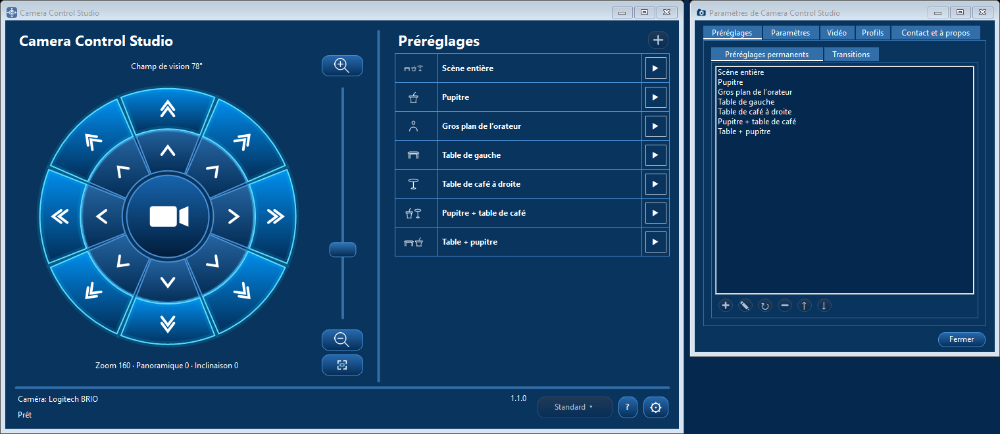

[English](../en/SETUP.md) · [Dansk](../da/SETUP.md) · [Deutsch](../de/SETUP.md) · [Atoutes les langues du guide](USER-GUIDES.md)

# Configurer l'application

*Écrit pour Camera Control Studio 1.1.0.*

[Dépannage](TROUBLESHOOTING.md)

Cliquez sur la roue dentée en bas pour ouvrir les paramètres. Les paramètres s’ouvrent dans une fenêtre séparée. Vous pouvez continuer à utiliser la fenêtre principale.

## Installez et vérifiez le téléchargement

Téléchargez **Camera Control Studio** depuis le Microsoft Store dès que l’application y est disponible. Recherchez son nom dans le Store. Microsoft signe le paquet et fournit les mises à jour.

Si l’application est encore indisponible dans le Microsoft Store, téléchargez le programme d’installation ou le fichier ZIP portable depuis les [versions GitHub](https://github.com/bkristensen/Camera-Ctrl-Pressets-Studio/releases). Lancez l’installation ou extrayez tout le ZIP avant d’ouvrir l’application. Si la version fournit une somme SHA-256, comparez-la au résultat de `Get-FileHash -Algorithm SHA256`.

Microsoft Defender SmartScreen peut afficher un avertissement bleu lorsqu'une application téléchargée ou son éditeur a une réputation peu établie. Prenez-le au sérieux. Si vous avez obtenu le fichier attendu à partir de la version officielle et que vous faites confiance à la source, sélectionnez **Plus d'informations** et vérifiez le nom du fichier et l'éditeur. Sélectionnez **RExécuter quand même** uniquement si vous choisissez de faire confiance à ce fichier et que Windows propose cette option. Sinon, fermez l'avertissement. Suivez la politique relative aux appareils de votre organisation. [Guide Microsoft SmartScreen](https://learn.microsoft.com/windows/apps/package-and-deploy/smartscreen-reputation)

<https://learn.microsoft.com/windows/apps/package-and-deploy/smartscreen-reputation>

Si la visionneuse de guide a besoin de WebView2, téléchargez le runtime depuis Microsoft.\
<https://developer.microsoft.com/microsoft-edge/webview2/>

Choisissez un profil en bas de la fenêtre principale. Par défaut, double-cliquez sur le bouton caméra au centre de la roue pour choisir une source. Le profil mémorise la caméra. Si elle manque, choisissez-en une autre.

Les sections suivent l’ordre des onglets. Un bouton grisé demande souvent de sélectionner un élément. Sous Vidéo, le pilote détermine les réglages visibles. Vérifiez le résultat dans votre application de capture.

**Fermer**. Redimensionnez ou déplacez les deux fenêtres. Glissez le séparateur de la fenêtre principale. Le profil mémorise ces valeurs. Fermer ferme les paramètres. La fenêtre principale reste ouverte.

## Préréglages

### Préréglages permanents

Orientez la caméra. Une position permanente mémorise les valeurs disponibles de panoramique, d’inclinaison et de zoom. Elle garde aussi le champ de vision si la caméra le fournit. La position appartient à une caméra dans un profil.

- **+ Ajouter un préréglage permanent**. Enregistrez le cadrage actuel. Choisissez un symbole et donnez un nom unique à la position. Si le champ est vide, le symbole peut proposer un nom. Saisissez un nom pour activer l’enregistrement. Annuler conserve la liste.
- **✎ Modifier le nom et l’icône**. Modifiez le nom ou le symbole de la position sélectionnée. Le cadrage reste identique.
- **↻ Remplacer par la position actuelle**. Remplacez le cadrage de la position choisie par le cadrage actuel. Confirmez. Le nom et le symbole restent identiques.
- **− Supprimer le préréglage permanent**. Supprimez la position sélectionnée après confirmation.
- **↑ / ↓ Monter le préréglage sélectionné · Descendre le préréglage sélectionné**. Déplacez la position d’une ligne dans les deux listes. En haut, la flèche haute est grisée. En bas, la flèche basse est grisée.

Sélectionnez une position pour la modifier, la remplacer, la supprimer ou la déplacer. Ajouter et remplacer exigent un profil chargé et au moins un axe réglable. Si la caméra est déconnectée, l’application peut tenter de la connecter.

### Définir des transitions prédéfinies

- **Utiliser la vitesse pour les transitions**. Désactivé applique une durée fixe. Activé applique une vitesse. Les déplacements courts se terminent plus vite. Les axes arrivent ensemble.
- **Transition (s)**. Réglez la durée d’un changement de position. La valeur par défaut est 1 seconde. Le champ est grisé en mode vitesse.
- **Vitesse de transition (%/s)**. Réglez la vitesse en pourcentage de la course de l’axe qui dicte le déplacement, par seconde. La valeur par défaut est 30 %. Le champ est grisé en mode durée fixe.

## Paramètres

### Panoramique

- **Vitesse fine (% de la normale)**. Maintenez Ctrl et appuyez sur une flèche pour affiner le réglage. La vitesse par défaut vaut 50 % de la vitesse normale.
- **Pas de panoramique normal**. Réglez le nombre de pas pour les flèches de l’anneau intérieur. La valeur par défaut est 1.
- **Pas de panoramique rapide**. Réglez le nombre de pas pour les flèches de l’anneau extérieur. La valeur par défaut est 4. Ce réglage agit aussi quand vous faites glisser le bouton caméra.
- **Inverser le mouvement gauche/droite**. Inversez gauche et droite si la caméra part dans le mauvais sens.
- **Inverser le mouvement haut/bas**. Inversez haut et bas, par exemple si la caméra est montée à l’envers. Ces choix modifient les commandes. L’image garde son orientation.
- **Faire glisser le bouton de caméra pour orienter la caméra**. Faites glisser le bouton au centre de la roue pour orienter la caméra. Désactivez l’option pour piloter avec les flèches.
- **Double-cliquer sur le bouton de caméra pour choisir la source**. Activé ouvre la liste des caméras au double-clic. Désactivé l’ouvre au clic simple.

Ces réglages sont disponibles avant la connexion. Le pilote fixe la taille du pas, les axes disponibles et leurs limites.

### Définir les étapes de zoom

- **Pas de zoom**. Réglez le déplacement du zoom à chaque appui sur + ou −. La valeur par défaut est un pas du pilote. Vous pouvez la régler avant de connecter la caméra. Il faut un zoom compatible. Le curseur choisit un niveau dans le champ de vision actuel.

### Application

- **Demander si la diffusion a commencé avant d’utiliser la caméra**. Activez cette option si l’application de capture doit diffuser en premier. La prochaine action caméra demande une confirmation. Répondez Oui quand le flux est prêt ou Non pour garder la caméra déconnectée. La question revient après un redémarrage, un changement de profil ou un changement de cette option. Désactivé autorise la connexion au démarrage.
- **Toujours au premier plan**. Gardez la fenêtre principale au-dessus des autres applications. Désactivez l’option pour laisser une autre fenêtre la recouvrir.
- **Langue du profil · Automatique**. Choisissez l’une des 12 langues. Automatique utilise la langue d’affichage de Windows si elle est disponible, sinon l’anglais. Redémarrez pour appliquer le choix. Chaque profil garde sa langue.

## Vidéo

- **Charger les réglages d’image**. Connectez la caméra pour charger ses réglages d’image. Le bouton apparaît quand elle est déconnectée. Si le pilote ne fournit aucun réglage d’image, seul l’onglet du champ de vision reste.
- **Automatique**. Le pilote choisit les curseurs et onglets disponibles. Automatique laisse la caméra régler la valeur. Décochez la case pour déplacer le curseur. Si seul le mode automatique est disponible, le curseur est grisé et la case peut être bloquée. En mode manuel seul, la case est masquée.
- **Rétablir les réglages d’image du pilote**. Rétablissez les réglages d’image pris en charge aux valeurs du pilote. Le bouton apparaît dans les onglets d’image et disparaît dans celui du champ de vision. Les valeurs sont gardées par caméra et profil.

### Mise au point et exposition

- **Gain**. Amplifiez le signal pour éclaircir l’image. Un gain élevé peut ajouter du bruit.
- **Exposition**. Réglez le temps pendant lequel le capteur reçoit la lumière. Une pose plus longue éclaircit l’image et peut flouter les mouvements.
- **Mise au point**. Choisissez la distance de mise au point. Vérifiez la netteté du sujet dans l’application de capture.

### Couleur

- **Balance des blancs**. Corrigez la dominante due à l’éclairage pour que le blanc paraisse blanc.
- **Saturation**. Renforcez ou atténuez les couleurs.
- **Gamma**. Éclaircissez ou assombrissez les tons moyens.
- **Teinte**. Décalez les couleurs sur le cercle chromatique.

### Lumière et détails

- **Contraste**. Modifiez l’écart entre les parties claires et sombres.
- **Luminosité**. Éclaircissez ou assombrissez toute l’image.
- **Compensation du contre-jour**. Éclaircissez un sujet fortement éclairé par l’arrière.
- **Netteté**. Rendez les contours plus ou moins marqués.

### Définir le champ de vision

Le champ de vision (FOV) indique ce qui entre dans l’image. Un angle plus large montre davantage. Le zoom recadre dans l’angle actuel.

- **Champ de vision au démarrage · Le plus large disponible · Ne rien changer**. Choisissez l’angle le plus large, gardez l’angle actuel ou sélectionnez un angle du pilote. L’application le tente lors de la première connexion de la session. La liste est grisée tant que la caméra connectée ne fournit pas d’angle.
- **Autoriser le réglage manuel du champ de vision**. Affichez un sélecteur d’angle sous la roue. Désactivé affiche l’angle actuel si l’application peut le lire. La case est grisée si le pilote offre moins de deux angles.
- **Changer de champ de vision aux limites du zoom et du panoramique**. Appuyez à nouveau en butée de zoom. En reculant, l’application tente un angle plus large. En rapprochant, elle tente un angle plus étroit. En butée horizontale, elle essaie un angle offrant plus de marge. Elle conserve au mieux le cadrage et le rétablit si le mouvement reste bloqué. Le réglage peut fonctionner sans sélection manuelle. Il est grisé avec moins de deux angles.

Exemple sur une Brio à 65° au zoom minimal. Appuyer sur − peut passer à 78°. Appuyez encore pour reculer dans le nouvel angle. Le bouton de cadrage tente l’angle maximal et le zoom minimal ensemble. Regardez le résultat si une autre application pilote aussi la caméra.

## Profils

- **+ Nouveau profil**. Créez et activez un profil avec les valeurs par défaut. Donnez-lui un nom unique.
- **⧉ Copier le profil actif**. Copiez les réglages et positions du profil actif, puis passez à la copie. La ligne sélectionnée ne change pas la source de la copie.
- **✎ Renommer le profil sélectionné**. Renommez le profil choisi. Le bouton est grisé sans sélection et pour Standard. Créer et copier exigent un profil chargé. Les trois dialogues demandent un nom pour valider.
- **Conserver la position et la disposition actuelles**. Double-cliquez sur un profil. Cochez l’option de disposition pour reprendre les tailles, positions et le séparateur. Décochez-la pour charger la disposition mémorisée du profil choisi. Le changement redémarre l’application et efface les positions temporaires.

## Contact et à propos

### Contact

- **Signaler un problème**. Ouvrez le modèle de rapport de bug sur GitHub. Si une version plus récente existe, l’application propose de l’ouvrir d’abord. Si vous continuez, elle propose de créer un ZIP avant d’ouvrir le brouillon.
- **Proposer une fonctionnalité**. Ouvrez le modèle de suggestion. Essayez d’abord une version plus récente si elle existe. La fonction y est peut-être déjà.
- **Enregistrer le ZIP de support**. Enregistrez une capture, les journaux disponibles, les profils et la disposition des fenêtres dans un ZIP. Vérifiez les données privées. Joignez le ZIP au brouillon. Les trois boutons sont grisés pendant une action.
- **Projet sur GitHub · Versions sur GitHub · Participer aux discussions du projet**. Les trois liens GitHub ouvrent le code du projet, les téléchargements ou les discussions.

[Signaler un problème](Report%20a%20bug.md) · [Proposer une fonctionnalité](Request%20a%20feature.md)

### Journaux de diagnostic

- **Paramètres des journaux**. Ouvrez les réglages des journaux. Ils s’appliquent à tous les profils. Enregistrer les applique. Annuler les laisse inchangés.
- **Choisir un dossier · Automatique**. Choisissez un dossier ou le mode Automatique. Le champ du chemin est en lecture seule. Automatique utilise le dossier du programme ou, à défaut, `%LOCALAPPDATA%\CamPressets\Logs`.
- **Taille maximale par fichier (Mio)**. Réglez le seuil de création d’un nouveau fichier. La valeur par défaut est 1 Mio par fichier.
- **Nombre maximal de journaux (actuel inclus)**. Indiquez combien de journaux garder, fichier en cours compris. La valeur par défaut est 2.
- **Afficher le journal**. Sélectionnez le dernier journal dans l’Explorateur. Un message s’affiche si aucun journal n’existe.

### À propos

- **Offrez-moi un café**. Consultez la version installée et le nom du développeur. Survolez la version pour voir l’identifiant de compilation complet. Le lien de soutien ouvre la page du développeur.
- **Ouvrir les guides**. Ouvrez les guides dans cet onglet. Le bouton d’aide de la fenêtre principale les ouvre aussi.

Fermez l’application et copiez `%LOCALAPPDATA%\CamPressets` pour faire une sauvegarde. Les positions temporaires durent une session.

[Utilisation quotidienne](DAILY-USE.md)

## Boîte de dialogue d’erreur

Si une erreur inattendue bloque une action, fermez la boîte de dialogue et réessayez. Si elle annonce la fermeture de l’application, relancez-la.

**Afficher le journal** sélectionne le journal de diagnostic dans l’Explorateur de fichiers s’il est disponible. **Signaler sur GitHub** propose d’enregistrer un ZIP de support, puis ouvre le modèle de rapport de bogue sur GitHub. Le ZIP peut contenir une capture de la boîte de dialogue, les journaux, les réglages du profil et de la fenêtre et un rapport système. Vérifiez le ZIP, puis joignez-le au brouillon.
