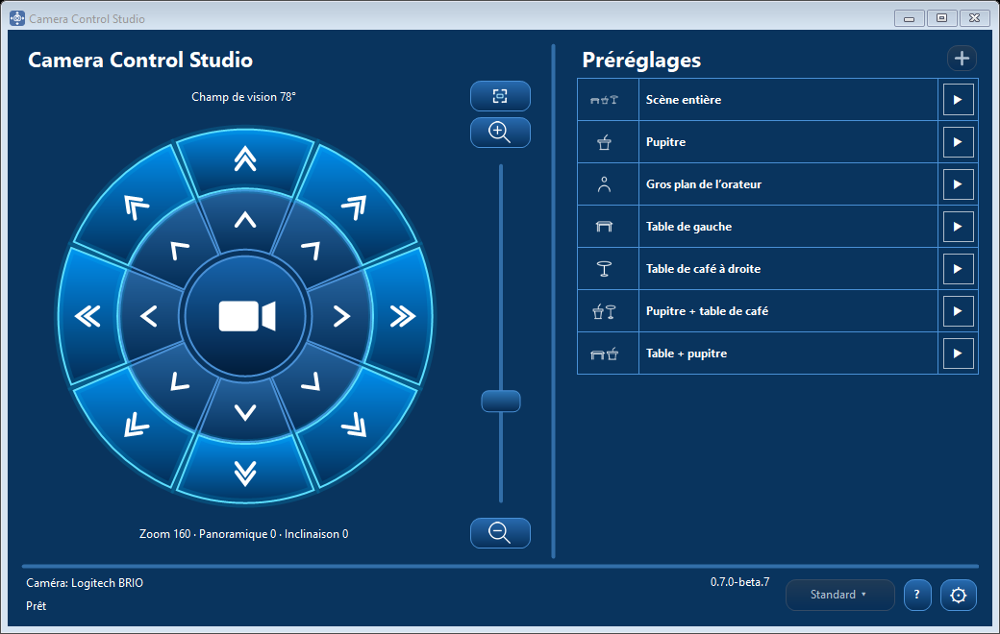
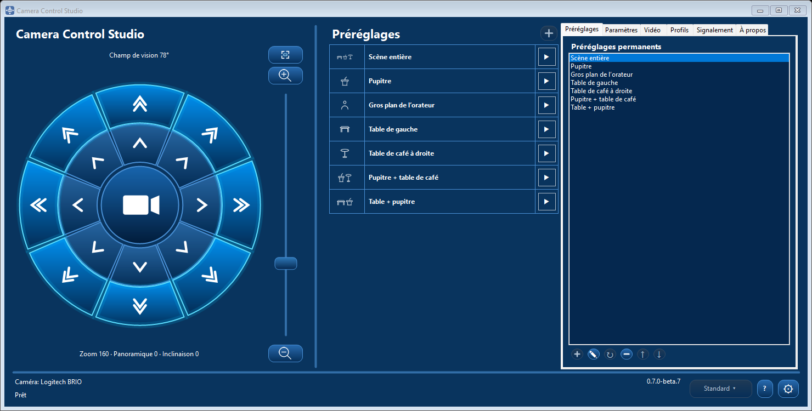
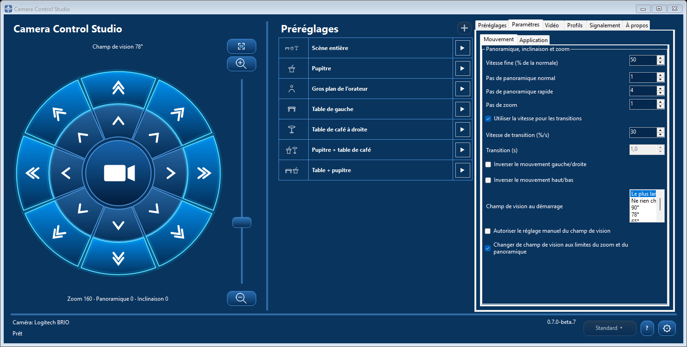
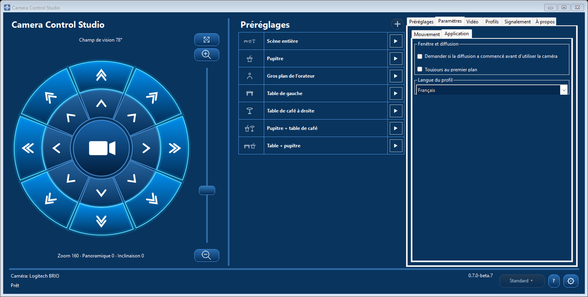

# Utilisation et paramètres

[Français · Camera Control Studio](../USER-GUIDES.md)

Lancez d’abord votre réunion en streaming, par exemple dans Zoom. Ouvrez ensuite **Camera Control Studio**.

Cliquez sur **?** pour ouvrir l’aide. Survolez une commande pour connaître son rôle. Chaque direction s’arrête à la dernière limite de la caméra.

1. **Activer un préréglage**

   Cliquez sur ▶ dans la ligne du préréglage, double-cliquez sur son nom ou sélectionnez sa ligne et appuyez sur Entrée.

   | Couleur | Signification |
   | --- | --- |
   | Jaune | La caméra se déplace vers la position enregistrée. |
   | Vert | Le pilote indique que la caméra a atteint les coordonnées enregistrées. |
   | Bleu | Le préréglage n’est pas marqué comme actif. |

   Le vert confirme les coordonnées signalées par le pilote. Vérifiez l’image dans votre diffusion. Si le pilote ne confirme pas la position à temps, la ligne devient bleue et un message s’affiche dans la zone d’état. Les icônes restent visibles.

2. **Affiner le cadrage**

   **Panoramique**

   Utilisez l’anneau intérieur pour les mouvements normaux et l’anneau extérieur pour les mouvements rapides. Une flèche diagonale déplace les deux axes à 45°, à 45 % de la vitesse de l’anneau par axe. Maintenez la flèche pour continuer. Relâchez-la pour arrêter.

   Cliquez sur le bouton de la caméra pour choisir la source. Pour diriger la caméra, maintenez le bouton et faites glisser dans la direction voulue. Plus vous l’éloignez, plus le mouvement est rapide, jusqu’au double de la vitesse rapide. Relâchez pour arrêter.

   **Zoom**

   Utilisez les loupes pour zoomer ou dézoomer. Maintenez une touche pour répéter. Le zoom change quand vous déplacez le curseur.

   **Interrompre le panoramique**

   Appuyez sur Échap pour arrêter un panoramique en cours.

   > Un panoramique, une inclinaison ou un zoom manuel interrompt le changement de position et efface la couleur du préréglage actif.

   **Touches fléchées**

   Lorsque la molette a le focus, utilisez les touches fléchées. Maintenez Maj enfoncée pour les pas rapides.

3. **Enregistrer un préréglage temporaire**

   Cliquez sur **+** au-dessus de la liste, saisissez un nom et enregistrez. La position actuelle apparaît sous les préréglages permanents. Les préréglages temporaires n’ont pas d’icône. Ils sont conservés séparément pour chaque profil et chaque caméra jusqu’à la fermeture de l’application.

   Pour en supprimer un, sélectionnez sa ligne et cliquez sur **×** au-dessus de la liste. Tous les préréglages temporaires sont supprimés à la fermeture. Pour réutiliser une position plus tard, créez-la dans **Paramètres → Préréglages**. La liste principale ne permet ni de modifier ni de supprimer les préréglages permanents.

4. **Quitter l’application**

   Si une commande échoue, lisez le message dans la zone d’état en bas de la fenêtre. La caméra peut être indisponible ou ne pas prendre en charge la fonction.

   Fermez l’application normalement. Le profil actif et la disposition de la fenêtre sont mémorisés.

   **Signaler un problème**

   Signalez les problèmes ou les fonctionnalités manquantes dans **Paramètres → Signalement**.

5. **Paramètres**

   Sélectionnez votre profil en bas de la fenêtre. Cliquez sur l’icône de caméra au centre de la molette pour choisir la caméra.

   Pour conserver une position, ouvrez la roue dentée en bas et choisissez **Préréglages → Ajouter un préréglage permanent**. Choisissez le nom et l’icône, puis enregistrez.

   

   Dans les paramètres, réglez les pas, la durée de transition et l’inversion des directions. L’onglet **Vidéo** présente les commandes disponibles via le pilote. L’onglet **Profils** permet de créer ou de copier un profil. Activez la confirmation de diffusion si le logiciel de capture doit se connecter d’abord.

   

   

6. Faites glisser le séparateur vertical pour ajuster la largeur des deux zones. Le volet des paramètres est fermé au démarrage. Choisissez la langue dans **Paramètres → Application → Langue du profil**, puis redémarrez l’application. Survolez un petit bouton pour afficher son infobulle.

## Champ de vision pendant le mouvement

**Changer de champ de vision aux limites du zoom et du panoramique**

L’option est activée par défaut. Sur une Brio, une pression de plus à la limite du zoom change le champ de vision. En dézoomant, vous passez de 65° à 78°, puis à 90°. En zoomant, l’ordre s’inverse. Entre deux champs, le zoom avance par crans. Si le panoramique atteint un bord, l’app essaie un champ plus large et ajuste le zoom pour conserver le cadrage. Désactivez l’option pour garder le champ actuel.

Le bouton carré avec un cadre règle le champ le plus large et le zoom minimal. Les préréglages mémorisent le champ si le pilote sait le lire.

[Installation et SmartScreen (anglais)](../en/SETUP.md)

<https://github.com/bkristensen/Camera-Ctrl-Pressets-Studio/blob/main/Source/docs/en/SETUP.md>

## Téléchargement et assistance

**Téléchargement officiel**\
<https://github.com/bkristensen/Camera-Ctrl-Pressets-Studio/releases>\

**Signaler un problème ou proposer une fonctionnalité**\
<https://github.com/bkristensen/Camera-Ctrl-Pressets-Studio/issues?q=is%3Aissue>\

