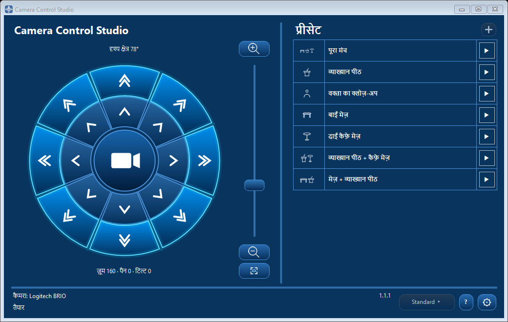
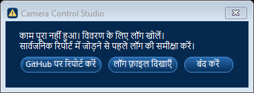

[English](../en/DAILY-USE.md) · [Dansk](../da/DAILY-USE.md) · [Deutsch](../de/DAILY-USE.md) · [सभी गाइड भाषाएँ](USER-GUIDES.md)

# दैनिक उपयोग

*Camera Control Studio 1.1.1.* के लिए लिखा गया

[समस्या निवारण](TROUBLESHOOTING.md)

ज़ूम जैसे ऐप में अपनी स्ट्रीमिंग मीटिंग शुरू करें। फिर **Camera Control Studio** खोलें।

## सामान्य

सहायता के लिए **?** पर क्लिक करें। किसी बटन का नाम और क्रिया देखने के लिए उस पर होवर करें। कैमरा जिस अंतिम सीमा तक पहुंच सकता है, उस पर एक दिशा लॉक हो जाती है। [स्वचालित FOV कैसे काम करता है](SETUP.md#%E0%A4%A6%E0%A4%96%E0%A4%A8-%E0%A4%95-%E0%A4%95%E0%A4%B7%E0%A4%A4%E0%A4%B0-%E0%A4%B8%E0%A4%9F-%E0%A4%95%E0%A4%B0)

## 1. प्रीसेट सक्रिय करें

प्रीसेट सूची में एक पंक्ति पर ▶ क्लिक करें या नाम पर डबल-क्लिक करें।
आप पंक्ति का चयन भी कर सकते हैं और Enter दबा सकते हैं।

| रंग | मतलब |
| --- | --- |
| पीला | ऐप कैमरे को प्रीसेट की ओर ले जा रहा है। |
| हरा | कैमरा ड्राइवर रिपोर्ट करता है कि सहेजे गए निर्देशांक पहुंच गए हैं। |
| नीला | प्रीसेट को सक्रिय के रूप में चिह्नित नहीं किया गया है. |

हरे रंग का मतलब है कि ड्राइवर सहेजी गई स्थिति की रिपोर्ट करता है और यदि सहेजी गई है तो FOV। अपनी स्ट्रीम में चित्र जांचें. यदि ड्राइवर समय पर शॉट की पुष्टि नहीं कर पाता है, तो पंक्ति नीली हो जाती है। क्या हुआ यह देखने के लिए स्थिति संदेश पढ़ें।

## 2. फ़्रेमिंग को ठीक करें

### पान

सामान्य चालों के लिए आंतरिक रिंग और तेज़ चालों के लिए बाहरी रिंग का उपयोग करें। प्रत्येक वलय में आठ तीर हैं। विकर्ण प्रत्येक अक्ष पर रिंग की गति के 45% के साथ 45° पर एक साथ घूमते और झुकते हैं। एक क्लिक प्रत्येक उपलब्ध अक्ष पर कम से कम एक ड्राइवर कदम आगे बढ़ाता है। चलते रहने के लिए एक तीर पकड़ें। रोकने के लिए इसे छोड़ें.

### पहिये के केंद्र में कैमरा बटन

- **कैमरा चुनने के लिए डबल-क्लिक करें।** कैमरा सूची खुलती है।
- **पकड़ो और खींचें.** कैमरा आइकन पर प्रारंभ करें. पैन करने के लिए बग़ल में खींचें या झुकाने के लिए ऊपर और नीचे खींचें। धीमी गति के लिए थोड़ा खींचें या तेज़ गति के लिए दूर तक खींचें, तेज़ गति से दोगुनी तक। बटन छोड़ें या पॉइंटर को वापस वहीं ले जाएँ जहाँ आपने रुकना शुरू किया था।

**सेटिंग्स → पैनिंग** के तहत, आप कैमरा चयन के लिए ड्रैगिंग को बंद कर सकते हैं या एक क्लिक पर स्विच कर सकते हैं। दोनों विकल्प सक्रिय प्रोफ़ाइल में सहेजे गए हैं.

### ज़ूम करें

ज़ूम करने के लिए आवर्धक बटन का उपयोग करें. क्रिया को दोहराने के लिए एक बटन दबाए रखें।
स्लाइडर को घुमाते समय ज़ूम को समायोजित करने के लिए उसे खींचें।

### पूर्ण फ़्रेम पुनर्स्थापित करें

ज़ूम आउट बटन के नीचे फ़्रेम आइकन वाले वर्गाकार बटन पर क्लिक करें। कैमरा जितना संभव हो उतना ज़ूम आउट करता है और यदि यह उस सेटिंग का समर्थन करता है तो अपने सबसे व्यापक दृश्य क्षेत्र का चयन करता है। इससे कैमरे की तस्वीर बदल जाती है. ऐप विंडो अपना आकार बनाए रखती है.

### पैन करना बंद करो

चल रहे पैन को रोकने के लिए Esc दबाएँ।

> मैन्युअल पैन, टिल्ट या ज़ूम प्रीसेट की ओर जाने को रद्द कर देता है और सक्रिय रंग साफ़ कर देता है।

### तीर कुंजियाँ

जब पहिया फोकस पर हो तो तीर कुंजियों का उपयोग करें। अच्छी चाल के लिए Ctrl या तेज़ चाल के लिए Shift दबाए रखें।

## 3. एक अस्थायी प्रीसेट सहेजें

प्रीसेट सूची के ऊपर **+** पर क्लिक करें, एक नाम दर्ज करें और सहेजें। वर्तमान स्थिति स्थायी प्रीसेट के नीचे दिखाई देती है।
अस्थायी प्रीसेट में कोई आइकन नहीं है. वे तब तक बने रहते हैं जब तक आप ऐप बंद नहीं कर देते और प्रत्येक प्रोफ़ाइल और कैमरे के लिए अलग-अलग रखे जाते हैं।

एक अस्थायी पंक्ति का चयन करें और इसे हटाने के लिए पूर्व निर्धारित सूची के ऊपर **×** पर क्लिक करें। ऐप बंद होने पर सभी अस्थायी प्रीसेट हटा दिए जाते हैं।
बाद में किसी पद का उपयोग करने के लिए, इसे **सेटिंग्स → प्रीसेट** के अंतर्गत बनाएं। आप मुख्य सूची में स्थायी प्रीसेट को संपादित या हटा नहीं सकते।

## 4. बाहर निकलें

यदि कोई नियंत्रण विफल हो जाता है, तो नीचे स्थिति क्षेत्र में संदेश पढ़ें। हो सकता है कि कैमरा इस सुविधा का समर्थन न करे या अनुपलब्ध हो।

ऐप को सामान्य रूप से बंद करें. ऐप सक्रिय प्रोफ़ाइल और विंडो लेआउट को याद रखता है।

## 5. मुद्दों की रिपोर्ट करें

यदि **नया संस्करण उपलब्ध है** पादलेख में दिखाई देता है, तो GitHub पर रिलीज़ खोलने और डाउनलोड देखने के लिए इसे चुनें।

<https://github.com/bkristensen/Camera-Ctrl-Pressets-Studio/releases>

समस्या या सुविधा का सुझाव देने के लिए **संपर्क और परिचय → संपर्क** खोलें।

कैमरा दिशा, स्थायी प्रीसेट, छवि सेटिंग्स, प्रोफाइल और मूवमेंट चरणों के लिए [Setup](SETUP.md) देखें।

## त्रुटि संवाद

अगर कोई अप्रत्याशित त्रुटि किसी काम को रोक दे, तो संवाद बंद करके फिर कोशिश करें। अगर संदेश में ऐप बंद होने की सूचना है, तो ऐप फिर खोलें।

लॉग उपलब्ध होने पर **लॉग फ़ाइल दिखाएँ** फ़ाइल एक्सप्लोरर में निदान लॉग चुनता है। **GitHub पर रिपोर्ट करें** सहायता ZIP सहेजने का विकल्प देता है, फिर GitHub का बग टेम्पलेट खोलता है। ZIP में संवाद का स्क्रीनशॉट, लॉग, प्रोफ़ाइल और विंडो सेटिंग, और सिस्टम रिपोर्ट हो सकती है। ZIP की जाँच करें और उसे खुद ड्राफ़्ट में जोड़ें।
